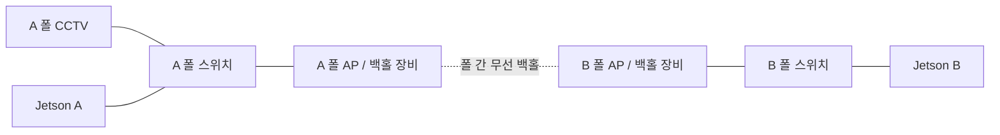
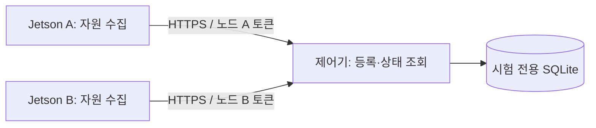
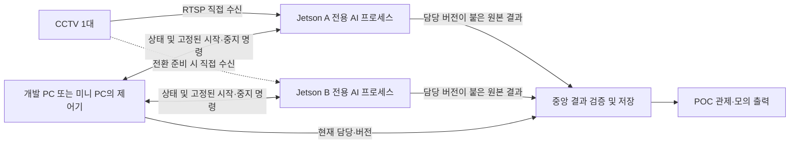

# Jetson 2대·CCTV 1대 엣지 오케스트레이션 구현 계획

2026-10-23 KST · 상태: **B 실영상 GPU·2보드 무선 DDS·미리보기 실증 / 종료경계 소비2건 만료·후속161건 재전송 ACK 완료/대기0·시험 정리 완료 / O5 IN_PROGRESS·I68 OPEN·DONE9/37 유지**.
사용자 요청은 정부과제의 엣지 오케스트레이션을 개발하는 것이다. 첫 실증은 느려지거나 중단된 Jetson이 처리하던 CCTV 영상을 다른 Jetson이 받아 AI 분석을 이어받는 기능이며, 같은 날 사용자가 `LOS2`는 **ROS 2**를 뜻한다고 확인했다.

<a id="poe-rewire-20261023"></a>

## PoE 연결 전환·입력 자동 복구 관측 — 10-23

**RTSP 입력은 운영 자체 복구가 관측됐으며 현재 실패 지속으로 표시하지 않는다.** 사용자 확인으로 Jetson A(Wi-Fi 식별IP192.168.2.141)·CCTV1대·미니PC를 PoE 스위치에 연결했다. A eno1은14:34:25~14:37:44에199초 단절됐고 EOS14:34:51·SDP timeout14:35:32/14:36:52가 모두 단절 구간 안이다. 이 입력 실패의 직접 네트워크 원인은 링크 단절로 설명된다.14:38부터 처리 재개,14:53~14:58 저장5분 평균29.306667FPS/14.650000Hz·마지막30초27.2FPS/13.566667Hz를 재계산했다. 저장 평가 차분이며 중간25~26FPS 구간이 있어 새 사전점검/장기 안정 PASS가 아니다.14:22~14:28 저하는 단절보다 앞서 회복했으므로 별도 원인 미확정이다. 수동 재시작0·운영 컨테이너 동일, A/B 조회 종료·새 GPU/부하 배정 없음.

미니PC Wi-Fi 모듈 부재를 유선 통신 장애 원인으로 사용하지 않는다. 후속 사용자 확인 미니PC 유선IP는192.168.0.20이며 PoE 전원 전환/정확한 사용자 작업 시각은 미확인이다.14:25 호스트CPU/GPU/카메라 수신률 이력은 조회한 Prometheus에 없으며 다른API의process_cpu를 AI CPU로 대체하지 않는다. 후처리 최대7869.646ms는14:20부터 고정된 누적값이고,avg_inference_ms는 A/B 소스 검토상 후처리 평균 별칭이다. 운영14:20~35 로그 조회0건은 보존 로그로 보완했으며 공백 이유는 미확정이다.

<a id="camera-offload-20261023"></a>

## 카메라 한 대 추론 이전 후속 개발 범위 — 10-23

### 10-26 최신 소스 통합 결과

10-26 **camera-offload 선택 회귀199 PASS·소스14파일 선별 통합** (`d5521d5`): 독립 카메라 감독자/노드 Agent service map·카메라별 인계/미리보기·초기/동적1입력 보호를 반영했다. 원본13파일 before와 신규시험 부재·후보14파일 after를 대조하고 수정 전 사본을 보존했다. A/B 자동복귀는 허용3지점만 결합, 기존 시험/정책은 그대로다. 08:50~08:52 CPU 모형 회귀199 PASS·보호28구간 PASS·자체잔여0이며 운영 반영0이다. 전체 edge_service/bootstrap 회귀·실물 카메라/ROS2/DDS·공유4입력 hot분할은 미검증/범위 밖으로 유지한다. **P6.2 PLANNED·O4 IN_PROGRESS·I68 OPEN·DONE9/37 유지**. [소스·실행·보존 근거](evidence/camera_offload_integration_20261026.json).

아래 10-23 미통합·검증 대기 항목은 당시 이력이다. 최신 통합은 READY `050731d2…81a1fd1`·614파일과 patch `542e63d2…fa271`을 기준으로 하며, worker의 기존 미커밋 소스와 실패 자료를 보존했다. `edge_auto_handoff.py`는 카메라별 상태 선택3지점 외 기존 복귀 조건을 바꾸지 않았다. 운영 엔진·컨테이너·카메라 연결은 변경하지 않았다.

사용자 지시에 따라 `camera-offload` 전용 worktree에서 **독립 카메라 프로세스별 감독자와 노드당1개 Agent service map**을 기준으로 카메라별 서비스 선택/인계 경계를 개발한다. 다른 카메라와 운영 엔진을 유지하며 공유4입력 파이프라인의 hot분할과 새 자동복귀 정책은 이번 범위에서 제외한다. 실제4카메라 중1개 이전·나머지3개 지속·다중 service 보고는 미검증이다.

A/B 완성본3파일은HEAD에 없는 미커밋 결과이므로 현재 원본12파일 고정 사본과 별도로 after SHA를 대조했다. A/B는3파일 본문을 동결하고 소유권을 유지한다. camera-offload는 자기 변경을 보존한 뒤 완성본을 기준으로 `observed_camera_service` import·`_fresh` 카메라 선택·`_candidate` services 조회3지점과 대응 회귀시험만 결합한다. failback 기본동작·지속회복/cooldown·CAS·최신 소유권/실행ID·새 결과 확인 후 이전 실행 중지 및 정책JSON을 보존한다. 추가 수정 범위는 통합/A/B와 먼저 조율한다.

기존 A/B87 PASS·후속44 PASS/Ruff/B Python3.8 import PASS와 실제 A→B는 담당 인계의 단일카메라 범위다. 연속왕복+60초는운영FPS 보호로 미완료이며 새 카메라 선택 결합의 합격으로 사용하지 않는다. 소스 개발과 아래 CPU 전용 모형시험만 배정했고 GPU/카메라/Docker/운영DB/네트워크/수동 인덱싱 부하 시험은 미배정이다. [담당표](../tooling/CODEX_SKILL_ADOPTION.md), 고정 SHA·한정 범위는`data/runtime/coordination_1433_as3hte41/camera-offload-scope.json`에 보존했다. 제품/운영 통합 없이 **O4 IN_PROGRESS·I68 OPEN·P6.2 PLANNED·DONE9/37 유지**.

### 추가7파일 개발 범위 확정

현재 원본=후보 기준해시 및 전용 후보=manifest 결과해시를7파일 모두 대조했다. 현재 담당표의 엔진health/convert·ROI runner/시험·A/B 동결3파일과 제품 작성 범위가 겹치지 않아 camera-offload 전용 개발 범위로 배정한다.

- `src/services/edge_ownership.py`
- `src/services/edge_preview.py`
- `runners/run_edge_orchestration.py`
- `src/bootstrap/runtime.py`
- `src/core/base_processor.py`
- `src/core/deepstream_processor.py`
- `src/core/processor.py`

범위는 선택 카메라 소유권/영상 주소·Agent 설정 연결·감독되는 프로세스의1카메라ID/입력guard에 한정한다. 일반 다중카메라 실행·A/B 복귀정책/기존시험·예외처리를 보존한다. shared4 hot분할/운영 적용은 포함하지 않는다. 이는 담당 지정이며 통합 측 코드 리뷰/최종 실행 검증은 미실행이다. 기존154 PASS와 중간 시험 실패/보완 이력은 최종 수정본 합격으로 사용하지 않는다. CPU0/nice19 최대5분 시험은15:34 READY 대조 후 아래 구간으로 배정했으며 아직 사전점검·실행 결과는 없다.

### 구현 인계와 최종 검증 대기

14:40 인계를 기존 파일과 대조해 제품12+시험2의14파일 후보를 접수했다. 현재 `changes.patch`는633줄 추가/55줄 삭제이며 전달된604줄 추가는 앞선 시점 수치다. `base/`는manifest 기준14개 모두 일치하고 후보는13개 일치한다. 새 `tests/test_edge_camera_offload.py`는15:17 보호시험 준비 중 수정되어 기존manifest와 다르므로 READY에서 고정본을 갱신해야 한다. 추가7파일의 과거 미배정 표기는 이후 한정 배정으로 해소됐으며 파일 소유권·범위는 기존 합의를 유지한다.

중간154 PASS/화면사본누락1 FAIL은 사본 보완 후 해당 시험만 통과했고, 신규11 PASS/시계문제1 FAIL은 수정 후 재실행하지 않았다. 최종 회귀·모형자식4개 유지 시험·실장비는 **NOT_RUN**, 원본 소스 통합·운영 반영은 없다. 독립 감독자 구성만 지원하며 공유4입력 즉시분할은 제외한다. 고정 READY 이후 CPU0/nice19 최대5분(사전점검30초·5초감시·정리1분 포함)의 실제 배정은 다음 단락을 따른다.

15:34 READY 후속: 고정614파일·제품manifest14파일·패치·A/B 동결3파일 해시 대조 PASS로 앞선 시험1파일의manifest 불일치를 해소했다. 보호CPU 시험은 **2026-10-23T15:42:00+09:00 ~ 2026-10-23T15:47:00+09:00**(신규작업중단 2026-10-23T15:46:00+09:00)로 배정한다. 새30초사전점검·5초감시·최종5초표본·자체정리 포함, GPU/카메라/운영 변경0. 선택7개 제품회귀+실행기 모의시험 범위이며 전체 edge_service/bootstrap 회귀는 이번 구간에 포함하지 않는다. 아직 사전점검/실행검증은 NOT_RUN이다.

15:47 CPU시험 인계: 새30.3557초 사전점검은30.0108FPS/14.9889Hz로 통과했지만 pytest는24 PASS/1 FAIL/174 NOT_RUN에서 최초실패중단했다. `test_multi_camera_reports_cross_http_size_boundaries`의 응답63915바이트가 기대한65536초과조건을 충족하지 못했다. 모형4자식 중 선택카메라만 중지/나머지 유지 시험은 해당 실행에서PASS지만 최종회귀전체/실장비합격은 아니다. 실행기15:43:17.610299 정리·잔여0, 담당15:44:17 자체PID없음 재확인,15:47:38 반환기록을 통합에서 대조했다. 자동재시도0·제품소스통합/운영반영0. 마지막 운영표본15:43:12 이후 현재 안정성을 외삽하지 않는다. 원본근거 `camera-offload-trial/final-attempt-20261023T154227` 및 통합보존 `data/runtime/roi_attempt2_allocation_viyoc7i_`.

<a id="b-integrated-20261023"></a>

10-23 **B 최신 통합본 GPU·2보드 무선 DDS·실영상 미리보기 실증 / 종료 재전송·정리 완료**: B DS6.3/TRT8.5/Python3.8 격리 환경에서 Pose·Helmet GPU 추론과 감독자·Agent·제어기·실제 ROS 2/DDS·브라우저를 연결했다. 기본 OSD/preview 조합의 정지는 기존 `DS_OSD_PROCESS_MODE=0`으로 해소했으며 JIT 원인으로 단정하지 않는다. **301.2446초 B8,887프레임/A7,657프레임 증가·DDS555원본(관측275/이벤트280) 중앙 ID/해시 일치**, 미리보기131조회 중130성공·2초 stale1회 차단 후 회복, Firefox640×360 새 영상4장/3회 변화·JS7·ACK 재시도1 PASS. 제품 변경은 조회 HTML의 pattern/favicon2곳이며 이미지 ID 검증·엔진0444 복사·CPU OSD는 격리 시험 설정 보완이다. A 운영37개 동일·관측 오류/재시작0·AP/운영 설정 변경0. **관측 종료경계 이벤트2건은 소비 만료(원본 보존), 이후 DDS 자동 종료가 AI 중지보다 빨라 남았던161건은 AI 재시작 없이25.4초 내 재전송 ACK를 확인했다. 최종1,962원본 중앙 ID/SHA 일치·committed·대기0, 늦은 재전송 이벤트의 현재 결과 전달0을 확인했다. A 운영37개·양쪽 네트워크·기존 엔진을 보존하고 시험 프로세스/컨테이너·터널·포트·키/인증정보를 정리했다.** 전체 기능 완료나 운영 반영으로 표시하지 않으며 O5 IN_PROGRESS·I68 OPEN·DONE9/37 유지. [실증·잔여 근거](evidence/edge_b_integrated_20261023.json).

이번5분의 DDS555건은 모두 중앙 원본 저장에 성공했다. 이벤트280건 중278건은 모의 소비자에게 전달됐고, 관측 종료경계2건은 소비자의 관측 종료 뒤 남아 후속 정리 때 TTL 만료로 폐기 판정됐다. 원본 DB는 보존하며 전체 소비 완료로 해석하지 않는다. 별도로5분 이후 DDS 컨테이너의30분 자동 종료가 AI 중지보다 먼저 발생해 B 전송 큐161건이 남았다. AI 재실행 없이 최대180초의 전용 DDS 재전송을 수행해25.4초 내161→0건·종료0을 확인했다. 최종 전송 큐1,962건은 모두 committed이며 대기0, 중앙 원본 ID/SHA도 모두 일치했다. 늦게 재전송된 이벤트가 현재 결과로 전달된 건수는0이다. A 운영37개의 ID/이미지/상태/시작/재시작과 양쪽 네트워크가 같았으며 시험 준비 이후 A144,292프레임 증가·오류/재시작 증가0을 확인했다. A Agent/전용 제어기와 B 시험 프로세스는 종료했고 전용 컨테이너·SSH 연결/모든 포워딩·시험 포트·키/인증정보/전송 묶음을 정리했다. B의 기존9엔진 크기와 Pose/Helmet 원본 해시는 유지했고 격리 후보 application/엔진·SDK·기록만 보존했다. [시험 기록](evidence/edge_b_integrated_20261023_telemetry.tar.gz)·[통합 소스 스냅샷](evidence/edge_b_integrated_sources_20261023.tar.gz)은 운영 배포나 전체 모델 합격을 뜻하지 않는다.

실제 CCTV는 B가 A의 SSH 터널을 통해 수신했다. A 기존 운영 추론은 계속 유지했으며 자동 A→B 실추론 인계나 A 호스트 전체 장애의 독립 우회는 시험하지 않았다. 2초 간격 JPEG 미리보기이며 연속 영상·장기 안정성·전체 선택 모델 정확도·실제 AI 지연/패킷 손실·기관 인터페이스 계약은 잔여다.

<a id="owner-preview-20261023"></a>

## O5 현재 담당 영상 미리보기 — 프레임 저장소부터 브라우저까지

기존 DeepStream 프레임 저장소에 영상과 식별 정보를 같은 잠금 안에서 복사하는 조회를 추가했다. 노드의 `/edge-preview/{camera_id}`는 현재 활성화된 session/assignment/epoch/boot/activation과 native frame generation을 확인하고 첫 활성화 조회 이후의 새 프레임만 JPEG로 제공한다. 중지된 추론, 이전 파이프라인 세대, 2초보다 오래된 영상은 거부한다. 영상 조회는 결과 sequence를 증가시키거나 결과 DB에 쓰지 않는다.

기존 제어기의 `GET /v1/cameras/{camera_id}/preview`는 읽기 전용 토큰과 `X-Edge-Assignment-Id`를 확인한다. 설정으로 허용한 노드 끝점만 사용하며 조회 전후의 담당이 다르면 이전 영상을 버린다. 화면은 담당·실행 식별자와 프레임 토큰 증가, 실제 JPEG 디코딩을 확인한 뒤 표시하고 남은 유효 시간이 지나면 이미지를 지운다. `view.media_verified=false`는 상태 조회만으로 영상을 증명하지 않는 기존 계약이다. 실제 미리보기 성공은 화면에서 별도로 표시한다.

**2초 간격·최대640px JPEG POC 미리보기다.** 연속 RTSP/HLS 영상 재생, 탐지 박스가 포함된 출력, 실제 영상 지연·분석 공백을 검증한 결과가 아니다. 조회 응답 뒤 발생한 담당 변경은 다음 조회 전까지 즉시 감지할 수 없다. 기존 운영 영상/MediaMTX 경로는 변경하지 않았다.

검증은 **Python134 PASS/53.19초·JS7 PASS·Firefox1 PASS/59.26초**다. 실제 두 HTTP 노드와 JPEG 인코딩/디코딩, A의 녹색 합성 영상→B의 적색 합성 영상, stale 상태의 이미지 제거, 이전 담당/세션·재사용 토큰·잘못된 해시/나이/메타데이터 차단을 확인했다. SQLite sequence/capture 불변, 영상 복사 중 동시 갱신, 비공개 설정 권한과 원격 평문 HTTP 거부도 확인했다. Firefox는 실제320/768/1024/1440px에서 넘침 없이 표시했고 키보드/인증/통신 실패를 검증했다. 첫 세션 시작45초 시간 초과는 보존했으며 시작 요청만120초까지 허용한 재시험이 통과했다. 근본 시작 지연 원인은 미확정이다. 선택 시험 플래그 오입력으로 건너뛴1회는 합격 수에 포함하지 않는다.

이번 영상은 합성이며 A/B GPU나 CCTV를 새로 사용하지 않았다. 앞선 실제 DDS·30분 시험은 아래 당시 소스의 근거로 유지하며 이번 미리보기의 실장비/30분 시험으로 승계하지 않는다. 운영37개 컨테이너의 ID/시작/재시작 상태는 동일했고 관측 소스 오류·파이프라인 재시작은0이었다. 추가 설치·AP/운영 설정 변경은0이다. [근거](evidence/edge_owner_preview_20261023.json)·[시험 자료](evidence/edge_owner_preview_20261023_telemetry.tar.gz)·[최신 검토용 통합 소스](evidence/edge_integrated_preview_sources_20261023.tar.gz). 소스 묶음은 전체 저장소에 적용할 스냅샷이며 독립 패키지/B 배포 완료가 아니다.

### 격리 환경에서 연결할 설정

1. 감독자가 관리하는 별도 AI 실행의 `environment_file` JSON에서 `DS_PREVIEW_ENABLED="1"`, `STREAM_API_ENABLED="1"`, 비어 있는 `STREAM_PORT`(예: B의18972), 새 `STREAM_API_TOKEN`을 지정한다. 기존 B 예시는 이 두 기능이0이므로 그대로는 영상을 제공하지 않는다. 토큰은 새로 생성해 권한0600 파일에만 저장한다. `EDGE_RESULT_CONTEXT_DB`와 실행 session은 기존 감독자가 주입하며 수동으로 위조하지 않는다. B DS6.3 격리 실증에서는 `DS_OSD_PROCESS_MODE="0"`으로 표시만 CPU 처리하고 Pose·Helmet GPU 추론을 유지했다. 기본 OSD/preview 조합의 정지는 관측했지만 JIT 원인은 확정하지 않았다. 성능 비교·장시간 영향은 추가 검증한다.
2. [미리보기 예시](../../config/deepstream/edge-preview.example.json)를 별도0600 파일로 복사한다. 각 `credentials_file`은 `{"stream_token":"실제로 생성한 토큰"}` 구조의0600 파일이며 AI 실행의 `STREAM_API_TOKEN`과 일치해야 한다. 예시에 실제 토큰은 없다. 노드 A/B의 끝점을 각각 지정한다.
3. 노드의 새 영상 API는 **127.0.0.1 접속＋Bearer 인증을 모두 요구**한다. 제어기가 A에 있고 B가18972를 사용할 경우, 인증된 SSH 연결에 `-L 127.0.0.1:18972:127.0.0.1:18972`를 붙여 B의 loopback으로 연결한다. 실제 빈 포트를 확인한 뒤 사용하며, 이 문서 작성 중 터널/서비스를 새로 기동하지 않았다. CCTV 수신용 A→B 터널과 이 미리보기용 B→제어기 터널은 별개다. AP/라우팅 변경은 필요 없다.
4. 기존 격리 제어기 명령에 `--enable-ownership --preview-config /absolute/private/edge-preview.json`을 지정하고 같은 제어기의 `/viewer`를 연다. 브라우저에는 제어기 `reader_token`만 넣는다. 노드 stream 토큰은 중앙 파일에만 둔다. 기본 기동에서는 이 기능이 비활성이다. 원격 브라우저는 인증서를 검증하는 기존 HTTPS 경로를 사용한다.

```bash
rtk proxy .venv/bin/python -m pytest -q tests/test_edge_preview.py tests/test_preview_frame_store.py tests/test_deepstream_context_worker.py tests/test_stream_api.py tests/test_edge_result_context.py tests/test_edge_view.py tests/test_edge_ownership.py
rtk proxy node tests/test_edge_viewer.cjs
rtk proxy env CCTV_EDGE_FIREFOX_TEST=1 .venv/bin/python -m pytest -q tests/test_edge_view_browser.py
```

변경 범위는 프레임 저장소/DeepStream의 읽기 API, 실행 context 조회, 선택형 노드/중앙 영상 API, CLI 설정, 기존 POC 화면과 관련 시험이다. DB 스키마·기존 결과 전송/담당 배정 계약·운영 서비스 설정은 바꾸지 않았다. **O5는 IN_PROGRESS**다. 후속 B 실제 GPU→제어/결과→미리보기·두 보드 무선 DDS 실증과 종료 재전송/정리 결과는 [최신 기록](#b-integrated-20261023)을 따른다. 연속 영상·전체 자동 판단 사유 이력·A 독립 영상 경로는 잔여다.

<a id="owner-view-20261023"></a>

## 앞선 O5 담당 조회 단계 — 당시 검증 스냅샷

기존 중앙 제어기의 `GET /v1/cameras/{camera_id}/view`에 현재 담당/후보, 실행 세대, 최근 유효 결과 저장, 최근20개 배정 상태를 연결했다. 같은 제어기의 `/viewer`에서 읽기 전용 토큰으로 조회하며 별도 프런트엔드 서버나 새 패키지는 필요 없다. 화면은2초 간격으로 조회하고3초 요청 제한을 적용한다. 토큰은 메모리에만 두며 입력란은 연결 즉시 비운다. 연결 해제/인증 실패 뒤에는 토큰·표시를 지운다.

`running` 표시는 최신 Agent 보고의 DeepStream/backend·모델 검증·assignment/epoch/session/boot/manifest/activation과 중앙의 최근 저장 결과가 모두 현재 담당과 맞을 때만 허용한다. 보고가 오래됐거나 실행이 다르면 `unavailable`, 노드 보고만 새롭고 결과가 오래됐으면 `awaiting_results`, 제어기 재시작 후에는 `reconciling`으로 표시한다. 후보 B를 준비하는 동안 A를 담당으로 유지하며 늦은 이전 요청이 새 카메라/연결 상태를 덮지 못하게 한다. 이 조회는 DB를 수정하지 않는다.

**이 단계 당시에는 영상 재생을 연결하지 않았다.** 현재의 JPEG 미리보기는 위 후속 절을 따른다. 현재 운영 화면과 MediaMTX의 고정 로컬 경로는 그대로다. 단순히 담당 주소가 바뀌었다는 사실을 영상 수신 확인으로 사용하지 않으며 API의 `media_verified`는 항상 `false`, 화면은 영상 미확인으로 표시한다. 최근20개 배정의 현재 상태를 보여주는 기능이며 모든 상태 전이·자동 판단 사유의 감사 이력은 아니다. O5 전체 완료가 아닌 부분 구현으로 `IN_PROGRESS`를 유지한다.

검증은 **조회/담당32·기존 자동/수동 인계74·JS6·Firefox1·실제 DDS 통합1 PASS**다. 브라우저에서 A→B·B 준비 중 A 유지·결과 대기·보고 stale·인증 거부·통신 실패·토큰 비저장·키보드 초점과 실제320/768/1024/1440px의 가로 넘침 없음을 확인했다. 일반 창 크기 지정은 Firefox에서500px로 제한돼 [WebDriver BiDi viewport](https://developer.mozilla.org/en-US/docs/Web/WebDriver/Reference/BiDi/Modules/browsingContext/setViewport)로 실제 폭을 대조했다. 화면의2027년 시각은 시험 fixture의 고정 시계이며 실장비 관측 시각이 아니다.

제어기·감독자·Agent·접수·SROS2 DDS의 전체 경로에서도 A→B→A 담당/배정1→2→3과 최신 결과가 조회 API에 반영됐다. **94.23초 시험, 원본555건 ID/해시 일치·영상 접수467건·최종 미처리0**. 같은 A 호스트의 격리 프로세스/컨테이너이며 AI 지표/이벤트는 모형이다. 새 통합본의 B GPU·2보드 무선 DDS 시험은 아니다. 앞선 O4의30분 근거는 당시 소스 스냅샷으로 보존하며 이번 조회 변경의 새30분 시험으로 바꾸어 해석하지 않는다.

초기 DDS 시험은 외부 `PYTHONPATH`가 없는 실행 환경에서 실패해 시험이 저장소 경로를 직접 넣도록 보완했다. 브라우저 시험의 BiDi Origin 헤더 오류도 시험 클라이언트에서 수정했다. geckodriver20초/Firefox 세션45초 시작 초과를 각각 보존했고, [전용 프로필 경로](https://firefox-source-docs.mozilla.org/testing/geckodriver/Flags.html)를 별도 디스크의 임시 폴더로 지정한 뒤 전체22.80초 PASS를 확인했다. 지연의 근본 IO 원인은 미확정이며 Snap/브라우저 보안 설정은 바꾸지 않았다. Firefox 내부 경고와 앱의 JS 오류 검사는 구분한다.

변경 파일은 `src/services/edge_ownership.py`, `edge_controller_api.py`, `web/edge-viewer.html`, `web/edge-viewer.js`와 관련 시험이다. 기존 DB 스키마·운영 화면·기본 기동·AI 추론 코드는 이번 조회 작업에서 바꾸지 않았다. DDS 시험 컨테이너에는 조회 화면 두 파일을 읽기 전용으로 추가 연결했다. 운영37컨테이너의 ID/상태/시작 시각/재시작 횟수는 같으며 관측된 소스 오류/파이프라인 재시작은0이다. 전용 시험/키/프로필 정리 여부와 실패 원자료는 [검증 근거](evidence/edge_owner_view_20261023.json), [시험 묶음](evidence/edge_owner_view_20261023_telemetry.tar.gz)을 따른다.

사용은 기존 격리 제어기를 `--enable-ownership`으로 실행한 상태에서 같은 제어기의 `/viewer`를 열고 `camera_1`과 해당 제어기의 `reader_token`을 입력한다. 원격 접속은 기존 인증서가 검증되는 HTTPS 주소를 사용한다. 제어/노드/소비자 토큰은 조회 권한이 없으므로401이다. 시험 서버는 정리했으며 운영 포트에 새 화면을 배포하지 않았다. 컨테이너/배포 복사본에는 `web/edge-viewer.html`과 `web/edge-viewer.js`가 함께 있어야 한다.

```bash
.venv/bin/python -m pytest -q tests/test_edge_view.py tests/test_edge_ownership.py
node --test --test-reporter=spec tests/test_edge_viewer.cjs
CCTV_EDGE_FIREFOX_TEST=1 .venv/bin/python -m pytest -q tests/test_edge_view_browser.py
```

마지막 명령은 설치된 Firefox/geckodriver와 시험 Python 환경의 `websocket` 모듈을 사용하는 선택 시험이다. [최신 통합 소스37개](evidence/edge_integrated_view_sources_20261023.tar.gz)는 기존 전체 저장소에 적용할 검토용 스냅샷이며 독립 패키지나 B 배포 완료가 아니다. 기존 O4/O7 소스 묶음은 그때의 검증 근거로 남겼다. 다음은 새 B 통합본 실장비 확인과, 현재 담당/session에 묶인 영상 경로·실제 프레임 갱신 확인을 연결하는 것이다.

<a id="automatic-handoff-20261023"></a>

## O4 자원 과부하 자동 판단 — 기존 인계·DDS 결과 전달에 연결

`auto` 실행기가 제어기의 인증된 보고를 읽어 CPU/GPU/메모리 과부하 지속을 판단하고, 기존 `EdgeHandoff`를 통해 후보 시작→준비·표본 확인→단일 담당 활성화→이전 실행 중지까지 연결한다. 정책 파일을 주고 명시적으로 실행해야 하며 기존 서비스 시작만으로 자동 인계가 켜지지 않는다. 첫 담당 배정은 기존 `handoff`로 수행한다.

자동 판단31개와 기존 인계43개 **74 PASS**. 실제 제품 제어기·감독자·Agent·영속 접수·SROS2 DDS를 연결한 단기 통합 **1 PASS/214.78초**, A/B 각60초 유지와 각 Agent 중지/재접속·DDS 단절/복구 포함. **원본1,171건 ID/해시 일치, 영상 이벤트982건, 최종 미처리0·만료0**. 자원 보고와 AI 지표/이벤트 입력은 모형이며 실제 GPU 추론 결과가 아니다. 과부하 지속15.25초 확인 뒤 B로 이동했고, 부하 보고 시작부터 완료까지19.71초에는 지속 관측과 의도적 실행기 강제 종료/재시작이 포함된다. 영상 분석 공백이나 일반 전환 시간으로 해석하지 않는다.

3초 부하 상승은 이동0회, 실행기 강제 종료 후 같은 결정ID·같은 B AI session으로 완료, 정상 보고 복구 뒤 시험 대기5초가 지나도 역전환0회를 확인했다. 예시 정책의 대기60초와 전체 경로 시험의 대기5초는 구분한다. MQTT 전체 경로도 **1 PASS/89.35초**로 재검증했다. 자동 경로의 **30분 시험도1 PASS/1,917.69초**로 완료했다. A900.44초/B900.21초 유지, 양쪽 Agent 약21초 중지/재접속, DDS12.91초 중단/복구를 포함한다. **원본8,407건 ID/해시 일치·영상 접수 이벤트6,653건·최종 미처리/만료0**. 이 장시간 실행의 자동 판단은 CPU 과부하15.15초 지속을 확인했고, 의도적 실행기 강제 종료/재시작을 포함해 부하 보고 시작부터 완료까지21.55초였다. [검증 근거](evidence/edge_automatic_handoff_20261023.json)에 결과와 한계를 기록한다.

초기 MQTT 시험은 미준비를 강제한 후보에 정상 실행 상태를 기다리는 시험 조건 오류로 실패했다. 생성된 session을 확인하는 조건으로 수정했다. 다음 eMMC `/tmp` 재시험은 자동 단계 전 감독자 시작20초 대기에서 실패했으며 원인을 단정하지 않는다. 앞선 실장비 보고 시험에서 eMMC commit 지연이 관측된 만큼 상태 저장은 별도 `/dev/sda1` 격리 폴더로 통일해 재검증한다. 실패 JUnit 기록도 최종 근거에 보존한다.

DDS 중단 뒤 관측 최대 전송 대기127건은 재시작45.21초 후20건 이하로 줄었다. A 감독자 저장소 잠금1회와 Agent의 읽기 재시도1회는 복구됐으며, 짧은 큐 관측125회와 별도 접수 관측19회의 읽기 실패도 근거에 보존했다. 이를 제품 전달 실패0회로 바꿔 적지 않는다. 입력 종료 후 전체 원본/중앙 해시·접수 상태·전송 완료를 대조했다. 운영37개 컨테이너의 ID/시작 시각/재시작 횟수는 같고 소스 오류·파이프라인 재시작 지표는0이다. 전용 프로세스/컨테이너/임시 키는 정리했고 A의 기존 ROS 이미지 캐시만 남겼다.

[시험 기록 묶음](evidence/edge_automatic_handoff_20261023_telemetry.tar.gz)은 비밀키·접속 인증값·DB를 제외한27개 항목이며 구성원 해시를 대조했다. [B 검토용 소스31개](evidence/edge_b_automatic_integration_sources_20261023.tar.gz)는 기존 전체 저장소에 적용할 스냅샷으로, 독립 실행 패키지나 B 배포 완료를 뜻하지 않는다. 기존 O7 근거/소스 묶음은 이전 검증 상태 그대로 보존했다.

실행은 검증된 두 노드 접속/인증 정보와 manifest ID를 먼저 준비한 뒤 다음과 같이 한다. `edge-auto-policy.example.json`의 A manifest는 교체용 값이며 실행 가능한 운영 설정이 아니다. 아래 경로는 실행 예시이며 이번 작업에서 운영용으로 만들거나 기동하지 않았다.

```bash
rtk proxy .venv/bin/python -m runners.run_edge_orchestration auto \
  --config /absolute/private/edge-handoff.json \
  --policy /absolute/private/edge-auto-policy.json \
  --state-dir /absolute/private/edge-auto-state
```

접속/정책 파일은0600, 상태 폴더는0700으로 준비한다. 자동 실행기의 종료는 AI 서비스 전체 종료가 아니며, 같은 정책·상태 경로로 재실행하면 미완료 작업을 이어간다. `reconcile_required`이면 자동 배정을 멈추므로 담당/실행 기록을 먼저 확인한다. 정책 변경은 기존 결정 기록을 덮어쓰지 않고 별도 상태 경로에서 시작한다. 아직 새 통합 코드의 물리 B GPU·두 보드 무선 DDS·실제 AI 지연/패킷 손실·영상 공백은 미검증이다. A 경유 SSH 영상은 A 전체 장애의 독립 경로가 아니다.

물리 B에 반영할 항목은 다음과 같다. 기존 추론 성공을 새 통합본의 성공으로 자동 승계하지 않는다.

| 항목 | 현재 확인 | 다음 실장비 확인 |
| --- | --- | --- |
| B DeepStream6.3·TensorRT8.5 SDK/전용 엔진9개 | 기존 격리 환경의 실제 AI 수신/추론 PASS | 보존된 lab 복사본에서 새 감독자로 기동·모델 checksum/실제 지표 대조 |
| Agent·감독자·결과 접수/인계 코드 | 같은 저장소의 격리 프로세스 연결 PASS | 새 소스 스냅샷을 별도 복사본에 적용하고 B Python3.8에서 실행 |
| ROS 2/DDS runtime | A에 캐시한 고정 ROS 이미지의 별도 컨테이너 시험 PASS | B Docker 가용성/공간/권한 확인 후 동일 이미지와 B 전용 역할 키로 시험 |
| 자동 판단 | 표준 라이브러리만 사용, 기존 제어 API 재사용 | 양쪽 실제 보고/시계 오차·영상 접근·manifest 확인 후 격리 제어기에서 명시적으로 실행 |

B에 SDK 전체를 다시 설치해야 한다고 판단할 근거는 없다. 새 통합 소스와 DDS 실행 환경의 배치·실장비 검증이 남아 있으며, 호스트 ROS 설치나 JetPack 교체를 선행 조건으로 삼지 않는다. ROS 이미지의 B 실행 가능 여부는 아직 실측하지 않았다.

<a id="dds-integration-20261023"></a>

## O7 ROS 2/DDS — 기존 접수·감독자·담당 판정에 연결

**최종 격리 재시험은 통과했다.** 첫30분 실패 뒤 공통 전송의 회차를20→100건으로 보완했다. A901.01초/B900.56초 구간과 각 Agent 약21초 중지, DDS 송신12.92초 중지/재접속을 거쳐 원본8,339건의 ID·해시·저장 ACK가 모두 일치했다. 영상 이벤트6,641건·최종 원시 접수/전송 미처리0이다. DDS 재접속 후 관측 최대128건의 큐가45.33초 뒤20건 이하로 줄었으며, 이후 인계 재개·대상 실패 복귀·원시 접수 강제 종료/재기동도 통과했다. 이 시간은 같은 호스트 모형 입력의 측정값이며 현장 SLA가 아니다.

만료는 **이전 A 담당의 보존 접수1건**뿐이었다. A를 중지하기 전 ID와 원본 해시를 따로 기록했고, 약15분 뒤 A 재시작 시 같은 원본으로 중앙 저장/만료 거절됨을 확인했다. 그 외 만료0이다. 중지된 AI의 원시 접수는 AI 재시작 때 복구되며 감독자만으로 비우는 기능은 아직 없다. 0.1초 제한의 읽기 전용 큐 관측 오류106회와 복구된 저장 오류도 근거에 보존했다. 실제 B GPU/두 보드 무선 DDS·장기 성능은 이 합격 범위에 포함하지 않는다.

**별도 ROS 통신 환경을 연결했고 격리 통합 시험은 통과했다. 새 코드의 B GPU 및 두 물리 보드 간 무선 DDS는 미검증이다.** 같은 ROS 컨테이너의 실제 보안 DDS 시험3개와 전체 프로세스2개가 통과했다. 이어서 AI 접수·감독자·Agent는 호스트 Python에서, 중앙 DDS 수신기와 A/B 송신기는 각각 다른 ROS 컨테이너에서 실행한2개도 통과했다. 이 마지막 시험은 원본409건 ID/해시 일치·영상351건·미처리0, A→B→A·준비 실패·실행기 재개·활성 AI 강제 종료/복귀·원시 접수 재기동을 포함한다. AI 추론 지표/엔진은 모형이며 이전 B GPU 실측과 구분한다.

DDS로 전달하는 대상은 **추론 이벤트와 준비 상태 표본의 JSON 원본**이다. 이 절의 원본/영상 건수는 이벤트·표본 레코드 수이며 CCTV 프레임 수는 이전 B 실장비 추론 절에 따로 기록한다. CCTV 영상 입력은 기존 RTSP/시험 SSH 통로를 사용한다. 이 시험의 결과 전달 연결만으로 A 장비 전체 장애 시 독립 영상 경로가 확보되지는 않는다.

| 실행 위치 | 연결한 기능/선택 |
| --- | --- |
| 기존 AI | `VideoEventIngest`의 원시 접수·불변 배정 정보·영속 결과 큐 재사용 |
| 호스트 감독자 | 기존 `service --enable-results`에 `--result-sidecar`를 선택하면1초마다 실제 준비 표본 생성. MQTT 전송 옵션과 동시에 선택 불가 |
| 별도 ROS 송신기 | `dds-relay --node-id ... --context-db ... --config ...`. 호스트의 소유자 전용 결과 DB를 공유하고 DDS 발행 후 기존 HTTPS의 ID/해시 저장 ACK를 확인 |
| 별도 ROS 제어기 | 기존 `controller --enable-ownership`에 `--result-dds ...`. 동일 담당 저장소·REST 제어·최종 소비 검증을 사용하며 MQTT 수신과 동시에 선택 불가 |
| 공통 전송 경계 | `edge_result_delivery.py`에 기존 저장 ACK 검사를 공유. 프로세스 락으로 MQTT/DDS 중 한 송신기만 같은 큐 사용 |
| 시험 보안 준비 | `scripts/ops/create_edge_dds_keystore.py`는 새 전용 폴더만 생성. CA 개인키와 역할별 배포 폴더를 분리하고 정확한 노드 토픽·도메인에만 권한 부여 |

[중앙 DDS 설정 예시](../../config/deepstream/edge-dds-controller.example.json)·[노드 DDS 설정 예시](../../config/deepstream/edge-dds-node.example.json). 주소/토큰/CA는 시험 값으로 채우고 설정0600·상태 폴더0700을 지킨다. ROS 프로세스는 `ROS_SECURITY_ENABLE=true`, `ROS_SECURITY_STRATEGY=Enforce`, 역할별 `ROS_SECURITY_KEYSTORE`, `RMW_IMPLEMENTATION=rmw_fastrtps_cpp`가 필요하다. enclave 경로 전역 덮어쓰기는 거부한다. 기관 타입이 없어 현재 `std_msgs/String` 내부 JSON 계약이며 기관 간 호환 합격으로 표시하지 않는다. 본문은49,152바이트를 넘으면 거부하지만 DDS 타입 자체가 고정 크기인 것은 아니다.

QoS는 Reliable·Volatile·KeepLast20이며 보존 책임은 SQLite 원본/중앙 저장 확인에 있다. 실제 DDS 시험에서 수신기 중단 중45건 적체, 송신기 강제 종료/재시작·수신기 재시작, 중앙 저장 실패를 거쳐 원본51건이 모두 일치했다. 다른 노드 토픽 발행·없는 키/다른 enclave·다른 도메인·변조 서명, 무인증 송신·BestEffort/신뢰 수신 불일치·본문 신원 위조·초과 크기도 실제 DDS에서 거부됐다. 단순 publish 성공을 저장 완료로 처리하지 않는다.

첫 분리 컨테이너 시험은 중앙 수신0·송신 큐 보존으로 실패했다. Humble의 `ROS_LOCALHOST_ONLY=1` 구현이 XML 설정 뒤에도 SHM 전송을 추가하는 것을 확인했다. 시험 프로필은 loopback UDP만 허용하고 해당 환경값을0으로 바꾼 뒤2 PASS를 확인했다. **이0 값만 따로 적용하면 무선망 격리가 보장되지 않으므로 반드시 loopback 제한 XML과 함께 사용한다.** 보안은 그대로 Enforce이며 AP/호스트 네트워크 설정을 바꾸지 않았다. [Humble 구현](https://github.com/ros2/rmw_fastrtps/blob/humble/rmw_fastrtps_shared_cpp/src/participant.cpp)·[공식 localhost 프로필](https://github.com/ros2/ros2_dds_profiles_examples/blob/main/fastdds/localhost_isolated.xml).

기본 이미지는 `ros@sha256:49472ce5ac155365329a6366ea332610efcdb613de73c802299ac7bc6cd4454d`(Humble/Jammy/ARM64/Python3.10)로 고정했다. 기존 JetPack/DeepStream/호스트 Python 패키지는 변경하지 않았다. 현재 이 ROS 이미지는 A에만 내려받았다. 새 B 시험에서는 컨테이너 실행 권한/런타임·여유 공간·시계와 격리 경로를 먼저 확인해야 하며, B의 새 DDS 실행 환경이 준비됐다고 판정하지 않는다. 첫 전체 시험용 기존 Python 의존성은 전용 임시 폴더에만 설치했고, 호스트 분리 시험은 기존 가상환경을 재사용한다. 운영37컨테이너 유지·소스 오류/재시작0을 관측했다. 수정 파일은 DDS 연결·공통 전송·기존 CLI·시험 보안 생성기와 해당 시험/예시이며 기존 운영 재시작/배포는 없다.

기준 회귀142 PASS 뒤 첫 DDS30분은 실패했다. 1,895.53초 실행에서 영상90건/관측26건 만료, 인계 실행기 재개 중 준비 표본 대기 시간 초과로 후보를 정리했다. 종료 시 미확인 큐 A25/B189건이며 최종 원본 해시 대조는 실행되지 않았으므로 무손실 합격으로 표시하지 않는다. 한 회차20건/1초 대기에서 중단 적체가 정상 유입에 밀리는 정황을 확인하고 기존 큐 상한100건을 재사용했다. 관련45 PASS·Ruff PASS 후 실제 DDS3 PASS·MQTT5 PASS·2분 부하1 PASS(원본1,050 일치/미처리0/만료0)·보완30분1 PASS(1,877.27초)를 확인했다. 실패 후에도 ID/해시만 남기도록 기존 시험 기록을 보강했으며 비밀 DB 보존은 하지 않는다. [현재 결과·실패와 수정·소스 해시](evidence/edge_dds_integration_20261023.json)에 구분해 기록한다. 실제2보드 SDK/무선 통신·장기 지연/SLA·기관 ROSIDL/gRPC·자동 저하 판단은 잔여다. O1/O2/O3/O4/O7 IN_PROGRESS·I68 OPEN·상위 DONE9/37 유지.


[최종 시험 기록/고정 소스](evidence/edge_dds_integration_20261023_telemetry.tar.gz)·[첫30분 실패 기록](evidence/edge_dds_first_soak_20261023_telemetry.tar.gz)·[B용 미배포 소스29파일](evidence/edge_b_o7_dds_recovery_sources_20261023.tar.gz). 묶음의 소스 해시는 장기 재시험과 동일하다. 전용 시험 프로세스/컨테이너·인증키/임시 의존성 폴더는 정리했으며 ROS 이미지만 A 캐시에 남겼다. 기존 운영37컨테이너·소스 오류/재시작0 유지, AP/네트워크/운영 재시작·B 변경은 없다.

<a id="manual-handoff-20261023"></a>

## O4 수동 인계 — 기존 감독자·상태 보고·결과 저장 연결

새 `handoff` 명령은 기존 **prepare → 대상 AI 시작 → 실제 준비 지표/중앙 표본 → 노드 활성화 → 중앙 담당 활성화 → 새 담당의 유효한 결과 저장 → 이전 AI 중지**를 연결한다. 정상 영상에서 감지 이벤트가 없을 수 있으므로 감독자의 추론 observation도 마지막 확인 근거로 사용한다. 최초/이전 담당의 결과를 재사용하지 않으며 현재 assignment·session·activation·sequence 경계와 수신 신선도/만료를 확인한다. 결과 본문은 조회 API에 노출하지 않는다.

쓰기 전에 작업 ID·명령 ID·본문을 별도 SQLite에 저장하고 응답 유실/실행기 재시작 시 같은 명령을 재사용한다. 중앙 활성화 응답을 잃으면 현재 담당부터 재조회한다. 준비 실패는 중앙 후보를 먼저 취소한 뒤 자기 후보 실행만 중지하며, 동시에 담당이 바뀐 경우에도 새 담당/새 실행을 중지하지 않는다. 제어기 재부팅·다른 supervisor/assignment로 바뀐 실행은 `reconcile_required`로 남긴다. 오래된 토큰으로 강제 복구하지 않는다.

변경 범위는 [수동 인계 실행기](../../src/services/edge_handoff.py), [기존 CLI](../../runners/run_edge_orchestration.py), [담당 저장소](../../src/services/edge_ownership.py)의 `result_progress`, [제어기 API](../../src/services/edge_controller_api.py)의 reader 전용 `GET /v1/cameras/{camera}/progress`, [설정 예시](../../config/deepstream/edge-handoff.example.json)와 해당 시험이다. 운영 Compose/AP·기존 AI 실행 파일·SDK/엔진은 이 단계에서 변경하지 않는다. 새 패키지 의존성은 없다.

### 격리 실행과 재개

예시의 접속 주소/CA/인증 파일을 **시험 제어기와 두 시험 감독자** 값으로 채운 별도 JSON을 준비한다. 설정과 인증 파일은 소유자 전용0600, 상태 경로는0700이어야 한다. 각 인증 파일에는 기존 역할별 `reader_token`, `control_token`이 필요하다. 원격은 명시한 CA의 HTTPS만 허용하고 HTTP는 `127.0.0.1`에서만 허용한다.

```bash
rtk proxy .venv/bin/python -m runners.run_edge_orchestration handoff \
  --config /absolute/private-lab/handoff.json \
  --state-dir /absolute/private-lab/handoff-a-to-b-001 \
  --camera-id camera_1 --target-node jetson-b \
  --manifest-id b-trt85-pose-helmet-v2 --timeout 60
```

위 명령은 준비된 시험 환경용이며 현재 B에 배포/실행한 명령이 아니다. **중단/응답 유실 후에는 같은 설정·대상·상태 경로로 재실행**한다. 새 전환(B→A 등)은 새 작업 디렉터리를 사용한다. 이미 `complete` 또는 `rolled_back`인 기록의 재실행은 당시 결과를 반환하며 새 인계를 만들지 않는다. `rolled_back`은 이전 담당으로 복귀한 상태이므로 요청 대상 인계 성공과 구분해 종료코드2를 반환한다. 종료코드0은 그 작업 완료,2는 미완료/정리/재대조 필요다. 상태와 마지막 오류를 읽고 판단하며 작업 DB를 삭제해 이전 명령을 잊게 하지 않는다. 기본 제한시간60초 뒤 준비 실패 정리에 추가 최대10초와 진행 중 HTTP 호출 시간이 필요할 수 있다.

### 검증과 한계

실제 프로세스·HTTPS·TLS MQTT·SQLite를 사용한 A→B→A, B 준비 실패 시 A 유지/후보 정리, 인계 실행기 SIGTERM/같은 기록 재개를 통과했다. 재개 시 B AI session이 유지됐다. 다섯 쓰기 경계의 commit 후 응답 유실/실행기 재시작, 결과 미도착, 오래된 boot·동시 담당 변경·저장 실패·권한/TLS 경계를 단위 시험으로 검증한다. 최초 구현 기준선 **77 PASS/0 SKIP·Ruff PASS·묶음 Python19파일3.8 문법 PASS**다. 한 격리 실행에서 초기 A 시작2.812초, A→B3.684초, B→A2.832초였고 B 준비 실패 정리21.142초였다. 중앙 저장286건 중 만료0이며 이 짧은 시험의 측정값은 현장 SLA가 아니다. [근거/지연 분포](evidence/edge_manual_handoff_20261023.json)·[시험 기록](evidence/edge_manual_handoff_20261023_telemetry.tar.gz)·[미배포 소스24파일](evidence/edge_b_o4_sources_20261023.tar.gz). 운영37컨테이너의 ID/시작시각/상태/재시작 횟수 유지·소스 오류/파이프라인 재시작0·시험 프로세스/브로커/비밀파일 정리를 확인했다.

AI/엔진/지표는 **모형**이고 새 통합 B 실장비·실제 영상 분석 공백·무선 백홀 성능·자동 과부하 판단·ROS 2 연결은 미검증/잔여다. 중앙 유효 결과 저장은 실제 경보 장치 출력 완료와 다르다. 짧은 인계 시험에서 만료가 없더라도 앞선30분 시험의 영상76건 만료 원인이 해소됐다고 판정하지 않는다. 제어기 재부팅의 새 토큰 재대조는 별도 복구 단계가 필요하다. O1/O2/O3/O4 IN_PROGRESS·I68 OPEN·상위 DONE9/37을 유지한다.

<a id="handoff-recovery-20261023"></a>

### 인계 중 실패 복귀·활성화 대조·재전송 순서 보완

위 기준선 후 재현한2건을 수정했다. **중앙 활성화 이후 인계 완료 전** 대상 AI가 `error`가 되면 이전 실행의 현재 배정/부팅 정보를 확인하고, 새 assignment/epoch로 이전 노드에 한 번 복귀한다. 원래 요청은 유지하고 `effective_intent`에 실제 복귀 대상을 기록한다. 기존 SQLite 명령 기록과 상태 전이를 재사용하되 복귀 명령 ID를 구분한다. 복귀 후 활성화된 대상도 오류가 되면 반복 전환하지 않고 `reconcile_required`로 남긴다. 복귀 준비가 실패하면 자기 후보를 정리하고 실패/중단 상태로 기록한다. 완료된 인계를 상시 감시하는 자동 장애 복구는 아직 구현하지 않았다.

대상 노드의 현재 관측 session·activation ID·sequence 경계가 중앙 담당과 다르면 과거 저장 결과를 근거로 이전 AI를 중지하지 않는다. 중앙 담당이 동시에 바뀌면 기존 CAS가 새 복귀 준비를 거부하며, 이전 노드의 관측 실행이 달라졌으면 복귀를 시작하지 않는다. 부팅/배정 변화와 운영자가 중지한 상태를 무조건 재시작하는 동작은 추가하지 않았다.

별도 재현에서 새 outbox 결과의 기본 `last_attempt=0`이 이미 시도한 결과를 계속 밀어내는 결함을 확인했다. 기존 열에 접수 시각을 넣도록 수정했으며 DB 구조·원본 ID/내용·중복 접수·중앙 저장 ACK 조건은 유지한다. 재시작/같은 원본 재접수와 매 배치 새20건 유입 중 이전 결과의 재시도를 검증했다. 첫 수정 후 시험은 이전 결과가 매번 첫 위치여야 한다는 과도한 조건으로 실패해, 다른 오래된 대기 건을 허용하면서 해당 배치에서 실제 재시도됐는지 확인하도록 바로잡았다. **이 코드 결함의 재현은 앞선30분 만료3건의 전체 원인 확정을 뜻하지 않는다.**

최종 **122 PASS/0 SKIP·Ruff PASS·포함 Python19파일3.8 문법 PASS**. 복귀의5개 쓰기 경계별 응답 유실/실행기 크래시·재개, 복귀 재실패·동시 담당 변경과 실제 제어기/감독자/Agent/HTTPS/TLS MQTT 프로세스를 검증했다. 활성화 직후 시험용 AI를 강제 종료한 전환·복귀 전체가 한 실행에서5.19초였고, 새 담당의 유효한 영상 이벤트가 중앙에 저장됐다. 모형 AI/지표/엔진 시험이며 현장 복귀 SLA가 아니다. 시험 프로세스/브로커/전용 인증 폴더2곳을 정리했고 운영37컨테이너 ID·시작시각·상태·재시작 수와 소스 오류/파이프라인 재시작0을 확인했다.

[수정·시험 근거](evidence/edge_handoff_recovery_20261023.json)·[재현/통과 기록](evidence/edge_handoff_recovery_20261023_telemetry.tar.gz)·[B용 미배포 소스24파일](evidence/edge_b_o4_recovery_sources_20261023.tar.gz). 제품 변경은 `edge_handoff.py`, `edge_result_context.py` 두 파일이다. 새 의존성·AP/네트워크/Compose/운영 재시작은 없다. 소스는 로컬 작업 트리에 있고 운영에 배포하지 않았으며 향후 재시작/적용 전 별도 검증한다. 수정 후30분과 별도 접수 재기동 결과는 아래 후속 절에 기록한다. **새 B 통합 GPU·ROS 2/자동 판단**은 잔여다. O1/O2/O3/O4 IN_PROGRESS·I68 OPEN·상위 DONE9/37을 유지한다.

<a id="handoff-recovery-soak-20261023"></a>

### 수정본30분·접수 강제 종료/재기동 후속 검증

**전송 큐 보존/복귀는 PASS,30분의 원시 접수 전체 완료는 미확정**이다. 동일 제품 소스로 A900.27초/B901.00초, 각 Agent 약22초 중지/재접속·브로커13.41초 중단/복구를 시험했다. 원본7,666건의 중앙 ID/해시가 일치하고 수신 만료0이었다. 영상 접수6,728건은 처리됐지만 마지막 의도적 AI 강제 종료 때 A 원시 접수1건이 남았다. 종료 후 그 개별 ID/본문은 보존하지 않아 이1건이 복구됐다고 소급 판정하지 않는다. pytest1 PASS/1,859.53초는 준비/실패/종료 검사를 포함하며 실제 GPU/엔진은 모형이다.

별도 결정적 시험에서는 발행 작업자를 잠시 멈추고 원시 접수 ID/해시/담당 정보를 보존한 뒤 AI를 강제 종료했다. 기존 노드로 복귀한 후 원래 AI를 다시 시작하자 **동일 접수1건이 같은 이벤트 ID·원시 해시·과거 담당 정보로 중앙에 저장되고 과거 담당 결과로 거부**됐다. 이 실행의 원본351건·영상311건은 모두 대조됐고 미처리0, 두 전체 프로세스 시나리오2 PASS/69.52초였다. 이는30분의 개별 잔여 원본을 복구한 시험과 구분한다. 원시 접수 복구는 AI 애플리케이션 재시작이 필요하며 감독자만으로 전달하는 기능은 없다.

브로커 구간을2초마다 읽은 관측은63표본 중52유효/11읽기 오류였다. 추적75건 모두 중앙 해시 일치·노드 committed이며 생성→수신 최대16.86초였다. 전체7,666건의 생성→수신 p50=1.53초/p95=3.97초/최대16.86초이다. 같은 호스트의 모형 이벤트 시각이며 CCTV 촬영→관제 지연 또는 현장 SLA가 아니다. 과거 시험의 만료4건/76건 전체 원인을 이 결과로 확정하지 않는다.

첫 후속 시험의 `no such table: operation`은 시험 관측기가 DB 파일 생성 직후 스키마를 읽은 경합이었다. 테이블 준비 확인과 시험 모드 파일 제거 경합을 보완해 재검증했다. 이번 변경은 `tests/test_edge_full_pipeline.py`, `tests/fixtures/edge_ai_process.py`와 문서/진행판이며 제품24파일 해시는 고정했다. 수정 전후 시험 소스·실패/통과 JUnit·관측 원본을 함께 보존했다.

[최종 결과/소스 해시](evidence/edge_handoff_recovery_soak_20261023.json)·[시험/계측 원본 묶음](evidence/edge_handoff_recovery_soak_20261023_telemetry.tar.gz). 시험 프로세스/브로커/전용 폴더 정리, 운영37컨테이너 ID·시작시각·상태·재시작 수 불변·소스 오류/파이프라인 재시작0. AP/운영 설정·배포 변경0. 다음 O7 실제 DDS 경로를 격리 환경에서 연결하고, B 인증 확보 후 새 감독자/담당 검증의 실장비 GPU 시험을 진행한다. O1/O2/O3/O4 IN_PROGRESS·I68 OPEN·DONE9/37 유지.

<a id="handoff-soak-20261023"></a>

**수동 인계30분 최종 판정 — 원본 보존·담당 차단/복구 PASS, 기한 내 전체 전달은 미충족:** A900.80초/B900.14초, 각 Agent 중지/재접속·브로커12.37초 중단/복구, A→B→A 및 준비 실패/실행기 재개를 실행했다. 원본 **A3,722/B3,651＝7,373건의 중앙 ID·해시 일치**, 영상 접수6,540건 미처리0·DB 무결성을 확인했다. pytest1 PASS/1,882.76초는 준비/추가 실패 시험/종료를 포함한다. 실제 AI/엔진/지표는 모형이다.

수신 시 **영상4건이 만료**됐다. 이전 A에 남은 접수1건은 생성16:15:38 UTC, B 활성화16:15:37 이후이면서 A 중지 요청16:15:38 직후에 저장됐다. A 중지 중에는 접수pending/전송큐미생성으로 보존됐고, A 재시작 후901.66초 만에 같은 ID/해시로 중앙에 저장되어 만료 거부됐다. 새 배정의 결과로 승격되지 않았다. 나머지 B3건은 브로커 중단 구간에 생성됐으며 복구 후 총30.11–30.48초 만에 수신되어 만료됐다. 이전30분 시험의76건 원인이 모두 해결됐다는 판정은 하지 않는다. 재전송 순서/브로커 재접속 시점은 후속 조사 대상이다.

결과별 생성/수신/만료 시각과 대기열을 보존했다. 커널의 `/proc/pressure` 파일이 없어 초기 관측은 디스크 통계만 가능했고 이후 CPU/메모리 통계를 추가했다. 관측기 교체 중 잘못된 JSON1줄은 원본에 보존하고 분석에서 제외한다. 접수 추적기의0.1초 읽기 제한 초과18회도 미관측으로 기록하며0건으로 처리하지 않는다. 이 계측은 실제 촬영→관제 지연이나 순수 저장소 병목의 인과 증거는 아니다.

운영37컨테이너 ID/시작시각/상태/재시작 횟수 유지·소스 오류/파이프라인 재시작0, 시험 프로세스/브로커/비밀파일 정리를 확인했다. [최종 근거](evidence/edge_handoff_soak_20261023.json)·[타이밍/관측/시험 기록](evidence/edge_handoff_soak_20261023_telemetry.tar.gz). 추가 재현2건은 위 후속 수정에서 격리 검증했다. 수정 후30분 재시험·새 B 통합 실장비·자동 판단/ROS 2는 잔여다.

<a id="ownership-20261022"></a>

<a id="result-transport-20261022"></a>

## 최신 통합 — O3 실제 이벤트 접수·MQTT·중앙 저장 ACK

<a id="result-soak-20261022"></a>

**최종30분 판정 — 원본 보존·담당 차단·장애 복구 PASS, 실시간 전달 성능은 미합격/미확정:** A900.39초/B900.42초 연속 구간, 각 Agent 약21.4초 중지 후 stale→재실행1.54/2.37초 online, 브로커13.04초 중단/세션 소실을 통과했다. 모형 입력 종료를 확인한 뒤 접수 원본을 모두 처리하고 AI를 중지해, **A6,323/B2,727＝9,050원본의 중앙 ID·SHA-256 일치**, 영상 접수5,621/2,456＝8,077건 전부accepted·pending0·DB 무결성을 확인했다. pytest1 PASS/1,869.84초는 준비·종료 시간을 포함한다. 테스트 AI/엔진/지표는 모형이며 새 B 코드의 GPU 실측은 아니다.

수신 시 **영상76건(A39/B37)·관측8건이 만료되어 거부**됐다. 이전 A 담당의 늦은 결과도 거부되므로 중앙 원본 저장 일치를 전체 결과의 기한 내 활용/최종 소비 완료로 해석하지 않는다. 이번 실행에는 개별 만료 건의 대기/수신 시각이 남아 있지 않아 원인을 확정하지 않았다. 중앙 DB 잠금에 따른 읽기503 1회는 재조회로 회복됐고, AI 로그의 발행 오류11회/접수 재시도7회 뒤에도 프로세스와 원본 처리가 유지됐다. 시험은 담당 차단을 검증하려고 이전 A도 계속 실행했으며, 이것이 만료 원인이라고 단정하지 않는다. 다음 O4에서 유효한 B 결과 확인 뒤 A를 실제 중지하는 인계와 전달 지연 측정을 연결한다.

운영37컨테이너의 ID·시작 시각·상태·재시작 횟수 유지, 소스 오류/파이프라인 재시작0을 확인했다. 시험 제어기/감독자/Agent/AI·브로커 잔여0, 전용 인증/상태/로그 폴더 정리 완료. [요약 근거](evidence/edge_result_soak_20261022.json)·[합성 시계열/시험 기록](evidence/edge_result_soak_20261022_telemetry.tar.gz). 기존 실패와 수정 이력은 아래에 보존한다. O3 전체/실장비 완료로 표시하지 않는다.

**앞선 장시간 실패와 수정 기록:** 첫 실행은 약4분30초 뒤 모의 결과 증가가 멈췄고, 감독자의 `readiness_timeout`/AI 종료를 확인해 약12분에 중단했다. 시작 시각을 계속 제한시간 기준으로 사용하던 결함 때문에 정상 실행 후 단발 지표 오류도 AI를 즉시 종료할 수 있었다. 같은 문제를2개 회귀 시험으로 재현한 뒤 연속 미준비 시간만 누적하고 정상 회복 시 초기화하도록 수정했다. 시작 준비·지속 이상 제한시간은 유지하고 단발 실패는 같은 AI 프로세스로 회복한다. 최초 지표 실패의 구체적인 원인은 당시 로그에 없어 미확정이며, 이후에는 비밀정보 없는 예외 분류를 남긴다.

관련55 PASS·Ruff/Python3.8 문법 PASS. 시험도 Agent 생존만 보지 않고 AI error/stopped 및45초 결과 정지를 실패로 처리하도록 보강했다. 45초는 이 시험의 정지 감지 한계이며 현장 전환/지연 합격 기준이 아니다. 기존 통합302 PASS와 당시 장시간 시험의 미합격/실행 중 기록을 구분한다. [실행 상태·재현/검증 근거](evidence/edge_result_soak_20261022.json). 운영 AP/설정/서비스는 변경하지 않았다.

**두 번째 장시간 시험·추가 보완:** A 담당900.41초/2,413건 소비와 B 전환까지 진행했으나 약1,025초에 `GET /v1/nodes`가503 `storage_unavailable`로 실패했다. AI는 단발 지표 TimeoutError 뒤 같은 실행 세션을 유지해 앞선 감독자 수정의 회복 동작을 확인했다. 쓰기 잠금으로 같은503을 재현했지만 원래 실행의 SQLite 오류 종류는 기록되지 않아 동일 원인으로 확정하지 않는다. 읽기 GET의 정확한 저장소503만0.2초 뒤1회 재조회하고 두 번째 실패는 그대로 전달한다. POST/PUT·인증 오류·TLS/소켓 예외는 이 재시도에 포함하지 않으며 기존 쓰기 멱등성/ACK 조건·DB journal/FULL 동기화를 유지했다. 제어기/노드 API는 원문·경로·토큰 없이 잠금/예외 종류만 기록한다.

재현2 FAIL→관련136 PASS, 실제 TLS MQTT/HTTPS17 PASS·Ruff/Python3.8 문법 PASS. 통신 시험을 처음 기본 `/tmp`에서 실행했을 때 제어기 시작20초/종료 제한시간 초과가 있었고, 기존 외장 시험 디렉터리로 옮긴 동일17개 시험은 통과했다. 이 경우의 실제 커널 대기 지점은 관측하지 못해 eMMC 원인으로 단정하지 않는다. 이후30분 시험의 판정과 복구된 오류/재조회 집계는 위 최종 결과에 기록했다. B manifest v2는 기존 AI main 직접 실행으로 감독자 주입 DB/지표 설정을 보존하도록 준비했으며 CLI 인수만 검증했고 B에 배포하지 않았다.

**세 번째 시험·시험 구성 수정:** 약285.83초에 모의 AI가 노드 담당 DB의 `database is locked` 예외로 종료됐다. 실제 제품은 `run_publish_loop`에서 발행 오류를 처리하고 영속 원본을 재처리하지만 모형은 이 작업자를 거치지 않았다. 모형을 기존 제품 발행/복구 작업자에 연결하고 지표 서버를 별도 스레드로 분리했다. 접수 전 저장 실패는 같은 입력을 유지해 재시도한다. 실제 DB 잠금/해제 시험에서 원본 pending 보존·같은 ID/담당 정보 복구를 확인한 뒤 **관련71 PASS**. 이는 시험 구성 보완이며 제품 이벤트 저장 코드는 바꾸지 않았다. 최종 대조 전에는 모형 입력 종료 확인→모든 영속 원본 접수 완료→AI 종료→모든 중앙 ACK/ID/해시 대조 순서를 적용한다. 2분 사전 시험은 PASS: A60.85초/B60.06초, 양쪽 Agent 중단/복구·브로커12.42초 중단/세션 소실을 통과했다. A517/B231원본이 중앙 ID/해시와 일치하고 영상 접수453/205건 전부accepted·미처리0이다. 실제 GPU 성능 검증은 아니며 이후 같은 구성의30분 결과는 위에 별도로 기록했다.

**소프트웨어 연결/격리 시험 PASS:** 중복을 제외한 관련302 PASS/0 SKIP·Ruff PASS·변경 제품11파일 Python3.8 문법 PASS. [근거](evidence/edge_result_transport_20261022.json). O3 IN_PROGRESS를 유지하며, 새 통합 코드의 B 실장비·만료/전달 지연 검증과 O4 인계 제어기는 남아 있다. 이번 전체 프로세스 시험은 **모형 AI 지표/모형 엔진＋실제 이벤트 접수·통신·저장 코드**다. 앞서 B에서 실측한 실제 GPU 추론과 구분한다.

연결 경로는 `기존 DeepStream 이벤트 → VideoEventIngest 최초 접수/영속 원본 → 노드 전달 큐 → 격리 MQTT → 중앙 담당 판정/영속 저장 → HTTPS 저장 ACK → 최종 모의 수신`이다. 원본의 event ID·노드/실행/담당 정보·sequence·활성화 토큰은 최초 접수 때 고정하며, fall aux 비동기 큐에 넣기 전에도 같은 경계를 적용한다. 재시작/재시도 때 현재 담당 정보로 다시 포장하지 않는다.

- [edge_result_context.py](../../src/services/edge_result_context.py): 최초 표본과 전달 큐를 SQLite에 보존한다. [VideoEventIngest](../../src/core/video_event_ingest.py)는 전달 큐 저장 후 원본 접수 상태를 완료하므로 두 저장 사이 종료가 발생해도 같은 ID/본문으로 복구한다. 기본 SQLite 동기화 안전성을 낮추지 않았다.
- [edge_result_transport.py](../../src/services/edge_result_transport.py): 기존 Paho 클라이언트/수신기를 재사용한다. 노드는 `poc/edge/raw/{node}/{assignment}/{camera}/{event_type}`에 QoS1으로 보내고, **중앙의 event ID·SHA-256 저장 확인**까지 원본을 보존한다. MQTT publish 성공/PUBACK만으로 완료 처리하지 않는다. 중앙이 거부한 원본도 거부 사유를 저장한 ACK를 확인한다.
- [edge_ownership.py](../../src/services/edge_ownership.py): 카메라당 단일 활성 담당/CAS·준비/취소·단조 epoch를 유지한다. 토픽과 노드 신원, 본문·ID/sequence, 준비/이전 담당/만료 상태를 검사한다. 잘못된 MQTT 메시지는 제한된 크기의 별도 거부 기록을 저장한 뒤 ACK하여 수신 큐를 막지 않는다. DB 저장 실패는 ACK하지 않는다.
- 제어기 재시작은 새 보고·중앙 샘플·노드 활성화 경계 확인 전까지 수용을 보류한다. 전달 대기/최종 모의 수신에서도 현재 담당·토큰·만료를 다시 확인한다. `consume`의 같은 ID 재조회는 새 물리 출력 권한이 아니다.
- 감독자가 실제 서비스 준비 지표에서 생성한 observation도 같은 원본/ACK 경로를 통과한다. 중앙 활성화에는 이 저장 샘플과 fresh한 Agent 보고, 노드 활성화 sequence 경계가 필요하다. 준비 중 B는 기존 A의 담당권을 바꾸지 않는다.
- Agent 보고의 일시 중단만으로 현재 담당을 자동 회수하지 않는다. 이미 활성화된 원본은 담당/실행/토큰/sequence/만료 경계를 계속 검사하며, 보고 중단에 따른 재배치 판단은 O4가 맡는다. 보고 복구와 AI 재시작은 서로 다른 동작이다.
- opt-in 프로필은 기존 콜백·직접 발행·구형 outbox 재발행 및 CPU 대체 실행을 차단한다. 격리 브로커 ACL은 자기 노드의 raw 토픽만 허용하며 기존 운영 출력 토픽 쓰기는 거부한다. 시험의 최종 수신은 모의 DB 소비 기록이며 스피커/전광판/EdgeX를 구동하지 않는다.
- 통신 작업자의 종료 오류가 발생해도 감독자는 자기 AI와 DB를 정리한다. 기존 수신기의 자동 재접속 중 반복 `connect()`를 막고, O3 전용 Paho keepalive를5초로 지정하여 응답 없는 TLS 협상 때문에 종료가60초 지연되는 문제를 제한했다. 기존 운영 수신기의 기본 keepalive60초는 유지한다.

### 격리 실행 설정

기존 제어기/감독자 명령에 다음 옵션을 추가한다. [노드 설정 예시](../../config/deepstream/edge-result-node.example.json)·[중앙 수신 설정 예시](../../config/deepstream/edge-result-controller.example.json)·[격리 브로커 ACL 예시](../../config/deepstream/edge-result-broker.acl.example)를 제공한다. 예시 주소/포트는 예약하거나 실제로 열어 둔 값이 아니다.

```bash
# 기존 controller 명령의 인증서/토큰/상태 경로 인수에 추가
--enable-ownership --result-mqtt /private/edge-result-controller.json

# 기존 service 명령의 manifest/토큰/상태 경로 인수에 추가
--enable-results --result-transport /private/edge-result-node.json
```

설정은 소유자 전용0600 JSON, 상태 디렉터리는0700이다. `REPLACE_ME`는 별도 생성한 시험 토큰/브로커 비밀번호로 채운다. 노드 토큰은 제어기 `node_tokens`의 해당 노드 값과 같아야 한다. 중앙에는 `reader_token`, `control_token`, `consumer_token`을 역할별로 분리한다. 원격 MQTT/HTTP는 명시한 CA와 서버 주소 검증이 필수이며, 평문은 문자 그대로 `127.0.0.1`에서만 허용한다. 운영 MQTT 주소/인증을 상속하지 않는다. collector의 client ID는 시험 제어기마다 고유하고 재기동 시 동일하게 유지한다.

기존 Agent에는 O2의 `--service-url/--service-token-file/--service-ca-file`을 유지한다. 감독자는 `EDGE_RESULT_CONTEXT_DB`와 자신이 소유한 `AIOT_INGEST_DB`를 자식에 주입한다. **B용 manifest v2는 감독자가 이미 읽은 환경을 덮어쓰지 않도록 기존 application/main.py를 직접 실행한다.** 보존된 수동 시험용 run-service 래퍼는 그대로 두며 새 감독자에서는 호출하지 않는다. SDK·엔진을 다시 받거나 전역 Python/운영 서비스를 교체할 필요는 없다. [B 반영용 소스 묶음](evidence/edge_b_o3_sources_20261022.tar.gz)을 준비했다. 이전 B 소스217파일과 대조해 기존10파일 변경·신규 Python7파일을 포함한22개 코드/예시 파일의 해시를 고정했다. 변경 누락 없음·Python3.8 문법·복원한 소스 조합의 CLI/모듈 import(Python3.10) PASS이며 B 배포/새 코드 실측은 미실행이다. 인증·CCTV 주소·SDK/모델 바이너리는 포함하지 않으며, 내부 README에 시험 복사본 적용과 원본 보존 조건을 적었다.

중앙 API는 `GET /v1/cameras/{camera}`, `POST /v1/cameras/{camera}/prepare`, `POST /v1/assignments/{id}/activate|abort`, 노드 원본/ACK의 `/v1/nodes/{node}/results|receipts/{event_id}`, 모의 소비자의 `GET /v1/results/pending` 및 `POST /v1/results/{event_id}/consume`이다. 준비→노드 시작→저장 observation/상태 확인→노드 활성화→중앙 활성화의 실제 호출 순서는 [전체 프로세스 시험](../../tests/test_edge_full_pipeline.py)에 고정했다. 자동 판단은 아직 연결하지 않았다.

### 시험 결과·저장 지연 관측

- 장시간 검증은 같은 프로세스를30분 유지하고 A/B Agent 각각21초 중단·재실행, A→B 담당 변경, 격리 브로커12초 중단/세션 소실을 포함한다. 종료 시 시험 AI 입력을 멈춘 뒤 노드 전달 큐 전체와 중앙 저장의 ID·해시, 영상 접수 완료 기록, DB 무결성을 대조한다. 실행 중 관측과 최종 합격을 구분하며, 모형 추론을 실제2보드 GPU 성능으로 해석하지 않는다.
- 전체302 PASS는 기존 단위/회귀와 실제 CLI 제어기1·감독자2·Agent2·AI 모형2의 연결을 포함한다. TLS·노드 ACL·DB 저장 실패/재전송·브로커 세션 소실·A→B 전환·이전 A 결과의 최종 소비 거부·중앙 ACK까지 노드 보존·종료 정리를 검증했다. 오류가 없는 단일 호출만으로 장시간 안정성을 판정하지 않는다.
- 최초 시험 브로커의 `persistence true; autosave_interval 1`에서 대기/큐 포화를 관측했다. 프로세스는 `wait_on_page_bit_common` 및 `jbd2_log_wait_commit` 대기에 있었고 TCP 재전송은0이었다. 브리지/host 네트워크 교체나 바이너리 메모리 복사만으로는 해소되지 않았다. 시험 파일 위치는 **/tmp의 eMMC**였다. 앞선 O2에서도 eMMC commit 최대35.19초를 기록했다.
- 최종 격리 브로커는 `persistence false`로 실행해 재시작 시 MQTT 세션까지 잃도록 했다. 노드/중앙의 영속 DB와 ACK로 복구하는 더 강한 통신 손실 조건을 통과했다. 이는 브로커 저장 지연을 피한 **시험 구성 변경**이며 SQLite/eMMC 장시간 지연 자체를 해결한 것은 아니다. 전역 디스크/마운트/운영 브로커는 변경하지 않았다.
- 외장 `/dev/sda1`99% 사용(당시 약32GB 가용)은 별도 용량 관측이다. 이번 eMMC 브로커 정체의 원인으로 단정하지 않는다. 운영 자료 삭제/이동은 하지 않았다.
- 이전 O3 core 시험의 유휴 TLS 단발 실패는 상세 오류가 없어 여전히 원인 미확정이다. 이번 Paho 협상/저장 지연으로 소급 단정하지 않는다. [이전 근거](evidence/edge_ownership_core_20261022.json)를 보존했다.

운영 AP/설정/서비스 재시작·패키지 설치0, A 기존 컨테이너37개 식별 유지·소스 오류/파이프라인 재시작0을 확인했다. 공유 소스는 운영 컨테이너의 다음 재기동 시 읽힐 수 있으나 현재 새 기능은 opt-in이며 운영에 활성화하지 않았다. **다음은 수동 인계 제어와 개별 전달 지연/만료 관측 보강**이다. B 새 감독자 실장비, 자동 인계, ROS 2, A 전체 장애와 무관한 CCTV 경로는 잔여다.

<a id="service-control-20261022"></a>

## 최신 구현 — O2 AI 상태 보고·실행 제어 연결

사용자 요청에 따라 **10-23 08:00 KST까지** 기존 운영을 유지하며 후속 작업을 계속한다. 이번 단계는 O2이며 단일 담당/결과 검증 O3로 이어진다. **관련454 PASS/2 SKIP·Ruff PASS**, 테스트 중 A18,086프레임 증가·소스 오류/파이프라인 재시작 증가0, 운영37컨테이너 조회·시험 AI 잔여0. [구조화 근거](evidence/edge_service_control_20261022.json). B의 기존 SDK/실제 AI 시험과 이번 **로컬 모형 지표를 사용하는 실제 프로세스·HTTPS 통합 시험**을 구분한다. 새 감독자 코드는 아직 B에 배포/실행하지 않았다.

### 연결한 실행 경로

`제어 명령 → EdgeServiceSupervisor → 허용된 기존 AI 실행기 → 실제 프로세서 지표 → JetsonNodeAgent → NodeRegistry`를 연결했다. 새 서비스/설정은 opt-in이다. 운영 `.env`·컨테이너·AP·드라이버·패키지 설치를 변경하거나 기존 AI를 재시작하지 않았다. 공유 소스 변경은 다음 운영 재기동 때 읽힐 수 있으나, 세션 환경변수 미지정 시 추가 세션 지표는 노출하지 않는다.

- [노드 감독자](../../src/services/edge_service.py)는 **로컬 private manifest 한 개**만 실행한다. 원격 명령에 임의 argv/경로/RTSP URI를 받지 않는다. [B용 예시](../../config/deepstream/edge-service-b.manifest.example.json)는 이전 실측 엔진의 SHA-256을 고정했다. `models_verified`는 **시작 전 로컬 파일 검증**이며 GPU가 로드한 엔진의 독립적인 해시 계측이 아니다. 모델/설정/코드는 실행 중 교체하지 않는다.
- `GET /v1/node/status`는 읽기 토큰, `PUT /v1/assignments/{camera_id}`는 별도 제어 토큰을 사용한다. loopback 외 바인딩은 명시한 IPv4와 TLS가 필수다. 요청 크기·시간/토큰 검증은 기존 등록 서버와 공유한다.
- 명령은 `command_id`, `assignment_id`, 양의 `epoch`, `desired_state=running|stopped`, `manifest_id`, `expected_boot_id`만 받는다. 같은 ID/본문 재시도는 같은 ACK, 다른 본문·오래된 epoch·재기동 전 boot는 거부한다. 한 epoch에서 시작은 한 번만 허용하고, 중지 뒤 다시 시작하려면 더 큰 epoch가 필요하다. `accepted=true`는 **접수 영속화**이며 준비 완료가 아니다.
- private SQLite에 명령/최신 epoch와 노드·manifest 신원을 보존한다. 감독자 재기동은 저장된 시작 명령을 자동 재실행하지 않는다. 새로운 boot 조회와 더 큰 epoch가 필요하다. Agent 보고 프로세스만 재시작하면 AI는 유지된다.
- 자기 자식 프로세스 그룹만 TERM→제한시간 후 KILL한다. [Linux 실행 경계](../../src/services/_edge_process.py)는 parent-death SIGTERM과 상속한 `flock`으로 부모 강제 종료/중복 기동을 막는다. **포그라운드 프로세스가 상속 FD를 유지하는 계약**이며 daemonize/FD 강제 정리는 지원하지 않는다. 정상 AI는 부모 사망 시 종료, TERM 무시 모형은 잠금으로 재기동 거부를 실제 시험했다. [부모 사망 신호](https://man7.org/linux/man-pages/man2/PR_SET_PDEATHSIG.2const.html)·[상속 잠금](https://man7.org/linux/man-pages/man2/flock.2.html).
- `cctv_edge_service_info`의 UUID session/실제 구현 backend와 모델별 tensor 출력 증가·프레임 나이를 대조한다. CPU 대체 경로, 다른 실행의 지표, 감소/정지한 카운터, 잘못된 지표, 해시 불일치를 준비 완료로 보고하지 않는다. SGIE `allow_empty=true`는 빈 화면에서 객체 없음 관측을 허용하며 해당 모델의 실제 객체 추론/정확도 합격을 뜻하지 않는다.
- Agent에 감독자 URL/읽기 토큰을 지정하면 자원과 서비스/모델 정보를 함께 보고한다. 연결 실패·잘못된 응답은 `service=null`로 보고하고 자원 보고는 계속한다. 제어기는 명시한 `--allow-service-status`에서만 받으며 `service_freshness`를 따로 계산한다. 인계 판단에는 노드 freshness, 서비스 freshness와 `ready`를 모두 확인해야 한다.

### 실행 준비와 인터페이스

새 실행기는 [run_edge_orchestration.py](../../runners/run_edge_orchestration.py)의 `service`, `service-status`, `assign`이다. 기존 `controller`/`agent`의 자원 전용 기본 동작을 유지한다.

B 재시험 전에는 **B 격리 application 복사본**에 새 감독자/Agent/실행기와 프로세서 세션 지표 코드를 동기화한다. SDK/엔진은 재사용하며 manifest v2가 기존 `application/main.py`를 직접 실행한다. 수동 시험용 `run-service`는 감독자 환경을 다시 덮어쓰므로 이 경로에서 호출하지 않는다. B용 manifest 예시를 private 경로에 복사하여 0600, state 디렉터리는 0700으로 준비한다. 모델은 다른 사용자/그룹 쓰기 권한이 없어야 한다. 기존 `work/service-env.json`·시험용 카메라 private JSON·SSH 터널·loopback MQTT가 준비돼야 실제 AI가 실행된다. 준비 중 운영 Python/설정을 복사하거나 기존 서비스를 중지하지 않는다.

인증 파일은 별도 0600 JSON에 `control_token`, `reader_token`을 서로 다른 URL-safe 난수32~128자로 저장한다. 원격 서버에는 노드 IP를 SAN에 포함한 시험 인증서/키와 클라이언트의 명시적 CA 파일이 필요하다. 토큰/카메라 자격 증명은 문서·명령행에 적지 않는다.

```bash
# B의 격리 application 디렉터리에서 실행하는 예시(경로는 준비한 private 파일).
../python-isolated -m runners.run_edge_orchestration service \
  --node-id jetson-b --manifest /private/manifest.json \
  --state-dir /private/edge-state --credentials /private/service-tokens.json \
  --bind 192.168.2.203 --cert /private/b.crt --key /private/b.key

# 감독자가 출력한 HTTPS 포트와 현재 boot_id를 조회한 뒤 명령 JSON에 넣는다.
python3 -m runners.run_edge_orchestration service-status \
  --node-url https://192.168.2.203:PORT --ca-file /private/b.crt \
  --token-file /private/read.token
python3 -m runners.run_edge_orchestration assign \
  --node-url https://192.168.2.203:PORT --ca-file /private/b.crt \
  --token-file /private/control.token --camera-id camera_1 \
  --command-file /private/start-command.json
```

명령 JSON 예시(현재 조회한 boot_id로 교체):

```json
{"command_id":"start-b-1","assignment_id":"camera-1-b-1","epoch":1,"desired_state":"running","manifest_id":"b-trt85-pose-helmet-v2","expected_boot_id":"CURRENT-BOOT-ID"}
```

기존 Agent 명령에 `--service-url`, `--service-token-file`, HTTPS인 경우 `--service-ca-file`을 추가한다. 기존 제어기 명령에는 `--allow-service-status`를 추가한다. 예시는 인터페이스 설명이며 B 재시험을 실행했다는 의미가 아니다. 원문 AI 로그는 state의 `ai-<session>.log`(0600)에만 남으며 자격 증명이 포함될 수 있다. 외부 공유 전 제거/가림과 장기 보관 상한 설정이 필요하다.

### 검증 범위와 남은 일

- 454 PASS/2 SKIP: 명령 재시도·충돌·지연·재기동 영속성, 허용 모델 파일 변조/권한, CPU/과거 세션/카운터 정지 거부, 준비 제한시간, 정상/강제 종료, 부모 강제 종료·상속 락, Agent 재기동/관측 단절, **실제 CLI+TLS+Agent→제어기** 및 관련 기존 프로세서 회귀. 2 SKIP은 SDK 미설치 경로 전용 시험이며 A에는 SDK가 있다.
- 초기 실패는 시험이 재기동 후 같은 command_id를 다른 본문으로 재사용한 기대값 오류와 fixture 기본권한0664를 안전 검사에서 거부한 경우였다. 시험을 새 ID/0600으로 바로잡고 해당 거부 사례도 고정했다. 제품의 안전 검사를 완화하지 않았다.
- B의 지난 임시 인증 연결은 정리된 상태다. B Python3.8의 새 감독자 실행, 실제 CCTV에서 감독자 지표/중지/재접속, 두 장비 수명 시험은 **미검증**이다. Python3.8 문법 검사와 기존 B AI 실측만 확보했다.
- O1/O2 IN_PROGRESS·I68 OPEN·상위 DONE9/37 유지. **다음 O3는 중앙 단일 담당 epoch와 결과 저장/ACK 경계**다. O4 자동 인계, ROS 2 계약/전달, A 전체 장애에도 가능한 독립 무선 CCTV 경로는 아직 구현/확정되지 않았다.

<a id="sdk-inference-20261022"></a>

## 최신 결과 — B 전용 SDK·엔진과 기존 AI 서비스 통합

**실장비 검증 PASS:** B 자체 GPU로 기존 `main.py → DeepStreamProcessor → 영속 이벤트 접수 → 시험용 MQTT` 경로를 실행했다. CCTV 5분 처리 후 정상 종료·재시작1분도 통과했다. O1/O2 IN_PROGRESS·I68 OPEN·상위 DONE9/37을 유지한다. [구조화 근거](evidence/edge_b_inference_20261022.json)·[인증 제거 로그/시험 코드](evidence/edge_b_inference_20261022_logs.tar.gz).

### 설치와 통합 범위

B의 기존 **L4T35.6.5·CUDA11.4·TensorRT8.5.2.2·DeepStream6.3·Python3.8.10**을 유지했다. A의 TRT10.3 엔진을 재사용하지 않고 저장소 ONNX 원본9개를 해시로 고정해 B에서 **batch1 FP16** 엔진을 만들었다. 9개 모두 `trtexec` GPU 실행과 기존 `_attribute_runtimes`의 실제 입력2종·유한 출력·입력 변경 반응 검사를 통과했다. 모델은 자세N/M·객체·안전모·PA100K·PP-Human·색상·YuNet·SFace다.

- B 보존 경로: `/home/sawwave/cctv-edge-lab/trt85-20261022`. `venv --system-site-packages`에 pyds1.1.8·numpy1.23.5·onnx1.14.1·protobuf4.25.8과 의존성 pgi0.0.11.2·typing-extensions4.13.2를 설치했다. 서비스 통합에는 paho-mqtt2.1.0·prometheus-client0.21.1·python-dotenv1.0.1을 추가했다. [검증 패키지](../../requirements/edge-trt85.txt)·[B 설정 예시](../../config/deepstream/edge-trt85.env.example).
- `libgstrtspserver-1.0-0=1.16.2-3` 및 시험 브로커 Mosquitto1.6.9와 필요한 `libwebsockets15/libdlt2/libwrap0/libev4`는 APT **다운로드·압축 해제**만 수행했다. 전역 apt 설치·sudo·드라이버 교체·재부팅·서비스 등록은 하지 않았다. broker는 `127.0.0.1:18885`에만 잠시 실행했다.
- `python-isolated`는 SDK용 실행기, `run-service`는 기존 프로젝트 `application/main.py` 실행기다. B 서비스는 자세/사람과 안전모 SGIE를 연결하며, DB·로그·GStreamer/CUDA 캐시는 해당 전용 경로에 둔다. 지표는 `127.0.0.1:18770`, 카메라는 SSH 포워딩 `127.0.0.1:18554`, MQTT 토픽은 `edge-lab/b/events`다. 운영 MQTT·EdgeX·물리 장치로 연결하지 않았다.
- [공식 pyds1.1.8](https://github.com/NVIDIA-AI-IOT/deepstream_python_apps/releases/tag/v1.1.8)은 DS6.3·Ubuntu20.04·Python3.8용이다. [DS6.3 문서](https://archive.docs.nvidia.com/metropolis/deepstream/6.3/dev-guide/text/DS_Quickstart.html)의 기준은 JetPack5.1.2/L4T35.4이며 여기서는 B의 R35.6.5를 실측 검증했다. A용 Dockerfile/requirements의 Python3.10·CUDA12·TRT10 조합을 B에 그대로 설치하지 않는다. 현재 TensorRT 서비스에는 PyTorch·Ultralytics·Triton 추가 다운로드가 필요하지 않다. 학습/선택 기능까지 이 판정을 확대하지 않는다.

### 실제 CCTV 결과

| 경로 | 실제 처리 구간 | 프레임 | FPS | 확인 |
|---|---:|---:|---:|---|
| 개별 자세N | 300.39초 | 9,047 | 30.11 | 매 프레임 실제 출력 텐서, 최대 간격0.210초 |
| 개별 자세M | 60.19초 | 1,845 | 30.64 | 출력 텐서·검출 확인 |
| 개별 안전모 | 60.01초 | 1,850 | 30.81 | 출력 텐서·head/helmet 검출 확인 |
| 개별 객체 | 60.84초 | 1,837 | 30.18 | 출력 텐서·클래스별 검출 확인 |
| **기존 AI 서비스** | **300.55초** | **9,090** | **29.98** | 사람 이벤트98건, 안전모 객체 tensor8,137건 관측 |
| **같은 서비스 재시작** | **60.11초** | **1,863** | **29.98** | 사람 이벤트21건, 안전모 객체 tensor1,823건 관측 |

서비스 FPS는 최초 지표 관측 이후 증가 프레임/경과시간이고 프레임 열은 해당 프로세스 총 처리량이다. SGIE tensor 건수는 메타데이터 관측이며 독립된 사람 수나 정확도 지표가 아니다. 두 서비스 구간의 정상 종료는 각각2.43초/2.62초, 강제 종료0이었다. 실제 MQTT 구독자가 **고유 event_id119개/사람 이벤트119건**을 수신했다. 별도 SQLite는 접수·정규화·전달 작업 각119건, `integrity_check=ok`, 전달 대상은 시험 토픽뿐이다. DB 상태 `submitted`를 외부 관제의 처리 완료 ACK로 해석하지 않는다.

이 서비스 시험 동안 기존 A 운영 스트림은 **12,170프레임 증가·소스 오류/재시작 증가0**, 운영 보호 중단0이었다. 개별 모델 시험도 A 오류/재시작 증가0으로 종료했다. 영상 원본·얼굴 식별값은 저장하지 않았다.

### 확인한 오류와 최소 수정

1. 변환기의 TRT8.5 미지원 옵션과 고정 shape 모델의 동적 profile 인자로 실패했다. [변환기](../../scripts/convert/convert_onnx_to_engine.py)가 실제 `trtexec --help`와 ONNX 차원을 사용하도록 수정했다. 색상/YuNet/SFace를 재생성해9/9 통과했다. 기존 엔진 보존·해시 검증은 유지한다.
2. [개별 CCTV 시험기](../../scripts/inference/check_edge_rtsp_inference.py)의 종료 직전 프레임/텐서 카운터 경합을 재현해, pipeline NULL과 스레드 정리 후 최종 판정을 계산하도록 수정했다. 중간 실패/중단 결과도 로그에 보존했다.
3. B Python3.8에서 타입 표기의 즉시 평가와 `removeprefix`가 실패했다. 설정·MQTT·이벤트 저장·장치 import 경로는 지연 annotation 및 동일 의미의 접두어 처리로 보완했다. `_context_event_store`의 실행 시 평가되는 타입 별칭은 `Optional`로 바꿨다. 비활성 보조 모델이 강제하던 PyTorch import는 사용 시점으로 옮겼다.
4. B의 이전 GStreamer 캐시에 `nvurisrcbin`이 없었다. 추가 라이브러리를 적용한 **새 전용 캐시**에서 필수 플러그인6개를 확인했다. 전역 캐시는 바꾸지 않았다. 사용하지 않는 libav/Chromaprint의 TLS 경고, Rivermax/Triton 미설치 경고는 해당 기능의 합격으로 표시하지 않는다.
5. 기존 서비스의 기본 `detect` 후처리를 자세 모델에 적용해 객체가 사라졌다. B 설정의 `DS_YOLO_TASK=pose`/`DS_YOLO_LABELS=person`을 명시했다. 짧은 재시험에서는 여전히 유효 이벤트가 없었고, 이후 실제 유효 객체가 관측된 최종 시험에서119건 전송을 확인했다. 정확도 기준을 낮추거나 합성 이벤트를 CCTV 결과로 섞지 않았다.
6. SSH 경로에는 `DS_RTSP_TCP_ONLY=1`, 시험 지표에는 `METRICS_HOST=127.0.0.1`을 추가했다. 기본값은 기존 동작을 유지한다. 변경 함수 가까이에 한국어 이유/제약 주석을 남겼다.

관련 회귀 **464 PASS / 2 SKIP**, Ruff PASS. SKIP은 DeepStream이 설치된 A에서 SDK 부재를 가정한2개 시험이다. loopback 바인딩 시험은 sandbox 권한으로 한 번 실패했으며 허용 범위로 동일 시험을 다시 실행해 통과했다. B의 실제 Python3.8에서 전체 서비스 import/초기화·실행을 검증했고, 실행 소스217개가 저장소 수정본과 해시 일치했다. 처음 개별 수신 시 발생한 일회성 첫 프레임 미수신의 정확한 원인은 미확정이며 이후 재접속/최종 시험에서는 재현되지 않았다. SDK의 고정 tensor bufferpool 경고도 남아 있으므로 경고0으로 표시하지 않는다.

### 정리·운영 영향·다음 단계

A의 컨테이너37개 ID/이미지/시작시각·원본 엔진9개/ONNX9개·양쪽 경로, B 시스템 패키지 목록·비활성 유선 프로필·전역 CUDA/GStreamer 캐시가 유지됐다. A 운영 재시작/재배포·AP/운영 설정 변경은 없다. 저장소의 호환 소스는 수정됐으며 A는 소스 bind mount를 사용하므로 **향후 재시작 시 변경본이 로드될 수 있다**. 이번 실행 중 운영 관측은 정상으로 유지됐다.

B 시험 서비스/브로커와 포트18554·18770·18885, SSH 인증 연결을 종료했다. 카메라 인증 JSON을 삭제하고 로그의 RTSP 인증을 가렸다. 격리 SDK·엔진·서비스 소스·시험 DB는 B에 보존했다. 인증 파일이 없으면 `run-service`가 시작을 거부하는 것도 검사했다. 재실행은 B README에 따라 새 터널·비공개 카메라 파일을 준비한 뒤 `./python-isolated check_service.py 새시험폴더 300 60`을 사용한다. 상시 서비스나 부팅 자동 실행은 등록하지 않았다.

**다음 O2:** 현재 Agent의 자원 보고에 AI 서비스 상태/모델 inventory를 연결하고 승인된 시작·중지 명령을 실행하도록 구현한다. 이후 O3/O4에서 단일 담당·중복 결과 방지·A→B 자동 인계를 검증한다. 얼굴/외형의 전체 서비스 경로, 낙상/안전모 위반 정확도, 다채널·장시간 추론, ROS2/기관 인터페이스는 잔여다. SSH는 A가 살아 있어야 하며 A 전체 장애나 실제 폴 간 무선 백홀 합격을 뜻하지 않는다.

<a id="report-reassessment-20261022"></a>

## 앞 단계 원문 재대조 — SSH 시험은 원본 영상 전달의 준비 검증

**보고서의 오케스트레이션과 관련된 시험이지만 자동 재배치 구현 자체는 아니다.** 인쇄15쪽(PDF25쪽)의 `EGC100 Orchestration DATA FLOW` 그림을 육안 재확인했다. ① 자원 모니터링 → ② 과부하 보고 → ③ EGC의 분산처리 AEC·인증정보 전달 → **④ AEC #1에서 다른 AEC로 원본 데이터 전달** → ⑤ AI 결과 전달 → ⑥ 제어 요청 → ⑦ 기본 AEC로 결과 반환이 표시돼 있다. 문서의 설계·달성 서술은 현재 작업 트리/운영 이미지의 구현 완료 증거와 구분한다.

앞선 계획의 **“A Jetson을 거치지 않는 CCTV 직접 경로”는 A 호스트 전체 장애 대응을 위한 선택**이다. 이를 모든 연산 부하 분산의 선행조건으로 읽으면 보고서 그림의 AEC 간 전달 방식을 놓친다. 현재 케이블/AP 설정을 유지하고 `CCTV → A의 SSH 바이트 전달 → 기존 Wi-Fi → B의 디코딩/향후 추론`을 시험할 수 있다. A에서 재인코딩하지 않지만 SSH 암호화·전송 부하는 생긴다. A 전체 장애, A의 통신 자체 병목, 공통 AP 혼잡은 이 경로로 해결되지 않는다.

| 원문 근거 | 이번 구현·시험과의 관계 | 남은 기능/판정 |
|---|---|---|
| 인쇄15쪽/PDF25쪽 그림의 원본 데이터 전달 | SSH 터널은 이 단계의 **임시 전달 수단 후보**. 원문이 SSH를 지정한 것은 아님 | EGC가 전달 대상/인증을 지시하는 기능과 자동 터널 관리는 미구현 |
| 인쇄15~18쪽/PDF25~28쪽 자원·등록·과부하·배치·복구 | `JetsonResourceCollector`·`JetsonNodeAgent`·`NodeRegistry`의 CPU/GPU/메모리 보고와 등록은 일부에 해당 | 네트워크/AI 상태·배치 판단·서비스 실행·결과 회수는 별도 |
| 기능정의서 F-03 | B가 영상을 수신·디코딩하는 입력 경로 준비 검증 | 최종 기준은 **AI 분석 입력 확인**이므로 디코딩만으로 F-03 전체 PASS 처리하지 않음 |
| F-22/F-23/F-29 | 현재 실제 자원 보고는 F-23 일부. AI 서비스 상태는 `service: None` | F-22 실제 서비스 상태와 F-29 재배치 판단 로그 미완성 |
| F-30 | EGC→AEC REST 명령과 실제 서비스 재배치 | 현재 제어기에는 등록/보고/목록 조회만 있으며 AI 시작/중지·이동 API 없음 |
| F-31/F-32 | 시험 JSON/CSV는 향후 근거로 재사용 | 전체 GW/AEC/ENC 로그 수집·과제 시험 전체 합격과 구분 |
| 인쇄30쪽/PDF40쪽 본문·표 | 외부 REST, 내부 제어/상태 gRPC, 실시간 DDS | SSH 영상 수신 성공을 ROS 2/DDS 또는 기관 gRPC 연동 성공으로 표시하지 않음 |
| 인쇄39쪽/PDF49쪽 성능지표표·인쇄53쪽 차년도 계획 | 성능지표표의 두 행은 비어 있고 차년도 통합시험을 기술 | 이번 **30분은 사용자 지정 시험 시간**. 5초 수신 정지 기준은 임시 시험 보호 기준이며 공식 과제 수치가 아님 |

코드 근거: [자원 수집](../../src/services/jetson_resources.py), [실제 Agent의 서비스 미수집](../../src/services/edge_node_agent.py), [등록·보고 제어기](../../src/services/edge_orchestrator.py), [격리 실행 진입점](../../runners/run_edge_orchestration.py). 이는 현재 작업 트리의 구현 확인이다. 보고서에 나오는 기관 EGC 실행 패키지/이미지·ROS 타입·gRPC proto는 아직 확보하지 못했다.

### 이번 30분 영상 시험의 범위와 현재 상태

**상태: 14:57:08~15:27:13 KST 관측, B의 실제 수신1800.18초 PASS·임시 연결 정리 완료.** 이전 `1800.12초` 결과는 자원 보고 시험이고, 이전 SSH 영상 결과는 약60초다. 서로 대체하지 않는다.

- A 기존 운영 세션을 유지하고 B 수신 세션만 추가한다. B의 `127.0.0.1:18554`만 SSH 원격 포워딩으로 CCTV TCP554에 연결한다. AP/라우팅/방화벽/카메라 설정·배선·설치·운영 서비스 변경 없이 임시 프로세스로 실행한다.
- B는 RTSP/TCP·H.264 하드웨어 디코딩 후 프레임을 버린다. 영상 저장·B AI 추론·운영 A 중지·부하 주입은 이번 시험에 포함하지 않는다.
- 최초 프레임부터 마지막 프레임까지 **1800초 이상**, 프레임 수·평균/구간 FPS·최대 수신 간격·오류/예상 밖 종료를 기록한다. 5초 초과 프레임 정지 또는 오류는 실패로 남기며 재시작 시간을 합쳐 30분으로 세지 않는다.
- A 운영 지표를5초마다 읽고 프레임 진행·카메라 수·오류/재시작 증가를 관측한다. 이상 시 **이번 B 시험 수신기만 중지**한다. 전후 컨테이너/경로를 대조하고 임시 포트·파일·인증 연결을 정리한다.
- 수신 간격은 네트워크 패킷 손실률이나 촬영→관제 종단 지연이 아니다. 시험 후에도 이 지표들은 별도 미측정으로 남긴다.

앞선 수신기를 재사용하는 과정에서 **처음3프레임만 받고 멈춰도 타이머 경과로 PASS**가 되는 결함을 합성 영상으로 재현했다. 임시 복사본에 실제 수신 기간·정지·조기 EOS·중단 판정을 보강했다. 합성4사례(기존 오합격 재현, 수정 후 정지 거부, 조기 EOS 거부, 지속 수신 통과)와 운영 보호 판정6사례를 확인했다. 제품 소스는 변경하지 않았다. 새 GStreamer registry 초기화 대기로 합성 시험이 timeout 된 경우에는 기존 캐시를 **임시 경로로 복사**해 시험만 재실행했고 운영 캐시는 수정하지 않았다. 실제 B 수신 결과와 구분한다.

첫 실장비 시도에서는 RTSP/RTP의 H.264 정보는 도착했으나 B NVDEC가 `Stream format not found, dropping the frame`을 반복했고15초 내 디코딩0으로 실패했다. A 운영 오류/재시작 증가는0이었다. B GStreamer1.16.3과 NVDEC의 byte-stream/AU 입력 지원을 조회하고 임시 `h264parse config-interval=-1`로 IDR마다 SPS/PPS를 전달하도록 보완했다. 재시도에서 실제 프레임 수신이 회복됐고 처음부터 새로 측정한1800.18초 시험을 통과했다. [GStreamer 파서 명세](https://gstreamer.freedesktop.org/documentation/videoparsersbad/h264parse.html)를 확인했으며 카메라/SDK/운영 파일은 바꾸지 않았다. 형식/헤더 초기화 구간의 실패는 확인했지만 첫 시도의 단일 원인을 확정한 비교 시험과는 구분한다.

**다음 순서:** B의 기존 SDK에 맞는 격리 추론 경로 준비 → O2 AI 서비스 상태·시작/중지 연결 → O3 단일 담당/결과 검증 → O4 수동·자동 인계. AP 모델 조사는 A 독립 경로/폴 간 백홀의 후속 과제로 유지하며, 현재 연산 분산 준비를 막는 선행조건으로 두지 않는다. A 전체 장애 시험은 독립 영상 경로와 제어기 확보 후 별도 수행한다.

### 실제 수신 결과와 보존 확인

| 항목 | 최종 결과 |
|---|---|
| B 실제 디코딩 수신 기간 | **1800.1816초**, 기동 시간을 제외한 첫 프레임~마지막 프레임 |
| B 영상 | NVDEC 1920×1080 NV12, **53,970프레임 / 29.9798FPS** |
| B 첫 프레임 / 최대 수신 간격 | **0.949초 / 0.602초**. 최대 간격은 기록된 사실이며 무손실·무지연을 뜻하지 않음 |
| B 오류 / 경고 / 재접속 | **0 / 0 / 0**, 하나의 세션으로 완료 |
| 기존 A 운영 | 약1804.90초 관측·**54,100프레임 증가 / 누적 계수 기준29.974FPS**, 360표본에서 계속 증가 |
| A FPS 지표의 차이 | 5초 누적 계수율28.33~31.54FPS. 순간 FPS gauge24.38~46.21은 별도 보존하며 지속 처리율과 혼동하지 않음 |
| A 소스 오류 / 파이프라인 재시작 / 지표 조회 실패 | 증가**0 / 0 / 0** |
| 운영 보존 | A 전체37컨테이너(실행31·created1·exited5)의 ID/이미지/상태/시작시각 동일. A/B 경로·B 주소/기존 연결 목록 유지, B 원본 GStreamer 캐시 동일 |
| 종료·정리 | B 수신 프로세스0, loopback18554 제거, B 임시 폴더·카메라 인증 파일 삭제, SSH master/인증 도우미 정리 |
| 변경 범위 | 임시 수신기/시험 기록·계획/진행판. 제품 소스·운영 설정·AP/카메라·배선·설치 변경0 |

이 합격은 **30분 동안 디코딩이 이어지고 설정한5초 정지 기준을 넘지 않았다는 판정**이다. A 경유 전송의 장기 품질·패킷 무손실·촬영→관제 지연·B AI 추론·자동 배치·A 호스트 전체 장애 복구는 판정하지 않았다. 첫 디코딩 실패 로그를 최종 성공으로 덮어쓰지 않았으며 SPS/PPS 보강 후 회복과 최초 단일 원인의 완전한 분리는 구분한다.

[결과·원문/소스 해시](evidence/edge_rtsp_soak_20261022.json) · [시계열 CSV](evidence/edge_rtsp_soak_20261022.csv) · [수신기·원본 로그](evidence/edge_rtsp_soak_20261022_logs.tar.gz).

원문/영상 준비 검증 후에도 O1/O2 IN_PROGRESS·I68 OPEN·DONE9/37 유지.

<a id="ap-audit-20261022"></a>

## 최신 AP 조사 — 관리 접속점 발견, 인증 거부로 모델·기능 미확정

10-22 운영을 유지하고 현재 연결 정보·캐시된 AP 비콘·게이트웨이의 일반 관리 포트10개·DNS 이름을 조회했다. **`192.168.2.1:22`에서 SSH 관리 서비스와 `Sawwave.lan` 이름을 확인**했다. 이것은 게이트웨이 관리 접속점이며, AP와 동일 장치인지까지 확정한 결과는 아니다. SSH 배너는 `Dropbear 2019.78`이다. 80/81/443/8000/8080/8081/8443/8888 웹 후보 포트와 Telnet23은 연결 거절이었다. 전체 대역 스캔·로그인 추측·설정 변경은 하지 않았다.

현재 Wi-Fi BSSID는 `50:20:65:D8:89:71`, 게이트웨이 MAC은 `50:20:65:53:89:71`이다. 내부 무선/브리지 인터페이스 MAC과 대조해야 동일 하드웨어인지 판정할 수 있다. 캐시된 비콘은 HT/VHT/HE 기능을 포함하지만 모델명을 제공하지 않았으며, 캐시 나이는 약40분이었다. 실시간 연결의 BSSID와는 일치했다. SSID·MAC 앞자리·무선 규격만으로 특정 SAWWAVE 모델을 지정하지 않는다. 제공 PDF/HWPX에서도 현재 설치 AP의 모델·관리 주소 명세는 찾지 못했다.

| 확인 대상 | 현재 판정 | 확정에 필요한 정보 |
|---|---|---|
| 현재 상위망 라우팅 | **기존 경로에서 관측됨** — 앞선 TTL 응답 `.2.1 → .88.254 → 상위망` | 이 결과는 CCTV망의 경로 또는 경로 편집 기능까지 보장하지 않음 |
| CCTV망을 별도로 연결하는 라우팅 구성 | **가능 여부 미확정** | 실제 장비의 LAN/WAN 포트·주소/서브넷·정적 경로/forwarding·ACL·CCTV 반환 경로 |
| AP 유선 LAN↔Wi-Fi 로컬 브리지 | **가능 여부 미확정** | 실제 브리지 구성원·포트/VLAN·무선 네트워크 연결·단말 격리 |
| 서로 다른 AP 사이 무선 투명 브리지 | **가능 여부 미확정** | 양단 모델/펌웨어와 WDS/4-address/mesh 지원·현재 모드·실제 연결 시험 |

**아직 브리지 또는 라우팅 중 하나를 지원한다고 확정하거나 선택하지 않았다.** SSH가 열려 있다는 사실은 관리 접속 수단의 증거다. Dropbear는 SSH 서버 이름이므로 이것만으로 OpenWrt나 특정 네트워크 기능을 확정할 수 없다. 기존 상위망 라우팅을 재사용할 수 있는지부터 확인하되, CCTV 독립 연결용 포트/게이트웨이가 없으면 추가 연결이 필요하다.

사용자가 제공한 `admin` 계정 조합으로 SSH 비밀번호 인증을 **1회** 시도했으나 `Permission denied (publickey,password)`로 거부됐다. 사용자는 별도 SSH 계정과 모델명을 모른다고 확인했다. 계정명/비밀번호 오류인지 SSH 계정 제한인지는 미확정이며, 다른 계정을 추측하거나 추가 인증을 시도하지 않았다. 비밀번호는 명령줄·파일·보고서에 기록하지 않았다. 현재 설정 변경 없이 이용할 수 있는 식별 정보만으로는 정확한 제품 모델·브리지/카메라 라우팅 지원을 확정할 수 없다.

후속 확인에는 **장비 라벨의 제품 모델명** 또는 **관리 담당자의 읽기 전용 조회 결과/정상 SSH 계정**이 필요하다. 관리 담당자에게 필요한 정보는 ① 모델/펌웨어와 무선 MAC, ② LAN/WAN 및 브리지/VLAN 구성, ③ 정적 경로·WDS/mesh 지원/현재 모드다. 이를 확보한 뒤 인증 조회를 수행한다. 장비가 제공하면 `ubus call system board`, `/tmp/sysinfo/model`, `/etc/board.json` 등에서 모델/펌웨어를 읽고, 주소·경로·브리지 멤버·무선 인터페이스 MAC/모드를 대조한다. 설정 조회는 필요한 항목만 읽어 비밀번호·무선 키·토큰을 결과에 포함하지 않는다. `uci set/commit`, 서비스 재시작, 브리지/주소 추가, AP 모드 전환은 이 조사의 범위에 없다. 인증 정보를 모르면 장비 라벨의 모델명 또는 관리 담당자가 제공하는 읽기 전용 정보가 필요하다.

[조사 근거](evidence/edge_ap_audit_20261022.json). 제품 코드·운영 설정·배선·설치 변경0. 아래 무선망 계획의 조건부 두 방식은 유지하며, O1/O2 IN_PROGRESS·I68 OPEN·DONE9/37을 유지한다.

<a id="wireless-plan-20261022"></a>

## A 전체 장애 대응용 후속 계획 — 폴 간 무선망의 독립 영상 경로

**두 Jetson을 같은 물리 스위치에 연결할 필요는 없다.** 필요한 것은 B에서 A 폴 CCTV까지 이어지는 영상 경로다. 앞서 제시한 공용 스위치안은 한 장소에서 하는 실험 대안으로 한정한다. A 전체 장애 대응안은 각 폴의 스위치/AP와 폴 간 무선 백홀을 사용하며, A Jetson을 영상 중계기·라우터로 사용하지 않는다. A가 살아 있는 연산 분산 시험에는 위 SSH 전달 경로를 먼저 검증한다. 이번 작업은 읽기 전용 조사와 계획 수정이다. AP/라우터/카메라/Jetson의 설정·배선은 변경하지 않는다.

### 확인된 구성과 아직 모르는 부분

| 항목 | 10-22 관측 / 근거와 한계 |
|---|---|
| A의 Wi-Fi | `wlP1p1s0`, `192.168.2.141/24`, SSID `SAWWAVE_5GX_Y`, BSSID `50:20:65:D8:89:71`, 5745MHz/채널149, RSSI -54dBm |
| A의 무선 속도 표본 | RX PHY702.0/TX PHY263.3Mbps. 순간 링크율이며 실제 가용 전송량이나 폴 간 백홀 성능이 아님 |
| A의 기본 경로 | 게이트웨이·DNS·DHCP 서버 `192.168.2.1`; 게이트웨이 MAC `50:20:65:53:89:71`. AP와 동일 장치인지는 미확인 |
| CCTV 접근 | A `eno1 192.168.0.10/24` ↔ CCTV `192.168.0.100` 직결. A의 `.0.0/24` 경로는 유선으로 향함 |
| B의 현재 Wi-Fi | `wlan0 192.168.2.203/24`, **A와 같은 SSID/BSSID·채널149**. RSSI -53dBm, RX PHY585.0/TX PHY292.5Mbps; 같은 AP 접속이지 별도 폴 AP 간 백홀 검증은 아님 |
| B의 현재 경로 | CCTV `.0.100` 요청은 `.2.1` 게이트웨이로 향함. `eth0 DOWN`·IPv4 없음. 앞선 TTL 진단은 `.2.1 → .88.254 → 상위망`을 확인 |
| B 유선 준비 | 이번 재조회에서도 `cctv-b-test=.0.20/24`, 비활성·자동 연결OFF. 무선 설계 확정 전 활성화하지 않음 |
| AP 관리·보안 | `.2.1`의 HTTP80/HTTPS443 연결 거절. 관리 주소/모델/펌웨어는 확인하지 못함. A의 캐시된 Wi-Fi 목록은 SECURITY `--`로 표시되며 실제 AP 보안 모드는 확인 필요 |
| 폴 간 연결 | AP 간 메시/PTP/브리지 역할·상대 AP·VLAN·라우팅·거리/가시선은 미확인. 같은 SSID 접속만으로 폴 간 백홀이 있다고 판단하지 않음 |

이번 TCP554 연결 재확인에서도 A는 약0.004초에 성공했고 B는4초 timeout이었다. RTSP 로그인·영상 추가 수신은 수행하지 않았다. 조사 전후 A 운영37컨테이너의 ID/이미지/상태/시작시각과 양쪽 라우팅은 같았으며 B 프로필은 비활성이다.

현재 확인된 경로 단절은 **CCTV 직결망이 무선망에 연결되지 않은 것**이다. B에 IP나 경로 하나를 추가하는 것만으로는 실제 연결과 CCTV의 응답 경로가 생기지 않는다. [읽기 전용 조사 근거](evidence/edge_wireless_plan_20261022.json)와 [앞선 경로 진단](evidence/edge_network_20261022.json)을 구분해 보존한다.

SAWWAVE는 [공식 제품군](https://sawwave.kr/products.html)과 [산업망·무선 백홀 구성](https://sawwave.kr/b2b.html)을 안내한다. 이는 구성 가능성을 검토할 근거이며, 현재 설치 AP가 특정 모델이거나 메시/투명 브리지를 지원한다는 증거가 아니다. 모델/펌웨어와 실제 역할 확인 후 제조사 명세에 맞춰 선택한다.

### 목표 경로와 IP 선택



그림은 **제안 구성**이다. 영상은 CCTV→A 폴 네트워크→무선 백홀→B로 이동한다. B가 자기 폴 AP에 Wi-Fi 단말로 연결되는 형태도 경로·격리 정책·용량이 충족되면 가능하다. CCTV와 B 사이에 직접 케이블을 깔지 않는다. 현재 직결 CCTV는 향후 **A 폴 안에서** 네트워크에 연결해야 하므로, 케이블 전환 시점은 별도로 안내한다. 카메라 전원 공급 방식도 그전에 확인한다.

| 선택 조건 | 네트워크/IP 계획 | 확인할 사항 |
|---|---|---|
| 기존 백홀이 카메라망을 투명하게 연결할 수 있음 | 카메라 전용 L2/VLAN을 양쪽 폴로 전달. A `.0.10/24`·CCTV `.0.100` 유지, B `.0.20/24`는 **전체 연결망의 중복 검사 후** 후보로 사용 | AP의 유선 단말 MAC 전달/브리지 및 필요한 VLAN 지원. 일반 Wi-Fi 단말 모드를 투명 브리지로 간주하지 않음. 기존 관리망/DHCP와 혼합하지 않음 |
| 폴마다 별도 서브넷을 쓰는 라우팅 백홀 | A 카메라망과 B망은 서로 다른 대역 유지. A와 독립된 라우터에 카메라망을 연결하고 B→카메라 경로 및 CCTV→B 반환 경로 설정 | CCTV 기본 게이트웨이와 라우터의 양방향 경로·ACL 확인. 실제 장비/IP를 확인한 뒤 주소표 확정. B에 `.0.20/24`를 강제로 부여하지 않음 |

기존 백홀과 장비를 재사용하는 가장 작은 변경을 우선한다. 현 AP가 백홀/브리지를 지원하지 않으면 별도 백홀 장비 또는 기존 라우팅망 사용을 검토하며, 구매/설정은 이번 범위가 아니다. L2와 라우팅 중 하나를 정하기 전 게이트웨이·VLAN ID·미사용 IP를 추정해 배포하지 않는다. 공공 Wi-Fi와 카메라 경로의 접근 범위를 구분하고, 첫 RTSP 시험은 TCP interleaved로 고정해 카메라 TCP554 연결과 영상 전달을 함께 확인한다. UDP RTP 또는 ROS 2/DDS를 쓰는 후속 시험은 포트·발견 경로를 별도로 검증한다.

### 운영을 유지하는 다음 순서

1. **읽기 전용 확정:** 양쪽 AP 모델/펌웨어·관리 주소·동작 모드·상대 장비·포트/VLAN·라우팅·단말 격리·거리/가시선을 확인한다. 양 Jetson의 SSID/BSSID만으로 AP 간 연결을 추정하지 않는다. 기존 장비 목록과 [폴별 배선안](../architecture/JETSON_MINIPC_SPLIT.md)을 대조한다.
2. **비운영 경로 시험:** 여분 장비나 시험 영상원으로 두 폴 사이 경로를 검증하고 실제 링크 처리량·RTT/손실·RSSI/재전송·영상 비트레이트를 기록한다. 운영망 포화 시험은 하지 않는다. 필요 대역은 해당 링크를 통과하는 스트림의 피크 합계와 인계 중 중복 수신·여유를 반영한다. AP 표시 속도를 가용 대역으로 쓰지 않는다.
3. **전환안 확정 후 별도 작업 창:** A/CCTV IP를 우선 보존하고, CCTV를 A 폴 스위치/라우터에 연결한다. 전원/PoE·관리 접근·복구 배선을 먼저 확인한다. 단일 직결 케이블을 옮길 때 영상 공백 가능성이 있어 무중단을 약속하지 않는다. 실패 시 기존 직결·주소/경로로 복구하고 A 프레임 증가를 확인한다. 지금은 케이블을 옮기지 않는다.
4. **직접 수신 검증:** B에서 원래 CCTV 주소로 TCP554→RTSP→첫 프레임을 확인한 뒤 기존 A 운영＋B 수신 60초, 통과 시 30분을 관측한다. 프레임 진행·오류·재접속·지연과 A 운영 상태를 기록한다. SSH 터널/중계 주소를 직접 수신 합격으로 인정하지 않는다.
5. **SDK·오케스트레이션 검증:** B SDK/엔진 호환을 별도로 해결한 뒤 실제 AI를 연결한다. 격리 시험에서 A AI/Agent 중지 시 B 수신·추론 지속을 검증한다. A 호스트 전체 장애에 대한 독립성은 별도 허용된 시험에서 확인하며 운영 A를 임의로 중지하지 않는다. 제어기까지 A에만 있으면 A 전체 장애의 자동 인계는 보장되지 않으므로 제어기 배치도 O1에서 확정한다.

A의 CPU/GPU 병목이면 B 인계가 도움이 될 수 있지만, **공통 무선 백홀의 혼잡·카메라 장애는 계산 위치 변경만으로 해결되지 않는다.** 인계 판단은 후보 B의 자원뿐 아니라 카메라 도달성·수신 상태·경로 여유도 확인해야 한다. 네트워크 지표와 AI 수명주기 연결은 기존 O2/O4 잔여 작업이다. 1카메라 성공을 4폴/16카메라 용량 합격으로 확대하지 않는다.

O1/O2 IN_PROGRESS·I68 OPEN·DONE9/37 유지. AP 내부 설정, 폴 간 무선 직접 RTSP, AI 인계는 아직 검증하지 않았다.

<a id="wired-profile-20261022"></a>

## 앞 단계 실험 준비 — B 유선 프로필 저장·비활성

사용자가 B IP 중복 확인과 유선 설정 준비를 요청하고 앱 터미널에서 SSH·관리자 인증을 수행했다. A-CCTV 직결은 유지했다. A의 `eno1`에서 후보 `192.168.0.20`로 ping3회를 보내 응답0, 이후 ARP `FAILED`를 확인했다. **현재 직결 구간에서 응답 장비를 발견하지 못한 결과**이며, 아직 연결하지 않은 스위치의 관리 IP·다른 장비까지 포함한 주소 미사용 보장은 아니다. 실제 사용 스위치의 모델/준비 상태·관리 주소는 확인 대기다.

**10-23 주소 조율 갱신:** 사용자 확인 미니PC 주소가192.168.0.20으로 아래 B 비활성 후보와 겹친다. 기존 무응답/ARP FAILED는10-22 당시 이력이며 현재 주소 미사용 근거가 아니다. B 프로필은 활성화 전 주소를 재조율하고 미니PC의 응답 신원·서브넷도 확인한다. 현재 중복 발생이나 B의 실제 활성 상태를 새 조회로 판정하지 않았다. [사용자 확인 기록](POC_SCOPE.md#minipc-address-20261023).

B NetworkManager1.22.10에 새 프로필1개만 저장하고 활성화하지 않았다.

| 속성 | 저장·조회 확인값 |
|---|---|
| 이름 / 인터페이스 | `cctv-b-test` / `eth0` |
| UUID | `a23983f3-3a41-4dcf-99bf-8ddf7ef9cbe1` |
| IPv4 주소 / 방식 | `192.168.0.20/24` / manual |
| 자동 연결 / 현재 활성 | no / false |
| 게이트웨이 / DNS | 없음 / 없음 |
| 기본 경로 제외 | `ipv4.never-default=yes` |
| 중복 주소 검사 | `ipv4.dad-timeout=3000`ms, 활성화 때 수행 |
| IPv6 | 새 프로필에서 disabled |

기존 B 프로필은 유지하고 이름/UUID/장치 목록에 새 비활성 프로필1개만 추가됐음을 대조했다. B의 모든 인터페이스 주소/상태·라우팅이 전후 같았다. A 운영37컨테이너 ID/이미지/상태/시작시각 유지·소스 오류/재시작 증가0을 확인했다. 제품 코드·패키지·A/CCTV 설정·배선 변경은 없다. 새 B 프로필은 후속 연결용으로 보존한다.

당시 다음 단계로 제안한 B의 공용 스위치 연결은 **같은 장소의 실험 대안**으로 남긴다. 현재 우선순위는 위 폴 간 무선망 계획이다. 프로필은 비활성으로 보존하며, 선택한 망이 L2인지 라우팅인지 확인한 뒤 필요 여부와 주소를 다시 판단한다. 자동 연결OFF는 실제 주소 활성화/통신 성공을 뜻하지 않는다.

필요 시 B에서 새 프로필만 제거하는 복구 명령은 `sudo nmcli connection delete uuid a23983f3-3a41-4dcf-99bf-8ddf7ef9cbe1`이다. 기존 Wi-Fi/유선 프로필을 삭제하거나 전체 NetworkManager를 재시작할 필요는 없다.

[준비·전후 대조 근거](evidence/edge_wired_preparation_20261022.json). 스위치망 최종 중복 검사·직접 RTSP·AI 인계는 미검증이며, O1/O2 IN_PROGRESS·I68 OPEN·DONE9/37을 유지한다.

<a id="network-followup-20261022"></a>

## 앞 단계 네트워크 후속 — 임시 우회 동시 수신 PASS, 독립 영상 경로 잔여

사용자가 **CCTV와 Jetson A가 직접 연결**돼 있다고 확인했다. A는 `eno1 192.168.0.10/24`에서 CCTV `192.168.0.100:554`로 접속하며, B는 `eth0 NO-CARRIER`·IPv4 없음으로 CCTV망에 물리적으로 연결되지 않았다. B의 CCTV 요청은 Wi-Fi 기본 경로로 나가고 TTL1/2/3 응답은 `192.168.2.1 → 192.168.88.254 → 상위망`이었다. B→A SSH는 정상, B→CCTV TCP554는4초 timeout이었다. A에서도 출발지 `.0.10`은 RTSP200, `.2.141`은 timeout이었다. **B에는 CCTV망 경로가 없고 기본 경로가 상위망을 향한다는 원인을 확인**했으며, RTSP 인증/SDK 수정으로 해결할 문제는 아니다.

기존 배선·공유기·주소·라우팅을 유지한 채 B의 `127.0.0.1:18554`에만 SSH 원격 포워딩을 열어 `B → SSH → A → CCTV`로 RTSP/TCP를 전달했다. 새 영상 중계 서버·패키지 설치 없이 B가 직접 H.264를 디코딩했다. 포트는 B loopback에만 바인딩했고 OPTIONS200을 확인했다. **A가 살아 있어야 하는 시험용 우회이며, A 장애 시 독립 인계를 위한 근본 해결은 아니다.** 시험 후 통로를 제거했으므로 현재 B의 직접 접근은 여전히 불가능하다.

| 검증 | 결과 |
|---|---|
| A 기존 운영 세션 | 약60.20초·처리 프레임1799개 증가·모든5초 표본에서 증가 |
| A 운영 FPS 표본 | 28.79~30.75FPS, 카메라1대 |
| B SSH 경유 RTSP | 60.30초 관측·1080p1756프레임·29.97FPS·오류0 |
| B 첫 프레임 / 최대 프레임 간격 | 1.718초 / 0.201초 |
| 운영 소스 오류 / 파이프라인 재시작 | 증가0 / 증가0 |
| 운영 보존 / 정리 | 37컨테이너 ID·이미지·상태·시작시각 유지, A/B 라우팅 유지, 임시 프로세스·포트·파일·인증/SSH 제거 |

첫 시도에서는 기존 A 운영 외에 A/B 시험 세션까지 총3세션을 요청했다. B는1758프레임을 수신했으나 추가 A 시험 세션은15초 내 프레임을 받지 못했다. 실패 로그를 보존하고 **요청 범위인 기존 A 운영＋B 수신 두 세션**으로 재검증했다. 추가 A 세션 실패의 단독 원인과 카메라 최대 세션 수는 미확정이며, 이후 성공으로 앞선 실패를 지우지 않았다. 이번 수치는 영상 수신·디코딩 검증이고 B AI 추론 합격이 아니다.

당시 제안한 `CCTV — 공용 스위치 — Jetson A / Jetson B`는 로컬 실험 대안이다. 스마트폴의 기본 구성은 위 **폴별 네트워크＋무선 백홀**로 수정했다. B가 같은 물리 스위치에 있을 필요는 없으며, 주소/게이트웨이 정책은 실제 L2 또는 라우팅 구성에 따라 정한다. 현재 직결 CCTV의 A 폴 네트워크 연결과 직접 수신 재시험은 별도 작업 창에서 수행하고, B SDK/엔진 정비 후 AI 인계를 검증한다.

[결과 JSON](evidence/edge_network_20261022.json) · [원본 진단/시험 로그](evidence/edge_network_20261022_logs.tar.gz). 인증정보·영상은 보존하지 않았다. 제품 코드·운영 설정·카메라 설정·설치 변경0, O1/O2 IN_PROGRESS·I68 OPEN·DONE9/37 유지.

<a id="sdk-rtsp-preflight-20261022"></a>

## 앞 단계 사전점검 — SDK·엔진/직접 RTSP 검사 완료, B 보완 필요

기존 운영을 유지하면서 실제 AGX Orin 2대의 설치 SDK·실제 실행 파일/Python import, 동일 SHA256의 프로젝트 엔진9개, `camera_1` 직접 RTSP 접속을 검사했다. **현재 구성은 AI 인계 준비 상태가 아니다.** 엔진은 A에서9/9 로드됐으나 B에서0/9이며, 두 호스트 동시 접속 시도에서 A만 영상을 받았다. 이 점검의 완료를 O1 전체/AI 인계 합격으로 처리하지 않는다.

| 항목 | Jetson A (.141) | Jetson B (.203) |
|---|---|---|
| L4T / Python | 36.5.2 / 3.10.12 | 35.6.5 / 3.8.10 |
| CUDA / TensorRT | 12.6 / 10.3.0 | 11.4 / 8.5.2.2 |
| DeepStream | 7.1.0, native 버전 조회 PASS | 6.3.0 설치, native 실행 FAIL |
| Python 바인딩 | 운영 컨테이너 pyds1.2.0 import PASS | 기본 Python `pyds` import 실패 |
| native 실행 의존성 | 버전 조회 성공 | `libgstrtspserver-1.0.so.0` 누락, ldd 대조 |
| 프로젝트 엔진9개 | 9/9 역직렬화 성공 | 0/9, `Magic tag does not match` / `Engine deserialization failed` |
| CCTV 연결 경로 | eno1·192.168.0.10 → 192.168.0.100 직접 | wlan0·192.168.2.203 → 192.168.2.1 경유; eth0 DOWN/IPv4 없음 |
| 동시 시도 시 RTSP 결과 | 60.157초·1080p1792프레임·29.944FPS | TCP554 5초 timeout·RTSP 리소스 열기 실패·0프레임 |

### 검사 범위와 판정 근거

- 기존 [SDK 검사기](../../scripts/health/check_deepstream_env.py)의 `_check_engine_load`를 복사해 재사용했다. 대상은 Pose n/m, helmet, person, PA100K, PPHuman, appearance color, YuNet/SFace의 **프로젝트 후보 엔진9개**이며, 모두 현재 운영에서 동시에 사용된다는 뜻은 아니다. 전송 후 SHA를 대조하고 순차 로드했으며 엔진 재생성·파일 변경은 없었다.
- A의 첫 로드는30초 제한에 걸렸다. 단계 계측 재시도에서는 역직렬화29.59초 후 성공했고, 같은 검사기를 재사용한 전체9개는 모두 통과했다. 초기 지연을 엔진 비호환으로 오판하지 않았다. 초기화 지연의 전체 시스템 원인은 미확정이다.
- B의 엔진 파일 SHA는 A와 동일하고 A에서 모두 로드됐다. B에서는9개 모두 serialization magic tag 오류였다. 두 TensorRT 계열이 다르므로 **현재 엔진의 직접 복사는 호환되지 않는다**. NVIDIA도 기본 엔진의 빌드 버전 의존성과 새 버전 엔진을 구형 런타임으로 실행할 수 없다는 제약을 설명한다([공식 엔진 호환 문서](https://docs.nvidia.com/deeplearning/tensorrt/latest/inference-library/engine-compatibility.html)).
- RTSP 시험은 원래 카메라 설정을 읽어 **TCP·H.264·NVDEC 디코딩 후 폐기**했다. 영상 저장·CCTV 설정 변경·새 AI 추론·중계 서버 추가는 없다. A의 운영 세션과 별도 시험 세션은 함께 유지됐다. 따라서 추가 세션 자체는 확인했지만 **2호스트 동시 수신과 카메라 최대 접속 수는 합격하지 않았다**.
- A의 첫 임시 수신기는15초 내 프레임이 없어 중단했다. 이후 디코더를 제외한 RTP11291패킷/30초 수신을 확인하고 임시 검사기에 `media=video` 필터와 초기화 시간 분리를 적용해60초 디코딩을 통과했다. 카메라는 ONVIF metadata와 H.264 video를 함께 제공한다. 최초 무프레임의 단독 원인은 확정하지 않았으며 제품 파이프라인은 수정하지 않았다. 검사기의 합성90프레임 자체 검사도 통과했다.
- B는 별도 TCP554 연결도5.007초에 실패했고 RTSP 시험은5.130초에 리소스 열기 오류로 종료됐다. 현재 Wi-Fi 경유 경로에서 CCTV에 도달하지 못한다. 라우팅/공유기/ACL 중 정확한 차단 위치와 카메라의 다른 클라이언트 정책은 이번 증거만으로 확정하지 않는다.

### 운영 영향과 후속 순서

운영 컨테이너37개의 ID·이미지·상태·시작시각과 원본 엔진 SHA가 전후 일치했다. 동시 시도 구간 운영 FPS 표본은28.776~30.108, 소스 오류·파이프라인 재시작 증가0이었다. 이를 장기 성능 무영향 보증으로 확대하지 않는다. 제품 코드·운영 구성·SDK·라우팅 변경/패키지 설치0이며, 양쪽 시험 프로세스·임시 엔진/캐시/인증파일과 SSH 연결을 정리했다.

1. **B에서 CCTV망 접근부터 확보한다.** CCTV망 유선 연결/주소 또는 승인된 라우팅·ACL 경로를 정한 후 TCP554 → 두 호스트 동시60초 수신을 재검증한다. 기존 라우팅/공유기 설정은 이번에 바꾸지 않았다.
2. **B의 SDK 준비 방식을 확정한다.** 현재 프로젝트가 실행되는 A의 Python/CUDA/TensorRT/DeepStream 계열에 맞추는 방식을 우선 검토한다. B의 OS/JetPack 이행·백업/복구가 수반될 수 있으므로 이 문서를 설치·재설치 승인으로 사용하지 않는다. 현 SDK 유지안은 Python/DeepStream API·pyds 호환과 엔진 재생성까지 별도 포팅 검증이 필요하다. 누락 라이브러리 하나만 설치해도 전체 호환성이 해결되는 것은 아니다.
3. 선택한 SDK에서 엔진 생성/로드 및 실제 전처리·추론·후처리를 확인한 뒤 O2 AI 시작/중지와 인계 시험을 진행한다. 엔진 역직렬화 성공은 실제 추론 품질·처리율 합격이 아니다.

[결과 JSON·모델/검사기 SHA](evidence/edge_sdk_rtsp_20261022.json) · [원본 SDK/RTSP 로그·임시 검사기](evidence/edge_sdk_rtsp_20261022_logs.tar.gz). 증거에는 카메라 인증정보와 모델 가중치를 포함하지 않았다. O1/O2 IN_PROGRESS·I68 OPEN·상위DONE9/37 유지.

<a id="reporting-soak-20261022"></a>

## 앞 단계 검증 — 실제 Jetson 2대 30분 보고·중지/재접속 PASS

2026-10-22 **10:52:31~11:22:31 KST, 1800.12초** 관측했다. 현재 프로젝트의 보고/수집/제어기 소스 6개를 해시가 같은 격리 복사본으로 실행했다. 제공 PDF/HWPX는 요구사항 근거이며, 시험 wrapper는 요청·SQLite 단계별 시간과 중지/재실행만 계측한다. 운영 서비스·설정, 제품 코드와 SQLite 내구성 설정은 변경하지 않았다.

| 확인 항목 | Jetson A (.141) | Jetson B (.203) |
|---|---:|---:|
| 저장된 보고 수 | 1,703 | 1,669 |
| 보고 요청 p95 / 최대 | 77.8ms / 1.044초 | 129.2ms / 1.347초 |
| 실제 수신 간격 중앙값 / p95 | 1.027 / 1.082초 | 1.045 / 1.130초 |
| Agent 중지 시점 / 실제 중지 시간 | 15분 / 20.96초 | 5분 / 20.91초 |
| 중지 후 stale 관측 | 9.95초 | 9.91초 |
| 재실행 후 online·2회 보고 확인 | 2.00초 | 2.00초 |
| 해당 노드 중지 중 상대 노드 보고 | 20건·계속 online | 21건·계속 online |

보고 수는 기동/종료 구간을 포함한 원본 로그 기준이며, 간격 설정1초는 수집/통신 뒤의 대기 시간이다. 계획된 중지 구간은 같은 boot의 수신 간격 통계에서 제외한다. 두 노드 각각 새 boot ID로 재등록했고 모든 boot의 sequence가1부터 연속이었다. **요청/저장 오류·예상 밖 stale·중복·sequence 누락0**, CPU 첫 표본을 제외한 CPU/GPU/메모리 누락0. CPU 첫 표본은 차분 기준이 없어 계약대로 null이다. 조회 1,798회 모두 두 노드를 확인했으며 DB 무결성 `ok`, Agent/제어기 정상 종료·리스너 해제를 확인했다.

### 재현한 저장 오류와 최소 수정

첫 시험은10:46:26 KST 시작 후181.91초에 중단했다. `/tmp`가 `/dev/mmcblk0p1` eMMC ext4였으며 SQLite commit 완료 대기가 최대35.19초, 커널 대기 위치가 `wait_on_page_bit_common`이었다. 이 동안 쓰기 잠금이 유지돼 다른 요청에서 `database is locked`/HTTP503/timeout과 조회 오류17회가 발생했다. DB 무결성은 유지됐다.

시험 전용 state/log 경로만 기존 `/dev/sda1` ext4의 새 임시 폴더로 옮겨 동일 소스로30분을 다시 시험했다. 4KiB 동기 저장3회 비교는 eMMC0.062~0.146초, 프로젝트 저장장치0.0052~0.0061초였다. 재시험의 보고 저장 최대는1.320초, 잠금/요청 오류는0이었다. 기존 `--state-dir`를 사용했으며 제품 코드·busy timeout·SQLite 내구성 옵션은 바꾸지 않았다. 실행 예시와 회귀 시험의 임시 경로도 이 조건에 맞췄다. **eMMC 지연을 일으킨 전체 시스템 원인이나 장치 고장은 확인하지 않았으며, 단기 저장 비교를 장치 수명/건강 판정으로 사용하지 않는다.**

### 검증 근거·운영 영향·다음 작업

- 같은 저장 조건에서 관련 **103 PASS/0 SKIP**(11.28초). 새 패키지 설치0. 전체 제품 회귀는 미실행.
- 운영 컨테이너37개의 ID·이미지·상태·시작시각이 시험 전후 동일했다. 운영 서비스/설정/배포·CCTV·클럭 변경0. 이는 AI 처리율 자체의 성능 합격을 의미하지 않는다.
- 시험용 Agent/제어기 프로세스·포트, 양쪽 임시 파일·인증정보·SSH 연결·도우미를 정리했다. 기존 SSH 설정/authorized_keys는 유지했다.
- [결과 JSON·소스 해시](evidence/edge_reporting_soak_20261022.json), [실패/통과 원본 로그·계측 스크립트·실행 소스](evidence/edge_reporting_soak_20261022_logs.tar.gz). 인증 토큰/개인키는 증거 묶음에서 제외했다.
- 이 결과는 **30분 상태 보고와 Agent 프로세스 중지/재실행** 범위이다. 네트워크 자체 단절, 30분 초과 지속 운전, CCTV AI 인계·ROS 2/DDS는 미검증이다. 다음은 O1의 두 보드 추론 SDK/엔진·양쪽 RTSP 접근 확인과 O2 AI 시작/중지 연결이다. O1/O2 IN_PROGRESS·I68 OPEN·상위DONE9/37을 유지한다.

<a id="remote-reporting-20261022"></a>

## 구현·이전 단기 검증 — 두 Jetson → 하나의 HTTPS 제어기

제어기와 각 Jetson의 Agent를 **서로 다른 프로세스/장비에서 실행**할 수 있다. 두 Agent는 자신의 `/proc`·GPU sysfs를 읽고 같은 제어기로 보고하며, 제어기는 노드 ID별 최신 상태와 부팅 세대를 별도 SQLite에 보존한다. 기존 로컬 HTTP 모형/실측 시험의 기본값은 유지한다.



| 파일 | 변경 범위 |
|---|---|
| [run_edge_orchestration.py](../../runners/run_edge_orchestration.py) | 새 `controller`/`agent`/`status` 실행 명령. 명시적 주소·인증서·비밀 파일·시험 DB 경로만 사용하며 SIGINT/SIGTERM으로 종료 |
| [edge_node_agent.py](../../src/services/edge_node_agent.py) | HTTPS 서버 인증서/이름 검증, 노드별 자신의 IP 등록. 기존 자원 수집·보고 재시도 유지 |
| [edge_orchestrator.py](../../src/services/edge_orchestrator.py) | `allow_remote_nodes=True`에서 원격 IPv4 등록 허용. 지정 IPv4의 TLS 리스너와 역방향 DNS에 의존하지 않는 기동 |
| [자원 수집기](../../src/services/jetson_resources.py) | Python 3.8에서도 타입 표기를 로딩 시 계산하지 않도록 보완, 수집 동작 유지 |
| [원격 보고 시험](../../tests/test_edge_orchestration_remote.py) | Python3.8 문법/지연 평가·Agent import 분리, 두 노드 값/생존 상태 분리, CA/서버 이름·토큰 검증, 미완료 TLS 연결, 단절/재시작/ACK 유실, 독립 CLI 3프로세스 및 종료/영속화 |

새 Python 의존성은 없다. **Agent는 Python 3.8 이상, 제어기는 현재 프로젝트의 Python 3.10 이상**을 사용한다. 기본 `ssl`과 제어기 측 SQLite만 필요하다. Agent의 타입 표기는 지연 평가하고 제어기/기존 공통 API 모듈은 제어기를 실행할 때만 불러온다. 아래 시험 인증서 발급과 자동 시험에는 설치된 OpenSSL 명령을 사용한다. 공통 HTTP 서버·기존 운영 API/Compose/systemd/`.env`는 수정하지 않는다. 원격 API의 URL·본문 필드는 기존과 같고, 명시적으로 원격 모드를 허용한 Registry만 loopback 외 IPv4를 받는다. 등록 IP는 Agent가 보고한 주소이며 NAT 등에서 실제 TCP 송신 주소와 일치한다는 보증은 아니다.

### 시험 전용 인증서와 노드별 토큰 준비

제어기 호스트의 프로젝트 루트에서 **새 시험 디렉터리**를 만든다. 아래 주소는 현재 시험 제어기 예시이며 다른 PC에서 실행하면 그 PC의 실제 IPv4로 변경한다. 기존 폴더를 덮어쓰지 않는다.

```bash
rtk proxy python3 - <<'PY'
from pathlib import Path
import json, secrets, subprocess
root = Path('/tmp/cctv-edge-remote-poc')
root.mkdir(mode=0o700)
tokens = {node: secrets.token_urlsafe(32) for node in ('jetson-a', 'jetson-b')}
reader = secrets.token_urlsafe(32)
for name, value in {**tokens, 'reader': reader}.items():
    path = root / (name + '.token')
    path.write_text(value)
    path.chmod(0o600)
path = root / 'controller.json'
path.write_text(json.dumps({'node_tokens': tokens, 'reader_token': reader}))
path.chmod(0o600)
subprocess.run([
    'openssl', 'req', '-x509', '-newkey', 'rsa:2048', '-nodes', '-days', '7',
    '-subj', '/CN=edge-report-poc', '-addext', 'subjectAltName=IP:192.168.2.141',
    '-keyout', str(root / 'controller.key'), '-out', str(root / 'controller.crt'),
], check=True)
(root / 'controller.key').chmod(0o600)
PY
```

Jetson A에는 `controller.crt`와 `jetson-a.token`, Jetson B에는 `controller.crt`와 `jetson-b.token`만 기존 SSH/SCP 등으로 전달한다. 제어기 개인키·전체 토큰 목록·조회 토큰은 Agent에 전달하지 않는다. 토큰 파일은 소유자만 읽을 수 있어야 한다. 실제 시험의 B 주소는 사용자가 **192.168.2.203**으로 정정했다(최초 제공 `.108`은 미사용).

### 제어기·각 Jetson·조회 실행

제어기의 시험 DB는 동기 저장 지연을 확인한 별도 볼륨에 둔다. 이 장비에서는 `/tmp`가 eMMC이므로 프로젝트 저장장치에 아래 전용 임시 폴더를 만든다. 종료 후 필요 결과를 보존하고 해당 시험 폴더만 삭제한다. 아래 18443은 지정 예시이며 이미 사용 중이면 기동이 실패한다. 기존 서비스를 중단하지 말고 다른 빈 포트를 지정하거나 `--port`를 생략해 출력된 임의 포트를 사용한다.

```bash
EDGE_STATE_DIR=$(rtk proxy mktemp -d "$PWD/.edge-report-state.XXXXXX")
rtk proxy .venv/bin/python -m runners.run_edge_orchestration controller \
  --bind 192.168.2.141 --port 18443 \
  --state-dir "$EDGE_STATE_DIR" \
  --credentials /tmp/cctv-edge-remote-poc/controller.json \
  --cert /tmp/cctv-edge-remote-poc/controller.crt \
  --key /tmp/cctv-edge-remote-poc/controller.key
```

각 Jetson에서 같은 소스의 실행 명령을 사용한다. 프로젝트 전체 설치가 없는 B에는 `runners/run_edge_orchestration.py`, `src/services/edge_node_agent.py`, `src/services/jetson_resources.py`와 빈 패키지 초기화 파일, 해당 노드의 인증서/토큰을 별도 폴더에 전달하면 된다. Agent 폴더 루트에서 기본 `python3`를 사용하며 venv/추론 패키지 설치는 필요 없다. 아래는 B 예시이며 A에서는 ID/IP/토큰 파일을 각각 `jetson-a`/A 자신의 IP/`jetson-a.token`으로 바꾼다. 두 장비가 같은 노드 ID를 사용하면 새 부팅이 이전 Agent를 차단하므로 ID를 구분해야 한다.

```bash
python3 -m runners.run_edge_orchestration agent \
  --controller https://192.168.2.141:18443 \
  --ca-file /tmp/cctv-edge-remote-poc/controller.crt \
  --node-id jetson-b --node-ip 192.168.2.203 \
  --token-file /tmp/cctv-edge-remote-poc/jetson-b.token \
  --interval 1 --reports 5
```

`--reports 5`는 성공한 보고 5회 후 종료한다. 이 옵션을 생략하면 중지 요청까지 반복하며 연결 실패 시에도 재시도한다. 보고 간격은 수집/통신 후 대기 시간이다. `Ctrl+C` 또는 이 시험 프로세스에 대한 SIGTERM으로 종료한다. 자동 시작 서비스·방화벽·라우팅·시각 동기화 설정은 설치하거나 변경하지 않는다. UTC 시계가 제어기보다 5초 넘게 앞선 보고는 기존 계약대로 거부되므로 시각 차이는 시험 전에 확인한다.

```bash
rtk proxy .venv/bin/python -m runners.run_edge_orchestration status \
  --controller https://192.168.2.141:18443 \
  --ca-file /tmp/cctv-edge-remote-poc/controller.crt \
  --token-file /tmp/cctv-edge-remote-poc/reader.token
EDGE_TEST_TMP=$(rtk proxy mktemp -d "$PWD/.edge-report-tests.XXXXXX")
rtk proxy env TMPDIR="$EDGE_TEST_TMP" .venv/bin/python -m pytest -q \
  tests/test_jetson_resources.py tests/test_edge_orchestrator.py \
  tests/test_edge_orchestration_integration.py tests/test_edge_orchestration_remote.py \
  --basetemp "$EDGE_TEST_TMP/pytest"
```

자동 시험도 위 전용 임시 폴더를 사용한다. 종료 후 결과를 보존하고 `EDGE_TEST_TMP`로 만든 해당 폴더만 정리한다. `/tmp`의 저장 지연을 재현하려는 시험과 정상 경로의 회귀 시험을 구분한다.

원격 평문 HTTP·서버 인증서 검증 생략·`0.0.0.0` 바인딩은 지원하지 않는다. HTTPS는 지정 CA 파일로 서버 체인/이름을 검증하고 최소 TLS 1.2를 사용한다([Python ssl 문서](https://docs.python.org/3.10/library/ssl.html)). 기본 stale 판정은 10초이며 보고 주기보다 충분히 크게 설정한다. Agent 재시작은 새 boot ID, 제어기 재시작은 같은 전용 DB/토큰/인증서로 복구한다. 제어기 실행기는 DB를 자동 삭제하지 않는다. 임시 데모의 자동 삭제 동작과 구분한다.

검증: **최종103 PASS/0 SKIP·Ruff PASS**. 실제 AGX Orin 2대에서 각자 수집해 동일 제어기로 1초 간격5회씩 보냈고 조회 시 두 노드 모두 `online`, `simulation=false`였다. 5.58초 단기 시험 후 A Agent/B Agent/제어기 정상 종료, 포트 해제, 양쪽 임시 상태/파일과 시험 인증정보·SSH 연결 정리를 확인했다. 추가 설치·기존 운영 설정 변경은 없다. [시험 원본·소스 해시](evidence/edge_remote_reporting_20261022.json).

| 확인 항목 | Jetson A | Jetson B |
|---|---|---|
| IP | 192.168.2.141 | 192.168.2.203 |
| 보드 | AGX Orin | AGX Orin Developer Kit |
| Python | 3.10.12 | 3.8.10 |
| L4T 관측 버전 | 36.5.2 | 35.6.5 |
| 조회 시 수신 횟수 | 5 | 5 |
| 마지막 CPU/GPU/메모리 | 94.29% / 81.2% / 27.92% | 30.41% / 24.2% / 6.88% |

이는 해당 시점의 자원 표본이며 장기 평균/추론 성능 합격이 아니다. A는 조회 뒤 정리 과정에서6회까지 보고했다. B에는 OS20.04.6·CUDA runtime11.4.298·TensorRT8.5.2 패키지가 이미 있으며 기본 Python에서 numpy/cv2/tensorrt 모듈을 찾을 수 있었다. 실제 추론 실행·엔진 호환성은 확인하지 않았다. rclpy/torch는 해당 Python에서 발견되지 않았다. 사용자 설치 허용을 확인했지만 이번 단계에는 설치가 필요하지 않았다.

### 접속·호환성 보완과 남은 안정성 확인

- 사용자 정정 주소는 `.203`이며 `.108`은 미사용이다. 사용자 SSH 설정/authorized_keys는 변경하지 않았다. 사용자가 앱 터미널에서 비밀번호를 직접 입력한 임시 SSH 연결로 시험했으며 비밀번호를 코드/채팅에 저장하지 않았다. 이번 `/tmp/jetson2.sh` 도우미와 연결·인증정보는 시험 후 삭제했다.
- 첫 B 실행은 Python3.10 제한으로 종료됐다. Python3.8 타입 표기 지연 평가 후 기존 공통 API의 `tuple[...]` import 오류를 실제 장비에서 재현했고, Agent에서 불필요한 제어기 import를 분리해 해결했다. B의 시스템 Python/SDK와 기존 공통 API 파일은 바꾸지 않았다.
- 앞선 1호스트 LAN2프로세스 각3회 시험도 통과했다. 첫 LAN 준비10초 초과 후 이 제어기의 역방향 DNS 의존을 제거해 재검증했다. DNS가 최초 지연의 유일한 원인인지는 미확정이다.
- 별도 A 대기 시험 중385회 수신과 일시 HTTP503/DB lock·요청 timeout·TLS EOF 후 회복을 관측했다. PTY 제어기는 중지 신호 뒤 남아 해당 시험 PID만 강제 종료했다. 최종 실장비2대 시험은 로그 오류 없이 정상 종료했다.
- 마지막 회귀 중 모형 데모1건이 저장 오류/시간 초과로 실패했다. 해당1건 단독 재검증과 최종103건 재실행은 각각0.30초/7.63초에 통과했다. 당시 일시 실패의 기록을 보존한다. 후속30분 시험에서 저장 지연/잠금 오류를 재현하고 별도 저장 경로로 보완한 결과는 [현재 검증](#reporting-soak-20261022)을 따른다.

<a id="jetson-resources-20261022"></a>

## 이전 단계 검증 — 로컬 Jetson CPU·GPU·메모리 실측 보고

운영 환경을 변경하지 않고 현재 호스트의 커널 통계를 읽어 격리 제어기에 주기적으로 보고한다. **현재 Jetson AGX Orin 1대에서 1초 간격 3회 보고·정상 종료**, 마지막 표본 CPU **34.65%**, GPU **2.5%**, 메모리 **32.94%**를 확인했다. 이 값은 해당 시점의 표본이며 장기 평균·여유 용량·AI 성능 합격을 뜻하지 않는다. 당시에는 두 장비 간 원격 보고를 연결하지 않았으며 현재 결과는 위 절을 따른다.

| 변경 파일 | 동작과 이유 |
|---|---|
| [jetson_resources.py](../../src/services/jetson_resources.py) | 새 읽기 전용 수집기. 표준 라이브러리와 `/proc`·`/sys`만 사용해 설치·GPU 작업 없이 호스트 자원을 계측 |
| [edge_node_agent.py](../../src/services/edge_node_agent.py) | `JetsonNodeAgent`가 기존 등록/주기 보고/동일 본문 재시도를 재사용하고 실측 표본을 생성 |
| [edge_orchestrator.py](../../src/services/edge_orchestrator.py) | 명시적 `allow_real_resources=True`에서만 실측 등록/보고 허용. 등록 모드와 보고 모드 불일치 거부 |
| [run_edge_orchestration_demo.py](../../runners/run_edge_orchestration_demo.py) | `--real-resources`를 지정하면 현재 호스트 1대만 수집. 기본 실행은 이전 모형 2노드 유지 |
| [수집기 시험](../../tests/test_jetson_resources.py)·[저장소 시험](../../tests/test_edge_orchestrator.py)·[HTTP 시험](../../tests/test_edge_orchestration_integration.py) | 단위/누락/권한/초기화·모드 분리·영속화·주기 보고·ACK 유실과 기존 모형 회귀 |

프로젝트 루트에서 실행한다. 설치·운영 설정 변경은 필요하지 않다.

```bash
rtk proxy .venv/bin/python -m runners.run_edge_orchestration_demo --real-resources --interval 1 --reports 3
rtk proxy .venv/bin/python -m pytest -q tests/test_jetson_resources.py tests/test_edge_orchestrator.py tests/test_edge_orchestration_integration.py
```

`reports`는 성공 보고 횟수(1~100), `interval`은 보고 후 대기 시간(0초 초과~60초)이다. 실제 측정 구간에는 수집/HTTP 소요 시간도 포함된다. 실행은 `local-jetson` 1개를 등록하고 임의 loopback 포트·임시 SQLite·임시 인증키를 사용한다. 종료 시 스레드/서버/DB를 정리하며 출력 JSON에는 마지막 표본만 남긴다. 원격 제어기 주소나 운영 DB/토큰을 받지 않는다. 기존 Agent의 `run(stop_event)`는 횟수 제한 없이 중지 이벤트까지 반복할 수 있으나 서비스 자동 시작은 설치하지 않았다.

| 보고 값 | 정의 | 읽기 실패/미수집 |
|---|---|---|
| `cpu_percent` | `/proc/stat`의 전체 CPU 첫 8개 카운터 변화량에서 idle+iowait를 제외한 비율. guest 중복 합산 없음, 0~100% | 첫 표본·카운터 역행/무진행·파일/권한 오류는 `null`; 다음 유효 구간부터 복구 |
| `memory_percent` | `/proc/meminfo`의 `(MemTotal-MemAvailable)/MemTotal×100` | MemAvailable 누락·단위/범위 오류·읽기 실패는 `null` |
| `gpu_percent` | Orin `17000000.gpu/load` 또는 `17000000.ga10b/load`, `bus@0` 경로 포함. 0~1000 값을 10으로 나눈 GPU 부하 표본 | 경로/권한/값 오류는 `null`, 마지막 성공값 재사용 없음 |
| 네트워크 두 값·`service` | 이번 단계에서 계측하지 않음 | `null`; `running`/`standby`·추론 FPS·모델을 생성하지 않음 |

CPU는 보고 사이 구간 평균이고 GPU는 드라이버가 제공하는 부하 표본이므로 같은 평균 구간으로 해석하지 않는다. 메모리는 Jetson의 **호스트 공유 RAM** 기준이며 별도의 GPU 메모리 사용률이 아니다. 호스트에서 실행해야 같은 범위의 `/proc`·`/sys`가 보이며 컨테이너/cgroup 자원 제한 비율은 지원하지 않는다. 정의 근거: [Linux proc 문서](https://www.kernel.org/doc/html/latest/filesystems/proc.html), [NVIDIA Orin GPU load 단위](https://docs.nvidia.com/jetson/archives/r39.2/DeveloperGuide/SD/PlatformPowerAndPerformance/JetsonOrinNanoSeriesJetsonOrinNxSeriesAndJetsonAgxOrinSeries.html), [JetPack 5 계열 ga10b 경로](https://docs.nvidia.com/jetson/archives/r35.3.1/DeveloperGuide/text/SD/PlatformPowerAndPerformance/JetsonOrinNanoSeriesJetsonOrinNxSeriesAndJetsonAgxOrinSeries.html).

API 변경은 격리 Registry에 한정한다. 명시적으로 허용한 실측 모드는 등록과 보고에 `simulation:false`, 보고에 `service:null`을 사용한다. 기존 모형 계약은 기본값 그대로 유지한다. 같은 부팅에서 모드를 바꾼 보고는409, 실측 보고가 가상 AI 상태를 포함하면400이다. 조회의 최상위 `simulation`은 모든 등록 노드가 모형일 때만 true이며, 개별 노드/보고의 플래그도 유지한다. SQLite 테이블 변경·운영 API 변경은 없다. **`online`은 보고가 최근 도착했다는 뜻**이므로 자원이 모두 null이어도 장비의 추론 준비 상태를 보장하지 않는다.

검증: **78 PASS/0 SKIP·Ruff PASS**, AGX 실측→실제 loopback HTTP→SQLite→조회 3회 성공. 운영 서비스/컨테이너/DB·클럭·전력 설정·CCTV 접근·배포 변경 없음. 소스/결과/격리 범위는 [검증 근거](evidence/jetson_resource_reporting_20261022.json)에 기록했다. 새 의존성 없음. **두 번째 Jetson/NX 실물·원격/TLS·네트워크 계측·AI 시작/중지·ROS 2·재배치·장기/전체 회귀는 잔여**이며 O2 전체 완료로 표시하지 않는다.

<a id="mock-nodes-20261022"></a>

## 이전 단계 검증 — 기본 모형 2노드 등록·주기 상태 보고

사용자의 운영 환경 제외 지시에 따라 **O2의 등록/보고 부분만 독립 구현**했다. O1 실장비/기관 계약을 기다리는 동안 실행 가능한 모형 시험이며, 실노드 제어·재배치·ROS 2 전송이 구현됐다는 뜻은 아니다.

| 파일 | 현재 동작 |
|---|---|
| [edge_orchestrator.py](../../src/services/edge_orchestrator.py) | 별도 SQLite 등록·최신 보고·부팅 세대 저장, HTTP 등록/보고/조회, 노드별 인증, 오래된/충돌 보고 거부, 수신/측정 시각 기반 freshness |
| [edge_node_agent.py](../../src/services/edge_node_agent.py) | 모형 등록 후 정해진 간격으로 보고, 실패/ACK 유실 시 같은 ID·본문 재시도, 중지 이벤트로 종료 |
| [run_edge_orchestration_demo.py](../../runners/run_edge_orchestration_demo.py) | 한 PC에서 제어기와 모형 Agent 2개 스레드 실행. 임시 DB·임의 loopback 포트·실행마다 새 인증키 사용, 검증 뒤 모두 종료/정리 |
| [단위시험](../../tests/test_edge_orchestrator.py)·[HTTP 통합시험](../../tests/test_edge_orchestration_integration.py) | 등록/재등록, 세대 차단, 저장/재열기, 동시 중복, 입력 경계, 인증 분리, 주기 보고, ACK 유실/전송·저장 실패 회복 |

프로젝트 루트에서 실행:

```bash
rtk proxy .venv/bin/python -m runners.run_edge_orchestration_demo --interval 1 --reports 3
rtk proxy .venv/bin/python -m pytest -q tests/test_edge_orchestrator.py tests/test_edge_orchestration_integration.py
```

실행 결과는 `simulation: true`, 노드 `mock-jetson-a`/`mock-jetson-b`, 각각 `last_sequence: 3`, `report_count: 3`, `freshness: online`이다. A의 `running`, B의 `standby`, CPU/GPU/메모리/네트워크·추론 수치는 **모형 값**이다. `online`은 최근 보고가 있다는 뜻이며 AI 처리 준비 완료 판정이 아니다. 데모는 종료 시 임시 DB를 삭제하고, 저장소 클래스의 같은 DB 재열기/이력 보존은 별도 시험으로 검증한다.

기본 모형 모드의 REST 계약(실측 확장은 위 절 참조):

- `POST /v1/nodes/register`: `node_id`, `node_type=AEC-100`, `boot_id`, loopback `ip`, `capabilities`, `simulation=true`. 사전 허용 노드별 Bearer 토큰 사용. 같은 부팅의 동일 등록은 멱등이며 내용 충돌/이전 부팅 재등록은409.
- `POST /v1/nodes/{node_id}/reports`: `boot_id`, 양의 정수 `sequence`, UTC `sampled_at`, `resources`, 단일 `service`, `simulation=true`. 저장 커밋 뒤200. 같은 sequence/같은 본문은 중복 ACK만 반환하고 생존 시각·저장 횟수를 갱신하지 않음. 오래된/충돌 sequence·과거 부팅은409, 미등록은404, 저장 실패는503.
- `GET /v1/nodes`: 별도 조회 토큰으로 최신 보고·수신 시각·보고 횟수·`pending/online/stale` 조회. 기본10초 무보고, 오래된 측정값 또는 수신 시계 역행 시 online으로 표시하지 않음.

운영 `.env`·내부 토큰을 읽지 않는다. loopback의 임의 포트만 열고 Client도 literal `127.0.0.1`만 허용하며 프록시/redirect를 사용하지 않는다. 외부 관리망/TLS 배포는 아직 지원하지 않는다. 임의 경로의 기존 DB를 넘기면 전용 application_id가 없는 DB는 쓰기 전에 거부한다. 저장은 최신 상태와 부팅 이력만이며 F-31/32 전체 시계열/감사 로그는 후속 범위다.

검증: **42 PASS·Ruff PASS**, CLI에서 1초 간격 각3회 보고·자동 종료 확인. 최초 샌드박스는 소켓 생성을 차단했으며, 해당 시험을 loopback 허용 환경에서 재실행해 skip 없이 통과했다. 기존 제품/설정540파일 해시 불변, Docker/GPU/CCTV/장치 접근·운영 배포0. [검증 근거](evidence/edge_node_mock_20261022.json).

<a id="source-review-20261022"></a>

## 0. 공유 대화·원문 대조와 개발 범위 보완

[공유 대화](https://chatgpt.com/share/6ad951e5-ed30-83e8-ad89-82f48fa58467)의 결론을 아래 사용자 제공 원문과 직접 대조했다. GPT의 기술 스택 추천과 과제 문서의 요구사항은 구분한다.

| 근거 | 직접 확인한 내용 |
|---|---|
| [SOMA 기능연동항목 정의서](</home/sawwave/.codex/attachments/e5ced2cf-9e22-4dce-8afd-af8987150212/SOMA 분산 통합 AIoT 엣지 게이트웨이 기능연동항목 정의서.hwpx>) 3~6장 | EGC의 노드/자원/정책/서비스 관리, F-16·F-18~F-24·F-29~F-32의 방향·데이터·프로토콜·확인 기준 |
| [2025년 연차보고서](</home/sawwave/.codex/attachments/0bdcac1e-b642-4ac5-95c2-482df95cc6dc/붙임 1. 2025년 ICT R&D 수행과제 연차보고서_20251231.pdf>) 인쇄15~18쪽 / PDF25~28쪽 | EGC가 다수 AEC의 자원·네트워크·서비스 상태를 모아 배치/재배치하며 정책 버전·롤백·장애 이력을 관리하는 설계 |
| 같은 보고서 인쇄29~35쪽 / PDF39~45쪽 | 동의대 응용서비스 프레임워크와 기존 구현/실험. 인쇄30쪽의 본문·표를 육안 대조: 외부 REST, 내부 제어/상태 gRPC, 실시간 데이터 DDS |
| 같은 보고서 인쇄53·58쪽 / PDF63·68쪽 | 다음 연도 통합시험 계획과 기관별 담당 영역. 기존 프레임워크의 현재 제공 여부·실제 배포 완료를 증명하지는 않음 |

원본 SHA256: HWPX `05f44cf9329b8d1efdfa4a97cfbab345f21e50263dffbb9a12b1077f4d1ba680`, PDF `561e87870322d231d41a56bf6dd09cba895779fe5d7d20592b91e04f3068f8c3`. Drive에서 먼저 찾은 연구소 ENC 부분본은 전체 보고서의 대체 근거로 사용하지 않는다.

**결론:** 기존 2Jetson/1CCTV 인계안은 EGC/AEC의 첫 구현으로 유효하다. 다만 노드 등록, 자원/서비스 보고, 정책/모델 버전 전달, ROS 2/DDS 데이터 경로와 시험 증거를 추가해야 한다. ROS 2 도입만으로 노드 선택·프로세스 재시작·소유권 전환이 구현되지는 않는다. 영상/추론은 기존 DeepStream 서비스로 유지하고 제어기·노드 Agent·결과 통신을 독립 서비스로 붙인다.

### 원문 시험항목과 코드의 차이

아래는 요구사항 대조표이며 **시험 PASS 표가 아니다**. 2대 AEC 부분 시험으로 GW/ENC를 포함한 항목 전체를 완료 처리하지 않는다.

| 원문 항목 | 요구·증거 | 현재 코드 및 구현 단위 |
|---|---|---|
| F-18 Node 등록 | Node ID/Type/IP/Capability 등록 | 카메라 목록은 노드 Registry가 아님. O2에서 사전 허용된 2대 등록·재등록·boot 식별·중복 ID 거부 |
| F-16·F-22·F-23 상태/자원 보고 | 주기적 CPU/메모리/GPU 또는 NPU/네트워크, Service ID/상태/실행시간 | 추론 계측은 재사용. O2에서 노드 자원·서비스 목록을 연결; 값의 측정시각/단위/실패를 포함하고 미측정을 0으로 표시하지 않음 |
| F-19 정책 배포 | EGC→AEC REST, Policy ID/Threshold/Model ID 실제 적용 | 기존 모델 API는 on/off 설정 중심. O8에서 정책 버전·허용값 검증·적용 확인·실패 롤백 추가; 기존 기준0.5를 문서 예시0.85로 바꾸지 않음 |
| F-21 모델 정보 | EGC→AEC REST/File Transfer, Model ID/Version/Checksum | O2 사전 설치 모델 검증, O8 원격 메타데이터 전달·지정 버전 적용 확인. 파일 전송/원격 업데이트까지의 합격 범위는 별도 명세 |
| F-24 장애·F-31 로그 | Node ID/원인/Fault Code·Type·Time, 정책·제어·운영 이력 | O2~O4에서 영속 이력, O5 조회; 각 시험에 UTC·Trace ID 연결 |
| F-29 재배치 판단 | Agent Report의 CPU/Memory/AI 지연 임계치 초과·판단 로그 | O4에서 지속 저하·대상 자원/영상 접근·공통 장애를 함께 판단. 판단했으나 이동 거절한 경우도 사유 기록 |
| F-30 재배치 명령 | EGC→AEC **REST**, Service ID/Target Node/Action 및 실제 실행 결과 | O2/O3/O4: 명령 접수와 준비/활성화 분리, 현재 담당 검증, 실제 A→B 분석 재개 |
| F-32 시험 자료 | 시험항목별 결과/시간/상태/로그 CSV 등 추출 | O6: 원본 event/command/trace ID 대조, 판단시간·준비시간·유효결과 공백을 분리한 기록 |
| F-20·F-25~F-28 | ENC 이벤트 정책, NC 단절 시 Standby→Active, Session Key·MAC 응답 | 별도 ENC 통합 범위. **Jetson A→B 전환으로 ENC Active 전환 시험을 대체하지 않음** |
| 연차보고서 인쇄30쪽 + 사용자 ROS 2 확인 | 실시간 데이터 DDS, 내부 제어/상태 gRPC | O7 ROS 2/DDS 결과 발행·수신·실패 시험. 동의대 gRPC 서비스/IDL/책임 경계는 D10에서 확보 후 연동 작업 산정 |

정의서10장의 기능연동 PASS95%·Packet Loss 없음·Device 동작·Active 전환·Dashboard는 **전체 시스템의 성능시험 진입 조건**이다. 일부 AEC 시험만으로95% 합격을 주장하지 않는다. Packet Loss의 측정 구간/단위와 허용 분석 공백은 별도로 고정해야 하며 MQTT QoS1·DDS Reliable만으로 무손실을 판정하지 않는다.

### 통신 구간과 ROS 2 적용안

| 구간 | 이번 구현 방향 | 근거/한계 |
|---|---|---|
| CCTV→Jetson A/B | 기존 RTSP 직접 수신 | F-03 및 기존 파이프라인. 원본 영상을 DDS로 옮기는 작업은 첫 POC에 불필요 |
| EGC↔Node Agent | 등록·상태 보고·정책·재배치 REST | F-18/19/30. Agent는 관리 대상 서비스를 실행하고 ROS 2 discovery와 별개로 등록 상태를 유지 |
| AI 결과→다른 응용 서비스 | 별도 ROS 2 bridge에서 DDS 발행/구독 | O7. 기존 AI 프로세스에 ROS 의존성을 강제하지 않고 로컬 영속 결과 경로를 입력으로 재사용 |
| 중앙 승인 결과→POC 수신기/기존 외부 연동 | MQTT/REST·EdgeX 계약 재사용 | 새 DDS 경로도 동일 소유권 검증을 통과. 실제 출력은 합격 전 모의 상태 유지 |
| 기관 프레임워크의 내부 제어·상태 | gRPC 계약 연동 대상 | REST와 충돌하는 요구가 아니라 다른 구간이다. ROS 2 service로 임의 대체해 gRPC 연동 완료로 표시하지 않음 |

O7 후보 위치는 `ros2/soma_interfaces/`의 타입 정의와 `ros2/soma_bridge/`의 송수신 실행 패키지다. 제공받을 기관 패키지·`.msg`/IDL이 있으면 그것을 우선 재사용한다. 임의 JSON 문자열 pub/sub만으로 기관 간 DDS 호환을 주장하지 않는다. 신규 의존성은 ROS 2 런타임/`rclpy`와 선정 RMW이며 독립 컨테이너에 제한한다. 기존 DeepStream Python/SDK를 보존하는 장점이 있지만 직렬화·큐·배포 메모리가 늘므로 O1/O7에서 측정한다. 기관 배포판/RMW는 D10 확인이 필요하다. 내부 격리 시험은 Humble/Fast DDS 컨테이너로 고정했으며 현재 구현은 위 O7 통합 절의 기존 Python 실행 모듈을 따른다.

- 전송 타입은 기존 이벤트 의미를 유지하고 `schema_version`, `event_id`, `trace_id`, `node_id`, `camera_id`, `service_id`, `boot_id`, `assignment_id`, `epoch`, `sequence`, UTC 생성시각, 모델/정책 버전을 매핑한다. 준비 확인용 추론 진행 메시지와 실제 경보는 구분한다.
- 같은 ROS 배포판/RMW·타입·토픽·domain·QoS를 양쪽에서 고정한다. domain 번호는 인증 수단이 아니므로 격리 시험망과 인증된 제어 API를 전제로 한다. AP/방화벽·컨테이너 환경의 발견/통신과 QoS 불일치를 실제 확인한다.
- 이벤트 경로의 Reliable·유한 큐·만료시간은 초기 후보이며 시험 전 설정을 고정한다. 고빈도 최신 상태와 보존해야 할 이벤트를 분리하고, 큐 포화/수신 지연을 숨기지 않는다. 생성→로컬 보존→중앙 DB 저장 확인의 ID 대조를 유지한다.
- 최소 연결안은 `AI→격리된 로컬 MQTT/Outbox→ROS 2 bridge→DDS→중앙 수신/검증→POC 수신기`다. 이는 기존 AI 코드 변경을 줄이는 제안이며 O7에서 지연/재시작 손실을 검증한다. DDS 시험 시 중앙이 같은 원본을 MQTT로도 직접 받아 우회 성공 처리하지 않도록 입력 경로를 하나로 고정한다.
- DDS 장애 주입 시 유효 결과 정지·재전송·중복 차단을 확인한다. 실장비 DDS 경로를 타지 않은 모형 시험은 ROS 2 연동 합격으로 기록하지 않는다.

공식 [ROS 2 DDS/RMW 설명](https://github.com/ros2/ros2_documentation/blob/humble/source/Concepts/Intermediate/About-Different-Middleware-Vendors.rst)과 [QoS 설명](https://github.com/ros2/ros2_documentation/blob/humble/source/Concepts/Intermediate/About-Quality-of-Service-Settings.rst)을 참고했다. 이 문서 확인은 Humble을 배포 버전으로 선택했다는 뜻이 아니다.

## 1. 범위와 권장 구성

- 첫 단위는 동일 CCTV 1대의 `camera_id`를 유지한 **Jetson A→B 처리 담당 전환**이다. 카메라별 프로세스를 시작·중지하고, 최초에는 수동 전환 후 자동 전환을 추가한다.
- 각 보드의 기존 DeepStream·낙상 판정·MQTT 경로를 재사용한다. 1080p30·사람/Pose 신뢰도 0.5 및 기존 품질 기준을 유지한다. 한 영상의 프레임을 두 보드에 번갈아 나누지 않는다.
- 제어기는 기존 개발 PC 또는 미니 PC **한 대**에서 실행한다. 두 Jetson 장애 시험과 독립된 제어 호스트의 가용 여부는 미확인이다. 제3의 Jetson 구매를 전제하지 않는다. 제어기를 A에 함께 두면 A 전원 장애 자동 전환을 검증할 수 없으므로 해당 구성을 합격 구성으로 사용하지 않는다.
- A/B는 같은 CCTV의 RTSP 주소에 직접 접근한다. 카메라 동시 접속 수·VLAN/방화벽·양쪽 수신 대역폭을 먼저 확인한다. A의 재송출에 B가 의존하지 않는다.
- POC 전용 브로커/DB·결과 수집기와 모의 출력만 연결한다. 센서·전광판·스피커의 실제 운영 제어 및 기존 운영 DB 이행은 이번 인계 기능의 첫 시험에 포함하지 않는다.
- 첫 보드는 사용 가능한 동일 사양 AGX 2대를 우선하는 제안이다. 실제 사용할 2대·SDK·이미지는 미확정이며 AGX/NX 혼합이면 보드별 엔진/메모리/성능 확인이 추가된다. **모델 원본·판정 설정의 일치와 TensorRT 엔진 파일의 동일성을 혼동하지 않는다.**



제어기와 결과 검증은 같은 단일 서비스·영속 상태를 사용한다. 첫 POC는 이 서비스의 고가용성을 구현하지 않는다. 제어기가 정지하면 자동 전환/중앙 결과 전달도 중단되며, 노드의 로컬 기록과 복구 후 재대조만 보장 대상으로 삼는다.

## 2. 현재 소스에서 확인한 것

그래프 검색·호출 관계/영향 조회 후 2026-10-22 작업 트리의 실제 소스를 대조했다. 미커밋 변경이 있는 작업 소스 기준이며 운영 이미지에 포함됐다는 뜻은 아니다. 그래프의 일부 줄 번호·호출 누락은 실제 파일로 보완했다.

| 경로·함수 | 확인된 동작 | 계획에 미치는 영향 |
|---|---|---|
| [runtime.py](../../src/bootstrap/runtime.py) `create_processor`, `start_processor_runtime` | 프로세서 생성→카메라 등록→시작·복구 루프. 카메라가 없으면 API만 유지. DeepStream 초기화 실패 시 CPU 프로세서로 폴백 | 실행 진입점 재사용. POC에서는 `backend=deepstream`·모델 준비 여부를 확인하고 CPU 폴백을 정상 대기/승격으로 인정하지 않음 |
| [deepstream_processor.py](../../src/core/deepstream_processor.py) `add_camera`, `remove_camera` | 등록 dict·플래그·추적 상태를 수정. 함수 본문에는 실행 중 GStreamer 소스의 동적 연결/해제가 없음 | 주석의 동적 추가/삭제 설명을 구현 완료 근거로 사용하지 않음. 1카메라 전용 프로세스 단위 시작·중지 선택 |
| 같은 파일 `get_stats`, `_reset_camera_tracking_state` | `pipeline_running`, `last_frame_age_seconds`, 카메라별 Primary 통계·모델 통계 존재. 추적·낙상 이력 초기화 경로 존재 | 기존 계측과 초기화를 재사용. 추적/낙상 이력의 다른 보드로의 이전은 현재 제공되지 않음 |
| [processor_metrics.py](../../src/services/processor_metrics.py), [_deepstream_primary_metrics.py](../../src/core/_deepstream_primary_metrics.py), [_deepstream_model_metrics.py](../../src/core/_deepstream_model_metrics.py) | 카메라별 실제 Primary tensor 카운터·마지막 프레임 나이·모델별 계측 | 새 GPU 계측 체계를 만들지 않음. Primary 처리율과 낙상 판정 완료율·결과 전달 지연은 따로 판정 |
| [zone_api.py](../../src/services/zone_api.py) `_health`; [stream_api.py](../../src/services/stream_api.py) `_health` | Zone health는 최근 후처리 프레임 30초 이내 등으로 200/503. Stream health는 서버/설정 정보 | 서버 health만으로 인계 준비를 판정하지 않음. 새 노드 상태 응답에 원래 계측·세션/설정 버전·오류를 포함 |
| [cameras.py](../../src/api/v1/cameras.py) `list_cameras`, `get_camera` | 로컬 cameras.json 조회, RTSP 자격증명 제거 | 기존 조회 API를 분산 할당/시작·중지 API로 오해하지 않음 |
| [mqtt_publisher.py](../../src/protocols/mqtt_publisher.py) `publish_event`, `replay_pending_once`; [mqtt_outbox.py](../../src/protocols/mqtt_outbox.py) | 발행 전 저장·재전송. event_id+목적지 중복 방지. 발행 호출 rc=0을 성공으로 처리 | 담당 버전 없는 기존 이벤트만으로 A/B 인계 중복을 막을 수 없음. rc=0을 중앙 DB 저장 ACK로 사용하지 않음 |
| [_event_publish.py](../../src/core/_event_publish.py), [video_event_ingest.py](../../src/core/video_event_ingest.py) | 일반 발행·주입 콜백·선택형 영속 ingest라는 복수 경로 | POC 출력은 중앙 검증 경로 하나로 고정. 선택 경로 및 콜백이 검증을 우회하지 않는 회귀 필요 |
| [_action_bridge_topics.py](../../src/services/_action_bridge_topics.py) | `cctv/ai/events/...`를 직접 구독하는 Action 경로 존재 | 어댑터 한 곳만 검사해도 모든 출력을 보호한다고 볼 수 없음. 검증 전 원본 토픽을 기존 소비자와 분리 |
| [public-demo.conf.template](../../config/nginx/public-demo.conf.template), [mediamtx.yml](../../config/mediamtx.yml) | AI/MediaMTX 호스트와 camera_1 발행 경로가 로컬 서비스에 고정 | AI 담당만 바꿔서는 화면이 따라가지 않음. POC 관제의 현재 담당 조회·영상 재연결을 함께 구현 |
| [docker-compose.jetson-candidate.yml](../../docker-compose.jetson-candidate.yml), [compose_stack.py](../../scripts/ops/compose_stack.py) | 후보는 기존 Compose 병합과 운영 경로를 전제. 실행 도구는 전체 스택 선택용 | 후보를 그대로 띄워 격리됐다고 보지 않음. 전용 프로젝트명·컨테이너명·DB·카메라 파일·토픽·포트의 제한된 POC 구성 필요 |

## 3. 수정·신규 구현 위치

아래는 전체 구현 후보 위치다. **현재 등록/보고·감독자·중앙 담당의 검증 범위는 위 최신 절을 따른다. 자동 인계와 미연결 경로는 계속 계획이다.** 제어기는 기존 HTTP 서버·표준 `sqlite3`를 재사용한다. ROS 2 의존성은 O7 통신 서비스에만 추가할 계획이다.

| 구분 | 파일 | 필요한 변경/재사용 |
|---|---|---|
| 신규 | `src/services/edge_orchestrator.py`, `runners/run_edge_orchestrator.py` | 2노드 상태 조회, 수동/자동 인계 상태 머신, 단일 담당 CAS 갱신, 원본 결과 검증·인수 상태 조회. 영속 assignment/command/admission 테이블은 별도 POC SQLite에 둠 |
| 신규 | `src/services/edge_node_agent.py`, `runners/run_edge_node_agent.py` | GPU AI와 별도 CPU 제어 서비스. 지정된 POC AI 프로세스만 시작·중지·조회, 명령 ID/최신 할당 버전 보존. 임의 쉘·경로·RTSP 주소를 원격 요청으로 실행하지 않음 |
| 보강 | [camera_model_api.py](../../src/services/camera_model_api.py), `models/model_manifest.json` | 기존 on/off API·모델 정보를 재사용하되 F-19 임계값/정책 버전 적용, F-21 원격 메타데이터 전달은 별도 구현. 기존 API의 성공을 정책 적용 완료로 해석하지 않음 |
| 신규 통신 | `ros2/soma_interfaces/`, `ros2/soma_bridge/`, POC 전용 ROS 설정/시험 | 기관 타입 재사용 우선. ROS 2/DDS 송수신과 기존 event/assignment/ACK 계약 연결; 운영 AI 컨테이너의 의존성은 유지 |
| 최소 수정 | [runtime.py](../../src/bootstrap/runtime.py), 필요 시 [deepstream_processor.py](../../src/core/deepstream_processor.py) | 불변 node/assignment/session 정보 연결, 실제 backend/시작 실패 보고. 기존 start/stop·신호 종료 재사용. 호출 흐름을 바꾸면 잘못된 동적 연결 주석도 한글로 정정 |
| 최소 수정 | [processor_metrics.py](../../src/services/processor_metrics.py), 필요 시 [zone_api.py](../../src/services/zone_api.py) | 기존 프레임/모델 지표를 노드 상태에 연결. 없는 최종 낙상 처리 완료 시각·세션 식별자만 보강. 기존 health 의미·응답 호환성 유지 |
| 최소 수정 | [mqtt_publisher.py](../../src/protocols/mqtt_publisher.py), [_event_publish.py](../../src/core/_event_publish.py), [video_event_ingest.py](../../src/core/video_event_ingest.py) | 최초 큐/영속 저장 전에 할당 메타데이터 고정, 모든 선택 발행 경로 보존. 재전송 때 현재 담당 버전으로 덮어쓰지 않음. 중앙 수신 저장 확인 전 보존이 필요한 POC 모드 추가 |
| 재사용·회귀 | [canonical_event.py](../../src/canonical_event.py), [mqtt_outbox.py](../../src/protocols/mqtt_outbox.py), [mqtt_subscriber.py](../../src/protocols/mqtt_subscriber.py) | 현재 canonical 변환은 top-level 추가 필드를 보존. 기존 event_id/카메라 ID 유지, 별도 envelope 필드의 보존·충돌 확인. durable 구독의 commit 뒤 ACK 방식 재사용. 기존 Outbox의 발행 호출 성공과 수신 저장 완료는 구분 |
| 신규 설정 | `deploy/edge-orchestration/node.compose.yml`, `control.compose.yml`, 비밀값 없는 설정 예시 | 후보 이미지/SDK/마운트 패턴만 재사용. 운영 스택과 컨테이너·볼륨·포트·토픽 분리. 모델은 사전 준비·읽기 전용, 카메라 자격증명은 각 보드 로컬 비밀 설정 |
| 관제 연결 | [cameras.py](../../src/api/v1/cameras.py), [public-demo.conf.template](../../config/nginx/public-demo.conf.template), [mediamtx.yml](../../config/mediamtx.yml) 참고 | 처음에는 제어기의 POC 상태 응답에서 현재 노드별 영상 URL을 제공하고 클라이언트가 재접속. 기존 운영 화면의 고정 주소를 즉시 바꾸지 않음. 기존 UI에 통합할 단계에서는 이 경로의 라우팅·인증·세션 재연결을 수정 |
| 기존 시험 | [test_bootstrap_runtime.py](../../tests/test_bootstrap_runtime.py), [test_deepstream_primary_metrics.py](../../tests/test_deepstream_primary_metrics.py), [test_deepstream_model_metrics.py](../../tests/test_deepstream_model_metrics.py), [test_event_publish.py](../../tests/test_event_publish.py), [test_mqtt_outbox.py](../../tests/test_mqtt_outbox.py), [test_mqtt_durable_subscriber.py](../../tests/test_mqtt_durable_subscriber.py), [test_zone_api.py](../../tests/test_zone_api.py) | 경로별 변경에 맞춰 종료·계측·원본/ID·재전송·인증 회귀 실행 |
| 신규 시험 | `tests/test_edge_orchestrator.py`, `tests/test_edge_node_agent.py`, `tests/test_edge_orchestration_integration.py` | 가짜 노드/시간·실패 명령·SQLite·격리 MQTT로 상태 전이/분할/재시작/늦은 결과 검증. GPU 없이 먼저 검증 |

공통 runtime/publisher/metrics 3파일의 그래프 1단계 영향 조회는 추가 13파일을 반환했다. 실제 변경 시 직접 호출·콜백·환경설정·기존 시험을 다시 대조하며, 이 표를 일괄 수정 목록으로 사용하지 않는다. 전체 AI·얼굴/외형 DB·센서/Action 로직은 첫 POC의 리팩토링 대상이 아니다.

<a id="ros2-isolation-plan-20261023"></a>

### O7 격리 DDS 연결 — 구현·검증 진행 중

10-23 읽기 전용 확인에서 A의 `/opt/ros`와 기존 ROS 컨테이너 이미지는 없었다. A/B의 기존 AI SDK/Python이 다르므로 **ROS 2 통신을 별도 환경에 두고 AI 감독자와 영속 결과 큐는 재사용**하는 안을 우선 검토한다. Humble의 Ubuntu22.04/ARM64 지원과 공식 ARM64 컨테이너는 확인했다. 두 보드에서 같은 통신 환경을 쓰려는 후보이며 기관의 최종 배포판/RMW 승인이나 B 실행 합격은 아니다. [공식 설치 문서 원본](https://github.com/ros2/ros2_documentation/blob/humble/source/Installation/Ubuntu-Install-Debs.rst)·[공식 이미지 목록](https://github.com/docker-library/official-images/blob/master/library/ros).

설치가 필요하면 별도 통신 컨테이너에 한정한다. 장점은 기존 JetPack·DeepStream·Python 의존성을 유지하는 것이고, 비용은 추가 이미지/통신 프로세스와 큐 경로·버전 관리다. 설치 전 가용 약30.77GB와 이미지 압축 용량256,935,557바이트를 대조했다. 앞선 O4 장시간 시험 종료 후 이미지를 준비했고 현재 DDS30분 시험 중에는 추가 다운로드/이미지 빌드를 하지 않는다.

연결 시 확인할 구체적인 접점은 다음과 같다.

- `EdgeResultContext.pending/confirm/record_error`의 원본·재시도·중앙 ACK 규칙을 재사용한다. DDS 발행 성공은 중앙 저장 완료가 아니며 기존 HTTPS의 ID/해시 수신 확인을 유지한다.
- 현재 `capture_observation`은 MQTT relay의1초 반복에서 실행된다. DDS만 선택했을 때에도 실제 준비 표본이 생산되도록 이 결합을 먼저 정리해야 한다. MQTT와 DDS가 같은 큐를 동시에 보내는 구성은 허용하지 않는다.
- 중앙 DDS 수신은 기존 담당 저장소/검증에 연결한다. 별도 제어기 인스턴스를 생성해 boot/활성화 토큰을 바꾸거나 MQTT 우회 수신으로 DDS 시험을 통과시키지 않는다.
- ROS 2는 인증·암호화를 강제하고 송신 노드와 결과의 `node_id`가 일치하는지 검증한다. 메시지 본문에 적힌 ID만 신뢰하지 않는다. 기관 타입이 없을 때의 내부 시험 형식은 공식 계약으로 표시하지 않는다.
- 신뢰성·대기 깊이·내구성 정책을 명시하고, 불일치/단절/수신기 재시작/큐 포화에서도 영속 원본과 중앙 ACK가 일치하는지 실제 DDS 경로로 시험한다. DDS의 전송 신뢰성과 영속 저장 책임은 구분한다. [ROS 2 보안 원본](https://github.com/ros2/ros2_documentation/blob/humble/source/Tutorials/Advanced/Security/Introducing-ros2-security.rst)·[QoS 호환성 원본](https://github.com/ros2/ros2_documentation/blob/humble/source/Concepts/Intermediate/About-Quality-of-Service-Settings.rst).

첫 검증은 A의 격리 환경에서 실제 DDS 송수신·보안 거부·저장 ACK를 확인하고, 이후 B 접속을 확보해 서로 다른 물리 보드의 무선망에서 재검증한다. 현재 O7 IN_PROGRESS이다. 실제 DDS 보안/저장 검증3 PASS, 한 ROS 컨테이너 안의 전체 접수·감독자·Agent·인계2 PASS(원본403건·영상327건·미처리0)를 확인했다. 호스트 AI와 별도 DDS 컨테이너 경계를 추가 검증 중이며 AP/호스트 패키지/운영 서비스 변경과 기관 연동 완료를 전제하지 않는다. [진행 근거](evidence/edge_dds_integration_20261023.json).

## 4. 최소 제어 계약과 상태 전이

아래는 전체 실노드 제안 계약이다. 현재 등록/보고·시작/중지·중앙 담당 REST의 구현 범위는 위 최신 절을 따른다. 자동 인계 API/상태 머신은 아직 미구현이다. 실노드 API는 관리망/TLS 또는 인증 터널과 노드별 인증을 사용하고 주소를 허용 목록으로 제한한다. RTSP 비밀값을 응답·로그에 출력하지 않는다.

- 제어기 `POST /v1/nodes/register`: 사전 허용된 인증 identity와 `node_id`를 대조하고 Node Type/IP/Capability·`boot_id`·지원 서비스/모델을 등록한다. 관리 주소는 서버의 허용 목록과 대조하며 요청 주소로 임의 접속하지 않는다. 등록·재등록은 영속화하고 identity/ID 충돌은 거부한다.
- 노드 `GET /v1/node/status`: `node_id`, `boot_id`, `assignment_id`, `epoch`, `camera_id`, `service_id`/실행시간, 실제 backend, 모델/정책 버전, 프레임/추론 카운터와 나이, 자원 수치·측정시각·마지막 오류. Agent는 같은 snapshot을 정해진 주기의 제어기 보고 API로 전송하고 보고 sequence로 오래된 값을 거부한다. 노드마다 별도 시계이므로 raw monotonic 값을 비교하지 않는다.
- 노드 `PUT /v1/assignments/{camera_id}`: `command_id`, `assignment_id`, `epoch`, `desired_state`, 사전 등록 `manifest_id`. 최신 버전보다 오래된 명령 거부, 같은 명령/내용 재요청은 같은 결과, 같은 ID/다른 내용은 충돌. 명령 접수와 영상 준비 완료를 구분한다.
- 제어기 `POST /v1/cameras/{camera_id}/handover`: 등록된 목적 노드와 기대하는 현재 할당 버전·요청 ID. DB의 현재 버전이 다르면 거부. `GET /v1/cameras/{camera_id}`로 전환 단계·현재 담당·오류·POC 영상 주소 조회.
- 한 카메라에 활성 담당 하나. 담당 버전은 단조 증가 `epoch`와 새 UUID `assignment_id`를 함께 사용한다. 노드 재부팅/DB 복원 후 과거 버전을 다시 활성으로 해석하지 않는다. 제어기는 단일 실행 잠금을 잡고 재시작 시 상태 대조 전 결과 수용을 보류한다.

정상 인계 순서:

1. A 담당 유지 → B에 새 assignment로 **PREPARING** 요청. B는 같은 CCTV를 직접 수신하지만 결과는 검증 전 원본 토픽으로만 보낸다.
2. B의 실제 DeepStream·고정 모델/설정·프레임/필수 모델 추론 진행·샘플 결과의 중앙 저장을 확인한다. 프로세스 생존, 모델 enabled, HTTP 200만으로 준비 완료 처리하지 않는다. 낙상 경보가 없는 정상 장면도 준비 판정할 수 있어야 한다.
3. 제어기 DB 트랜잭션에서 현재 담당을 B로 바꾼다. B 준비 중 생성된 큐는 새 활성 구간으로 소급 승격하지 않도록 노드의 활성화 확인/출력 경계와 `event_sequence`를 고정한다.
4. 활성화 후 새 프레임/추론 결과를 확인하고 관제에 새 영상 주소를 알린다. 기존 WebRTC 연결은 다시 연결한다. A에 중지를 요청하고 종료 결과를 기록한다.
5. B가 준비 전 실패하면 A를 유지한다. 담당 변경 후 실패하면 같은 절차로 **새 버전**의 A 복귀를 요청한다. 응답 유실은 조회로 대조하며 성공을 추정하지 않는다.

A가 완전히 끊긴 경우에도 중앙 담당 버전을 바꾼 뒤 B만 수용한다. 이전 A에 중지 응답을 받지 못해도 A의 늦은 결과를 수용하지 않는다. A와 B 사이 직접 통신 없이 제어기와 각 노드가 통신하는 첫 구성을 사용한다.

## 5. 결과 저장·중복·영상·낙상 상태

**발행 경로:** Jetson → `poc/edge/raw/{node_id}/{assignment_id}/{camera_id}/{event_type}` → 중앙 검증/저장 → POC 전용 정상 결과 토픽. `camera_id`는 이동해도 동일하게 유지한다. node/assignment 정보는 이벤트 의미와 별도 메타데이터다.

- 브로커 ACL은 노드가 자기 원본 토픽만 발행하도록 제한한다. 정상 결과 토픽은 중앙 서비스만 발행하며 Action/EdgeX/관제는 검증 후 경로만 구독한다. 기존 HTTP 전달·callback·로컬 ingest의 실시간 출력 우회도 POC 구성 검사에서 차단한다.
- 최초 이벤트 생성/접수 시 `node_id`, `assignment_id`, `epoch`, `boot_id`, `event_sequence`를 고정해 로컬 큐와 Outbox에 함께 저장한다. 동일 이벤트의 재시도 ID/메타데이터는 바꾸지 않는다.
- 중앙은 원본·현재 담당 검증 결과·중복 키를 영속 저장한 뒤 수신 ACK한다. 기존 durable subscriber와 SQLite 패턴을 재사용한다. `MQTT_QOS=1`과 고정 수신 client_id를 사용하되 PUBACK·publish rc=0은 중앙 DB 저장 완료가 아니다. POC 전용 수신 확인/조회로 보존 기록과 대조하고 ACK 유실 시 같은 ID로 재조회/재전송한다.
- 이전 담당·준비 단계·만료 결과는 사유와 함께 보관하고 실시간 경보로 재생하지 않는다. 보관 기록을 지워 단절 구간의 누락을 숨기지 않는다. 중앙 전달 큐의 오래된 항목도 재발행 전에 현재 담당/활성 구간·유효시간을 재확인한다.
- 검증 후 브로커에 이미 대기 중인 결과도 있으므로 최종 POC 수신기는 출력 직전에 담당 버전/유효시간을 재확인한다. 이 검사를 모의 결과 수집기에서 검증하고, 운영 Action 연동 단계에서는 [action_bridge.py](../../src/services/action_bridge.py)의 접수와 [_action_bridge_executor.py](../../src/services/_action_bridge_executor.py)의 실행/재시도 경계까지 같은 검증을 연결한다. 토픽 분리만으로 실제 출력의 중복/만료를 해결했다고 하지 않는다.
- **같은 event_id 재전송 중복**과 **같은 실제 낙상에 A/B가 서로 다른 ID를 붙이는 중복**은 별도다. 전자는 영속 ID 중복 검사로 막는다. 후자는 전환을 가로지르는 정답 영상으로 확인하고, 미해결이면 실제 출력 연동/운영 승격을 보류한다. 무조건 일정 시간 모든 경보를 버리는 방식으로 신규 사건 미탐을 숨기지 않는다.
- 추적 ID는 세션 경계에서 바뀔 수 있다. 동일 숫자를 같은 사람으로 연결하지 않는다. 첫 POC는 추적·낙상 시계열 메모리 이전을 하지 않고 새 세션의 준비 시간·분석 공백을 기록한다. 진행 중 사건의 완전한 연속 판정은 별도 확장 조건이다.
- 출력 영상은 A/B별 경로를 분리한다. 둘이 동일 MediaMTX publisher 경로를 경쟁하지 않게 하고, 현재 담당의 URL만 POC 관제에 안내한다. 전환 뒤 영상 시각이 진행하는지와 분석 결과 수용이 각각 확인돼야 한다. 기존 얼굴/외형 조회 DB까지 자동 이전된 것으로 표시하지 않는다.

## 6. 자동 전환 판단

카메라 1대에서는 A/B가 후보 두 개뿐이므로 복잡한 점수 기반 스케줄러가 필요하지 않다. GPU 사용률 하나 대신 실제 영상·필수 추론 진행과 중앙 도착 상태를 사용한다.

| 관측 | 판단/행동 |
|---|---|
| A의 입력 프레임은 진행하지만 필수 추론 처리율 저하·처리 대기가 지속 | B 준비/여유 확인 후 인계 |
| A의 제어/추론 프로세스 중단·프레임 정지 | 원인과 B의 카메라 접근을 확인하고 B 인계 시도 |
| A/B 모두 CCTV 수신 실패 | 공통 카메라/네트워크 장애로 기록. 노드를 반복 전환하지 않음 |
| 추론은 정상인데 결과 전달만 늦음 | 브로커/중앙 저장 병목을 먼저 구분. 공통 병목이면 인계로 해결됐다고 하지 않음 |
| B도 모델 부적합·메모리 부족·처리율 미달 | 자동 인계 거부/명확한 성능 미달 상태 |
| 제어기 중단·상태 DB 불일치 | 새 할당 중지, 복구 후 버전/노드 대조. 노드들이 각자 새 담당을 선출하지 않음 |

관측 주기·연속 위반 횟수·B 준비 제한시간·전환 후 유지시간은 O1에서 측정 후 O4 시험 전에 고정한다. 기존 낙상 목표 15회/초·검증 하한 14.25회/초는 참고하되 Primary 카운터만으로 낙상 완료율을 대체하지 않는다. 순간적인 저하/시작 준비 구간은 분리하고, 첫 자동 모드에서는 원래 A로의 자동 복귀를 끈다.

`last_frame_age_seconds`는 마지막 관측의 나이이지 촬영→관제 지연이 아니다. RTT·중앙 도착 간격·노드 내 처리시간·가능할 때 원본 PTS 진행비를 분리한다. 장비 간 지연을 계산하려면 시계 동기화 오차를 기록하고, 신뢰할 촬영 시각이 없으면 종단 지연은 미측정으로 남긴다.

## 7. 구현 순서·공수·완료 기준

WBS 상위 P6.2의 확장 작업으로 `P6.2-O1`~`O8`을 관리한다. O7/O8은 원문과 ROS 2 확인으로 추가한 작업이다. 장애/지속 운전 증거는 P6.3, 배포/복귀는 P6.4에 연결한다. 기존 37개 상위 WBS의 집계와 P6.1~P6.4 선행조건은 유지한다. POC 부분 검증은 기존 전체 AI·실물4카메라·4폴/16카메라 완료를 대신하지 않는다.

| 단위 | 작업 | 선행/종료 기준 | 초기 공수 | 상태 |
|---|---|---|---|---|
| P6.2-O1 | 원문/통신 계약·2보드·1카메라 사전점검 | 원문/SSH 영상30분 확인 후 B SDK·엔진9/9·기존 AI 서비스5분/재시작1분·MQTT119건 PASS. 기관 계약·독립 경로·전체 모델/정확도 잔여 | 기존4–6시간＋계약 추가 재산정 | IN_PROGRESS |
| P6.2-O2 | 등록·주기 보고·노드 시작/중지 API | HTTPS 보고·실제2대30분 PASS. 새 감독자→B GPU→Agent→제어기5분 실증; 종료 후161건 재전송 ACK 완료·최종1,962원본 일치/대기0·시험 정리 완료 | 기존8–12시간＋등록/자원 보고 재산정 | IN_PROGRESS |
| P6.2-O3 | 단일 담당 영속 상태·중앙 결과 검증 | 격리 통합/담당 차단에 이어 실제B DDS555원본 중앙 ID/해시 일치. 소비 종료경계2건 만료·후속161건 재전송 ACK 완료·최종1,962원본 일치/대기0·시험 정리 완료 | 12–18시간 | IN_PROGRESS |
| P6.2-O4 | 수동 인계와 자동 판단 연결 | O2/O3 통과 후 수동 A→B→A·실패/응답 유실 재대조. O7 수신 경로/기준선 고정 후 자동 시험. F-29 판단과 F-30 실행 시간을 따로 기록 | 기존8–12시간＋추가 연동 재산정 | IN_PROGRESS |
| P6.2-O5 | POC 관제·영상 재연결 | 실제B GPU→2초 JPEG/Firefox 미리보기 실증. stale1회 차단/회복; 시험 정리 완료; 연속 영상·자동 판단 사유 전체 이력 잔여 | 6–10시간 | IN_PROGRESS |
| P6.2-O6 | 장애·회복·낙상 경계·과제 증거 시험 | O1~O5/O7/O8의 해당 범위 통과. 아래 행렬·정답 영상·기록 ID 대조, F-31/32 CSV와 전체/부분 합격 분리 | 기존10–20시간＋DDS/정책 시험 재산정 | PLANNED |
| P6.2-O7 | ROS 2/DDS 결과 송수신 | 격리 적체 보완30분에 이어 실제2보드 무선 DDS555원본 일치. 종료 후161건 재전송 ACK 완료·대기0. 시험 정리 완료; 기관 계약·장기 운전 잔여 | 미산정 | IN_PROGRESS |
| P6.2-O8 | AI 정책·모델 정보 배포 | F-19/F-21 계약; 정책 ID/버전·임계값·모델 ID/Version/Checksum의 전달/적용 확인·실패 복귀. 운영 설정과 격리 | 미산정 | PLANNED |

O4 수동 인계 실행기는 기존 prepare→노드 시작→실제 준비/중앙 표본 확인→노드 활성화→중앙 활성화 API를 연결했다. 쓰기 전에 작업 ID·명령 ID·기대 담당/epoch/boot·보낼 본문을 영속 기록하고 재개 시 같은 명령을 사용한다. 새 노드가 중앙에서 유효한 결과를 저장한 사실을 확인한 뒤 이전 노드를 정확한 assignment/epoch/boot로 중지한다. 감지 이벤트가 없는 정상 영상도 처리하므로 확인 표본은 같은 활성화 경계의 유효한 추론 observation을 포함한다. 중앙 저장 ACK와 실제 장치 출력 성공은 계속 구분한다.

수동 인계 검증은 A→B→A, 대상 준비 실패, 각 쓰기의 응답 유실 후 같은 명령 재조회, 실행기 중단/재개, 동시에 바뀐 담당 및 오래된 boot/epoch를 포함한다. 중앙 활성화 응답이 유실되면 먼저 현재 담당을 다시 조회한다. 담당 확인이 불가능하면 이전/신규 AI를 임의로 중지하지 않고 재대조 필요 상태를 기록한다. 준비 실패 시 기존 담당을 유지하고 자기 후보만 정리하며, 제어기 재부팅으로 토큰이 바뀐 경우 오래된 활성화 명령을 그대로 반복하지 않는다. 수동 실행기의 소프트웨어 격리 검증을 진행했으며 자동 판단/전체 O4 합격을 뜻하지 않는다.

**F-29 자동 판단 구현의 제한된 범위:** 정의서29항은 CPU/Memory/AI 지연 임계치 초과와 재배치 판단 로그를 요구하지만 수치·지속 시간은 제공하지 않는다. 보고서 인쇄16~18쪽은 네트워크 품질·서비스 요구사항도 배치 입력으로 제시한다. 현재 Agent는 CPU/GPU/메모리·추론 FPS를 보고하며 실제 AI 지연 시간/패킷 손실률은 없다. 첫 자동 구현은 **신선한 자원 보고의 지속 과부하와 대상의 자원 여유**로 한정하며 FPS를 지연 시간으로 바꿔 해석하지 않는다. 격리 통합에서는 인증 API에 통제한 자원 값을 보내며 실제 운영 GPU를 과부하시키지 않는다.

기존 `EdgeHandoff`를 실행기로 재사용하는 명시적 `auto` 명령을 추가했다. 같은 현재 담당/실행·서로 다른 최신 sequence에서 같은 자원이 일정 기간 연속으로 임계치를 넘을 때만 후보를 만들고, 오래된/누락 보고·담당/부팅 변경·양쪽 자원 부족은 이동 거절 사유로 기록한다. 대상의 영상/모델 준비와 유효 결과는 기존 인계 과정에서 확인한다. Agent stale만으로 이동하거나 정상 복구 즉시 되돌리지 않는다. 같은 작업 디렉터리의 동시 실행을 락으로 막고, 다른 실행기와의 경쟁은 중앙 prepare의 담당/epoch 비교로 막는다. 수치는 격리 시험 정책으로 명시하며 운영 승인값과 구분한다. 이 자원 기반 구현을 F-29 전체 합격으로 표시하지 않는다.

첫 구현의 **격리 시험용 제안값**은 CPU85%/GPU90%/메모리85% 중 같은 자원의 과부하15초, 대상 CPU60%/GPU60%/메모리70% 이하, 보고 최대 나이5초·서로 다른 보고3회, 시도 후 대기60초다. 이 수치는 문서에 명시된 요구값이나 운영 승인값이 아니다. 명시적 정책 파일로만 주고 운영 Agent/제어기에 자동 활성화하지 않는다. 미측정 자원은 여유가 있다고 간주하지 않는다.

판단 당시 제어기 boot·현재 assignment/epoch와 결정 유효 시간을 실행기에 함께 넘긴다. 최초 명령 전 담당 또는 원래 AI 실행/활성화가 바뀌거나 결정이 만료되면 새 명령 없이 중단한다. 아직 prepare 기록이 없는 결정은 재시작 후에도 만료 검사를 받고, 이미 준비 명령을 기록한 작업은 같은 ID로 계속 대조·정리한다. 재대조 필요 상태에서는 새 배정을 만들지 않는다. 관측 중단 시간은 연속 과부하 시간에 더하지 않고, 재시작 시 표본을 다시 수집하며 완료 작업의 대기 시간도 처음부터 적용한다.

변경 범위는 `src/services/edge_auto_handoff.py`, 명시적 `auto` CLI와 `config/deepstream/edge-auto-policy.example.json`, 기존 `EdgeHandoff.run`의 선택적 판단 조건 및 관련 시험이다. 기존 접속 설정·명령 저널·인계 실행을 재사용하고 운영 REST 계약·DB·기본 시작 동작은 바꾸지 않았다. 판단 지속 시간과 대기 시간은 단조 시계를 사용한다. 결정/인계 DB는 새 전용 상태 폴더에만 생성하며 저장 실패 뒤에는 다시 열기 전 제어 명령을 보내지 않는다. `execution_seconds`는 정상 반환한 실행 구간의 합이며 강제 종료된 호출의 시간을 포함하지 않는다.


**기존 인계 핵심 추정48–78시간(6시간/일 약8–13일)은 확장 범위 전체의 공수가 아니다.** 등록/보고 보강, O7 ROS 2/DDS, O8 정책/모델, 기관 gRPC 통합·추가 시험은 재산정 대상이다. 전체 공수/완료일은 아직 미정이다. 장비 대기·SDK 정비/엔진 재생성·낙상 모델 자체 결함 수정·제어기 고가용성·운영 장치 이행도 기존 추정에서 제외했다. 큰 단위는 반나절 카드로 나누고 한 번에 하나씩 진행한다.

실행 순서는 **O1 계약/격리→O2 등록·보고→O3 단일 담당→O4 수동 인계→O7 ROS 2 송수신→O4 자동 인계→O8 정책/모델·O5 관제→O6 통합시험**이다. 실제2보드 자원 보고·B 기존 AI와 O2 제어/O3 결과 연결의 격리 시험을 확보했다. O3/O4 수동 인계의30분 보존/차단과 후속 복귀·재전송 보완122시험을 확인했다. O7 DDS 적체 보완과 O4 자동 판단의30분 검증, O5 담당 조회 API/화면 연결을 마쳤다. O5 영상/session의 합성 JPEG 경계도 검증했다. 다음은 새 B 실측·연속 영상과 O8 정책/모델 계약이다. 새 감독자/통합 코드의 B 실장비 시험은 접속을 확보한 뒤 별도로 진행한다.

기존 11월 준비안의 배정120시간에 이미 포함된 공수가 아니므로 단순 추가해 납기를 보장하지 않는다. 장비·O1 결과 확보 후 기존 P5.1/P5.2·장치/센서 작업과 재배정하며 11월 현장일·12월31일 목표를 자동 변경하지 않는다. 위의 실제/모형 검증 범위를 유지하며 운영 중단·배포·실물 출력 시험으로 확대하지 않는다.

## 8. 인수 시험과 기록

| 시험 | 확인할 결과 |
|---|---|
| 정상 A 운전·B 대기 | 잘못된 자동 전환 0회, 같은 카메라 ID·고정 모델, 실제 입력/추론/결과 진행 |
| 수동 A→B→A 및 짧은 지연 | 명령/준비/활성/첫 유효 결과/첫 화면의 시간 구분, 순간 저하만으로 전환하지 않음 |
| 지속 과부하·A 프로세스 종료 | 지정 B로 자동 인계, 준비 실패/능력 부족을 성공 처리하지 않음 |
| A 전원 단절·A 관리망만 단절 | B가 CCTV 직접 수신. 복구한 A의 늦은 발행·자동 재시작 결과 수용 0건 |
| B 준비 실패·응답 유실·오래된 명령 | 현재 담당 유지 또는 새 버전 복귀; 조회 재대조, 중복 프로세스/역행 할당 차단 |
| 카메라·브로커·제어기 장애 | 공통 병목과 노드 장애 분리, 무한 왕복 전환 없음. 제어기 재시작·DB 복원 시 과거 할당 수용 금지 |
| 중앙 DB 저장 실패·ACK 유실·Outbox 재전송 | 원본/거절 사유 보존, 같은 ID 추가 수용 0건. 수신 저장 전 완료 표시 금지 |
| ROS 2/DDS 단절·QoS 불일치·bridge 재시작 | 실제 DDS 경로 수신 여부·누락/중복/지연 대조. MQTT 우회 수신으로 성공 처리하지 않음 |
| 정책/모델 버전 변경·거부·복귀 | 요청/적용 버전·checksum과 실제 동작 일치, 잘못된 값/비호환 모델 거부, 실패 사유·이전 버전 복귀 기록 |
| 낙상 시작/진행/종료 중 전환·정상 유사 동작 | 탐지 공백·동일 사건 중복·신규 사건 미탐·재준비 시간을 정답 영상으로 판정. 물리 출력은 모의로 유지 |
| 영상 연결 전환 | 현재 담당 영상으로 재연결, 정지/과거 프레임을 정상 라이브로 표시하지 않음 |
| 전환 후 정상 RTSP 30분 | 카메라/모델별 처리율·지연 변동·오류·메모리·추가 전환 확인. 기존 낙상 30분 기준과 결과 분리 기록 |

기록은 camera/node/boot/assignment/command/event ID, 코드·이미지·모델/설정 버전, 시간 동기화 오차, 전환 원인·단계별 시간·유효 결과/영상 공백, 이전 담당 거절·재전송/중복 수, 모형/실장비 구분을 포함한다. 영상의 신뢰할 시각이 없으면 프레임 유실 수를 추정해 0으로 적지 않는다.

필수 합격은 **단일 담당 수용, 오래된/준비 결과의 실시간 출력 0건, 같은 ID 중복 수용 0건, 미확정 전환의 명확한 실패 처리, 복구 후 ID/기록 대조**다. 전환/분석 공백 상한은 O1에서 cold-start 실측 후 시험 전에 고정한다. 상한 미합의/미측정이면 전환 동작 실증까지만 인정한다. 전환 경계의 같은 실제 사건 중복·미탐이 남으면 운영/실물 출력 승격은 보류한다.

## 9. 이번 검토의 한계와 다음 작업

- 추가 완료: 공유 대화 및 사용자 제공 HWPX·85쪽 PDF의 관련 절 직접 대조, 인쇄30쪽 통신 본문/표 육안 확인, 사용자 ROS 2 확인 반영. 최초에는 O1 요구사항을 검토했고 이후 장비/SDK·직접 RTSP 실패·네트워크 원인·SSH 경유 수신까지 실측했다. 기관 소스/IDL·ROS 배포판/RMW·정량 인계 합격 수치는 미확정이다. D10에서 후속 인터페이스를 관리한다.
- 최초 계획판 검증 기록: 로컬 링크39개, 상위 WBS37행/완료9행과 진행판 JSON, 당시 하위6개·I68·D09 정합 검사 PASS. 진행판 렌더러 Ruff·Python 문법·HTML/PDF 생성 PASS, PDF 첫 쪽/수정된 WBS 쪽 육안 확인. HTML/PDF HTTP200·로컬 SHA256 일치. 제품/설정/배포/시험 추적 파일538개는 작업 전후 해시 동일. 원문/ROS 2 추가 반영판의 검증은 PROGRESS에 별도로 기록한다.
- 현재 O2는 실제2대 자원 보고/재접속과 B 기존 AI 실측, 새 감독자의 격리 제어/보고까지 확인했다. O3/O4는 실제 접수/저장 ACK·수동 인계·인계 중 오류1회 복귀와 모형30분을 검증했다. 제품 연결 코드는 작업 트리에서 변경했으나 AP/네트워크/운영 설정·서비스 재시작은 하지 않았다.
- 이번 보완의 관련122시험·Python3.8 문법·문서/진행판은 통과했다. 전체 제품 회귀·ROS 2·새 B 통합 GPU 인계·실제 분석 공백·브라우저 영상 전환은 미검증이다. 장시간 모형의 원본 보존과 전체 결과의 기한 내 전달을 구분한다.
- O7 DDS 적체 보완30분과 O4 자원 자동 판단30분은 위 최신 기록처럼 격리 검증했다. **새 통합본의 B GPU·양쪽 실제 보고·무선 DDS·실영상 미리보기는5분 실증했으며 종료 후161건 재전송 ACK·최종1,962원본 일치/대기0·운영 보존/시험 정리를 확인했다.** 자동 A→B 실추론 인계는 아직 시험하지 않았다. B SDK/엔진9개·기존 AI 추론은 이미 확인했으며, A 독립 영상 경로·독립 제어 호스트·기관 ROS 타입/gRPC 계약·정량 전환 기준은 여전히 미확정이다. 기관 패키지가 확보되면 재사용하고, 자체 시험 인터페이스를 공식 기관 연동 완료로 표시하지 않는다.
- 추적/시계열 상태 이전, 4폴 전체의 최적 배분, 제어기/브로커의 고가용성, 운영 관제·얼굴/외형 DB의 전체 이행은 후속 범위다.

참고: [NVIDIA TensorRT 엔진 호환성](https://docs.nvidia.com/deeplearning/tensorrt/latest/inference-library/engine-compatibility.html)은 기본 엔진의 장비 호환 제약과 JetPack의 하드웨어 호환 모드 제한을 설명한다. 실제 보드 SDK에 맞춰 엔진을 준비한다. [KubeEdge 네트워크 역할](https://kubeedge.io/docs/advanced/cni-edge-networking/)처럼 제어와 영상/이벤트 전송은 분리해 검증한다. 이 POC는 Kubernetes/KubeEdge 도입을 전제로 하지 않는다.
