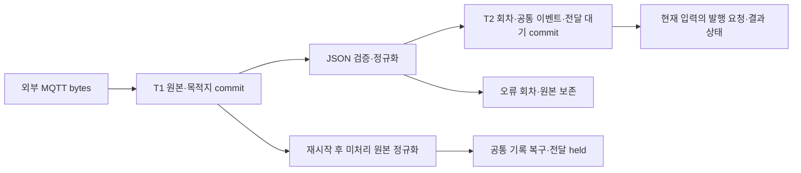

# P2.2 — 공통 이벤트·전달 대기 영속화

2026-09-18 · **IN_PROGRESS: 외부 MQTT 저장 1차 구현·로컬 검증 / 운영 미적용**

> 2026-09-21 현재: [P2.2 로컬 완료 판정·잔여 인계](TLV_RECORD_DELIVERY.md). 아래 판정/시험은 1차 구현 당시 이력이다.

> 후속 갱신: [직접 TLV 원본·ACK·복구](TLV_MQTT_RECOVERY.md)를 검증했다. 직접 TLV 선택 경로에는 이제 `AIOT_MQTT_CLIENT_ID_PREFIX`도 필요하다. 아래 내용은 해당 단계의 검증 이력이다.

외부 MQTT의 선택 경로에서 원본 bytes를 JSON 해석 전에 저장하고, 정규화한 이벤트와
전달 대기를 함께 commit한다. 발행 예외가 원본 기록까지 없애던 I13의 일부를 보완했다.
영상 접수·MQTT 수신 ACK·전달 worker는 아직 연결하지 않아 P2.2 전체는 완료가 아니다.

위 내용과 231 PASS는 **저장 1차 작업 당시의 범위**다. 후속
[외부 MQTT 수신 ACK·격리 브로커 검증](MQTT_ACK_RECOVERY.md)을 완료했다.
최신 잔여 범위는 [완료 판정·인계](TLV_RECORD_DELIVERY.md)와 PROGRESS를 기준으로 한다.

## 1. 이번에 구현한 범위

| 파일 | 변경·책임 |
|---|---|
| [event_ingest_store.py](../../src/event_ingest_store.py) | 공통 파일에 schema v2 추가 이행, MQTT 원본 접수, 정규화/이벤트/전달 대기 동시 저장, 중복·충돌·실패 상태 |
| [ingest_store.py](../../src/ingest_store.py) | 센서 저장기가 v1과 v2를 모두 읽도록 허용. 기존 센서 테이블·작업·처리 방식 유지 |
| [external_ingest.py](../../src/services/external_ingest.py) | `AIOT_INGEST_DB` 선택 시 선저장→정규화 commit→현재 입력 발행, 미처리 원본 복구는 기록 전용 |
| [저장소 시험](../../tests/test_event_ingest_store.py)·[서비스/강제 종료 시험](../../tests/test_external_ingest_durable.py) | 이행·rollback·중복/충돌·발행 예외·재시작 이후 원본/업무 ID 대조 |

새 라이브러리·API endpoint·Compose 설정·운영 DB 변경은 없다. 설정 미지정 시 기존
`ingest_events` 경로를 유지하며 기존 경로의 발행→저장 문제는 남아 있다. 새 경로에서는
기존 테이블에 이중 저장하지 않는다. 따라서 기존 ingest_events 조회를 새 공통 DB 조회로
자동 연결했다고 해석하지 않는다. 조회/관제 연결은 P1.4/P2.3에서 구현한다.

## 2. 접수·정규화·발행 경계



- **T1:** `ingest_id`, namespace, 최초 수신 시각, topic+원본 bytes의 base64, hash,
  수신 당시 목적지를 저장한다. JSON/UTF-8 해석 이전이며 NaN 등 잘못된 JSON도 원본을 보존한다.
  저장 실패는 서비스 호출자에게 예외로 전달하고 정규화/발행을 시작하지 않는다.
- **T2:** 정상화 회차·canonical record·delivery job·접수 상태를 한 transaction으로 저장한다.
  실패하면 모두 rollback하고 T1 원본이 남는다. 같은 namespace/업무 ID/원본 hash의 재수신은
  접수·duplicate 회차만 추가한다. 같은 ID/다른 원본이면 conflict 회차를 남기고 기존 값을 보존한다.
- 원본 fingerprint는 **topic과 정확한 bytes**를 포함하고 앱 수신 시각은 제외한다. JSON 공백이나
  전송 topic의 차이를 같은 본문으로 추측하지 않는다. 기존 정규화 event_id 산식은 유지한다.
  생산자 시각/안정 ID가 없는 별도 재수신의 중복 제거를 보장하지 않는다.
- 수신 당시 broker/port/topic_prefix/QoS/retain을 목적지에 고정한다. 인증 값은 저장하지 않는다.
  복구 시 설정이 달라져도 저장한 목적지를 덮지 않는다. 발행 비활성 입력에는 job을 만들지 않는다.
- 현재 입력만 발행을 시도한다. publisher의 `True`는 Paho publish의 반환 코드 기준이므로
  **submitted**이며 broker ACK/관제 수신/물리 장치 성공으로 표시하지 않는다.
- 복구는 최초 수신 시각·ingest_id·기존 event_id를 유지한다. 처음 정규화하는 복구 입력의 job은
  **held**다. 이미 준비/시도한 job도 자동 재발행하지 않는다. 과거 경보가 복구만으로
  스피커·전광판에 출력되지 않도록 전달 판단은 후속 구현에 남긴다.
- 정상화 일시 오류는 1~60초 backoff, 한 회차 최대 100건으로 재개한다. 서비스 내 현재 입력과
  복구는 lock으로 겹치지 않게 한다. 동일 외부 입력을 처리하는 복수 프로세스의 소유권/lease와
  고부하 지연은 미검증이다. 이번에 수신 콜백의 네트워크 대기를 분리한 것은 아니다.

| job 상태 | 의미 | 현재 복구 동작 |
|---|---|---|
| pending | T2 commit 후 발행 시도 전 | 보존; 시작 시 자동 발행 안 함 |
| held | 재시작/재처리에서 정규화한 입력 | 기록 전용, 발행 판단 대기 |
| sending | 발행 시도 진입. 여기서 종료되면 결과 미확정 | 보존; 중복 물리 출력 가능성을 판단하기 전 재생 안 함 |
| submitted | 발행 함수가 요청 성공을 반환 | 수신 ACK 미확인, 종단 전달 완료 아님 |
| uncertain | 발행 함수 false/예외 | 원본·이벤트·작업·시도 오류 보존; 전달 worker 구현 대기 |

## 3. 스키마·선택 설정과 적용 준비

- 센서만 사용하는 `IngestStore`는 신규 DB에 v1을 생성한다. `EventIngestStore`를 열면 v1에
  `event_ingest_state`, `ingest_revisions`, `canonical_records`, `delivery_jobs`를 추가하고
  같은 transaction에서 `PRAGMA user_version=2`로 올린다. 실패 시 v1과 센서 작업을 보존한다.
  기존 센서 행·payload를 변환하거나 삭제하지 않는다. DELETE/EXTRA 설정을 그대로 사용한다.
- v2 센서 호환은 **이번에 수정한 IngestStore 코드** 기준이다. 이전 parser 이미지가 v2를
  지원한다고 가정하지 않는다. 공통 파일을 실제 공유하기 전에 모든 writer의 패키징/버전을 맞춘다.
- 외부 MQTT도 parser와 같은 `AIOT_INGEST_DB` 환경변수로 파일을 선택한다. 현재는 개발/격리
  검증용이다. Compose에는 전달하지 않았으며 별도 운영 활성화는 수행하지 않았다.
- 새 경로에서 재발행을 켜면서 `MQTT_EVENT_OUTBOX_DB`까지 지정하면 시작을 거부한다.
  기존 publisher의 자동 replay worker와 새 전달 작업이 같은 이벤트를 동시에 발행하는 것을 막는다.
  기존 outbox를 삭제하거나 backlog가 자동 이행됐다고 간주하지 않는다.
- [전체 저장 설계](STORAGE_DESIGN.md)의 첫 정규화 회차(revision 1)만 구현했다.
  변환기 변경에 따른 추가 회차, 과거 DB import/map, 목적지별 lease/retry/ACK와 조회 API는 남는다.
- 복구/되돌리기 때 공통 DB를 보존한다. 설정을 끄면 기존 writer는 새 backlog를 처리하지 못한다.
  실제 전환에는 일관된 백업·권한/용량·단일 writer·구버전/신버전 이미지·누락 ID 대조가 필요하다.
  자세한 순서는 [모듈별 적용](POC_SCOPE.md#31-모듈별-실장비-적용-시점)을 따른다.

## 4. 검증 결과와 한계

[시험 XML](evidence/event_persistence_slice_20260918.xml): **231 PASS / 실패·오류·SKIP 0, 12.29초**.
[검증 요약·소스 해시](evidence/event_persistence_validation_20260918.json)에 최종 범위를 기록했다.

신규 저장소 11개·서비스 20개와 기존 저장소/외부 입력/공통 이벤트/관측/발행/MQTT/outbox/
Dockerfile/센서 배치/TLV 회귀를 포함한다. 네 강제 종료 시험은 실제 자식 프로세스에서
T1 직후, T2 직후, 발행 중, submitted 기록 직후 `os._exit(42)`를 실행하고 재접속해 ID와 행 수를
대조했다. 발행기는 모형이며 물리 장치를 호출하지 않는다. 별도로 Ruff 5파일, 신규 Python
3파일 Black, 앱 3파일 py_compile PASS다.

```bash
rtk proxy .venv/bin/python -m pytest tests/test_event_ingest_store.py tests/test_external_ingest_durable.py tests/test_ingest_store.py tests/test_external_ingest.py tests/test_canonical_event.py tests/test_sensor_observation.py tests/test_video_observation.py tests/test_event_publish.py tests/test_mqtt.py tests/test_mqtt_outbox.py tests/test_check_dockerfile_sources.py parser-python/tests/test_data_processor.py parser-python/tests/test_tlv_parser.py -q
```

이번에는 실제 MQTT 브로커·PostgreSQL·GPU·실장비·외부 관제에 연결하지 않았다. Docker build나
운영 서비스 재시작도 수행하지 않았다. 이전 P2.1의 격리 PostgreSQL 57 PASS를 이번 실행 결과로
재사용하지 않는다. 센서 v1→v2 대기 상태/고정 payload 보존은 이번 SQLite 시험에서 확인했다.
프로세스 종료 시험은 정전/디스크 고장 시험이나 성능 합격을 뜻하지 않는다.

## 5. P2.2 잔여 작업과 완료 판정

1. **MQTT 수신 ACK:** 후속 외부 MQTT 선택 경로는 고정 ID·QoS 1·지속 세션·수동 ACK와 실제 브로커
   재전송 검증을 완료했다. [결과·조건](MQTT_ACK_RECOVERY.md). 다음은 별도 구현인 직접 TLV Manager의
   외부 JSON 원본 접수·안정 ID·ACK 연결이다. 기존 비활성 경로의 보장을 자동으로 확대하지 않는다.
2. **영상 입력:** 모든 관련 생산자의 휘발성 큐 투입 전에 원본/오류 접수를 연결한다. I17은 그대로다.
3. **전달 재개:** 목적지별 worker/lease·backoff·확인 가능한 ACK·재시작 후 미확정 결과를 검증한다.
   관제 전달과 물리 경보 재생은 P1.4/P1.3 계약에 맞춘다. 현재 보존된 대기를 전달 완료로 계산하지 않는다.

| P2.2 완료 기준 | 이번 판정 |
|---|---|
| 이벤트/전달 대기 일관성 | 외부 MQTT 새 경로 충족; 영상 및 다른 writer 연결 미완료 |
| 영속 접수 전 실패 응답 | 외부 MQTT 새 경로 예외/수동 ACK/재전송 로컬 검증 완료; 직접 TLV 바깥 경계 미완료 |
| 중간 종료 후 복구 | 외부 MQTT 기록/ID 복구 확인; 실제 전달 재개·영상 복구 미완료 |

따라서 **P2.2는 IN_PROGRESS**, 다음 작업은 직접 TLV 바깥 MQTT 수신 경계다. P2.3은 선행 P2.2와
P1.4가 모두 완료돼야 착수할 수 있으므로 PLANNED를 유지한다.
