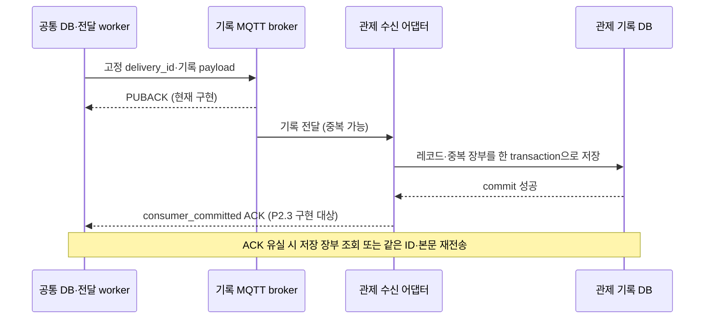

# P1.4 — 관제 전달·저장 ACK·조회·계측 계약

2026-09-21 · **DONE / 내부 계약 1.0** · R04,R10 · 계획 v0.13

관제 제품이 정해지기 전에 구현할 **내부 연동 기준**이다. 기존 기록 envelope 1.0을
유지하고 저장 완료 ACK·중복/충돌·조회·누락 대조·계측을 추가로 정의한다.
이 문서의 새 ACK/조회 기능은 아직 실행 서비스에 구현되지 않았다. P2.3에서 모형
수신처로 구현/검증하고 실제 관제 제품의 API·인증·DB·화면은 D06 선정 후 연결한다.
앱 코드·DB 스키마·운영 설정·물리 출력은 이번 계약 작업에서 바꾸지 않는다.

09-21 후속: [수신 저장/ACK](MONITORING_RECEIVER.md), [송신 ACK 영속화/재전송](MONITORING_SENDER.md),
[snapshot 대조·적체/구간 계측](MONITORING_RECONCILIATION.md)을 로컬 구현·검증했다.
이후 [서비스·로컬 MQTT/조회·전체 지연](MONITORING_SERVICE.md)까지 검증해 P2.3 내부 모형을 완료했다.
실제 관제 공개 API/인증/화면은 남는다. 아래 P1.4 당시의 구현/검증 범위와 구분한다.

## 1. 현재 구현과 다음 경계



| 확인 위치 | 현재 동작 | P2.3에서 추가할 것 |
|---|---|---|
| [RecordDeliveryStore/Worker](../../src/record_delivery.py) | namespace/업무 ID/destination별 작업, lease, 재시도, PUBACK 후 submitted | 관제 저장 상태·ACK 검증·조회/재전송 상태를 별도 영속화 |
| [MqttRecordTransport](../../src/protocols/record_mqtt.py) | QoS 1, retain=false, wait_for_publish, BrokerAck(job_id) | 이 결과를 관제 DB ACK로 변환하지 않음 |
| [센서 공통 기록](TLV_RECORD_DELIVERY.md) | sensor_observation과 observation_id 전달, PG 실패와 독립 | 관제 레코드·ACK·조회까지 ID 대조 |
| [저장 설계](STORAGE_DESIGN.md) | 접수/정규화/기록 전용 복구, 공통 조회 목표 | 실제 읽기 API·고정 대조 목록 구현 |

MQTT PUBACK는 broker가 메시지 책임을 수락한 확인이다. 관제 DB commit이나 화면 표시를
보장하지 않는다. [MQTT 3.1.1 §4.3.2 공식 규격](https://docs.oasis-open.org/mqtt/mqtt/v3.1.1/os/mqtt-v3.1.1-os.html).
broker 저장 설정·전원 장애 내구성도 별도 시험 대상이다. 현재 worker는 호출자가 소유하며
서비스 자동 실행·관제 ACK 대기/재전송은 아직 없다.

## 2. ID와 기존 payload 호환

| 이름 | 의미·수명 |
|---|---|
| ingest_id | 원본 접수 1회의 ID. 같은 접수 복구에서는 유지, 새 MQTT 접수에서는 별도 생성 |
| observation_id / event_id | 관측/이벤트 업무 ID. 같은 값의 별도 측정도 임의로 합치지 않음 |
| canonical_records.source_record_id | 업무 키: 관측이면 observation_id, 이벤트이면 event_id |
| record.source_record_id | 생산자 원본 연결 필드. 직접 TLV에서는 ingest_id이며 위 업무 키와 다름 |
| delivery_id | 현재 job_id. 목적지별 전달 1건, 재시도 때 고정. 다른 목적지는 새 ID |
| origin_id | 공통 저장소의 영속 식별자. 서비스 재시작에 유지; 별도 장비/새 DB는 다른 값 |
| consumer_id | 특정 관제 데이터셋의 버전 있는 ID. DB 초기화/과거 백업 복원으로 장부가 되돌아가면 새 버전 및 전체 재대조 |

origin_id/consumer_id는 **새 내부 어댑터의 영속 설정/장부 계약**이며 기존 wire 필드를
필수로 추가하지 않는다. `destination = record-mqtt:cctv/records/v1/<sink>`와 endpoint에
두 ID를 묶어 고정한다. 하나의 sink에는 하나의 origin/consumer 조합만 허용한다.
다른 조합·수신 DB 교체는 새 destination 버전을 사용한다. 여러 Jetson이 같은 sink를
공유하거나 DB 복제본이 같은 origin으로 동시에 보내는 구성은 이 계약의 적용 전제에 어긋난다.
이미 제출한 job에 새 목적지를 덮어쓰지 않는다. 현재 endpoint 고정만으로 이 등록이 구현됐다고 보지 않는다.

기존 envelope는 다음 두 형태다. 아래 ID는 설명용이다.

```json
{"schema_version":"1.0","delivery_id":"job_video_1","source_namespace":"video_detection","event_id":"evt_1","record":{"event_id":"evt_1","severity":"critical"}}
```

```json
{"schema_version":"1.0","delivery_id":"job_sensor_1","source_namespace":"tlv_mqtt","observation_id":"obs_1","record":{"message_type":"sensor_observation","observation_id":"obs_1","source_record_id":"ing_1","observed_at":null,"measurements":{"temperature":{"value":0,"unit":"degC","quality":"valid"}}}}
```

- JSON UTF-8 object, schema_version는 현재 `1.0`. 필수 문자열은 빈 값 금지.
- `event_id`와 `observation_id`는 정확히 하나다. record 내부의 동일 ID와 일치해야 한다.
  sensor_observation이면 observation_id를 쓰고 그 외 현재 이벤트 경로는 event_id를 쓴다.
  영상의 추가 관측 형식은 기존 관측 계약을 따라 후속 확장하며 여기서 가짜 센서형으로 바꾸지 않는다.
- 내부 record의 source_namespace가 있으면 바깥 namespace와 같아야 한다.
  record의 나머지 필드는 기존 공통/관측 버전에 따라 보존한다. null·실제 0·invalid·missing을 구분한다.
- 중복 JSON 키, NaN/Infinity, 잘못된 UTF-8, 미지원 버전은 성공 ACK를 보내지 않는다.
  변환 실패의 원본/오류는 격리하고 기록 전용 경로에서 물리 명령을 만들지 않는다.
- `payload_sha256`은 **수신한 MQTT application payload bytes 전체**의 SHA-256(소문자 64자리)이다.
  MQTT 헤더/topic과 ACK는 제외한다. 수신자가 JSON을 다시 직렬화한 결과를 hash하지 않는다.
  기존 ingest raw_sha256는 원본 접수 bytes의 hash이므로 이 값과 바꿔 쓰지 않는다.
- 재시도는 같은 ID와 같은 UTF-8 bytes를 사용한다. 배포 후 serializer 변경까지 견디려면
  P2.3에서 최초 전송 bytes/hash를 영속 고정해야 한다. 현재 claim의 재직렬화만으로 보장하지 않는다.
  같은 ID의 내용 정정은 자동 덮어쓰기 대신 충돌/별도 revision 절차로 남긴다.

## 3. 관제 저장 ACK

새 ACK object의 이름은 `monitoring_ack`; 버전 필드는 기존 record 버전과 별도다.
모형 수신처는 이 구조를 반환한다. 실제 제품의 HTTP/MQTT/조회 응답을 이 구조에 대응하는
어댑터는 D06에서 정한다. **현재 공개 HTTP 경로 또는 ACK MQTT topic이 있다는 뜻은 아니다.**

| 필드 | 타입·필수 규칙 |
|---|---|
| ack_schema_version | string, `1.0` |
| ack_kind | string, `consumer_committed` |
| origin_id, consumer_id, destination | string, 등록된 송수신 범위와 정확히 일치 |
| delivery_id, source_namespace | string, 전송 작업과 일치 |
| record_type, record_id | `event` 또는 `sensor_observation`; 각각 event_id/observation_id 값 |
| payload_sha256 | 원래 전송 bytes hash와 일치 |
| status | `stored` 또는 `duplicate`만 성공 |
| receiver_record_id | 수신 DB 레코드의 안정적인 불투명 ID |
| stored_at | timezone 있는 ISO8601 string. 레코드 최초 삽입 transaction의 기록 시각 |
| ack_emitted_at | timezone 있는 ISO8601 string. commit 성공을 확인한 후 ACK를 구성한 시각 |

stored_at은 commit 완료 순간의 정밀 측정값이 아니다. 재전송 duplicate에서도 최초
receiver_record_id와 stored_at을 유지하고 ack_emitted_at만 새로 기록할 수 있다.
sender는 위 식별자·hash·필드 타입·시각 형식과 **인증된 수신 채널**을 검증한 후 ACK를
로컬 DB에 commit한다. SHA-256 자체는 인증 수단이 아니다. ACK 내용을 믿고 목적지를 선택하지 않는다.
잘못된 ACK는 오류로 보관하고 작업을 완료시키지 않는다. 같은 ACK의 중복 반영은 멱등이다.
이미 영속 저장한 성공 상태를 지연된 timeout/실패 응답으로 되돌리지 않는다.

### 수신 DB transaction

1. 전달 장부 unique key는 `(origin_id, consumer_id, destination, delivery_id)`다.
2. 업무 레코드 unique key는 `(origin_id, consumer_id, source_namespace, record_type, record_id)`다.
3. 신규 업무 레코드와 전달 장부를 같은 transaction으로 commit한 **뒤에만** 성공 ACK를 만든다.
   레코드 insert 후 장부 insert 실패·commit 실패면 둘 다 rollback하고 성공 ACK를 보내지 않는다.
4. 같은 전달 키+같은 bytes hash는 기존 장부로 duplicate ACK를 반환한다.
   같은 전달 키+다른 hash는 `delivery_conflict`; 기존 저장 내용을 보존한다.
5. 다른 delivery_id로 같은 업무 키가 왔을 때 record 내용도 같으면 업무 레코드 1건을 재사용하고
   새 전달 장부를 추가해 duplicate ACK를 반환한다. 내용이 다르면 `record_conflict`다.
   모형의 record 비교는 Python JSON sorted keys/UTF-8/allow_nan=false 표현을 사용한다.
   배열 순서·필드 누락/null·숫자 0/0.0도 보수적으로 구분한다. 이는 범용 JSON canonicalization 표준이
   아니며 다른 언어 어댑터는 동일한 비교 결과의 호환 벡터를 검증해야 한다. wire hash는 이 비교와 별개다.
6. 충돌·invalid 원본, 요청 범위, 오류 코드는 별도 격리 이력에 보존한다. 재시도 횟수 초과나
   낮은 중요도를 이유로 원본/미확인 작업을 삭제하지 않는다. 격리 저장마저 실패하면 실패를 전파한다.

수신 DB commit 후 ACK 전송 실패, sender의 ACK 저장 실패는 **저장 결과 미확정**이다.
같은 ID 조회/재전송으로 복구한다. UI 표시·운영자 확인·EdgeX 명령 ACK·실제 출력은 이 ACK에 포함하지 않는다.

## 4. 상태·오류·복구

기존 `delivery_jobs.state=submitted`, `ack_kind=broker_puback`, `acked_at` 의미는 유지한다.
P2.3은 별도 관제 상태를 둔다. broker 상태와 관제 상태를 한 완료 flag로 합치지 않는다.

| 관제 상태(새 설계) | 진입 조건 | 다음 행동 |
|---|---|---|
| pending | 대상 작업 등록 | 전송; 다른 레코드/목적지를 막지 않음 |
| awaiting_ack | 전송/PUBACK, 최종 ACK 없음 | bounded timeout 후 장부 조회 또는 같은 ID 재전송 |
| uncertain | 전송/조회 timeout, ACK 유실 가능 | 성공·실패를 단정하지 않고 조회/재시도 |
| stored | 검증한 consumer_committed ACK를 sender DB에 commit | 주기 대조 대상; UI 상태는 별도 |
| quarantined | invalid/unsupported_version/ID 충돌 | 원본·오류 보존, 수정 후 통제된 기록 복구 |
| blocked | 인증/등록 불일치, 수신처 세대 변경, 공간 부족 | 오류·최고 대기시간 노출, 조건 복구 후 재개 |

오류 object는 `{code, retryable, message}`로 통일한다. 응답을 요청과 연결하려면 등록 범위와
delivery_id를 함께 둔다. 식별조차 불가능한 malformed 요청은 범위/수신 접수 ID로 격리하며 성공하지 않는다.

| code | 자동 재시도 | 규칙 |
|---|---|---|
| unavailable / timeout / storage_failed | 가능 | 같은 job/bytes 유지, 지수 backoff, 네트워크 대기는 DB 밖 |
| invalid / unsupported_version / delivery_conflict / record_conflict | 금지 | 격리, 다른 정상 항목 계속 처리 |
| unauthorized / binding_mismatch | 금지 | blocked; 등록/인증 수정 후 재개 |
| cursor_invalid / snapshot_expired | 같은 cursor 반복 금지 | 새 snapshot을 시작하고 미완료 대조로 표시 |
| status_unknown | 허용 | 조회 실패/장부 없음은 전달 완료 증거가 아님; 재전송 또는 조사 |

P2.3 로컬 모형 설정은 send timeout 5s, lease 30s, 저장 ACK 조회 대기 10s,
backoff 1/2/4/8/16/32/60s, 1회 최대 100건으로 시작한다. 이는 시험 설정이지 D04의
현장 지연 합격 기준이 아니다. ACK 대기 중 한 worker를 sleep으로 묶지 않고 due 작업을 고른다.
lease는 네트워크 제한시간+정리 여유보다 길어야 한다. 실패 작업은 다음 시각으로 넘기며
FIFO/오래된 작업 선택으로 지속적인 후순위 굶김을 막는다. 물리 경보의 선점은 P1.3/P3에서 다룬다.

PUBACK 이후 관제 ACK가 없을 때도 애플리케이션 재전송이 필요하다. 현재 store의 claim은
broker acked 작업을 제외하므로, P2.3의 별도 상태/재전송 경로가 이를 지원해야 한다.
기존 broker ACK 이력을 지워 retry를 강제로 만드는 방식은 사용하지 않는다.

## 5. 조회와 누락 대조

아래는 **논리 인터페이스**이며 URL·전송 수단은 P2.3 모형/D06 어댑터에서 정한다.
필드명은 기존 snake_case를 유지한다. 인증 범위 밖 origin/consumer 조회는 허용하지 않는다.

| 연산 | 요청 | 응답 |
|---|---|---|
| get_delivery_status | 등록 범위 + delivery_id | committed이면 위 ACK, 없으면 status_unknown; DB 읽기 실패를 not_found로 바꾸지 않음 |
| create_snapshot | side(source/consumer), 등록 범위, 선택 device_id/namespace/업무 ID/received_at 기간 | snapshot_id, 대상 count, created_at, expires_at, applied_filters |
| list_snapshot | snapshot_id, opaque cursor 또는 null, limit 1~1000(기본100) | items, next_cursor 또는 null, snapshot_id |
| get_records | 등록 범위 + snapshot_id 내 업무 키 목록(최대100) | 해당 record/전달 상태; 없는 키를 명시 |

일반 이력 조회는 received_at+ingest_id, 같은 접수에 여러 업무 기록이 있으면 namespace+
record_type+record_id까지 붙여 총순서를 정한다. observed_at이 없다고 received_at으로 채우지 않는다.
수신 시각은 timezone을 정규화해 비교한다. 숫자 offset 페이지로 장애 누락 검사를 하지 않는다.

**누락 검사는 고정 목록을 사용한다.** 짧은 일관된 source DB read transaction 안에서
그 시점의 대상 업무 키/job ID/hash/received_at/ingest_id를 snapshot manifest로 복사하고
transaction을 닫는다. manifest에는 불변 ordinal을 부여하고 snapshot_id+ordinal로 페이지를 읽는다.
목록 저장량도 P2.4 용량 예산에 포함한다. 긴 MQTT/HTTP 요청 동안 SQLite read transaction을 유지하지 않는다.

- snapshot 시작 시 이미 접수됐지만 아직 정규화/작업 생성 전인 건수는 `pending_normalization`,
  `pending_delivery_creation`으로 별도 보고한다. 전달 집합 누락 0을 전체 접수 완료로 해석하지 않는다.
- 이후 정규화된 과거 접수, 같은 timestamp의 신규 항목, 재처리 결과는 **다음 snapshot에서** 포함한다.
  다음 대조를 이전 최대 observed_at/received_at 초과분만으로 제한하지 않는다.
  P2.3은 보관 중인 전체 대상 집합을 다시 대조한다. 증분 최적화는 별도 내구 sequence/변경 장부 후 검토한다.
- source manifest의 `(scope, delivery_id, business_key, payload_sha256)`별로 consumer의
  commit된 장부를 조회한다. manifest 전체 페이지를 소진하고 모든 조회가 성공해야 판정한다.
- `missing`: 저장 확인 없음, `conflict`: 같은 키 다른 hash, `unexpected`: 수신측 범위에만 존재,
  `unverifiable`: timeout/권한/기간 만료로 대조 불가를 따로 집계한다. unexpected를 자동 삭제하지 않는다.
- unexpected 검사는 consumer 장부 snapshot도 페이지 조회한다. 두 snapshot은 분산 transaction이
  아니므로 source snapshot 뒤 생긴 정상 전송은 `out_of_snapshot`으로 분리해 다음 회차로 넘긴다.
  consumer에만 보이는 ID는 source의 현재 장부까지 조회해 이 경우인지 확인하고, 확인 불가는
  unverifiable로 남긴다. source의 고정 대상 집합에 대한 missing 0과 전체 양쪽 집합 일치를 구분한다.
- missing은 같은 ID/bytes의 기록 재전송으로 복구한다. conflict는 격리/조사한다.
  건수만 같고 ID가 다르면 실패다. 중복 수신 시도 수와 unique 업무 레코드 수를 별도 기록한다.
- manifest TTL은 D06 보관 정책과 구분한다. 로컬 예제 TTL 300s; 만료 시 명시적 snapshot_expired,
  기존 부분 결과를 합격으로 확정하지 않는다. source/consumer 장부 보관기간이 대조/재전송 기간보다 짧으면
  무중복·무누락을 보장할 수 없으므로 실제 적용 전 D06에서 맞춘다. 현재 자동 삭제는 추가하지 않는다.

조회 모델은 저장 설계의 device_id/namespace/ingest_id/업무 ID/observed_at/processed_at/
received_at/quality/validation_status에 broker_status·monitoring_status를 구분해 붙인다.
receiver에서 알 수 없는 원본 연결/시각은 source 조회 어댑터가 제공하고 없으면 null/unknown이다.
record payload에 구현되지 않은 값을 채워 기존 형식을 바꾸지 않는다.

## 6. 시각과 계측 기준

시각은 timezone 있는 ISO8601, 비교할 때 UTC로 정규화한다. 원래 observed_at은 보존한다.
같은 프로세스 내 구간은 monotonic timer로 측정한다. 재시작/다른 장비 간 비교는 wall clock과
clock_sync 상태를 함께 기록하고, 음수 지연/동기화 불명은 invalid/unknown 표본으로 센다.
이를 0ms로 보정하거나 p95에서 조용히 제외하지 않는다.

| 시각/측정 | 소유자 | 의미 |
|---|---|---|
| observed_at | 센서/영상 생산자 | 실제 측정/분석 대상 시각, 없으면 null |
| received_at | 공통 접수 | 앱이 원본을 받은 시각; commit 완료 시각과 구분 |
| ingest_commit_completed_at, normalize_completed_at | source writer | 성공 commit 후 계측; 기존 영속 필드 제공 여부와 구분해 P2.3 추가 |
| send_started_at, broker_acked_at | 전달 worker | 시도별 시작/브로커 ACK; 과거 시도를 덮지 않음 |
| stored_at, ack_emitted_at | 관제 수신 어댑터 | 수신 DB 행 기록 시각/commit 확인 후 ACK 생성 시각 |
| consumer_ack_received_at, consumer_ack_persisted_at | source ACK 처리 | ACK 수신/로컬 저장 완료 |
| displayed_at | 관제 UI | 실제 화면 증거가 있을 때만 기록, 저장 ACK로 대체하지 않음 |

관제 확인 지연은 source의 `consumer_ack_persisted_at - received_at`으로 정의한다.
source 내부 처리/대기, send→PUBACK, send→consumer ACK를 별도 기록한다.
cross-host observed→stored/표시 지연은 동기화 확인과 정의가 있어야 비교 가능하다.
P2.3은 구현된 단계만 측정하고 미계측은 null로 남긴다.

필수 지표: namespace/destination별 pending/awaiting_ack/uncertain/quarantined/blocked 수,
가장 오래된 미확인 작업 나이, 시간당 유입/처리량, retry/duplicate/conflict/ACK invalid 수,
대조 missing/conflict/unexpected/unverifiable 수, DB 크기·여유 공간, 구간별 p50/p95/max와
유효·무효 표본 수/측정 창. event_id 같은 무한 증가 ID는 메트릭 label 대신 구조화 로그/장부에 둔다.
정상 저위험 관측도 저장·전달 지표에 포함한다. 경보 우선순위가 관제 기록 삭제 조건이 되지 않는다.

| 미확정 수치 | 현재 판정 | 책임·목표일·적용 위치 |
|---|---|---|
| 저장/관제/명령 지연 p95·최대, 허용 적체·동시 이벤트 | D04 대기; 값 없이 성능 PASS 금지 | 사용자·관제/현장, 10-02, P2.4/P6 |
| 센서별 stale 시간·송신 부하 | D02/D04 대기; 시간/연결/측정 품질을 별도로 노출 | 사용자·센서 부서, D02 09-25/D04 10-02, P4 |
| 실제 ACK 보장·인증·보관/재전송 가능 기간·디스크 예산 | D06 대기; 내부 모형 통과로 제품 합격 금지 | 사용자·관제, 10-02, P2.3 외부 적용/P2.4 |

## 7. 검증·완료 판정과 인계

[실행 가능한 계약 예제](evidence/test_monitoring_contract.py)는 pytest tmp_path의 SQLite만
사용한다. 현재 RecordDeliveryStore의 sensor/event envelope와 모형 수신 계약을 대조한다.
정상 저장, 저장 실패 rollback, ACK 유실 후 재조회/중복, ID/본문 충돌, ACK 불일치,
snapshot 도중 과거 시각 데이터 추가와 건수만 같은 누락을 검증한다.
모형은 배포용 consumer·HTTP API·MQTT ACK listener가 아니며 새 앱 의존성도 없다.
실제 프로세스 강제 종료·전원 단절·외부 관제/화면·네트워크 부하는 P2.3/P2.4 후속 시험이다.

검증 결과: **55 PASS / 실패·오류·SKIP 0, 47.89초**, [JUnit](evidence/monitoring_contract_20260921.xml).
Ruff·Black check·py_compile 각 1파일 PASS. 최초 예제의 destination 필수 인자 누락은
수정했고 [초기 실행](evidence/monitoring_contract_fixture_error_20260921.xml) 7 PASS / 48 setup ERROR를
별도 보존했다. 앱 결함 수정이나 TDD의 기능 실패 재현으로 집계하지 않는다.
[검증 범위·해시·문서 점검](evidence/monitoring_contract_validation_20260921.json)에 재현 근거를 기록한다.
인증 채널, sender ACK 상태 저장/재시작, 실제 API/worker lifecycle, snapshot TTL·권한·한도는
이번 모형에 구현하지 않았으므로 55 PASS를 그 기능의 검증 결과로 확대하지 않는다.

```bash
rtk proxy .venv/bin/python -m pytest docs/planning/evidence/test_monitoring_contract.py \
  -q -o addopts=--tb=short --junitxml=/tmp/monitoring_contract_recheck.xml
rtk proxy .venv/bin/python -m ruff check docs/planning/evidence/test_monitoring_contract.py
rtk proxy .venv/bin/python -m black --check docs/planning/evidence/test_monitoring_contract.py
```

P1.4 완료 범위는 내부 계약과 위 예제 검증이다. D04/D06의 제품·수치가 미확정이라는
조건을 제거하지 않는다. WBS의 '지연 상한'은 계측 정의+결정 책임/기한까지 내부 계약에 담고,
실제 수치 확정/합격은 P0.2와 P2.4/P6의 미완료 조건으로 유지한다.

P2.3 실행 순서:

1. source의 origin/consumer binding·고정 wire bytes/hash·관제 상태를 영속화하는 최소 추가 설계를 하고
   기존 schema v1~v3/record broker ACK/물리 경보 작업을 보존하는 회귀를 만든다.
2. 모형 receiver의 업무 레코드/전달 장부/격리와 저장 ACK를 구현한다. sender는 별도 관제 상태로
   PUBACK 이후에도 ACK 조회·동일 ID 재전송·복구를 이어간다. 호출자 서비스 생명주기에 연결한다.
3. snapshot 조회/ID 대조와 지연 계측을 연결하고 센서·AI→source DB→receiver DB를 출력 장비 없이 시험한다.
   ACK 전후 프로세스 종료, 잘못된 ACK/충돌/DB 장애, 수신처 교체, 지연/순서 역전도 확인한다.
4. 실제 관제 선정 후 인증·전송 binding·화면 반영과 D04/D06 수치를 대조한다. 이 조건이 없으면
   내부 모형 완료와 외부 연동 미완료를 구분한다. I10/I13/I17은 이 계약만으로 닫지 않는다.

이 순서 뒤 P5.1/P6.3에서 [다중 카메라 검토](MULTICAMERA_ARCHITECTURE_REVIEW.md)의
입력 복구/출력 격리 항목을 검증한다. 이번에 영상 파이프라인을 변경하지 않는다.
