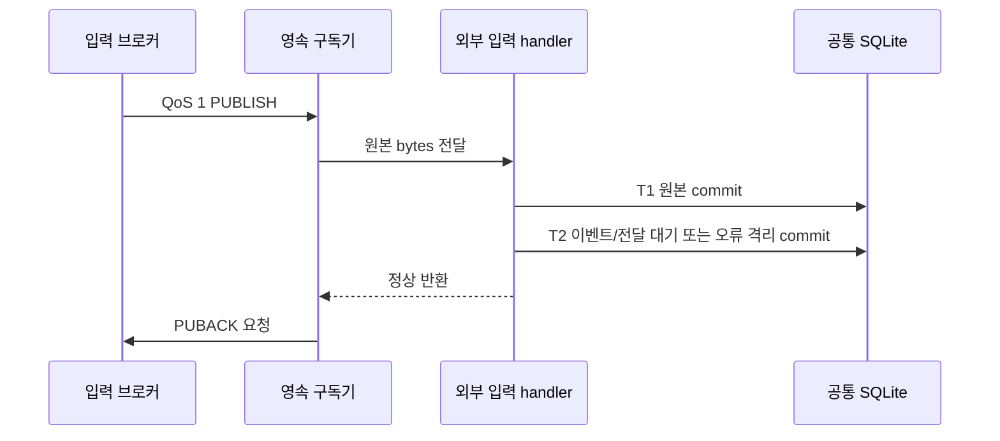

# P2.2 — 외부 MQTT 수신 ACK·재전송 검증

2026-09-18 · **외부 MQTT 선택 경로 로컬 검증 완료 / P2.2 전체 IN_PROGRESS / 운영 미적용**

> 2026-09-21 현재: [P2.2 로컬 완료 판정·잔여 인계](TLV_RECORD_DELIVERY.md). 아래 판정/시험은 외부 MQTT ACK 단계의 이력이다.

> 후속 갱신: [직접 TLV 원본·ACK·복구](TLV_MQTT_RECOVERY.md)를 검증했다. 직접 TLV 선택 경로에는 이제 `AIOT_MQTT_CLIENT_ID_PREFIX`도 필요하다. 아래 내용은 해당 단계의 검증 이력이다.

[앞선 영속 저장](EVENT_PERSISTENCE.md)에 수신 ACK를 연결했다. 원본 저장에 실패하면
ACK 없이 연결을 종료하고, 같은 클라이언트 ID의 지속 세션으로 재접속해 다시 받는다.
실제 격리 브로커에서 저장 실패·오프라인 대기·자식 프로세스 강제 종료를 검증했다.

## 1. 변경 파일과 영향 범위

| 파일 | 변경 |
|---|---|
| [_mqtt_factory.py](../../src/protocols/_mqtt_factory.py) | `durable=True`에서 고정 client_id, clean_session=False, manual_ack=True. Paho 2 미지원 시 자동 ACK로 폴백하지 않고 실패 |
| [mqtt_subscriber.py](../../src/protocols/mqtt_subscriber.py) | 영속 경로 QoS 1 구독·SUBACK 확인, handler 정상 반환 후 ACK, 예외/ACK 오류 시 연결 중단과 소유 루프의 재접속 |
| [external_ingest.py](../../src/services/external_ingest.py) | 공통 DB 선택 시 영속 구독 활성화, 기존 반복문에서 실패한 구독 재개 |
| [단위 시험](../../tests/test_mqtt_durable_subscriber.py)·[격리 브로커 시험](../../tests/test_mqtt_durable_integration.py) | ACK 순서·실패·옵션·구독 거부와 실제 MQTT 재전송/세션/종료 경계 |
| [기존 영속 저장 시험](../../tests/test_external_ingest_durable.py) | 새 필수 조건인 고정 client_id를 시험 설정에 명시 |

DB 스키마·업무 ID 산식·외부 payload·API endpoint는 이번에 변경하지 않았다.
영속 모드를 선택하지 않은 기존 구독기의 QoS 0/자동 ACK 동작과 기존 발행기 기본값은 유지한다.
직접 TLV의 `parser-python/mqtt/manager.py`는 별도 구현이므로 이번 변경이 적용되지 않는다.
운영 설정·이미지·서비스·장비 출력은 변경하지 않았다.

## 2. ACK의 의미와 실제 순서



- 현재 ACK 시점은 **handler 정상 반환 뒤**다. handler는 T1/T2와 현재 입력의 선택적 발행 시도를
  수행한다. T1 직후 곧바로 ACK하거나 네트워크 대기를 수신 콜백에서 분리한 구조는 아니다.
  이미 commit된 T1 뒤 T2가 실패해도 ACK를 보내지 않아 원본이 재수신될 수 있다.
- 저장 오류/handler 예외 때는 ACK를 호출하지 않고 연결을 중단한다. 네트워크 콜백 안에서
  자기 thread를 join하지 않고, 소유 반복문에서 loop를 종료한 뒤 같은 ID로 새 client를 만든다.
  재접속은 기존 시간 제한을 따르며, 실제 서비스 반복문을 사용하는 DB 실패 시험도 통과했다.
- 잘못된 JSON/UTF-8은 영속 격리 후 정상 반환하므로 ACK한다. 처리 불가능한 입력을 브로커가
  끝없이 다시 보내는 상태와 오류 원본 보존을 구분한다.
- CONNACK만으로 준비 완료로 표시하지 않는다. 설정한 토픽의 SUBACK가 모두 QoS 1을 허용해야
  `is_connected=True`가 된다. 거부/하향 협상은 준비 실패로 처리한다.
- 입력 PUBACK는 앱이 수신 기록을 확보했다는 경계다. 관제 수신 확인·출력 MQTT 발행 확인·
  전광판/스피커 작동 성공을 뜻하지 않는다. 기존 delivery_jobs의 submitted도 종단 ACK가 아니다.

수동 ACK·지속 세션 설정은 [Paho 공식 Client 문서](https://eclipse.dev/paho/files/paho.mqtt.python/html/client.html)를
대조했다. 재시작 때 클라이언트의 메모리 세션이 사라지는 제한을 고려해 수신 구독을 QoS 1로 고정했다.
[Paho 세션 제한](https://eclipse.dev/paho/files/paho.mqtt.python/html/index.html#known-limitations).

## 3. 격리 시험 결과

[최종 JUnit](evidence/mqtt_ack_final_20260918.xml): **253 PASS / 실패·오류·SKIP 0, 26.63초**.
이는 신규 단위 13개·실제 브로커 7개와 기존 저장/관측/발행/센서 회귀를 합친 결과다.
[검증 요약·소스 해시](evidence/mqtt_ack_validation_20260918.json)에 최종 범위와 환경을 기록했다.
처음 작성한 새 검사 12개 실패/기존 동작 대조 1개 통과의 [수정 전 결과](evidence/mqtt_ack_red_20260918.xml)도 보존한다.

| 실제 브로커 시험 | 관측·판정 |
|---|---|
| 정상 + 잘못된 UTF-8 | 원본 각각 보존, 정상 canonical 1건/오류 격리 1건. ACK 확인 후 같은 ID로 재시작해 재전송 없음 |
| SQLite 접수 INSERT 실패 | 원본 0건·ACK 호출 0회. 제약 해제 후 서비스 반복문이 자동 재접속, 같은 MQTT mid/DUP=True로 재수신·원본 1건 저장 |
| 서비스 오프라인 수신 | 미리 만든 지속 세션에 QoS 1 입력 대기. 같은 ID의 새 서비스에서 수신/저장 |
| T1 이전 강제 종료 | 새 프로세스로 재전송, 원본 1건·업무 이벤트 1건 |
| T1 직후 강제 종료 | 저장된 원본 복구 후 브로커 재전송. 접수 2건·업무 이벤트 1건, 중복 회차 보존 |
| handler 완료 후 ACK 직전 종료 | 브로커 재전송. 접수 2건·업무 이벤트 1건, 기존 event_id 유지 |
| 브로커가 ACK를 받은 뒤 종료 | 같은 세션 재접속 뒤 재전송 없음. 원본/업무 이벤트 각각 1건 |

네 종료 시험은 실제 자식 프로세스에서 `os._exit(42)`를 실행했다. ACK 호출 성공과 브로커 도착을
구분하기 위해 동일 연결에서 PUBACK 다음에 별도 시험 토픽 PUBLISH를 보내고 그 응답까지 확인했다.
단위 시험에서는 구독 거부/하향, ACK 오류, 안정 ID/Paho 기능 미지원, 기존 구독 호환을 확인했다.
Ruff 6파일·Black 4파일·앱 3파일 py_compile PASS다.

시험 환경은 Paho **2.1.0**, Mosquitto **2.0.22**(`eclipse-mosquitto:2.0`), 임시 SQLite다.
브로커는 `--network none`, TCP 포트 공개 없음, 64MiB/0.5CPU 제한의 일회용 컨테이너였다.
호스트와 `/tmp/cctv-p22-mqtt-*` 아래 Unix socket만 공유했고 운영 브로커에 연결하지 않았다.
Unix listener 설정은 [Mosquitto 공식 문서](https://mosquitto.org/man/mosquitto-conf-5.html)를 따랐다.
검증 후 컨테이너를 종료/제거했다. 테스트 환경의 소켓 권한만 조정했다.

시험 전용 브로커를 준비한 경우 다음처럼 재실행한다. 환경변수 미지정 시 브로커 시험 7개는
SKIP되므로 그 결과를 위의 실제 브로커 포함 PASS와 혼동하지 않는다.

```bash
# 폐기 가능한 시험 전용 Unix socket 경로만 지정한다.
rtk proxy env CCTV_TEST_MQTT_SOCKET=/tmp/cctv-p22-mqtt-TEST/broker.sock .venv/bin/python -m pytest tests/test_mqtt_durable_subscriber.py tests/test_mqtt_durable_integration.py tests/test_external_ingest_durable.py tests/test_mqtt.py -q
```

## 4. 적용 조건·검증하지 않은 범위

- 공통 DB의 `AIOT_INGEST_DB`와 함께 **EXTERNAL_MQTT_CLIENT_ID를 명시**해야 한다.
  같은 입력 서비스의 재시작에는 같은 값을 사용하고 동시에 실행되는 다른 서비스와 공유하지 않는다.
  새 기능을 처음 도입할 때 전용 ID를 배정한다. 구독 범위/ID 변경 시 기존 세션의 대기 데이터를
  확인하고 이행하며, 자동 삭제·자동 이행을 가정하지 않는다.
- 새 모드는 Paho 2 수동 ACK가 필요하다. 현재 requirements는 1.x도 허용하므로 실제 적용 이미지의
  설치 버전을 확인해야 한다. 이번에는 의존성 파일 변경·패키지 설치·이미지 build를 하지 않았다.
  미지원 환경은 시작을 거부하며 조용히 자동 ACK로 실행되지 않는다.
- 송신 QoS 0은 구독 QoS 1만으로 재전송 가능한 데이터가 되지 않는다. 수신 시 보존은 시도하고
  경고하지만 무손실/재전송을 보장하지 않는다. 송신측 QoS·broker queue 한도/기간은 실제 환경에서 확인한다.
- 이번에는 **클라이언트** 중단/재시작만 시험했다. 시험 브로커의 persistence는 false다.
  브로커 자체 재시작·전원 단절·디스크 포화·인증/ACL·TCP/TLS 현장 연결·장기 용량·지연 시험은 남는다.
- ACK 유실 시 별도 접수 행이 생기는 at-least-once 처리다. 시각/ID가 안정적인 이번 예제는 업무
  이벤트가 1건으로 유지됐다. 생산자 시각/안정 ID 없는 재수신을 항상 중복 제거한다고 보장하지 않는다.
- SQLite backlog 복구는 앞선 구현처럼 기록 전용이다. 브로커가 재전송한 입력에 대한 오래된 경보
  판단·유효시간과 물리 출력 재생 정책은 P1.3/P3에서 연결해야 한다. 시험에서는 재발행을 껐다.
- 직접 TLV Manager는 QoS 1 구독이지만 시간 기반 client_id·자동 ACK를 사용하고, JSON/필수 필드
  오류나 SensorService 예외를 로그 처리한다. 서비스 내부의 P2.1 영속 저장만으로 바깥 수신 ACK까지
  해결됐다고 보지 않는다. 현재 경계를 확인했으며 다음 P2.2 작업으로 연결한다.

**이번 완료 범위는 외부 MQTT 선택 경로의 수신 ACK다.** 직접 TLV 바깥 JSON/ACK,
영상 큐 전 접수, 목적지별 전달 worker/ACK가 남아 P2.2는 IN_PROGRESS를 유지한다.
