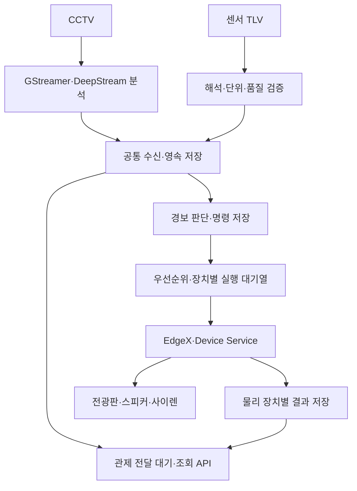

# CCTV·AIoT 모듈 안정화 개발 기준 및 SDLC

10-27 **현재 우선순위 변경**: 기존 모델 정확도·근거 한계 정리 → 1대 기준선 → 녹화영상4입력 batch4 안정화/최적화 → 추가3대 확보 후 실물4대 검증. 연결 가능한 CCTV는1대다. 모델 추가 학습/확장은 보류하고 전광판·스피커는 과제 후로 이관한다. 센서·사이렌·저장/관제는 유지한다. [10-27 우선순위·범위](POC_SCOPE.md#scope-20261027) · [모델별 근거](MODEL_INFERENCE_METRICS.md#model-quality-20261027). DONE9/37·과제후2행, 새 장비 배정/운영 변경 없음. 아래 날짜별 항목은 당시 이력이다.

10-23 주간 마감: [이번 주 보고서(10-19~10-23)·다음 주 우선순위](WEEKLY_REPORT_20261023.md). H.264 보완 운영 반영·낙상 후보 보완·A/B/DDS 부분 실증·max4 raw batch1/2/4 검증을 정리했다. 엔진 정확도/영상4입력 유효결과0, ROI6결과 NOT_RUN, camera-offload 수정본 회귀 NOT_RUN, A/B 연속 왕복 미완료·미니PC 지문 불일치로 인증/전송 보류다. 모든 배정 반환·새 배정 없음, 최신 보존 운영 표본16:21:17은17.345FPS/8.870Hz 보호 실패이며 이후 회복 미관측. **DONE9/37(24.3%) 유지**, 아래 시각별 항목은 당시 이력이다.

15:07 조율 갱신: **RTSP 입력은 운영 자체 복구가 관측됐으며 현재 실패 지속으로 표시하지 않는다.** 사용자 확인으로 Jetson A(Wi-Fi 식별IP192.168.2.141)·CCTV1대·미니PC를 PoE 스위치에 연결했다. A eno1은14:34:25~14:37:44에199초 단절됐고 EOS14:34:51·SDP timeout14:35:32/14:36:52가 모두 단절 구간 안이다. 이 입력 실패의 직접 네트워크 원인은 링크 단절로 설명된다.14:38부터 처리 재개,14:53~14:58 저장5분 평균29.306667FPS/14.650000Hz·마지막30초27.2FPS/13.566667Hz를 재계산했다. 저장 평가 차분이며 중간25~26FPS 구간이 있어 새 사전점검/장기 안정 PASS가 아니다.14:22~14:28 저하는 단절보다 앞서 회복했으므로 별도 원인 미확정이다. 수동 재시작0·운영 컨테이너 동일, A/B 조회 종료·새 GPU/부하 배정 없음. [원시 대조](evidence/engine_batch_gpu_20261023.json)·[현재 배정](../tooling/CODEX_SKILL_ADOPTION.md).

10-23 14:33 **P6.2 개발도구 중복 인덱싱 조치 완료·엔진 재사전점검 차단**: 자동감시/자동시작OFF·직접 갱신 도구 비활성화·단일 잠금 수동 갱신을 적용했다. 설정/해시 대조 및14:15~16의45.20초30FPS/15Hz 회복은 확인했으나, 이후worker0 상태에서4.77FPS/2.39Hz로 다시 낮아졌다(원인 미확정). 엔진14:25 사전점검은4.19FPS/1.99Hz로 GPU0/9·변환0 보호 종료,14:27:02 반환·새 배정 없음. 정확도/영상4입력은 미평가다. ROI guard 보완31 PASS/Ruff PASS는 담당의 모의시험 결과이며 기존 실패 수치는 미기록 유지. camera-offload는 A/B 완성본을 보존한 카메라 서비스 선택3 hunk만 조율해 소스 개발 중이다. 운영 변경0·**P6.2 PLANNED/I56 OPEN/DONE9/37 유지**. [장비/담당](../tooling/CODEX_SKILL_ADOPTION.md)·[엔진 근거](evidence/engine_batch_gpu_20261023.json)·[ROI 근거](evidence/two_camera_baseline_20261023.json)·[카메라1대 이전](EDGE_ORCHESTRATION_POC.md#camera-offload-20261023).

14:42 후속 읽기 진단: 후속14:36:39~49의10.03초에는 frames127556→127556으로0FPS·인덱서0·CPU약17%가 관측됐다.14:34:51 EOS 뒤 운영 자체 복구가RTSP SDP 응답 시간초과로 실패했다. 현재 입력을 열지 못하는 상태와14:25 저하의 동일 원인 여부는 미확정이다. Primary 카운터63778→0 감소는RESET으로 구분하며 음수 처리율로 사용하지 않는다. 카메라 링크/TCP 연결 존재만으로RTSP 정상 판정하지 않는다. 운영 재시작/설정 변경·새 카메라 접속 없이 원인 확인을 이어가며 새 시험은 보류한다.

10-23 **P6.2 운영 FPS 진단·중복 인덱싱 수정 담당 지정**: A/B 원시 자료 재계산에서 CPU99.84~99.99%·인덱싱7개 합계3.94~5.11코어와 운영16.57~17.60FPS를 확인했다. 변경 없이 인덱싱0·CPU46.97~54.27%·30.29초 평균30.01FPS로 단기 회복. CPU 경합이 주된 원인으로 판단되나 단독 기여/채팅 귀속은 미확정, PrimaryHz·장기 안정은 미검증이다. 사용자 지시로 A/B는 공유 개발도구 중복 방지 수정, 엔진은 현재 회복 읽기 확인, ROI는 자체 계측 보완을 담당한다. 구체 수정/적용은 대기, GPU 배정 없음·운영 변경0·**P6.2 PLANNED/I56 OPEN/DONE9/37 유지**. [근거](evidence/engine_batch_gpu_20261023.json)·[담당/다음 순서](../tooling/CODEX_SKILL_ADOPTION.md).

10-23 **P6.2 엔진 정확도·영상4입력 사전점검 중단·GPU 반환 보고 수신**: 첫5.0229초 운영25.09FPS/12.54Hz로27/13.5 기준 모두 미달했다. GPU·변환0,9회·카메라별12결과 NOT_RUN·정확도 NOT_EVALUATED. 중단 원시 수치 저장·재계산, 자체 시험 컨테이너0·이번 실행 전후 운영/고정파일 보존. 잔여 배정 종료·새 배정 없음, 운영 회복 후 별도 조율한다. 기존 max4 raw batch1/2/4 PASS 및 **P6.2 PLANNED·I56 OPEN·DONE9/37 유지**. [근거](evidence/engine_batch_gpu_20261023.json)·[인계](handoffs/engine_batch_20261023.md).

10-23 **P6.2 ROI pilot 변환 중 보호 중단·GPU 반환**: 운영 사전점검29.49FPS/14.75Hz PASS 후 CPU 변환 중 보호 기준 미달로 중단. GPU 비교0·6결과 NOT_RUN·정확도/성능 미평가, 자체 시험0 확인 후12:35:02 반환. 운영 미반영·기존 완료 수 유지. [수치/한계](VIDEO_INFERENCE_CONTRACT.md#two-camera-pilot-20261023)·[근거](evidence/two_camera_baseline_20261023.json).

10-23 **P6.2 기준 성능 사전관측·ROI/트래픽 분석**: 추가 GPU 없이 운영1채널 처리16.29/18.37FPS·추론8.16/9.17회/초, CPU 중앙100%를 확인했다. 공유 인덱싱의 다른 채팅 귀속을 구분할 수 없어 일시정지·새2채널 시험은 미실행이다. CPU 변환 앞의 프레임 선택·보조 분석 앞의 구역 선택·출력 경로별 트래픽을 후보로 정리했다. **42 PASS·격리 Compose2개 검증**, 제품/운영 변경0·완료 수 유지. [상세·재시험 조건](VIDEO_INFERENCE_CONTRACT.md#two-camera-baseline-20261023)·[근거](evidence/two_camera_baseline_20261023.json).

10-23 **O5 현재 담당 영상 미리보기 통합 PASS(격리)**: 기존 프레임 저장소→노드 영상 API→담당 검증 릴레이→조회 화면을 연결했다. **Python134·JS7·Firefox1 PASS**, 합성 영상 A→B·JPEG640px·오래된 프레임/이전 실행 차단·실제320/768/1024/1440px 확인. 2초 간격 POC 미리보기이며 연속 영상·새 B GPU/무선은 미검증이다. 운영37컨테이너 유지·AP/운영 설정/추가 설치0. **O5 IN_PROGRESS·I68 OPEN·DONE9/37 유지**. [범위/실행법](EDGE_ORCHESTRATION_POC.md#owner-preview-20261023)·[근거](evidence/edge_owner_preview_20261023.json).

10-23 **O5 담당 조회 API·POC 화면·DDS 연결 PASS(격리)**: 기존 제어기에 현재 담당/실행·최근 저장·최근20개 배정 상태 조회를 연결했다. **조회/담당32·인계74·JS6·Firefox1·DDS 통합1 PASS**, 실제320/768/1024/1440px·키보드/인증/통신 실패 검증. DDS 원본555건 ID/해시 일치·영상 접수467건·미처리0, A→B→A 배정1/2/3 조회 확인. 운영37컨테이너 유지·AP/운영 설정/추가 설치0. **영상 재연결·자동 판단 사유 전체 이력·새 B GPU/무선은 잔여**이며 O5 IN_PROGRESS·I68 OPEN·DONE9/37 유지. [범위/사용법](EDGE_ORCHESTRATION_POC.md#owner-view-20261023)·[근거](evidence/edge_owner_view_20261023.json).

10-23 **O4 자원 자동 판단→인계·DDS 통합30분 PASS(격리)**: 지속 과부하 판단, 실행기 강제 종료/같은 작업 복구, 정상 복구 후 역전환 방지를 기존 인계에 연결했다. **원본8,407건 ID/해시 일치·영상 접수 이벤트6,653건·최종 미처리/만료0**, 관련74·MQTT1·DDS 단기/30분 각1 PASS. 운영37컨테이너 유지·AP/운영 설정 변경0·전용 시험/키 정리. 모형 AI/통제 보고이며 새 B GPU·2보드 무선 DDS·실제 AI 지연/패킷 손실은 잔여다. O1/O2/O3/O4/O7 IN_PROGRESS·I68 OPEN·DONE9/37 유지. [범위/실행법](EDGE_ORCHESTRATION_POC.md#automatic-handoff-20261023)·[근거](evidence/edge_automatic_handoff_20261023.json).

10-23 **O7 DDS 통합·적체 보완30분 PASS(격리)**: 첫30분의 적체/만료·인계 재개 실패를 보존하고 공통 송신 회차20→100건으로 보완했다. 재시험 **원본8,339건 ID/해시 일치·영상 이벤트6,641건·최종 미처리0**. 이전 A 보존 접수1건은 같은 원본으로 저장 후 만료 차단됐고 그 외 만료0이다. 관련45·실제 DDS3·MQTT5·단기/30분 각각1 PASS, Ruff PASS. 운영37컨테이너 유지·AP/운영 설정 변경0·전용 시험/키 정리, ROS 이미지만 A 캐시 보존. 새 B GPU/무선·기관 계약·자동 판단은 잔여이며 O1/O2/O3/O4/O7 IN_PROGRESS·I68 OPEN·DONE9/37 유지. [범위/한계](EDGE_ORCHESTRATION_POC.md#dds-integration-20261023)·[근거](evidence/edge_dds_integration_20261023.json).

10-22 **B 기존 AI 서비스 통합 PASS**: B 전용 SDK·FP16 엔진9개, 실제 `main.py→DeepStream→영속 접수→격리 MQTT`를 연결했다. **5분9,090프레임·재시작1분1,863프레임·사람 이벤트119건 수신**. 관련464 PASS/2 SKIP·Ruff PASS, A 운영37컨테이너/원본 엔진·양쪽 네트워크 보존. B 환경 보존·시험 프로세스/터널/인증 정리. Agent의 AI 상태/제어·자동 인계는 다음 O2이며 O1/O2 IN_PROGRESS·I68 OPEN·DONE9/37 유지. [상세·제약](EDGE_ORCHESTRATION_POC.md#sdk-inference-20261022)·[근거](evidence/edge_b_inference_20261022.json).

10-22 **O1 보고서 재대조·SSH 영상30분 PASS**: 보고서 인쇄15쪽의 AEC 간 원본 전달과 연산 분산/A 전체 장애 경로를 구분했다. 임시 수신기 SPS/PPS 보강 후 B **1800.18초·53,970프레임·29.98FPS·최대 간격0.602초**, A **54,100프레임 증가·오류/재시작 증가0**. 초기 실패·합성4/운영 보호6사례와 실제 결과를 보존했다. A37컨테이너·양쪽 경로 유지·임시 통로/파일/인증 정리, 제품/운영 설정·설치 변경0. B SDK/AI 수명주기→F-29/F-30은 잔여이며 O1/O2 IN_PROGRESS·I68 OPEN·DONE9/37 유지. [원문 대조·결과](EDGE_ORCHESTRATION_POC.md#report-reassessment-20261022)·[근거](evidence/edge_rtsp_soak_20261022.json).

10-22 **O1 AP 관리 접속점 조사**: `192.168.2.1`의 DNS 이름 `Sawwave.lan`·SSH22/Dropbear2019.78 확인, 웹 후보8포트 연결 거절. 제공 admin 계정의 SSH 인증1회가 거부됐고 사용자는 별도 계정/모델을 모른다고 확인했다. AP와 게이트웨이 동일성·모델·브리지/WDS·CCTV망 라우팅 지원은 미확정이며 장비 라벨 또는 관리 담당자의 조회 정보가 필요하다. 기존 상위망 라우팅과 CCTV 직접 경로 지원을 구분하며 방식 선택은 보류한다. 운영 설정/배선 변경0·O1/O2 IN_PROGRESS·I68 OPEN·DONE9/37 유지. [상세](EDGE_ORCHESTRATION_POC.md#ap-audit-20261022)·[근거](evidence/edge_ap_audit_20261022.json).

10-22 **O1 폴 간 무선망 기반 직접 수신 계획으로 수정**: A/B가 같은 SAWWAVE_5GX_Y·BSSID·채널149·게이트웨이192.168.2.1을 사용하고 CCTV는 A의 직결망(.0.100)에 있음을 읽기 전용 확인했다. 동일 물리 스위치는 필수가 아니며, CCTV→A 폴 네트워크→무선 백홀→B 경로를 기준으로 L2/라우팅 조건을 나눴다. AP 모델/실제 백홀·직접 수신은 미확인, B 유선 프로필은 비활성 보존. 운영 설정/배선 변경0·O1/O2 IN_PROGRESS·I68 OPEN·DONE9/37 유지. [수정 계획](EDGE_ORCHESTRATION_POC.md#wireless-plan-20261022)·[조사 근거](evidence/edge_wireless_plan_20261022.json).

10-22 **O1 B 유선 프로필 준비 완료·비활성 유지**: `cctv-b-test`에 후보192.168.0.20/24·자동 연결OFF·게이트웨이/DNS 없음·기본 경로 제외·IP충돌 검사3초를 저장했다. 현재 A-CCTV 직결망에서 ping0/3·ARP FAILED로 응답 장비는 없었으나, 미연결 스위치망의 최종 중복 검사는 대기다. B 기존 주소/라우팅/프로필과 A 운영37컨테이너 유지·오류/재시작 증가0. 케이블/활성화/설치 변경0·O1/O2 IN_PROGRESS·DONE9/37 유지. [상세](EDGE_ORCHESTRATION_POC.md#wired-profile-20261022)·[근거](evidence/edge_wired_preparation_20261022.json).

10-22 **O1 B 네트워크 원인 확인·임시 우회 동시 수신 PASS**: A-CCTV 직결(사용자 확인), B 유선 NO-CARRIER·CCTV 요청의 상위망 경유를 실측했다. 기존 A 운영＋B SSH 경유 수신에서 A 약60초1799프레임 증가·B60.30초1756프레임/29.97FPS·운영 오류/재시작 증가0. **독립 직접 접속은 미해결**이다. 당시 공용 스위치안은 로컬 실험 대안이며 현재 폴 간 무선망 계획을 따른다. 운영37컨테이너·양쪽 라우팅 유지·설치0·임시 통로/파일/인증 정리. B SDK 호환 잔여·O1/O2 IN_PROGRESS·I68 OPEN·DONE9/37 유지. [상세](EDGE_ORCHESTRATION_POC.md#network-followup-20261022)·[근거](evidence/edge_network_20261022.json).

10-22 **O1 SDK·엔진/동시 RTSP 실장비 검사 완료 — B 호환·접속 불합격**: [상세](EDGE_ORCHESTRATION_POC.md#sdk-rtsp-preflight-20261022)·[근거](evidence/edge_sdk_rtsp_20261022.json). 동일 프로젝트 엔진9개 A9/9 로드, B0/9(Magic tag 불일치). A CUDA12.6/TRT10.3/DS7.1, B CUDA11.4/TRT8.5/DS6.3·기본pyds 없음·libgstrtspserver 누락. 동시 접속 시도에서 A 1080p1792프레임/60.16초/29.94FPS, B CCTV TCP554 timeout/0프레임. A 운영＋추가 접속은 유지됐으나 두 호스트 동시 수신은 실패. B eth0 DOWN·IPv4 없음, Wi-Fi 게이트웨이 경유 경로의 차단 위치는 미확정. 운영37컨테이너·원본 엔진 불변·운영 소스 오류/재시작 증가0·설치/제품 코드/운영 설정 변경0·시험 파일/인증/SSH 정리. 다음 B CCTV 경로와 SDK 정비 방식 확정 후 재시험. O1/O2 IN_PROGRESS·I68 OPEN·DONE9/37 유지.

10-22 **O2 실장비 2대 30분 보고·Agent 중지/재접속 PASS**: [상세 결과](EDGE_ORCHESTRATION_POC.md#reporting-soak-20261022)·[근거](evidence/edge_reporting_soak_20261022.json). 10:52:31~11:22:31 KST, 1800.12초 관측. A 1,703건/B 1,669건, 오류·예상 밖 stale·sequence 누락/중복0. 각 Agent 약21초 중지→약10초 후 stale→재실행 후 약2초에 online, 다른 노드 보고 유지. 첫 시험 eMMC commit 최대35.19초/DB 잠금 오류를 재현해 시험 state/log 경로만 /dev/sda1로 이동 후 재검증했다. 관련103 PASS/0 SKIP·DB 무결성 PASS·운영 컨테이너37개 ID/이미지/시작시각 유지. 제품 코드/운영 설정/설치 변경0·시험 프로세스/파일/인증/SSH 정리. 30분 초과 안정성·AI 제어/인계·ROS 2는 잔여. O1/O2 IN_PROGRESS·I68 OPEN·상위DONE9/37 유지.

10-22 **O2 Jetson 2대 HTTPS 원격 자원 보고 구현·실장비 검증 완료**: [실행법·호환성·검증 범위](EDGE_ORCHESTRATION_POC.md#remote-reporting-20261022). 192.168.2.141/Python3.10.12와192.168.2.203/Python3.8.10의 AGX Orin 2대가 각자 CPU/GPU/메모리를 수집해 동일 제어기에 **각5회·1초 간격 보고, 모두online**을 확인했다. **최종103 PASS/0 SKIP·Ruff PASS**. 추가 설치0·운영 서비스/설정/배포·CCTV 변경0, 시험 프로세스/포트·원격 임시 파일·시험 인증정보/SSH 연결 정리 완료. 단기 보고 검증이며 장시간 안정성·AI 제어·ROS 2·재배치는 잔여다. O1/O2 IN_PROGRESS·O3~O8 PLANNED·I68 OPEN·상위DONE9/37 유지.

10-22 **O2 Jetson CPU·GPU·메모리 실측 보고 구현 완료**: [실행법·정의·한계](EDGE_ORCHESTRATION_POC.md#jetson-resources-20261022). 표준 라이브러리로 커널 통계를 읽고 격리 제어기에 주기 보고한다. **78 PASS/0 SKIP·Ruff PASS**, 현재 AGX Orin 1대에서 1초 간격3회 보고/정상 종료·마지막 CPU34.65%/GPU2.5%/메모리32.94%. 미측정은null·실측은simulation=false·AI 상태 미수집. 운영 서비스/설정/배포·클럭·CCTV 변경0, 두 번째 보드/원격·네트워크·AI 제어는 잔여. O1/O2 IN_PROGRESS·O3~O8 PLANNED·I68 OPEN·상위DONE9/37 유지.

10-22 **O2 모형 2노드 등록·주기 보고 구현 완료**: [실행법·현재 API](EDGE_ORCHESTRATION_POC.md#mock-nodes-20261022). 운영과 분리된 loopback HTTP·임시 SQLite·노드별 인증으로 등록/재등록·sequence/boot 차단·상태 freshness·실패 재시도를 구현했다. 단위/실제HTTP42 PASS·Ruff PASS, CLI1초 간격 각3회 보고/종료 확인. 기존 제품/설정540파일 불변·운영/GPU/CCTV 접근0. O1/O2 IN_PROGRESS(모형 등록/보고 부분 완료)·O3~O8 PLANNED·I68 OPEN·상위DONE9/37 유지.

10-19 P5.1 **H264 보완 이미지 운영 적용·3분 확인 완료**: 같은 AI의1파일 임시 비교에서 처리28.16→30.08FPS·최대 출력 도착 공백0.455→0.178초를 확인하고 원본 복구 후24.70FPS/0.479초(후속22.12FPS)를 기록했다. 이후 설정 대조·복귀12시험 PASS를 거쳐 이미지1항목만 ccbfe02a로 전환했다. **새 AI c6aac881 healthy·3분29.97FPS/추론14.99회·오류/파이프라인 재시작/PTS역행0**, 비대상6서비스 불변. 최대 출력 공백0.302초·원격 브라우저/장기 검증 잔여이며 해결 완료로 표시하지 않는다. P5.1 IN_PROGRESS/I54 OPEN·DONE9/37 유지. [전환·복구·한계](VIDEO_INFERENCE_CONTRACT.md#live-h264-runtime-20261019).

10-19 **Jetson·미니PC 분리 설계 정리**: 폴당 SAWWAVE AP4대(총16AP), 스위치 SFC8000GHP/NEXT-POE1411GDT를 추가 확인했다. 공유 DB/이미지를 보존하는 서비스 배치·수정 파일·통신/배선·검증 순서는 [분리안](../architecture/JETSON_MINIPC_SPLIT.md)을 따른다. 제안 문서이며 제품/운영 변경0·완료9/37 유지.

10-19 **스마트폴 POC 규모·보유 장비 추가 확인**: 총4폴·폴당 CCTV4대(총16대), 여분 Orin AGX2대·NX2대, 함체 내 Jetson·PoE 스위치·미니PC와 SAWWAVE AP 사용 계획을 확인했다. 장비 보유와 현장 연결/성능 합격은 구분하며 1차 POC 동시 가동 범위·일정은 추가 확인 대상이다. [확정 사실·미확정 조건](POC_SCOPE.md#smartpole-four-sites-20261019). 완료9/37·운영 변경0 유지.

10-19 **11월 1차 POC 범위 확정·실행안 반영(현장 일정 미정)**: 11-20 내부 준비 → 11-23~27 현장 POC를 제안한다. 사용자가 낙상·영상·센서/출력 중심 1차 현장 POC를 선택했다. 싸움·월담·실물4카메라 등 전체 요구사항·선행조건은 후속 완료 대상으로 유지한다. 주5일×6시간 가정 시 준비25일/150시간, 결함 여유20% 제외 배정120시간이다. C++ 전면 전환을 일정에 추가하지 않고 라이브 보완 실측→단일 낙상 판정→장치/센서→다중·복구 순서로 진행한다. 전체 범위 추가 공수·NX 확보일·현장 접근은 미확정이므로 납기 보장이 아니다. 운영 변경0·완료9/37 유지. [주간 실행안·판단 시점](WBS.md#poc-before-december-20261019).

10-19 P5.1 **웹 라이브 끊김 재현·H.264 송출 탐색 비용 로컬 보완**: 45초 관측에서 처리26.57FPS·송출25.98패킷/초·최대 도착 공백0.385초·영상 시각100ms 초과42회를 확인했다. 매 출력 바이트를 Python으로 순회하던 H.264 시작 코드 탐색을 내장 검색으로 교체했다. 같은120프레임의 보정 합계 중앙1371.05→6.41ms·프레임 p95 42.48→0.106ms, 출력 바이트3회 동일·41시험/Ruff PASS. 함수 CPU 비교이며 실제 화면 개선·전체 원인 확정은 아니다. 수정1파일 후보 ccbfe02a 생성·CPU smoke PASS·운영 미반영·P5.1 IN_PROGRESS/I54 OPEN·완료9/37 유지. [결과·C++/참고 파이프라인 검토](VIDEO_INFERENCE_CONTRACT.md#live-h264-scan-20261019).

10-19 P6.4 선행 **AGX/NX 후보 구성·장치 이력 복구 로컬 검증 완료**: 후보 이미지 전체 ID·GPU venv·화면 세션을 보드별로 선택하도록 보완하고 기존 영속 DB·소스 고정 검사를 유지했다. **후보/Compose78시험·백업14시험=고유92 PASS·Ruff PASS**, 실제 Compose 해석/검사기2경우 PASS(NX는 가상 이미지·빈 venv 경로 선택 시험). 장치3종의 완료/미확정 명령 재출력 차단·복원 후 신규 이력/재시작 보존을 모의 장치로 확인했다. 운영 ID/이미지/시작시각 동일·GPU/이미지 빌드/교체0. NX 이미지·SDK/엔진·16GB 성능·실제 전체 이행/복구는 잔여, P6.4 PLANNED/I07 OPEN·완료9/37 유지. [구성·검증 범위](../guides/JETSON_EDGEX_FIELD_CHECKLIST.md#orin-nx16-compatibility).

10-19 P5.2 **Pose 클래스 반복 검사 축소·로컬 검증 완료**: 저장100영상 **15,005프레임 출력 동일**, CPU 후처리 중앙 **2.179→1.821ms(약16.4% 감소)**. 느린 텐서8개의 단독/경쟁640회 출력 동일·경쟁 p95 **32.96→22.95ms**. **56 PASS·Ruff PASS**. 현재 **30W·systemd 정상·운영30초30.00FPS/14.97회**, 5서비스 관측 전후 동일. 새 GPU/운영 중단/배포0이며 실제 GPU 지연 개선은 미확인이다. P5.2 IN_PROGRESS/I56 OPEN·완료9/37 유지. 다음은 소스 고정·실행/복구 사전점검 후 승인된 GPU100·정상30분 재검증 → 단일 판정 → 다중. [결과·한계](MODEL_INFERENCE_METRICS.md#fall-pose-filter-20261019) · [근거](evidence/fall_pose_filter_20261019.json).

아래는 각 작업 당시 기록입니다.

10-19 P5.2 **50W 비교 완료·기준 미달·운영 복구 완료**: 동일r4·엔진·1080p·신뢰도0.5 유지. GPU9 PASS·실제 경보 최대4.986→4.497초. 정상RTSP30분 오경보0건·추론 최저14.924/중앙14.995회·0/49구간 하한14.25 미달·지연변동0.873초. 같은 AI복구43.15초·29.69FPS/14.81회·다른4서비스 유지. **비교 미달·50W 미채택, 관리자30W 복귀 필요**. 시험34.03분·복구43.15초로 승인45분+5분 이내다. 재부팅 전후37컨테이너 설정/상태 일치·31가동을 확인했다. 부팅 사전점검의SDK15초 timeout은 같은 조건 재점검PASS이며 Docker가 기존 서비스를 복구했으나 systemd 실패 표시/부팅 안정화는I43 OPEN으로 관리한다. P5.2 IN_PROGRESS/I56 OPEN·DONE9/37(24.3%)·운영 후보 미배포 유지. r4 전체GPU100·독립 평가·다중·운영 승격 잔여; 싸움 보류. [30W/50W 비교](MODEL_INFERENCE_METRICS.md#fall-power50-20261019) · [근거](evidence/fall_power_comparison_20261019.json).

아래는 각 작업 당시 기록입니다.

10-19 P5.2 **r4 재검증·운영 복구 완료, 처리율·지연변동 미달**: 1080p·신뢰도0.5·동일 엔진/30W 유지. 기존0/진단53 차이는 같은 정상 반복 영상에서 자세 후보720→1,919·추적 재연결0→83과 함께 발생했다. 발목 상승의 하강 오인·착석 이력 유지·다리 투영 판정을 보완했고 중복 제거 후 낙상 계산으로 CPU 중앙5.626→2.251ms(약60% 감소), 저장15,005프레임 출력 동일이다. **r4 CPU100 TP50/TN50·기록된 정상7경보→0, GPU9 경보 시점 일치·실제 지연최대4.986초**. r4 정상RTSP30분 오경보0건·추론 최저13.634/중앙14.136회·38/49구간 하한14.25 미달·지연변동0.654초. 같은 AI복구43.30초·29.99FPS/14.98회·다른4서비스 유지. r3 30분FP6·추가20분FP7과 시험DB 준비 실패/복구 기록은 보존했다. **374 PASS/2 SKIP·실행/복구12 PASS·Ruff PASS**. 50W 검토에서 기본Compose와 현재 AI의12항목 차이를 기록했으나, 후속 점검에서 운영 보존 drop-in이 이미 설치·적용된 것을 확인해 정정했다. 전력 전환/재부팅은 미실시다. P5.2 IN_PROGRESS/I56 OPEN·DONE9/37(24.3%)·운영 미배포 유지. [결과·한계](MODEL_INFERENCE_METRICS.md#fall-cadence-fix-20261019) · [근거](evidence/fall_cadence_fix_20261019.json).

아래는 각 작업 당시 기록입니다.

10-19 P5.2 **추가 GPU 진단 1회·30분 관측·운영 복구 완료, 후보 확정 보류**: 1080p·신뢰도 0.5·고정 r2를 유지했다. 후처리 최대 **431ms 중 스레드 CPU 11ms**(계산 외 시간 약 97.4%), 해당 호출 GC/페이지 폴트 0·자발적 문맥 전환 113회를 기록했다. 준비 300초 이후 CPU quota 제한 증가는 0이다. 보존 텐서 8개의 CPU 48회 비교에서 출력은 같았고, 단독 최대 15.73ms·경쟁 스레드 추가 시 최대 98.05ms로 대기 영향이 재현됐으나 실제 GPU 앱의 정확한 대기 원인은 미확정이다. 이번 계측 반복 시험은 **정상 영상 경보 53건·30초 49구간 중 48구간 추론율 미달**(최저 13.35/중앙 14.02회), 지연 변동 0.267초·파이프라인 오류/드롭/재시작 0이었다. **같은 운영 AI 복구 43.85초·29.98FPS/14.99회**, 다른 4서비스 불변·추가 1회 승인 범위 이내·운영 모델 미교체. 다음은 대기 구간과 입력 간격/추적 전환·53경보 원인 분리 → 최소 보완/고정 재검증 → 단일 판정 → 다중 → 운영 준비다. P5.2 IN_PROGRESS/I56 OPEN·완료 9/37 유지. [실행·분석 근거](evidence/fall_postprocess_diagnostic_20261019.json) · [결과와 한계](MODEL_INFERENCE_METRICS.md#fall-postprocess-diagnostic-20261019).

10-19 P6.3 선행 **정기 백업 누락 보완·로컬 11시험 통과**: 10-16 실제 경로 대조에서 어댑터 전용 DB 2개가 정기 백업에 빠진 것을 확인했다. 지정 경로의 필수 DB 검사·동명 Outbox 분리·WAL/권한 보존을 추가했고 누락 3건 실패 재현 후 11시험·Ruff·Bash 문법 검사를 통과했다. 스크립트는 수정했으나 **타이머의 추가 경로 설정은 미적용**, 새 전체 예약 실행은 잔여다. 10-16 관측 백업 파일 크기 합 79.19GB·빈 DB 페이지 4.48GB는 용량 가정과 구분해 기록했으며 원본 삭제/VACUUM은 하지 않았다. I41 FIXED_LOCAL·I22 OPEN·P6.3 PLANNED 유지. [근거](evidence/backup_coverage_20261019.json) · [백업·복구 절차](../handover/BACKUP_RESTORE_RUNBOOK.md).

아래는 각 작업 당시 기록입니다.

10-16 P6.3 선행 I64 **수정 이미지·복귀 구성·온라인 백업 준비 완료, 운영 미반영**: 명령 기능과 지표 서버를 분리한 수정은 관련 8시험·Ruff를 통과했다. 후보 이미지 `ab366dd3`는 기존 17레이어와 실행 설정을 유지하며, 이미지 자체의 격리 시험에서 HTTP 200·명령 비활성(0)을 확인했다. 운영 구성 9항목 및 후보/복귀 프로필 대조를 마쳤고, **DB 2개 온라인 백업·무결성 검사 통과**(Outbox 전달 완료 861,538건·대기 0건)를 확인했다. 백업 후 **29.96FPS·추론 14.98회/초**, 드롭/재시작 증가 0·운영 6컨테이너 불변이다. 부팅 시에도 후보 이미지를 유지할 설정 초안은 미설치 상태다. 복귀 모의 실행은 자동 승인 검토가 차단해 구성 검증까지만 완료했으며, 실제 전환·복귀·재부팅·수집/알림은 잔여다. **운영 4up/1down·P6.3 PLANNED·I64 OPEN·완료 9/37 유지**. 낙상 추가 GPU 진단은 중단 승인 답변 대기다. [근거](evidence/adapter_metrics_20261016.json) · [운영 확인 방법](../operations/edgex-aiot-pilot.md#지표-수집과-명령-기능의-구분).

10-16 P5.2 **r2 GPU100·30분 실행 완료, 지연 변동 기준 미달**: 1080p30·사람/Pose0.5·같은 엔진/소스를 유지했다. **GPU100 TP50/FN0/FP0/TN50·조기/중복0·CPU경보시점100/100 일치**, 실제경보 지연 중앙2.642/p95 3.816/최대4.527초·3초 초과10/5초 초과0이다. **정상RTSP30분 오경보0건**으로 착석 보완을 확인했고49개30초 구간 최저14.879/중앙15.002회·RSS+0.45MiB·추론/카메라/드롭/재시작0이다. 다만 **지연 변동0.589초>고정상한0.5초로 r2 미달**이며 기준을 변경하지 않는다. 약24분52초 지연 최대 구간과 후처리 최대375→530ms 증가가 겹쳤으나 정확한 원인은 아직 미확정이다. **4회운영복구 PASS·최종30.01FPS/14.97회**, 시험·복구 합약68.2분·운영미배포. 다음은 후처리 순간 지연 추적/보완→고정후보 재검증→단일판정→다중→운영 준비·싸움 보류. P5.2 IN_PROGRESS/I56 OPEN·DONE9/37(24.3%) 유지. [판정·지연 구간](MODEL_INFERENCE_METRICS.md#fall-r2-final-gpu-20261016) · [실행 근거](evidence/fall_r2_final_gpu_20261016.json). 추가 원인 분리: 저장RTSP952입력×2회 CPU후처리에서 최대25.47ms·반복결과952/952 일치로530ms 지연은 미재현했다. GPU 실패 구간과 준비300초 이후의 CPU quota 제한 증가는0이다. 실제 CPU 계산/실행대기/GC를 구분하는30분 GPU 계측을 준비했고12시험·고정223입력·읽기전용 운영점검 통과. 추가 시험38분·복구5분의 운영 중단 승인은 자동검토 차단 후 사용자 답변 대기이며 아직 실행하지 않았다. 아래는 각 작업 당시 기록이다.

10-16 P5.2 **RTSP 오경보 원인 보완·r2 짧은GPU 재검증 완료**: 1080p30·사람/Pose0.5·같은 엔진을 유지했다. r1의 정상 착석 중 단일 관절 흔들림이 하강 이력으로 보존되는 오류를 실제RTSP에서 재현하고, 여러 과거 관측 또는 bbox 높이 감소로 교차 확인하도록 공통 판정을 보완했다. **저장GPU100 CPU 재생 TP50/FN0/FP0/TN50·조기/중복0**,99영상의 경보 결과 동일·00702 한 건3.150→3.283초(+0.133초),최대4.446초다. **실제RTSP 약60초 비교 r1 오경보1→r2 0·잘못된 전환228→0**,339 PASS/2 SKIP·복구9시험 PASS. 후속2회 각각시험약81~82초·복구43초, 최종같은AI **29.96FPS/15.02회**·다른4서비스 유지·운영 미배포. **r2 GPU100 전체경로·30분 최종검증은 잔여**, r1 미달 기록은 보존한다. 다음은r2 고정/최종검증→단일판정→다중→운영 준비·싸움 보류. P5.2 IN_PROGRESS/I56 OPEN·DONE9/37(24.3%) 유지. [원인·수정·검증 한계](MODEL_INFERENCE_METRICS.md#fall-rtsp-transition-20261016) · [근거](evidence/fall_rtsp_transition_20261016.json). 아래는 각 작업 당시 기록이다.

10-16 P5.2 **후보r1 미달 판정·운영 복구 완료**: 1080p30·사람/Pose0.5·같은 엔진/소스211을 유지한 **GPU100영상은 TP50/FN0/FP0/TN50·조기/중복0·CPU 경보100/100 일치**로 통과했다. 실제 경보 지연 중앙2.656/p95 3.819/최대4.524초·3초 초과13/5초 초과0이다. **30분 정상RTSP 반복 관측에서 낙상 오경보30건**이 발생해 후보를 채택하지 않는다. 처리율49개30초 구간 최저14.860/중앙15.005회, 지연 변동0.325초·추론/카메라/드롭/재시작0·RSS+139.9MiB. **4묶음 시험·복구 합약69분(승인148분 이내)**, 매 복구약43초·최종같은AI30.01FPS/14.97회·다른4서비스 유지·운영 모델 미교체. 다음은 RTSP 원시관절·추적/전환 이력 재현→보완/재검증→단일후보 재판정→다중→운영 준비, 싸움 보류. P5.2 IN_PROGRESS/I56 OPEN·DONE9/37(24.3%) 유지. [결과·한계](MODEL_INFERENCE_METRICS.md#fall-final-gpu-20261016) · [실행 근거](evidence/fall_final_gpu_20261016.json).

10-16 [이번 주 업무보고(10-12~10-16)·다음 주 계획](WEEKLY_REPORT_20261016.md): **전체 WBS 완료24.3%(9/37), 낙상 계획100영상 GPU 평가100%(100/100)**. 세 주간업무의 최종 종료는0/3이며 보완·검증 진행 중이다. 최신 CPU후보 미탐1/오탐1·지연 증가5건, 2/4채널 인수 미통과·최신 낙상 후보 운영 승격 미실시를 구분했다. 다음 주는 잔여 낙상 보완/고정 GPU 재검증 → 다중 카메라 → 운영 후보·복귀 준비 순서다.

10-16 P5.2 전방 미탐·숙임 조기경보 보완 후보: **1080p30·사람/Pose0.5 유지**, 저장GPU100개 CPU 재생에서 후속80 **TP38/FN2→TP39/FN1·FP1/TN39 유지·조기1→0/중복0**, 기존20 TP10/TN10 유지. 전방00683은 직전 직립→숙임→하강을 연결해 **지연2.400초**로 검출했다. **기존TP/TN 손실0이나 기존TP5건 지연이0.533~1.267초 증가**해 품질 최종 승인으로 보지 않는다. 정상 착석00932 오탐1·청소 후00795 실제 낙상 미탐1 잔여. 접힘 제한으로 실제 낙상을 놓친 중간안은 철회했다. **421 PASS/2 SKIP·Ruff PASS·속도300조건 일치**; 신규GPU/중단/배포0, 같은 운영AI 종료 후30초 **29.96FPS/14.98회·재시작 증가0·다른4개 유지**. P5.2 IN_PROGRESS/I56 OPEN·싸움 보류·DONE9/37(24.3%) 유지. 다음은 잔여 품질·지연의 시간적 근거와 고정 GPU/다중 시험 준비이며, 이100개는 독립 성적이 아닌 회귀 자료다. [후보·검증·지연 한계](MODEL_INFERENCE_METRICS.md#fall-pose-controls-20261016) 아래 기록은 각 작업 당시 상태다.

10-16 후속80영상 GPU 재평가·운영 복구 완료: **1080p30·사람/Pose0.5·동일 후보 엔진 유지**, 낙상40/정상40에서 **TP35/FN5/FP1/TN39·조기1/중복0**, 영상 단위 **정밀도97.22%·탐지율87.50%·특이도97.50%·F1 92.11%**. 24,004프레임·GPU12,004회·PTS판정1,949건 검증, 추론/카메라/드롭 오류0. 처리 중앙 **29.64FPS·14.84회/초**, 탐지된35건 경보 지연 **중앙2.600초·최대5.212초**. 정상 착석 오탐·숙인 청소 동작의 조기경보·접힌 자세/후보 시간 부족 미탐을 확인했다. 각40개 시험 **22분8초/24분51초**, 복구·처리율 확인 **52초/49초**로 승인45분+5분 이내. 동일 AI 최종 **29.98FPS/14.98회·재시작 증가0**, 다른4개 유지·모델 미교체. **평가는 완료했으나 품질 보완은 남아 P5.2 IN_PROGRESS/I56 OPEN**, 싸움 보류·**DONE9/37(24.3%)** 유지. 다음은 저장GPU 출력의 착석/숙임·미탐·지연 보완/회귀 → 다중 카메라 → 운영 준비다. 배우/현장 독립·지속15회 여유·장시간 합격은 아니다. [결과·실패 사례·복구](MODEL_INFERENCE_METRICS.md#fall-remaining80-20261016) 아래 기록은 각 작업 당시 상태다.

10-16 낙상 새 엔진·GPU20영상 회귀 완료: **1080p·사람/Pose0.5 유지**, Pose 배포 경로와 호스트 FP16/L1 빌드로 GPU 평균 **114.83/120.31→64.69ms(약44–46% 감소)**. 기존20개 **TP10/FN0/FP0/TN10·조기/중복0**, 6,001프레임·GPU3,001회·PTS/추론/카메라 오류0. 처리 중앙 **29.63FPS·실제 추론14.84회/초**(범위27.38–29.90FPS/13.71–14.97회)로 지속30FPS/15회 여유는 미확정이다. 경보 지연6개 단축/4개 동일·악화0, 후면00925의 **4.446초와 자세 후보 공백**은 남았다. 동일 운영 AI 복구 **30.07FPS/15.02회·재시작 증가0**, 다른4개 유지·운영 모델 미교체. 시험15분6초·최초 시작→healthy15분20초·최종 결과→처리율 확인59초로 승인25분+5분 이내. 변환기4시험·복구9시험 PASS. P5.2 **IN_PROGRESS**, 싸움 P5.7 **PLANNED(사용자 보류)**; **DONE9/37(24.3%)·진행2/검증7/대기3/계획16**. 다음은 고정 후보의 **미사용80영상 재평가 → 다중 카메라 → 운영 준비**이며 성능 여유·후면 지연은 잔여로 관리한다. [결과·한계](MODEL_INFERENCE_METRICS.md#fall-performance-20261016) 아래 기록은 각 작업 당시 상태다.

10-16 P5.7 **IN_PROGRESS**: 승인된 주간5·야간1 **GPU6회 추출 완료(1080p·신뢰도0.5)**. 영상6,680프레임·관절 출력3,341프레임·0.5 이상 검출7,668건을 확보했고 전체 처리/PTS·중복ID 검증을 통과했다. 첫 시도는 X11 소켓 누락으로 추론 전 실패해 읽기 전용 연결을 복원했으며 실패 기록을 보존했다(추론 전 실패1·성공6·운영 중단2회). **최초 시작→최종 healthy14분11초, 마지막 추출→복구·30초 처리율 확인45초**, 동일 AI/이미지·비대상4개 유지, 복구 후 **29.43FPS·추론14.72회/초·재시작0**. 실영상 싸움 학습0·운영 미배포이며 실제 사람쌍 ID/연속성·배우/촬영 그룹 분리가 다음이다. **DONE9/37(24.3%)·진행2/검증8/대기3/계획15**. [실행 결과·한계](MODEL_INFERENCE_METRICS.md#fight-gpu6-execution-20261016) 아래 기록은 각 작업 당시 상태다.

10-15 P5.7 공식 가이드·촬영 그룹 확인: **AI Hub 공식2019 통합 가이드북 확보, 관련5쪽과 XML83개 대조 완료**. `person_1`은 영상 내 행위자, `character`는 시나리오 성별/연령대이며 전역 배우 ID가 아니다. 학습/검증 분리에 필요한 **원본 파일→촬영 회차→익명 배우 코드 연결표**를 잔여 조건으로 구체화했다. 우리 싸움 탐지의 일방적 공격 범위를 놓치지 않도록 **AI Hub 폭행/싸움 두 분류 검수**를 반영했다. 개발 라벨5건·GPU6회 개정2는 유지하고 **실영상학습0·신규GPU0·운영 미배포**다. GPU 중단 승인·인물ID/촬영 그룹 검수 잔여,1080p/0.5·P5.7 IN_PROGRESS·DONE9/37(24.3%) 유지. [공식 근거·적용](MODEL_INFERENCE_METRICS.md#fight-group-guide-20261015)

10-15 P5.7 GPU 추출안 개정2: **총6회 중 마지막 입력을 검수한 야간 영상으로 교체해 주간5·야간1,223초·1080p6,680프레임**으로 구성했다. 개발 정답5건(싸움2/비싸움3)이 있는 두 원본을 포함하며, 파일명 계열 차이를 배우/촬영 독립성으로 인정하지 않는다. **50파일 해시·입력 연결·Compose 사전 점검 PASS, 복구 모의15시험 PASS**. 기존 실행안/원본은 보존했다. 시험20분+복구5분 범위의 새 운영 중단 승인 대기이며 **실영상 학습0·신규GPU0·운영 미배포**다. 승인 후 관절 추출→실제 인물ID/그룹 검수→첫 학습 순서이며,1080p/0.5·P5.7 IN_PROGRESS·DONE9/37(24.3%) 유지. [현재 입력·실행안](MODEL_INFERENCE_METRICS.md#fight-development-download-20261015)

10-15 P5.7 학습 입력 연결 완료(오프라인): **검수한 사람쌍 라벨+GPU 관절 기록→기존 학습 JSONL 연결, 관련71항목 PASS·Ruff PASS**. 원본 PTS·큰 인물ID·쌍별 정답을 보존하고 미검수 ID/그룹·평가 예약·중복/겹침 정답·시각 단절을 거절한다. **실영상 싸움 학습0회·실영상 가중치0·신규GPU0**이며 합성 CPU3에포크는 앞선 기능 검사다. 현재 개발 라벨3건은 GPU ID/그룹 연결 전이므로 실제 학습 입력으로 승격하지 않았다. 새GPU6회 운영 중단 승인·별도 촬영 그룹/다양성 검수 잔여,1080p/0.5·운영 미배포·P5.7 IN_PROGRESS·DONE9/37(24.3%) 유지. [현재 단계·연결 규격](MODEL_INFERENCE_METRICS.md#fight-development-download-20261015)

10-15 P5.7 Pose 자료 연결·다인ID 충돌 보완: 같은 프레임의 두 사람에게 같은 임시ID가 배정되는 문제를 **4실패로 재현 후 수정**했다. 라벨 없는 캡처 변환기를 추가하고 기존GPU 원자료1영상 **76프레임/143검출의 PTS·좌표·ID→48×139특징 연결**을 확인했다. **관련169 PASS·Ruff PASS**, 기존20영상/1,501tensor의 CPU재생에서 수정 전후 경보 프레임·시각 **20/20 동일**. 원자료의 다인 검출67프레임은 실제2인 정답/성능을 뜻하지 않는다. **실영상싸움학습0·신규GPU0·운영배포0**, I67 VERIFY(로컬 후보), 평가 예약38개/선행 근거·운영6파일 불변.1080p/0.5 유지·P5.7 IN_PROGRESS·DONE9/37(24.3%) 유지. [결과](MODEL_INFERENCE_METRICS.md#fight-pose-capture-20261015)

10-15 P5.7 싸움 초기 학습 경로 구현: **2인 COCO17 특징·시계열 TCN·오프라인 학습 명령**을 추가했다. 상대 위치·신뢰도0.5·결측 마스크·실제PTS·큰 인물ID를 보존하고 인물 순서 대칭, 평가 예약/원본/촬영 그룹 중복·기존 출력 덮어쓰기를 차단한다. **관련41 PASS(새28+기존13), Ruff PASS, 합성 CPU3에포크→후보 저장/재로딩 확인**. 이는 기능 검사로 **실영상 싸움 학습0·실영상 가중치0·GPU 학습0**이며 정확도 개선 근거가 아니다. 예약38후보/기존 근거·운영6파일 불변,1080p/0.5 유지. P5.7 IN_PROGRESS·DONE9/37(24.3%) 유지. 다음은 별도 개발 영상·정상 대조/그룹 검수와 GPU Pose 특징 추출 연결이다. [구현·검증](MODEL_INFERENCE_METRICS.md#fight-tcn-pipeline-20261015)

10-15 P5.7 잔여27후보 대표 구간 분류: **27영상·각2초·1,614연속프레임(54시트)**에서 타격 동작 후보6·접촉 후 이동 후보11·판정 보류10을 기록했다. 기존11개와 합쳐 **38후보 모두 일부 구간 관측 완료**이며, 전영상 검수·독립38사건·최종 정답 승인과는 다르다. 파일명/XML 장소 불일치2건은 원본을 유지하고 분리 키 사용을 보류했다. 원본 영상/XML27쌍·프레임 해시/연속PTS PASS, 선행5근거·운영6파일 불변.1080p/0.5·AI중단/GPU/학습0. **P5.7 IN_PROGRESS·완료9/37(24.3%)** 유지. 다음은 정상/유사 행동·배우/촬영 세션 근거 보강과 전체 사건 문맥·정답 승인이다. [결과](MODEL_INFERENCE_METRICS.md#fight-context-20261015) · [근거](evidence/fight_context_review_20261015.json)

10-15 P5.7 후속 라벨·시간축 검수: **38후보의 행동551구간(접촉 후보379·위협133·쓰러짐39)**을 분리 기록했다. 사건 헤더와 첫 접촉 후보가1초 넘게 다른 영상11개(헤더가 먼저7·나중4)를 우선 검수 대상으로 지정했다. 대표 차이는 +79.57/+54.20/−75.30초이며 모델 경보 지연이 아니라 라벨 간 차이다. 대표4영상 **36,987패킷 PTS 누락/중첩0**,30/29.97FPS만으로 큰 차이를 설명할 수 없음. 검사기 **23 PASS·Ruff PASS**. 원본 라벨·38후보 manifest·1080p/0.5·운영 설정 불변, 학습/GPU/AI중단0. 최종 정답·독립 평가셋 미확정. **P5.7 IN_PROGRESS·9/37 DONE(24.3%)** 유지. [결과](MODEL_INFERENCE_METRICS.md#fight-annotation-20261015) · [근거](evidence/fight_annotation_review_20261015.json)

10-15 P5.7 다운로드·자료 검사: **승인 만료가 원인, 재승인 후 I66 해결**. 실외 ZIP **30.79GB·영상41/XML41**, 전체 CRC/SHA 확인. 손상 MP4 1개·사건 시각 오류2개를 격리하고 **38영상/파일명11그룹의 평가 후보 목록·해시 고정**. 정확 중복0, 시각 유사3쌍은 분리 사용 금지. 독립200장면+정상2시간은 목표이며 **최종 독립 평가셋 미확정**: 정상/유사 행동·폭행 다양성·배우/세션·PTS/사건 경계 검수 부족. 사용자 별도 자료 없음 확인. 검사18 PASS·Ruff PASS,1080p/0.5·운영/GPU/AI중단0. **P5.7 IN_PROGRESS·완료9/37(24.3%)·진행2/검증8/대기3/계획15**. [결과](MODEL_INFERENCE_METRICS.md#fight-access-20261015) · [후보 목록](evidence/fight_candidate_pool_20261015.json)

10-15 P5.6 내부3종 계약·합성 전달 검증: 싸움/월담/쓰러짐의 사건 경계·카메라/세션/PTS·다인 참여자·JSON 유형과 사건F1/정상 창 특이도를 정의했다. **관련186 PASS(신규27 포함)**. 큰 추적ID·원본/메타 보존, 중복/충돌, 재시작 held·잘못된 부모 입력을 검증했다. P5.6 **VERIFY** — 현장 사건/정답창 합의·실제 생산자 연결 대조 잔여. 운영 코드/설정·GPU/AI중단0. **완료9/37(24.3%)·진행1/검증8/대기3/계획16**. 다음은 P5.7 싸움 데이터·모델/라이선스 후보와 독립 평가셋 고정이며 낙상/다중/운영 검증은 유지한다. [계약](OBSERVATION_CONTRACT.md#behavior-contract-20261015) · [시험 근거](evidence/behavior_contract_20261015.json)

10-15 AI 사양서 수신·WBS 반영: 싸움/월담이 기존 확장 계약만으로는 충족되지 않아 P5.7/P5.8, 현장 재학습P5.9, KISA 대응P7.4 추가. 인증 일정은 사용자 답변상 미정,12월POC와 별도. **완료9/37(24.3%)·미완료28**, 추가 공수 미산정. [사양서 대조·공식 신규 기준](POC_SCOPE.md#10-15-ai-모델링-사양서-반영) · [WBS](WBS.md#10-15-사양서-반영--필수3종인증-일정-미정). 당시 다음으로 편성한 P5.6의 후속 결과는 위 최신 기록을 따른다.

10-15 P5.2 엔진 처리 여유 시험 종료: 같은ONNX/FP16/960 L3 빌드를4CPU/16GB·720초로 제한했으나 후반 tactic 탐색 중시간 초과, 새 엔진/후속영상 비교0. 기준 L0 GPU 단독60표본 평균130.686ms·중앙130.051ms이며 앱15회/초 합격 근거가 아니다. 복구 제어시험5 PASS·같은 운영AI/이미지 healthy·30초29.95FPS/추론14.98회·재시작0·비대상4개 불변, 점검착수→재기동735.13초. 제품 판정부/운영 설정 변경0·후보 미배포·P5.2 VERIFY/I56 OPEN. 같은 빌드를 반복하지 않고 별도 빌드 자원/프로파일 근거 확보 후 재개한다. [실행 근거](evidence/ai_spec_1080_standard_20261015.json)

10-15 사용자 후속 지시에 따라 **1080p30 전체화면을 프로젝트 기본 규격으로 확정**했다. 사람/Pose0.5·카메라별 실제 추론15회/초 목표·실물4카메라·12월POC를 유지하며4K는 후속 확장으로 둔다. 현재는 같은960 모델의 엔진 최적화와 처리 여유를 검증한다. [규격](POC_SCOPE.md#10-15-확정-1080p-프로젝트-기본-규격) · [진행](PROGRESS.md)

10-15 P5.2 착석 오경보·1080p 처리율 보완: 신뢰도0.5, GPU20회 TP10/FN0/FP0/TN10·조기0/중복0, 처리율 중앙값25.61FPS. 관련350 PASS/2 SKIP·복구13 PASS. 동일 AI healthy·30초29.97FPS/추론15.00회·재시작0·비대상4개 불변. 후보 미배포·P5.2 VERIFY/I56 OPEN·DONE9/33(27.3%)·고유20/100/미사용80 유지. 다음은 처리 여유 확보·미사용80영상·일상 착석/눕기 대조·검출 연속성 → 배치 지원2채널 → 운영 준비. [결과·한계](MODEL_INFERENCE_METRICS.md#fall-floor-perf-20261015) · [근거](evidence/fall_floor_perf_20261015.json)

10-15 P5.2 측면 보완·1080p30 GPU20회: 신뢰도0.5, TP10/FN0/FP1/TN9·조기0/중복0. 측면00610 2.650초. 동일 운영 AI healthy·30초30.00FPS/추론14.98회·재시작0·비대상4개 불변. 후보 미배포·P5.2 VERIFY/I56 OPEN·DONE9/33(27.3%) 유지. 4K는 필수 운영 조건으로 잡지 않고1080p30 검증 기준을 우선한다. 고유20/100·미사용80 유지. 다음은 1080p 착석 오경보·처리율 보완 → 미사용80영상/검출 연속성 → 배치 지원2채널 → 운영 준비. [결과·한계](MODEL_INFERENCE_METRICS.md#fall-side-1080p-20261015) · [근거](evidence/fall_side_20261015.json)

10-15 P5.2 전체화면·신뢰도0.5 보완 GPU20회 완료: 같은20영상에서 기존 TP8/FN2→TP9/FN1, 정상10개 무경보·조기/중복0. 추적 만료를 영상PTS로 바꾸고 직립→후면 바닥 자세 변화를 보강해00709 미탐을 검출(3.954초), 00898 최초 경보5.322→2.586초. 12,002프레임·tensor3,001개·추론/카메라 오류0, CPU 재생20영상의 경보 프레임과 모두 일치. 회귀324 PASS/2 SKIP·복구13 PASS. 동일 운영 AI healthy·30초29.93FPS/추론15.00회·재시작0·비대상4개 불변, 점검착수→재기동430.46초. 측면00610은 실제 검출 점수가0.5 미만으로 떨어져 미탐1개 잔여. 후보 미배포·P5.2 VERIFY/I56 OPEN·DONE9/33(27.3%) 유지. 다음은 측면00610의 실제 저신뢰 검출 단절 보완안 고정·미사용80영상 일반화 검증 → 배치 지원2채널 → 운영 준비. [장면별 결과·한계](MODEL_INFERENCE_METRICS.md#fall-fullframe-20261015) · [근거](evidence/fall_fullframe_20261015.json)

**10-15 이전 crop 비교:** P5.2 승인된 crop GPU20회·운영 복구 완료: 사람/Pose 신뢰도0.5 고정, 고유20영상 모두 끝 프레임까지 처리·추론/카메라 오류0. 기존 전체화면 낙상8/10→crop 3/10(TP3/FN7/FP0/TN10), 조기0/중복0로 악화해 이번 crop 후보는 보류한다. 동일 운영 AI healthy·30초29.98FPS/추론14.94회·재시작0·비대상4개 불변, 점검착수→재기동708.50초. 운영 후보 미배포·P5.2 VERIFY/I56 OPEN·DONE9/33(27.3%) 유지. 다음은 전체화면 Pose를 기준으로 신뢰도0.5 유지·검출 단절 구간의 입력/추적 보완과 후면 자세 변화 검증 → 미사용80영상 → 배치 지원2채널 → 운영 준비. [결과·장면별 비교](MODEL_INFERENCE_METRICS.md#fall-crop-gpu-20261015) · [근거](evidence/fall_pose_refinement_20261013.json)

10-13 P3.2 REST 영속 접수·실행 분리 로컬 완료: 기존 수신 DB/작업자를 재사용해 HTTP 원본·접수 상태·만료 계획 저장 뒤 202와 ingest_id를 반환한다. 저장 실패503·접수 조회·REST/MQTT 접수 순서·같은 이벤트의 기한/출력 중복 방지·재시작 보류·저장 전용 우회 차단을 확인했다. **회귀392 PASS+실제 loopback HTTP2 PASS(신규33개)·Ruff PASS**. 핵심2파일 mypy PASS, 변경8파일 전체 mypy는 기존16오류가 전후 동일해 전체 통과 아님. 제품 Python8파일·DB 스키마/경로·새 의존성 추가0·운영/준비 이미지 미반영·실물 출력0. P3.2 전체는 큐 계측·운영 검증이 남아 PLANNED·DONE9/33 유지. 다음은 P3.2 큐 길이·최장 대기·지연 계측이다. [API·동작](ACTION_POLICY_CONTRACT.md#10-13-p32-rest-영속-접수실행-분리) · [검증 근거](evidence/action_rest_intake_20261013.json)

10-13 P3.1 경보 만료·안전 재개 로컬 완료: 최초 유형/장치별 기한·정책/대상을 SQLite에 고정하고 접수·실행·물리 대상 발행 직전에 검사한다. 재수신/재시작으로 기한을 연장하지 않으며 유효한 미실행 입력만 재개한다. 처리 중 강제 종료·저장 실패·정책/대상 변경·시각 불명은 원본과 사유를 보존해 보류한다. **회귀209 PASS+격리 실제MQTT6 PASS(신규47개)·Ruff PASS·핵심2파일 mypy PASS**. 제품 Python8파일/설정1파일·기존 수신 DB 테이블1개 추가·새 의존성0. 기본 정책은 TTL 미정/시계 미확인으로 출력 보류, 운영/준비 이미지 미반영·실물 출력0. P3.1 전체는 물리 장치 영속 우선순위/FIFO·수동 승인/발행 후 만료·운영 검증이 남아 PLANNED, DONE9/33 유지. 다음은 P3.1 물리 장치별 영속 대기/FIFO다. [동작·설정](ACTION_POLICY_CONTRACT.md#4-만료장기-대기수동-승인) · [검증·한계](evidence/action_expiry_20261013.json)

10-13 장기 운영 보완·도구 설치·P3.1/I23 로컬 수정: [WBS 완료 기준](WBS.md#10-13-장기-운영-구조-보완도구-도입-반영)11행에 만료/안전 재개·장치 격리·보관/관측·운영 조회·배포/보안 조건을 연결했다. Nsight Jetson CLI와 pytest-benchmark 설치·실행 확인, 기존 도구/관측 스택 재사용. 위험 구간·별칭11 FAIL 재현→관련140 PASS·Ruff PASS. mypy는 기존 생성자 타입 오류2건이 남아 통과 아님. I23 FIXED_LOCAL·운영/준비 이미지 미반영; I64 어댑터 지표 수집1건 down 신규 기록. DONE9/33·12월 POC 필수 유지, 다음은 P3.1 만료/시각 검증·안전 재개다. [도구 적용표](../tooling/JETSON_DEVELOPMENT_TOOLS.md) · [검증·한계](evidence/tools_priority_20261013.json)

10-13 사용자 요청 후속: [모듈 흐름 웹](http://192.168.2.141:18081/module_flow.html)에 전체 구조·미적용 입력 보존 후보·code-review-graph 탐색을 연결했다. 그래프 7,564노드/68,808관계/454정적 흐름, 코드와 동적 통신 경계는 구분한다. 파서의 격리 Python 사용자 패키지 누락을 작업용 환경으로 우회했고 새 미추적 파일도 포함했다. Wi-Fi가 .141로 변경되어 문서 nginx만 재생성·새 정적 경로만 허용했다. 구조도 각각9/9·JS/JSON 검사 통과, Chrome 부재로 브라우저 조작은 미검증. CCTV 운영5컨테이너·DONE9/33 유지, 다음 개발은 P3.1 우선순위·만료 정책이다. [근거](evidence/module_graph_20261013.json)

작성·갱신: 2026-10-15 KST · 계획 버전: 0.138

10-13 P3.2 수신 저장·실행 분리 로컬/후보 완료: 기존 IngestStore·지속 MQTT 구독을 재사용해 원본 commit 뒤 ACK, 별도 Action 작업자와 저장 전용 모드를 연결했다. 재시작 pending/실행 중 ready는 원본을 보존하며 보류하고 자동 재출력하지 않는다. **회귀302 PASS+실제MQTT4 PASS, 후보 Action299/로더3/MQTT4 PASS(신규25개)**. 저장 실패 무ACK/동일 packet 재전달·느린 실행 중 수신 지속·프로세스 강제 종료·고정 요청 모의 출력1회 확인. 제품6파일·새 의존성0·후보 누적22파일·표준 백업12경로, 이번 운영 교체/실물 출력0. 초기 MQTT 시간초과3건은 단독 재검증에서 재현되지 않았으나 원인/부하 안정성은 미확정이다. 다음은 P3.1 위험 우선순위·만료·장치별 영속 대기/안전 재개이며 P3.2 전체·선행 조건·DONE9/33은 유지한다. [범위·검증·한계](evidence/action_intake_20261013.json)

10-13 P3.3 운영 대조·전환안 구체화 완료: 대상 환경224/213/13개를 이미지 기본값까지 대조해 스피커 음량30/30을 보존했고, 의도한 추가키2개 외 차이0·비대상23서비스 불변을 확인했다. 전용 로더 후보 `71cb3c3d`는 재시도/원본 ID 누락2 FAIL 재현 후 **2 PASS·2파일 해시 일치**. 표준 백업은 현재8DB 약9.07GiB이며 최종 백업/이관·AI3규칙만 전환/복귀하는 순서를 고정했다. 단, Action 비지속 수신·AI규칙 출력QoS0으로 정지 중 보존이 보장되지 않아 **다음은 P3.1/P3.2 입력 영속 보존·실행 격리 검증**이다. 제품 코드 추가수정0·이번 운영 교체/실물 출력 명령0·전체 백업/전환 리허설 미실행, P3.3 PLANNED·DONE9/33 유지. [근거·남은 조건](evidence/action_cutover_20261013.json)

10-13 P3.3 과거 요청 재수신 차단 로컬·후보 검증 완료: 과거 논리/물리 ID를 `uncertain/legacy_execution_unconfirmed`로 보류하고 새 요청은 정상 실행한다. 장치3종 재출력3 FAIL 재현 후 **관련252 PASS(신규22개), 후보 이미지에서도252 PASS**. 10-12 보존 출력5,774건→식별자5,815개 이관·재전달 모의 장치 호출0, 신규 요청은 재시작/재수신 포함1회 실행, 원본 hash 보존. 제품2파일·기존 테이블 재사용/새 의존성0, 후보 `0f27de36` 누적18파일 일치. 운영 반영/실물 출력0·DONE9/33 유지. 다음은 실행 환경 대조와 최종 백업/이관/전환안 고정이다. [검증·한계](evidence/action_legacy_guard_20261013.json)

10-12 P3.3 배포 후보·보존 준비 완료: 누적17파일만 포함한 후보 `28789d9e`에서 **222 PASS**, 명령5,775건·이벤트 표본40건의 DB 열/인덱스 이관 후 기존 내용 보존을 확인했다. 장치 실행 이력3종의 표준 백업 누락은3 FAIL 재현 후 수정해 **8 PASS**. 후보 Compose 문법·비대상23서비스 불변 확인, 전환/복귀안 작성. 운영 적용·전체3.3GiB DB 백업·실물 출력은 미실행이며, 과거 요청 이력이 부족해 전환 재수신 차단이 다음이다. P3.3 PLANNED·DONE9/33 유지. [근거·전환안](evidence/action_release_20261012.json)

10-12 이번 주 실행: 사용자 확인한 월~금 하루6시간·총30시간으로 전광판→센서→스피커→영상/품질→연결·복구 순서를 적용한다. [10-12~10-16 WBS](WBS.md#이번-주-계획--10-12월10-16금)와 [현재 실행 단위](PROGRESS.md)를 우선 읽는다. 아래10-08까지의 일정은 지난주 이력이며 기존 완료 상태·선행 조건은 유지한다.

10-12 P3.3 응답 기한·상태 조회 로컬 완료: 미응답을 잠정30초 뒤 uncertain/response_timeout으로 영속 기록하고, 최초 기한을 재시작·재수신에도 보존한다. 늦은 정상 응답은 실제 결과로 갱신하며 기한 초과 이력은 유지한다. 장치3종 GET /requests/{request_id}는 실행 없이 이력만 조회하고, 조회 실패/이력 없음은 재실행 허가로 쓰지 않는다. 동시 중복 대기자도30초 뒤 반환하되 원래 실행 소유권은 유지한다. **관련282 PASS(신규26개)·Ruff/공백 검사 PASS**, 기존 DB 마이그레이션·경계/경합·조회 장치 호출0·DB 미생성/내용 보존·주기 점검 연결 종료 확인. 제품11파일·Action DB 열1개/인덱스1개 추가·새 의존성0, 운영 배포/실물 출력0. P3.3 PLANNED·DONE9/33 유지. [검증·한계](evidence/action_response_20261012.json)

**10-12 사용자 확정: 2026년 12월 POC 실시가 필수다.** 정확한 날짜·현장 조건은 미정이다. 기존11-27 통합 사전검증을 내부 준비 목표로 유지하고, 12월 POC와12-31 보완·인계 종료 목표를 구분한다. 개발/검증 지연을 연말 완충으로 넘겨 POC 준비를 늦추지 않으며, 미달 위험은 주간 점검에서 별도 보고한다.

10-08 11:12 KST 운영 비교: 사용자 요청으로 AI만 검증 이미지294e로 교체했다. nano·보조 모델·임계값·카메라는 유지하고 CPU OSD 명시·개발 src 마운트 제거를 적용했다. 5분 처리29.97FPS·추론14.98회/초·재시작0, 사용자는 끊김 감소를 확인했다. 송출 간격 불규칙성과 자동 시작 고정은 남아 I54 OPEN·P5.1 IN_PROGRESS 유지. [교체 전후·복귀·한계](evidence/live_refresh_20261008.json)

프로젝트 시작은 **2025년 11월 1주차**, **POC는2026년12월 필수(세부 날짜 미정)**, 보완·인계 목표 종료는 **2026-12-31**이다.
영상·센서 입력부터 경보 출력과 관제 전달까지 모듈별로 정리하고, 현장팀과 POC 및
보완 검증을 마치는 것을 목표로 한다. 연말 완료는 목표이며 현재 성능 합격이나
확정 납기를 뜻하지 않는다. 사용자는 하루 순개발 **6시간 이상** 가능하다고 확인했다.
10-06 사용자 확인: 이번 주는10-08(목)까지 업무·10-09(금)부터 연휴다. 이후 휴무·현장팀 일정은 미확정이다. 10-07 현재 연결 가능한 CCTV는1대이며, 온습도·기울기 센서,
전광판·스피커를 보유하며 사이렌은 없다. [현재 성과·이슈](STATUS.md)와
[실제 자원·POC 범위](POC_SCOPE.md)에 최신 확인을 기록한다.

10-08 작업 방식 재정리: 사용자는 약2주간의 작업이 실제 개선으로 이어지는지 확인할 수 있는 기준을 요청했다. [현재 작업의 판정·중단 기준](#work-gates-20261008)을 우선 적용한다. 시험 완료·후보 채택·운영 개선을 구분하며, 기존 실패를 소급 합격으로 바꾸지 않는다.

v0.138: **기존/배치 후보의 정답6영상 비교 완료·후보 적용 보류.** 12회 단일채널 batch1 재생3602프레임·tensor1802, 두 엔진 모두TP2/TN4·정상 오경보0. 하지만 후보의 약10초 입력 관측은17.45–19.56초이고 첫 낙상 경보가1→2건이었다. 낙상 후보 프레임/ID 순서는6영상 모두 같았으며 처리시계가 지속2초·재연결5초를 다르게 넘었다. 사후 기존 판정 로직의 처리시계12회 재현·동일 영상시각6쌍 대조에서 경보 시점도 일치했다. 모델 개선/지연 개선으로 세지 않고 제품206소스·원본·운영 상태 유지, 관련47테스트 PASS. Pose 결과행 갱신·다른7모델/WBS33상태 유지, I56 OPEN·실제2채널/현장 품질 미검증. [비교표·한계](VIDEO_INFERENCE_CONTRACT.md#pose-decisions-v138) · [근거](evidence/pose_decisions_20261008.json).

v0.137: **P6.2 medium 배치1~2 후보 생성·배치 일관성 통과, 기존 엔진 동등성은 미달.** 수정 없는 ONNX로 별도 FP16 후보를 만들었다. 고유32장의 batch1/2·역순과 전환1장의 주 출력 최대차0. 기존 대비 원시 출력 allclose는 실패(atol/rtol0.001)했고, conf0.5 검출 수는32/32장 일치했다. 31개 단일 사람 쌍의 최대차는 box성분2px·검출점수0.002315·관절좌표11.25px다. 재계산·기존5테스트 통과, 제품206소스/원본/운영 컨테이너 상태 불변. 실제2채널 앱·정확도·속도는 미검증, I56 OPEN·모델8행·DONE9/33 유지. 다음은 기존 정답6영상의 판정 차이 대조다. [비교표·한계](VIDEO_INFERENCE_CONTRACT.md#pose-batch-v137) · [근거](evidence/pose_batch_candidate_20261007.json).

v0.136: **P6.2 고정 후보의 공유2채널 기동 실패 원인 확인·I56 OPEN.** 실제 medium 엔진 입력/profile은batch1 고정인데 앱은 카메라2대에batch2를 요청했다. 실행 로그의 배치 불일치/NVDSINFER_CONFIG_FAILED 각8회, 150초 준비 제한에서 기동 실패·두 채널 관측 처리0·수신 단계 미도달. FPS/지연은 미측정이다. 코드/기존17테스트로 단일 RTSP 경로와 batch2 preview 거부 계약도 확인했으나 이번 실행의 출력 장애 재현으로 세지 않는다. DB3종ok·행 수 불변·제품206소스/엔진/운영 불변. 기존1채널30분 통과·모델8행·DONE9/33 유지. 다음은 별도 batch1~2 후보의 출력 대조이며 재학습·운영 교체는 하지 않았다. [결과·제약](VIDEO_INFERENCE_CONTRACT.md#two-channel-v136) · [근거](evidence/two_channel_preflight_20261007.json).

v0.135: **P5.1 최소 후보의 1채널 30분 격리 연속 운전 통과·운영 미전환.** 준비 제외1800.50초, Primary 29.90FPS·후처리 29.90FPS, 재시작/관측된 오류0. RSS 중간값 1544.6→1542.1MiB(차이-2.5MiB)·OOM0, 누수 없음의 증명은 아니다. 이벤트214건 로컬 저장·DB3종ok, 영상50,238프레임/1800.33초 디코드 오류0·종료3.08초. 보조 호출0·제품206소스/운영 불변. 녹화 반복·최소 구성의 결과이며 전체 모델/실물 다중/품질/24시간 합격은 아니다. P5.1 IN_PROGRESS·DONE9/33 유지, 다음은 P6.2 재생2채널 전체경로 사전검증. [결과·한계](VIDEO_INFERENCE_CONTRACT.md#soak-v135) · [근거](evidence/soak_validation_20261007.json).

v0.134: **P5.1 신규 DB 행 보존 복귀 검증 완료·운영 미전환.** d5a223fd 후보에서 이전1ace+보존 v0.88 코드로 같은 격리 DB를 연결했다. 기존707,155행+후보 신규11행, 총707,166행 유실/내용 변경0·복귀 후 이벤트32건 및 외형27행 추가. 같은 후보 이벤트 재접수 시 중복/값 변경0. 영상2개 3293프레임·DB3개×3시점ok, 종료1.97/2.60초. 이전 app 진입점3개 해시 일치·제품206소스/운영 불변. 보존 디스크 조합이며 현재 운영 메모리 동등성·실제 전환 합격은 아니다. P5.1 진행 중·DONE9/33 유지, 다음은 30분 격리 연속 운전. [결과·한계](VIDEO_INFERENCE_CONTRACT.md#data-rollback-v134) · [근거](evidence/data_rollback_20261007.json).

v0.133: **P5.1 medium·최소 구성 고정 후보와 격리 입력/출력 복구 검증 완료.** d5a223fd 이미지에 medium 설정·기본값15개를 포함하고 config/source 덮기 없이 실행했다. 각25초 단절 뒤 입력11.19초·출력15.12초 복구, 종료2.70/2.83초. 영상4개 6177프레임·DB3개×2회 정상, 이벤트181건 로컬 저장·보조 호출0. 앞선 같은 입력 비교의 처리+43.9%·수신+35.9%는 보조 모델을 끈 효과이며 전체 안정화 완료율이 아니다. 제품206소스·운영/배포 파일 불변, P5.1 진행 중·DONE9/33 유지. 다음은 신규 DB 행 보존 복귀 검증. [결과·한계](VIDEO_INFERENCE_CONTRACT.md#fixed-candidate-v133) · [근거](evidence/fixed_candidate_20261007.json).

v0.132: **P5.1 운영 구성 대조·복귀 조건 정리 완료, 운영 전환 보류.** 현행 정적 검사14/14·기존 고정 후보 계약 PASS. 운영1ace/기존 후보0c11/평가294e와 보조 모델 설정 차이를 확인했다.294e의 내장 설정도 nano이며, 평가는 medium 파일을 별도 연결했다. 이미지 번호만 바꾼 후보는 기존 계약에서 거부됐다. 자동 시작은 기본 Compose만 사용하고10-01 X11 실패 기록이 남아 있다. 현재 AI healthy와 재부팅 합격은 구분한다. 모델3종 해시쌍·제품206소스 확인, 운영/배포 파일 불변·DONE9/33 유지. 다음은 medium·최소 구성을 고정한 후보의 격리1채널 검증이다. [차이·복귀 조건](VIDEO_INFERENCE_CONTRACT.md#operating-readiness-v132) · [근거](evidence/operating_readiness_20261007.json).

v0.131: **P5.3 사람 상단35% ROI 비교 완료·후보 보류.** 같은100장에서 사람329영역을 추론했다. conf0.35의 helmet/head 재현율72.60/69.01%(전체 화면87.19/85.92%), 총FP14→50·FN46→99로 악화했다. conf0.70도R66.19/43.66%로 개선되지 않았다. 정답352개 중 중심25개가ROI밖이며 사람 미검출2장도 분모에 포함했다. 영역별 unknown/ambiguous를 미착용으로 확정하지 않았고 사람별 경보 정확도는 미검증이다. 제품206소스·운영 불변·P5.3 VERIFY·DONE9/33 유지, 다음은 운영 적용 준비의 구성/복귀 조건 대조다. [결과·한계](MODEL_INFERENCE_METRICS.md#helmet-roi-v131) · [근거](evidence/helmet_roi_20261007.json).

v0.130: **P5.3 PT/TensorRT·입력320/768 대조 완료, 입력 크기 영향 확인.** 같은320입력·공통 후처리에서 두 임계값의 PT/TRT 이미지별100장 집계가 모두 일치했다. PT768·conf0.35의 helmet/head 재현율97.15/94.37%(320은87.19/85.92%), conf0.70은88.26/78.87%다. 원시 출력은 수치 차이가 있어 모든 입력의 동등성을 뜻하지 않는다. 현재 엔진 유지·재학습/운영 변경 보류, 다음은 사람 ROI 검증. 제품206소스·운영 불변·P5.3 VERIFY·DONE9/33 유지. [결과표·한계](MODEL_INFERENCE_METRICS.md#helmet-parity-v130) · [근거](evidence/helmet_parity_20261007.json).

v0.129: **사용자 요청한 헬멧 임계값0.70/0.80/0.90 추가 평가 완료.** 현재 엔진·같은100장·320입력에서0.70의 helmet/head 재현율72.60/56.34%, 오검출2/1건;0.80은35.59/29.58%, 오검출0;0.90은검출0이다. 고임계값은 오검출을 줄이지만 놓침이 커 운영 상향 보류. 앞선0.15/0.35 결과를 비교표에 보존, 다음은 사람 ROI의0.35/0.70 대조와 미착용 연결. 제품206소스·운영 불변·P5.3 VERIFY·DONE9/33 유지. [결과표·한계](MODEL_INFERENCE_METRICS.md#helmet-threshold-v129) · [근거](evidence/helmet_threshold_20261007.json).

v0.128: **P5.3 헬멧 고정100장·현재/구버전×임계값2종 재평가 완료.** 현재 엔진 conf0.35의 helmet/head 재현율87.19/85.92%, conf0.15에서91.10/92.96%이며 오검출은 각각10/4→28/7건이다. 구버전 대비 현재 엔진의 클래스별 F1이 두 임계값 모두 높아 현재 엔진을 유지한다. 같은100장 재사용4회·full-frame 평가로 ROI/미착용 경보 합격은 별도다. 제품206소스·운영 불변·P5.3 VERIFY·DONE9/33 유지, 다음은 사람 ROI 판정 연결. [결과표·한계](MODEL_INFERENCE_METRICS.md#helmet-validation-v128) · [근거](evidence/helmet_validation_20261007.json).

v0.127: **AI15FPS·지연/품질 기준 반영, FPS 제한 시험 종료 후 P5.2 정상 대조 완료.** 디코더 선택 후보는1채널14.99FPS·지연 증가 없음,2채널9.29/9.26FPS·약11초 지연 증가로 미채택. 추가 정상2영상의 기본/접힌 자세4회 모두 최종 오경보0. 기존 결과를 포함한 고유 진단6영상은 각 설정TP2/TN4이나 정상 약40초·재생 지연 잔여로 운영 승격 보류. 제품206소스·운영 불변·DONE9/33 유지, 다음은 P5.3 헬멧 정답/평가 정리. [결과·한계](MODEL_INFERENCE_METRICS.md#cadence-and-controls-v127) · [근거](evidence/cadence_and_normal_controls_20261007.json).

v0.126: **이번 주 세 업무의 첫 검증 완료·운영 적용 보류.** 실제 CCTV1대 유입 확인. 낙상4영상의 기준/접힌 자세 후보 모두TP2/TN2·오경보0, 영상 기준 지연4.92→3.85초·3.00→2.07초이나 작은 단회 진단이라 후보 승격 보류. 독립 Primary1→2채널은30.16→17.31/17.57FPS로 기준 미달. 배포 정적14·후보 계약1 PASS, 배포/평가 이미지·활성 모델 차이 정리. 제품206소스·운영 불변·DONE9/33 유지. [결과표·한계](MODEL_INFERENCE_METRICS.md#weekly-validation-v126) · [근거](evidence/weekly_validation_20261007.json).

v0.125: **I54 조사 범위 종료·P5.2 정답 진단4영상 완료.** AI/재생 CPU 분리 후 AI 없음에도 송출 감소가 재현됐다. 원본PTS 보존 가설은 고유출력24.30→26.82FPS이나 처리28.19FPS로 기준 미달·미채택. 낙상2/정상2 단회 재생1201프레임에서 TP2/TN2·최종 오경보0, 영상 시각 기준 경보 지연4.92/2.74초를 확인했다. 작은 기관측 진단군이며 현장 합격 아님. 제품206소스·운영 불변, I54/I37 OPEN·P5.1 IN_PROGRESS·P5.2 VERIFY·DONE9/33 유지. [비교·한계](MODEL_INFERENCE_METRICS.md#split-and-labels-v125) · [송출 근거](evidence/split_io_validation_20261007.json) · [정답 근거](evidence/labeled_fall_baseline_20261007.json).

v0.124: **I54 감소 구간 관찰·동기화 후보 기각, 제품 변경 철회.** 송출 큐/프레임률 보정 전후를 계측했다. 동기화+200ms 임시 후보는 처리28.89/수신29.35FPS로 통과했으나 실제 새 이미지에서26.12/27.64FPS로 처리 기준이 미달했다. 후보 회귀218 PASS/2 SKIP와 성능 합격을 구분하며 제품206소스 원상 복원·운영 불변. 진단1회 종료30초 초과도 보존, I54/원 I40 OPEN·P5.1 진행 중. [비교·한계](MODEL_INFERENCE_METRICS.md#output-rate-v124) · [근거](evidence/output_rate_validation_20261007.json).

v0.123: **최소 구성 비교 완료·범위 고정, 수신율 기준 미달로 안정화 합격 보류.** 같은 낙상 입력에서 처리20.67→29.74FPS·수신17.30→23.50FPS, 보조 호출0·이벤트30건 저장·영상945프레임/DB3개ok·종료2.29초를 확인했다. 사전 수신 기준26.97FPS에 못 미쳐 I54 OPEN, 다음은 처리→수신 간격 확인 한 가지다. 제품206소스·운영 불변, P5.1 진행 중·정확도 미승인. [비교·한계](MODEL_INFERENCE_METRICS.md#minimal-configuration-v123) · [근거](evidence/minimal_configuration_20261007.json).

v0.122: **전체 모델 결과표·격리 통합 검증 및 사람 ROI 오류 로컬 수정.** medium+CCTV/낙상과 별도 사람 경로를 시험했다. 사람 검출의 관절None 오류(I53)를 재현·수정해 관련157 PASS/2 SKIP, 새 후보의 사람/SGIE 처리를 확인했다. 최종3조건 영상2899프레임·DB8개ok·운영 불변. medium 처리관측27.92/20.67FPS(입력29.97)·RF 예측실패로 실시간/정확도 승격은 보류한다. [전체 모델 표·한계](MODEL_INFERENCE_METRICS.md#all-models-v122) · [근거](evidence/all_models_validation_20261007.json).

v0.121: **실제 CCTV 규격 비교 완료·medium 평가 후보 유지.** 원본 카메라는1080p/29.97FPS, 앞선 시험은4K/59.94FPS였다. 같은 장면·약15Hz 추론으로 맞춘4회 비교에서 입력 구간13.51/13.58→9.98초, Pose148/150·후반66/68을 유지했다. 실제 낙상/정상 발행 큐1/0, 사후 원본시간 판정 위치도두조건408프레임으로 일치했다. 제품206소스·운영모델 불변·audit/독립검토 PASS. 전체모델·송출·정확도 승격 근거는 별도이며 P5.1 안정화와 P5.2 품질 개선을 분리한다. [근거](evidence/camera_rate_validation_20261007.json) · [범위·한계](MODEL_INFERENCE_METRICS.md#camera-rate-v121).

v0.120: **라이브 화면 복구·medium Pose 지연/발행 큐 대조.** WebRTC의 현재 무선 IP 누락을 보완했고 사용자가 영상 복구를 확인했다. AI/RTSP 연결을 유지하며 API 설정과 다음 Compose 환경을 보완했다. 격리4회 모두600프레임·Pose148/150·낙상/정상 발행 큐1/0건. 상세계측 제외14.31/14.63초·포함13.86/14.10초로 약10초 원본 대비 지연이 남는다. 지속조건은 처리시계2.04초/원본PTS1.47초로 달라 품질 합격 아님. 제품206소스/운영모델 유지·P5.1 진행 중. [근거](evidence/live_pose_validation_20261007.json) · [범위·한계](MODEL_INFERENCE_METRICS.md#live-pose-v120).

v0.119: **I37 누운 사람 Pose 누락 단계 확인·격리 입력 개선.** 후반137회 모두 기존 nano 검출 점수가0.5 미만이라 사람 검사 전 제거됐다. 기존 crop 경로도 사람을 놓쳤고, medium+간격3 후보는 같은 후반68프레임에서 Pose0→66개를 관측했다. 입력 구간은17.41→11.08초로 줄었으나 약10초 원본 대비 지연이 남는다. 관련248 PASS/2 SKIP·대표3프레임 대조·제품206소스/운영 불변. 경보 품질 합격·운영 승격 아님. [근거](evidence/pose_gap_analysis_20261006.json) · [비교·한계](MODEL_INFERENCE_METRICS.md#pose-gap-v119).

v0.118: **I37 실패12창 대조·기존 TCN 입력3종 비교 완료.** RF와 같은 학습9/내부3그룹·임계값0.7 고정, 새4영상2401프레임 추가. 새 외부47라벨창에서 움직임 TCN은 RF 대비 TP1→8/9·FP4→3/38이지만 기존 외부 FP6→10, 새 영상 주석 전 양성2창이 남았다. 새00837은 사람이 누워 보이는 후반에 Pose 관측이 없다. 관련67 PASS·TCN3개180창 호스트 재로딩 일치. I37 OPEN·승격 보류·제품/운영 불변. [근거](evidence/tcn_input_comparison_20261006.json) · [비교·한계](MODEL_INFERENCE_METRICS.md#tcn-input-comparison-v118).

v0.117: **I37 독립 학습 확대·외부 비교 완료, 확대 후보 승격 기각.** 새12영상7201프레임 추가, 누적18그룹10801프레임·344창 수집/246창 라벨. 학습 후보군12그룹을 실제학습9/내부검증3으로 분리·외부6그룹 제외. 새 외부4영상에서 오탐4→6창·미탐4→6창으로 악화했다(임계값0.7 고정). 외부115창 후보 재로딩/특징·호스트 결과 일치·관련123 PASS. I37 OPEN·제품/운영 모델 불변. [근거](evidence/rf_training_expansion_20261006.json) · [비교·한계](MODEL_INFERENCE_METRICS.md#rf-training-expansion-v117).

v0.116: **I37 실제 영상 재수집·호환 RF 파일럿 생성.** 독립6영상3600프레임에서53특징116창 수집·84창 라벨 연결. 학습 후보군4그룹을 실제학습2/내부검증2로 분리하고 외부2그룹은 제외했다. 외부39창의 실제 verifier 재로딩·후보 컨테이너 예측/특징 일치·관련123 PASS. 비낙상3/19창 오탐·낙상 구간8/9창 확정으로 품질 미승인, I37 OPEN·운영 모델 불변. [근거](evidence/rf_training_pilot_20261006.json) · [범위](MODEL_INFERENCE_METRICS.md#rf-training-pilot-v116).

v0.115: **I51 RF 대기 중 Pose 입력 유실 로컬 수정.** 기존 후보에서 큐54.24초 대기 후 참조 삭제·no_pose_records를 재현했다. 접수 시 동일 인물·과거 Pose를 보존하고 세대 변경은 거부한다. 수정 전2 FAIL→관련280 PASS/2 SKIP. 새 후보 소스206개 일치·기존 RF 기록 조건 통과, 원 경보 각1건·RF 비호환 결과 각1건 보존. 복구15.33초·종료5.65초·영상3220프레임/DB3개ok. 대기 지연·I37 비호환 등 잔여, 운영 미배포. [근거](evidence/rf_retention_20261006.json) · [범위](VIDEO_INFERENCE_CONTRACT.md#rf-retention-v115).

v0.114: **구형 주석·미사용 코드 정리 완료, 후보 RF 조건 미통과.** 설명3곳을 한글로 정리하고 미사용 래퍼1개 제거(순55줄 감소), 나머지 실행 AST 동일·관련280 PASS/2 SKIP. 소스206개 일치 후보에서 공통 저장40건 ID/hash·큐 포화2조건 확인. 출력 복구23.92초·종료6.04초·영상2724프레임/DB3개ok. 복구 후 RF1건은 약67–69초 뒤 no_pose_records, 원 경보는 각1건 보존. I51 OPEN·종합 판정 미통과·운영 미배포. [근거](evidence/cleanup_integration_20261006.json) · [범위](VIDEO_INFERENCE_CONTRACT.md#cleanup-integration-v114).

v0.113: **낙상 경보 발행 정리·보조 큐 포화 누락 수정.** confirm 후보의 보조 큐 제출 실패에서 중복 억제2회로 원 경보가 막히는 I50을 재현·수정했다. 허용 판단과 큐/리뷰 처리를 분리해 공통 사용한다. 수정 전2 FAIL→수정13 PASS→관련280 PASS/2 SKIP·전체2797 PASS/52 SKIP/0 FAIL. 제품1파일·I50 FIXED_LOCAL·운영 미배포. [근거](evidence/fall_publish_refactor_20261006.json) · [범위](MODEL_INFERENCE_METRICS.md#fall-publish-refactor-v113).

v0.112: **DB 연결 경합 완화·정리 리팩토링 1차 완료.** 같은 프로세스·같은 DB의 연결을 공통 조정하고 종료 코드를 표준 closing으로 정리했다. 진입250ms 초과는 기존 SQLite로 넘겨 새 거절을 막는다. 관련132 PASS·전체2795 PASS/52 SKIP/0 FAIL. 혼합6회 모두48건 저장·ID/hash/ACK 일치·SQL 오류0. I45 잔여 조건 OPEN·제품1파일 변경·운영 미배포. [근거](evidence/ingest_connection_refactor_20261006.json) · [범위](VIDEO_INTAKE_CONTENTION.md#connection-refactor-v112).

v0.111: **I49 shadow RF 비교 연결 로컬 수정·새 후보 통합 검증.** 원 경보를 먼저 큐에 넣고 RF는 비동기 기록만 하도록 보완했다. 신규11조건 포함 관련278 PASS/2 SKIP. 실제 Pose 참조의 합성 낙상2건은 경보 각1건·비호환 RF 결과 각1건 기록, 출력 복구18.44초·종료6.31초·영상3261프레임/DB3개ok. 전체2789 PASS/52 SKIP/1 FAIL(기존 I45 SQLite 잠금 재발). I49 FIXED_LOCAL·I37/원 I40/I45 잔여·운영 미배포. [근거](evidence/shadow_rf_fix_20261006.json) · [검증 범위](MODEL_INFERENCE_METRICS.md#shadow-rf-fix-v111).

v0.110: **RF 미호출 경로·모델 입력 계약 대조.** 동일 후보의 합성6호출/5입력 조건에서 shadow 낙상은 원 이벤트큐1·RF큐0(I49 신규 OPEN), confirm 경계는RF큐1이나 선택 모델은 출처 비호환으로 예측0(I37) 확인. 비교용 inline 후보12Pose 예측1·캐시 재사용, 기존 관련267 PASS/2 SKIP. 관측 누락 해결·정확도 합격 아님. 제품/운영/모델 선택 불변·P5.1 진행 중. [근거](evidence/rf_call_contract_20261006.json) · [분석](MODEL_INFERENCE_METRICS.md#rf-call-contract-v110).

v0.109: **출력 서버 재기동 후 자동 복구 검증.** v0.108 후보에서 출력25초 단절 뒤22.49초에 새 세대 추론·RTSP 송출 회복, 이후90초 처리·SIGTERM5.40초 종료. 전후 영상3400프레임·DB3개ok, 복구 후 이벤트31/외형27행 및 TCN/색상 반환 증가 확인. 시험 관찰기 중복 집계 보완·초기 EGL 구성 실패 보존. 제품/운영 불변·I40/I45 OPEN·P5.1 진행 중. [근거](evidence/output_recovery_20261006.json) · [범위](VIDEO_INFERENCE_CONTRACT.md#output-recovery-v109).

v0.108: **최신 소스 후보 이미지·격리 통합2조건 검증.** 소스206개 일치, 입력25초 단절 후8.18초 복구·SIGTERM9.60초 종료, 출력 단절 후 SIGTERM11.46초 종료. 영상4871프레임 디코드·DB6개ok·이벤트93/외형83행 증가 대조. 시간 단위 경고와 재시작 세대별 계측을 분리 확인했다. 기존 후보/운영 보존·I40/I45 OPEN·P5.1 진행 중. [근거](evidence/candidate_integration_20261006.json) · [범위](VIDEO_INFERENCE_CONTRACT.md#candidate-integration-v108).

v0.107: **I46 배포 구성 대조·로컬 보완.** 외형 미사용 경로와 RF 기본값 정리, 현행 EdgeX 검사와 과거 Direct 복귀 검사를 분리했다. 현행14 PASS·후보 마운트 PASS·관련68 PASS·전체2779 PASS·52 SKIP·0 FAIL. 모델2종 SHA 일치·운영 이미지/시각/설정/health 불변. I46 FIXED_LOCAL, 새 후보 이미지·실행 검증 잔여·운영 미배포. [근거](evidence/deployment_config_20261006.json) · [검사 범위](VIDEO_INFERENCE_CONTRACT.md#deployment-config-v107).

v0.106: **낙상 ID 연계 시험·DeepStream 전달 보완.** I47은262.1ms 지연으로 실패 재현 후 테스트 시계로 보완. 별도 I48은 bbox 이벤트 인자 누락을 실제 큐에서 재현·수정했다. 시간 경계10조건·큐/분리/cooldown5조건 포함 관련190 PASS/2 SKIP·전체2767 PASS·52 SKIP·0 FAIL. I47/I48 FIXED_LOCAL·운영 미배포, 원 I40/I45·I46 잔여. [근거](evidence/fall_reassociation_20261006.json) · [분석](MODEL_INFERENCE_METRICS.md#fall-reassociation-v106).

v0.105: **센서 중복 투영의 불필요한 쓰기 제거.** 완료/invalid 접수의 실제 쓰기 예약 충돌2 FAIL→2 PASS, 쓰기/커밋4조건 원본 보존·복구 후1건 저장 확인. 관련62 PASS/5 SKIP·전체2752 PASS·52 SKIP·0 FAIL. 원래2스레드 시험은 수정 전40회·전체 모두 통과하여 과거 실패 원인 미확정, I45/I47/I40 OPEN·운영 미배포. [근거](evidence/sensor_projection_lock_20261006.json) · [분석](VIDEO_INTAKE_CONTENTION.md#sensor-lock-v105).

v0.104: **I45 SSD DB 경합 구간 관측.** 짧은 쓰기16~22건과 겹친251~257ms BUSY 확인·대표 혼합 시험 단독/전체 각48건 저장·ACK 대조. 전체2744 PASS/52 SKIP/2 FAIL(센서 동시 투영 잠금·낙상 ID 연계), 개별 재확인2 PASS. 원 I45 소진/조회 실패 원인 미확정·I47 추가·제품 변경/운영 배포 없음. [근거](evidence/db_contention_trace_20261006.json) · [분석](VIDEO_INTAKE_CONTENTION.md#db-contention-v104).

v0.103: **인코더 큐·원 실패 시간 관계 대조.** 기존 실패는 SIGTERM보다 최소15.9초 먼저 시작한 것으로 추정·해당 신호 재진입이 최초 원인이라는 설명과 불일치. 수정 전 포함3조건 종료0·STREAMOFF12반환, 정지 전 입력버퍼3개 잔여도 정상 처리. 영상4807프레임/DB9개 정상·제품 소스 불변. 원 native I40 OPEN·운영 미배포·다음 I45. [근거](evidence/encoder_queues_20261006.json) · [분석](TRACKER_VALIDATION.md#encoder-queues-v103).

v0.102: **종료 신호 재진입 재현·로컬 수정.** 정리3지점 수정 전3 FAIL→신규8건 포함 관련196 PASS/2 SKIP. 실제 신호 주입2조건·주입 없는 출력 단절1조건 모두 종료0·중첩 깊이1, 영상5016프레임/DB9개 검증. 전체2745 PASS/52 SKIP/1 FAIL(I45), 원 native I40 OPEN·P5.1 IN_PROGRESS·운영 미배포. [근거](evidence/shutdown_signal_20261006.json) · [분석](TRACKER_VALIDATION.md#shutdown-signal-v102).

v0.101: **실제 AI 후처리·버퍼 소유권5조건 확인, 종료 재진입 관측.** CPU 영상3565개 모두 독립 소유·인코더/디코더 중지20요청 반환, SIGTERM 이후2.18~14.65초 종료. flush 제외 대조에서 동일 스레드 stop() 중첩1건 확인·기존 native 멈춤과 인과 미확정. 제품206파일 불변·운영 정상, I40 OPEN·P5.1 IN_PROGRESS. [근거](evidence/buffer_ownership_20261002.json) · [분석](TRACKER_VALIDATION.md#buffer-ownership-v101).

v0.100: **실녹화·디코더·미리보기 종료6조건 확인.** 약89~90초씩 처리·인코딩15950개, 종료39~59ms·인코더/디코더 중지24요청 모두 반환. 미리보기 CPU 매핑5347개 확인. I40 원 실패는 미재현이며 해결 판정하지 않는다. 제품206파일 불변·운영 정상. [근거](evidence/encoder_decode_20261002.json) · [분석](TRACKER_VALIDATION.md#encoder-decode-v100).

v0.99: **Ponytail 검토·인코더 최소 재현6조건 확인.** 공통 생성/종료 함수와 기존 요청 계측을 재사용, 합성 입력·RTSP·단절·NVMM·mux6조건 종료21~35ms/중지 요청 모두 반환. 실제 AI 통합의90초 실패 조건과 달라 I40 해결 근거 아님. 진단 성공 판정에 실제 게시·단절 순서 확인 추가. 제품206파일 불변·운영 정상, I40 OPEN·P5.1 IN_PROGRESS. [근거](evidence/encoder_minimal_20261002.json) · [검토/시험](TRACKER_VALIDATION.md#encoder-minimal-v099).

v0.98: **종료 대기를 인코더 입력 STREAMOFF로 특정·flush 제외안 미채택.** 격리10회 중 정상 종료8회·30초 초과2회(서로 다른 조건, 실패율 아님). 실패 스택/동일 시점 주소와 SDK 바이너리 대조로 NvVideoEncAbortBuffer→NvOsSemaphoreWait 확인. 요청 계측에서도 인코더 입력 STREAMOFF만 반환되지 않음. 제품 소스·SDK·운영 변경 없음, I40 OPEN·P5.1 IN_PROGRESS. [실행 근거](evidence/native_shutdown_20261002.json) · [분석](TRACKER_VALIDATION.md#native-shutdown-v098).

v0.97: **첫 프레임 지연 구간 확인·새 후보 통합 검증, 종료 실패 잔여.** GPU OSD 첫 처리10.87초→CPU OSD17.64ms, 등록→CPU10.97→0.11초. 새 고정 후보 단절 복구8.16초·CPU1450개 정확 대응/누락0·TCN18회(유효17/Pose 부족1), 구성 회귀85 PASS. 추가 관찰 종료 실패2회(일반30초/진단60초 초과), 전체 NULL→NVIDIA 버퍼 풀/드라이버 대기 native 확보·I40 OPEN. 운영 미배포·P5.1 IN_PROGRESS. [실행 근거](evidence/startup_delay_20261002.json) · [분석](MODEL_INFERENCE_METRICS.md#startup-delay-v097).

v0.96: **매칭 누락 원인별 계측 구현·격리 검증.** 총계 유지·카메라별 최근256개 사유 기록, 실제 누락24건=무대상23+만료1로 프레임 기록/Prometheus 일치. 관련245 PASS/2 SKIP·전체2737 PASS/52 SKIP·Ruff PASS. 첫 프레임10.34초 중 메타 완료→미리보기 분기 전10.29초로 범위를 좁혔으며 원인은 미확정. 영상1333프레임/DB3개 검증·운영 미반영, I32/P5.1 진행 중. [실행 근거](evidence/match_metrics_20261002.json) · [분석](MODEL_INFERENCE_METRICS.md#match-reason-metrics-v096).

v0.95: **매칭 누락 사유 재현·배포 순서 조정.** 격리2회 정상 종료·영상3122프레임 디코드/DB3개ok. 두 번째 누락12건은 빈 사람 메타11·첫 프레임 만료1(도착7.95초)로 분류. 과거13건의 원인 확정은 아니며 I32/I38 OPEN. RF 재생성 설정2개를 현재 운영값에 맞춰 명시·서비스 재시작/제품 소스 변경 없음. 구성 회귀63 PASS·분류10조건 PASS, 기존 배포 구성 검사3실패/외형 모델 경로 불일치는 I46 OPEN. 별도 Jetson 시험은 기능 완성 후로 연기. [실행 근거](evidence/match_reason_20261002.json) · [분석](MODEL_INFERENCE_METRICS.md#match-reasons-v095).

v0.94: **운영 환경 복구·설치 검증 보완.** 호스트 누락2패키지 설치(I44 FIXED), 호스트/컨테이너 SDK·필수 플러그인 각6항목 PASS. X11 권한 복구와 동일 이미지 AI 재시작 후 프레임 진행 재개. 새 health는 첫 프레임 없음/30초 정지에503이며 운영 반영됨. X11 재시도·SDK 사전/사후 검사 서비스도 설치·reload 확인. 187초·7표본에서 처리 카운터6942→12535, 드롭/이벤트 실패0·video_ready=true. 재부팅·새 장비·장시간/다중 카메라 미검증, I43 VERIFY·P5.1 IN_PROGRESS 유지. [실행 근거](evidence/environment_20261002.json) · [설치·검증 절차](../guides/JETSON_EDGEX_FIELD_CHECKLIST.md#1-1-호스트와-컨테이너-의존성-준비). 최종 전체 회귀2717 PASS/52 SKIP/1 FAIL(DB 동시 쓰기 경합), 해당 단독 재시험1 PASS. 실패 경로4파일은 작업 전과 동일하나 원인 미확정으로 I45 OPEN을 등록했다.

v0.93: [복귀 매칭·TCN·CPU 대조](MODEL_INFERENCE_METRICS.md#rollback-match-timing-v093). 보존243표본 분석: 누락13건 중 TCN 시작/진행 구간5·반환 후8, CPU 제한 증가 없는 구간9. 후보/복귀 코드4파일 해시 일치. 개별 프레임 사유는 미확정·I32/I38 OPEN. 새 GPU 시험·제품 변경·운영 배포 없음.

v0.92: [I07 후보→이전 구성 전환](VIDEO_INFERENCE_CONTRACT.md#transition-rollback-v092). 동일 격리 DB에서 후보 실행·제거→이전 이미지 복귀. 후보 신규 이벤트31건/외형28건을 포함한705517행 보존·중복 재접수 시 행/내용 변경0. 복귀 후 이벤트32건/외형28건 추가·영상3009프레임 디코드. 후보/복귀 종료6.37/3.49초·복귀 매칭 누락13·TCN Pose 부족 잔여. 운영 미배포·I07 OPEN.

v0.91: [I07 복구본·이전 이미지 격리 기동](VIDEO_INFERENCE_CONTRACT.md#restore-bundle-v091). 49,917파일 해시 대조·설정12파일 암호화 복원·이전 이미지 내보내기/재적재. 기존705,398행 보존·대기32건/외형28건 추가·SIGTERM2.59초 종료. 첫 기동 timeout·TCN timeout1·매칭 누락17·최대 영상 간격1.936초는 잔여. 후보→이전 구성의 연속 전환은 후속·운영 미배포·I07 OPEN.

v0.90: [I07 후보 전체 기동·복구 의존성](VIDEO_INFERENCE_CONTRACT.md#profile-start-v090). 캐시 연결 디렉터리 누락 I42 수정·종료 유예60초 명시·46 PASS. 격리180초 입력/추론/송출·DB 저장, SIGINT25.12초/SIGTERM4.86초 정상 종료. 누적 이벤트82건 대기·외형73건/DB 무결성 정상. 외부 의존성 약7.69GB는 별도 복구본 준비 잔여·운영 미배포·I07 OPEN.

v0.89: [I07 후보 프로필·영속 저장 검사](VIDEO_INFERENCE_CONTRACT.md#candidate-profile-v089). 고정 이미지·읽기 전용 모델·영속 DB·필수 비밀값을 연결, 구성 회귀44 PASS. 격리 컨테이너 재생성 후 합성 대기2건 보존/중복 방지, 이미지359파일·모델8개 해시 일치. 전체 AI 통합 기동/이전 구성 복구는 후속이며 운영 미배포·I07 OPEN이다.

v0.88: [I07 구성 차이·DB 복구](VIDEO_INFERENCE_CONTRACT.md#rollback-preparation-v088). 재전송 DB 백업 누락 I41 보완·5 PASS, 실제 SQLite8개 복원·1717566행/스키마/상태 동일. 현재 디스크351파일·모델8개 보존, 비밀값/시작 당시 메모리·전체 구성 복구는 미검증. 다음은 운영용 후보의 영속 DB·비밀값·마운트 프로필 확인이며 AI 재배포 없음·I07 OPEN이다.

v0.87: [일반 실행 매칭·TCN 대조](MODEL_INFERENCE_METRICS.md#match-tcn-v087). 기준180초·단절/복구 시험 정상 종료, CPU 영상1497개 전부 등록 메타와 대응·후처리327/정상 제한1170. TCN18회 반환(유효17·Pose 부족1), timeout0·재연결8.23초. 과거 I32/I38 원인은 미확정·I34 OPEN·운영 미배포. 다음은 I07 고정 후보·이전 구성의 차이표와 격리 복구 준비다.

v0.86: [CUDA 할당 경계·수명 검사](TRACKER_VALIDATION.md#cuda-bounds-v086). padding32·비동기 할당 수명 검사를 추가해 원 보존본/고정 후보 각60프레임·정상 종료·메모리 오류0을 확인했다. 원 CUDA700은 미재현·I34 OPEN. 검사 중 TCN timeout과 매칭 누락은 별도 보존, 제품 코드·운영 배포 변경 없음. 다음은 일반 실행의 I32 매칭 사유·I38 상태 대조, 이후 I07 복구 준비다.

v0.85: [RTSP 종료 재활성화 수정·후보 이미지 검증](TRACKER_VALIDATION.md#rtsp-shutdown-fix-v085). 출력 bin이 종료 중 다시 열리는 결함 재현·상태 잠금 보완, 관련36 PASS. 공식 RTSP 보완을 포함한 조합5조건 종료1.62~5.27초·복구6.36초, 영상6파일 디코드/원본 DTS 정상. 후보 이미지 고정·I40 FIXED_LOCAL, I34 CUDA700/I32/I07 잔여·운영 미배포.

v0.84: [출력 장애 종료 대기 분리](TRACKER_VALIDATION.md#output-shutdown-v084). 진단 없는 정상 종료6.25초·출력 서버만 단절하면30초 초과 재현. RTSP caps 대기 native 스택 확보·공식1.20.2 패치 격리 빌드. 수정본 일반 실행의 전체 NULL 대기가 남아 I40 OPEN·배포 보류. CUDA700 해결 근거와 구분.

v0.83: [종료 시간 초과 재현·순서 보완](TRACKER_VALIDATION.md#shutdown-recovery-v083). 인코더 버퍼 풀 회수 대기 native 스택 확보·RTSP 출력 우선 종료로 최소 수정. 실제 후보 정상/입력 단절 종료7.23/2.49초·46 PASS. I40 추가 회귀·I34/I32/I07 잔여, 문제 해결·검증 전 배포 보류.

## 1. 매 작업을 시작할 때

1. 이 문서의 요구사항과 SDLC를 읽는다.
2. [진행 기록](PROGRESS.md)과 [기존 성과·이슈](STATUS.md)에서 현재 작업,
   결정 대기 사항, 완료 범위와 마지막 검증을 확인한다.
3. [WBS·일정](WBS.md)에서 선행 작업이 충족된 항목 **하나**를 선택한다.
4. 해당 모듈의 현재 코드·테스트·운영 반영 상태를 확인하고 작은 실행 범위를 정한다.
5. 완료·실패·차단·범위 변경이 생기면 같은 작업에서 WBS와 진행 기록을 갱신한다.
   새 이슈는 STATUS의 이슈 ID로 등록하고, 해결 시 검증 근거와 해결일을 남긴다.
   추가 문서화 요청을 기다리지 않는다. 새 대화에서도 같은 순서로 이어간다.

| 문서 | 한 곳에서 관리할 내용 |
|---|---|
| 이 문서 | 요구사항, 책임 경계, 완료 기준, 개발 절차 |
| [WBS.md](WBS.md) | 작업 ID·의존성·예상 공수·상태, 목표 일정 |
| [PROGRESS.md](PROGRESS.md) | 다음 행동, 실제 작업·검증 이력, 결정·위험·차단 사항 |
| [STATUS.md](STATUS.md) | 기존 성과·기준선·증거·미해결 이슈 대장 |
| [사내 진행판·갱신 방법](ONLINE_PROGRESS.md) | 브라우저 주소·전용 문서 서버·검증 범위·같은 주소로 갱신하는 절차 |
| [OBSERVATION_CONTRACT.md](OBSERVATION_CONTRACT.md) | 관측 ID·측정/수신 시각·단위·결측 규칙, 센서 구현과 영상 대응 범위 |
| [COMMON_DATA_CONTRACT.md](COMMON_DATA_CONTRACT.md) | 확정한 공통 필드·시간/ID·센서 단위 대응과 적용 범위 |
| [INGEST_FAILURE_CONTRACT.md](INGEST_FAILURE_CONTRACT.md) | 입력별 대응·접수/실패·재처리 계약, 결함 재현과 P1.1 완료 판정 |
| [ACTION_POLICY_CONTRACT.md](ACTION_POLICY_CONTRACT.md) | P1.3 DONE(계약): 위험 등급·장치별 경합·만료·중복·재실행·부분 결과. 현재 코드 차이 I23·후속 P3 인계 |
| [POSE_TRACK_ISOLATION.md](POSE_TRACK_ISOLATION.md) | I24 FIXED_LOCAL: 인물별 자세 입력·캐시·세대 분리, 신규 20개 포함 291 PASS/5 SKIP. 실영상 추적/운영 반영 잔여 |
| [MODEL_INFERENCE_METRICS.md](MODEL_INFERENCE_METRICS.md) | v0.73 동시 부하 근거 유지. 최신 v0.75 GPU/VIC 비교·종료 판정표는 VIDEO_INFERENCE_CONTRACT 참조 |
| [APPEARANCE_TRACK_ID.md](APPEARANCE_TRACK_ID.md) | v0.47: I31 FIXED_LOCAL, 67 PASS·실영상 기록/대형 ID 저장·조회 검증. 운영 미반영 |
| [TRACKER_VALIDATION.md](TRACKER_VALIDATION.md) | v0.66: GPU 버퍼/스트림 개선·인물별2Hz/미완료 중복 방지. I34 원인 미확정 |
| [VIDEO_INFERENCE_CONTRACT.md](VIDEO_INFERENCE_CONTRACT.md) | P5.1 진행: mux 좌표·ROI 경계 보정. 동일 토큰/크기와 실제 영상 내용 대응을 구분하며 I32 추가 확인·I07 OPEN |
| [STORAGE_DESIGN.md](STORAGE_DESIGN.md) | P1.2 DONE: 저장 책임·공통 조회·이행/복구 설계와 임시 DB 검증 |
| [SENSOR_RECOVERY.md](SENSOR_RECOVERY.md) | P2.1 DONE: 센서 영속 저장·중복 방지·재시작 복구 구현/시험, 운영 적용 준비 |
| [EVENT_PERSISTENCE.md](EVENT_PERSISTENCE.md) | P2.2 진행: 외부 MQTT 원본·이벤트·전달 대기 저장 1차 구현, 남은 영상/ACK/전달 복구 범위 |
| [MQTT_ACK_RECOVERY.md](MQTT_ACK_RECOVERY.md) | P2.2 외부 MQTT 수동 ACK·지속 세션·격리 브로커 재전송 검증, 직접 TLV의 별도 경계 |
| [TLV_MQTT_RECOVERY.md](TLV_MQTT_RECOVERY.md) | P2.2 직접 TLV 원본·수동 ACK·PG 복구 검증, 센서/영상/EdgeX 역할 구분 |
| [VIDEO_INGEST_RECOVERY.md](VIDEO_INGEST_RECOVERY.md) | P2.2 DeepStream/OpenCV 큐 전 원본 접수·오류 격리·실제 종료 후 저장 복구, 전달 worker 잔여 범위 |
| [RECORD_DELIVERY.md](RECORD_DELIVERY.md) | P2.2 기록 목적지별 worker·lease·PUBACK·재시도·실제 종료 복구, 관제/물리 출력과의 경계 |
| [TLV_RECORD_DELIVERY.md](TLV_RECORD_DELIVERY.md) | P2.2 DONE: 직접 TLV 공통 관측·기록 전달 연결, 490 PASS·종료 복구와 완료 판정/인계 |
| [MONITORING_DELIVERY_CONTRACT.md](MONITORING_DELIVERY_CONTRACT.md) | P1.4 DONE: 관제 저장 ACK·중복/충돌·고정 목록 대조·계측 내부 계약, 모형 55 PASS와 P2.3 인계 |
| [MONITORING_RECEIVER.md](MONITORING_RECEIVER.md) | P2.3 수신 실행 단위: 관제 DB·저장 ACK·재조회·종료 경계 검증 |
| [MONITORING_SENDER.md](MONITORING_SENDER.md) | P2.3 송신 실행 단위: v4 고정 bytes·ACK 영속화·조회/재전송·종료 복구 |
| [MONITORING_RECONCILIATION.md](MONITORING_RECONCILIATION.md) | P2.3 대조·계측 실행 단위: 고정 목록·ID/hash 대조·적체/구간 지연 |
| [MONITORING_SERVICE.md](MONITORING_SERVICE.md) | P2.3 DONE(내부 모형): 주기 실행·종료/재시작·실제 로컬 MQTT·commit/전체 지연, P2.4 인계 |
| [MONITORING_OUTAGE.md](MONITORING_OUTAGE.md) | P2.4 진행: DB 잠금 중 혼합 입력 누적·복구·ID/hash/ACK 대조, 송신 DB 경합과 용량 후속 검증 |
| [MONITORING_CONTENTION.md](MONITORING_CONTENTION.md) | P2.4 진행: 빈 관제 조회의 쓰기 잠금 제거, 입력별 실패 책임·197 PASS·I22 잔여 범위 |
| [MONITORING_REMOTE.md](MONITORING_REMOTE.md) | P2.4 진행: 실제 노트북 TLS 인증·수신기 중지/재기동 후 총 4건 저장 ACK 대조 완료, 용량·오래된 데이터 후속 |
| [MONITORING_CAPACITY.md](MONITORING_CAPACITY.md) | P2.4 용량 부족 실행 단위 완료: 격리 SQLite FULL·원본/대기 보존·ACK 복구, 신규 6개 포함 71 PASS |
| [MONITORING_FRESHNESS.md](MONITORING_FRESHNESS.md) | P2.4 내부 조회 단위 완료: 센서값 나이·지연 도착·판정 불가 표시, 신규 30개 포함 131 PASS |
| [VIDEO_INTAKE_CONTENTION.md](VIDEO_INTAKE_CONTENTION.md) | P2.4 영상 최초 저장 BUSY 1회 재시도·활성 혼합 쓰기 48건 대조, 신규 14개 포함 200 PASS·I22 운영 부하 잔여 |
| [MONITORING_BACKLOG_RESTART.md](MONITORING_BACKLOG_RESTART.md) | P2.4 혼합 300건 적체·두 차례 프로세스 종료 복구·DB 증가량, 신규 1개 포함 108 PASS·운영 검증 잔여 |
| [WINDOWS_MONITORING_POC.md](WINDOWS_MONITORING_POC.md) | Windows 11·32GB 노트북 임시 관제 서버: WSL2·네트워크 확인 이력·실행 패키지·잔여 시험 |
| [PERFORMANCE_DECISION.md](PERFORMANCE_DECISION.md) | 기존 Primary 성능 재계산·한계·전체 AI 검증 경로·장비 판단일 |
| [MULTICAMERA_ARCHITECTURE_REVIEW.md](MULTICAMERA_ARCHITECTURE_REVIEW.md) | 공유 GPT 답변 대조: 현재 pyds/SDK·입출력 격리·모델 성능 개선 후보와 채택 조건 |
| [POC_SCOPE.md](POC_SCOPE.md) | 확인된 장비·가용시간·단계별 시험·미확정 수치/협력 조건 |
| [Figma·시각화 보드](figma_exports/README.md) | 온라인 간트 차트, 로드맵·WBS·모듈 흐름/SDLC의 SVG·PNG 스냅샷 |
| [Archify 구조 보기](../architecture/archify/index.html) · [근거/사용법](../architecture/archify/README.md) | 09-22 기존 장치 제어·선택 공통 저장 데이터 흐름·관제 저장 ACK 시퀀스, 독립 HTML 3종 |

[사내 온라인 진행판(유선)](http://192.168.88.146:18081/) · [Wi-Fi](http://192.168.2.242:18081/)에서 현재 상태·전체 WBS·최근 검증·대기 이슈를 본다.
사용자는 09-22 같은 회사 네트워크에서 브라우저로 열람하는 방식을 선택했다.
세부 작업 상태는 WBS가 원본이다. 매 작업 종료 시 원본과 게시본을 함께 갱신하고
HTTP 재조회로 확인한다. 실시간 자동 동기화는 아니며 [갱신 절차](ONLINE_PROGRESS.md)를 따른다.
FigJam은 제목만 추가된 뒤 호출 한도에 막혀 최신 진행판으로 완성하지 못했고,
Google Drive PDF 업로드는 저장 공간 초과로 거부됐다. 이전 보드를 최신 완료 상태로 해석하지 않는다.

기존 [계획](../../tasks/plan.md), [작업 기록](../../tasks/todo.md), 모델·EdgeX 보고서는
과거 근거로 보존한다. 과거 체크박스를 새 WBS의 완료로 자동 이관하지 않는다.
상태 충돌은 관측 시각·실행 버전·검증 범위를 대조한 뒤 정리한다.

## 2. 요구사항 기준선

| ID | 요구사항 | 합격을 판단할 근거 |
|---|---|---|
| R01 | CCTV와 온습도·기울기 센서를 입력으로 받는다. 센서 개발은 타 부서 담당, TLV 수신·연동은 본 프로젝트 범위다. | 실제 패킷·녹화물·실장비 입력 대조, 단절·잘못된 입력 시험 |
| R02 | 전광판·스피커·사이렌은 EdgeX를 통해 제어하고 장치 상태와 명령 결과를 확인한다. | 물리 장치별 대상·요청·응답·실제 출력 증거 |
| R03 | 수신 데이터와 이벤트를 영속 저장하고 실패 후 복구한다. | 합의한 저장용량·장애시간 내 접수 ID 대조, 재시작·DB 실패 복구 |
| R04 | 중요도가 낮은 데이터도 관제에 전달하며, 장치 지연이 관제 전달을 막지 않는다. | 관제 수신·표시 시각, 누락·중복·재전송 및 장애 격리 결과 |
| R05 | 다중 경보는 장치·구역별 우선순위로 처리한다. | 동순위 순서, 선점 가능 여부, 대기·만료·중복·장기 대기 처리 |
| R06 | 장치가 달라도 ID·시각·관측값·이벤트·명령·결과의 공통 규칙을 사용한다. | 데이터 형식 버전, DB 소유권·관계, 기존 데이터 호환 검증 |
| R07 | GStreamer·DeepStream에서 낙상·헬멧·의상·색상 모델을 기능별로 검증한다. | 모델별 고정 평가셋, 정확도·추론 완료·지연·메모리 증거 |
| R08 | 제공 사양서의 싸움·월담을 쓰러짐과 함께 구현·평가한다. 공통 입력/이벤트 경계는 재사용한다. | 사건별 독립 정답/정상·유사 행동 평가, RTSP→판정→JSON 연동·시간/인물 일치 |
| R09 | 최대4카메라를 유지하고 AI 실제 추론은 우선 카메라별15FPS를 시험한다(10-07 사용자 합의). 입력/출력 FPS는 별도 관리한다. | 모델별 실제 완료율·프레임 선택·누적 지연·탐지 품질, 실물4대 검증 |
| R10 | 데이터 흐름의 지연·적체·누락·오류 및 장비 상태를 구분해 관측한다. | 단계별 지연 분포, 대기열 길이·최고 대기시간, 오래된 센서값·연결 끊김 표시 |
| R11 | 현장 POC에서 탐지·입출력·오작동·관제 전달을 검증하고 발견 결함을 보완한다. | 현장팀 확인이 있는 시험표·증거·결함 처리·재시험 |
| R12 | 한 번에 모듈 하나를 작은 변경으로 정리하고 추적 가능한 상태로 종료한다. | WBS와 요구사항·변경 파일·테스트·운영 반영·증거의 연결 |
| R13 | 사양서의 KISA 성능 요구를 적용 제도·제출물과 맞춰 검증하고 시험 대응한다. 인증 일정은 미정이다. | 신규 안내의 F1/특이도 각90점 기준, 사건 매칭/정상 단위·월담 항목 대응·인증/확인서 수용 여부, 기관 결과 |
| R14 | 현장 데이터를 축적해 재학습 경로를 마련하고 기준 미달 시 현장 특화 모델을 보완한다. | 데이터 권한/보관·라벨/버전·독립 분리, 재학습 재현·신규/기존 현장 회귀·승격/복귀 |
| R15 | RTSP 입력과 SA 또는 JSON 출력, 장비·프로그램·API 설명서로 시스템 연동성을 입증한다. | 수신 측 스키마/버전·3종 사건/시각/ID·전달 예제·실제 연동; 기관 SA 형식 별도 확인 |

R09의 근거는 [다중 카메라 인수 기준](../testing/MULTICAMERA_30FPS_ACCEPTANCE.md)이다.
1080p 전체화면을 내부 기본 규격으로 고정한다. 해상도 변경 시험은 별도 조건으로 관리한다. 프레임 선택률과 실제 추론 완료를 기록하며
Primary-only 결과·합산 FPS를 전체 모델/개별 카메라 합격으로 표시하지 않는다. 실물 1대, 독립 재생 2/4채널,
실물 4대는 별도 검증이며 모델 추가·해상도 변경 후 품질도 다시 확인한다.

10-15 제공 사양서로 기존 “동작 분류는 확장 계약만” 범위를 변경한다. 싸움·월담 구현/평가와 현장 재학습, KISA 대응을 WBS 별도 행으로 편성하며 알고리즘은 미정이다. 데이터/라이선스·품질·자원 근거를 확인한 뒤 선정한다. 추가4행 공수는 미산정이며 기존 시간 추정에 포함된 것으로 보지 않는다. [사양서 대조·최신 공식 기준](POC_SCOPE.md#10-15-ai-모델링-사양서-반영)

## 3. 책임 경계와 데이터 흐름

| 경계 | 맡는 일 | 다음 모듈에 제공할 것 |
|---|---|---|
| 영상 입력·추론 | 영상 수신, 모델 전처리·추론·후처리 | 카메라·인물·실제 시각·모델 버전을 포함한 분석 결과 |
| TLV 입력 | 패킷 해석, 장치 식별, 단위·배율·품질 검증 | 측정값과 원본 참조, 해석 실패 사유 |
| 공통 저장 | 관측값·이벤트·전달 대기의 확정과 조회 | 영속 접수 결과, 재전송 가능한 기록 |
| 경보 정책 | 임계값, 사건 묶음, 우선순위, 대상 장치 결정 | 식별자가 있는 명령과 실행·보류·만료 이유 |
| 장치 실행 | 장치별 대기·시간 제한·재시도·EdgeX 전달 | 접수·실행·응답·실행 불명 등을 구분한 결과 |
| 관제 전달 | 전달 재시도, 이력·현재 상태 조회, 화면 반영 | 누락 대조가 가능한 수신 확인과 관제 표시 |

이 표는 코드 책임 경계다. 모듈마다 새 프로세스·컨테이너를 만드는 계획이 아니다.
기존 서비스와 파일 구조를 활용하며 각 기능은 작은 경로를 연결해 검증한다.
AI가 장치를 직접 호출하거나 모델별로 별도 관제 저장 규칙을 만들지 않는다.

## 4. 먼저 합의할 공통 규칙

- **관측과 경보:** 정상 온도나 의상 색상은 관측값이다. 임계값 초과·낙상 판정과
  같은 경보 이벤트와 구분하되 필요한 관측 기록도 관제에 전달한다.
- **식별자·시간:** 현장·구역·장치·관측·이벤트 ID, 발생·수신 시각, 형식 버전을
  공통화한다. [명령 ID 계약](../architecture/COMMAND_CORRELATION_CONTRACT.md)의
  `event_id → command_id → request_id` 관계를 재사용한다. 논리 명령과 물리
  장치 요청을 구분하고 재시도 ID·중복 판단 범위를 명시한다.
- **저장:** 장치, 관측값, 이벤트, 명령, 장치별 결과, 전달 대기는 논리적으로
  구분한다. 기존 DB와 테이블을 먼저 조사하고 공통 조회 모델·쓰기 주체를 정한다.
  EdgeX 내부 DB와 앱 DB를 바로 합치거나 기존 센서 테이블을 일괄 교체하지 않는다.
- **유실·복구:** 가능한 동일 저장소의 트랜잭션에서 데이터와 전달 대기를 함께
  확정한다. 수신 ACK·영속 접수 경계를 정하고, DB 실패를 성공으로 응답하지 않는다.
  저장용량·장애시간 범위, 디스크 부족 처리, 보관·삭제 정책을 함께 정한다.
- **우선순위:** 물리 장치·구역 단위로 경합을 조정한다. 동순위 FIFO, 반복 사건
  묶음, 최대 대기시간, 유효시간, 만료 기록을 정한다. 선점은 장치의 중단·교체
  기능을 확인한 뒤 적용한다. 후순위 기록 보존과 경보 재생 의무를 구분한다.
- **명령 결과:** 발행 성공·장치 응답·실제 출력 확인을 구분한다. 한 장치의 실패를
  다른 장치의 성공으로 덮지 않는다. 응답 유실은 실행 불명으로 남길 수 있어야 하며
  물리 장치의 기능 확인 없이 무조건 재전송하거나 정확히 1회 작동을 보장하지 않는다.
- **모델:** 전처리·입력 크기·시간창·인물/카메라 ID·품질 부족·출력·버전을 정한다.
  의상/색상과 사건 검출의 평가 기준을 구분한다. 영상은 파일 참조로 연결하고 DB에
  모든 프레임을 저장하지 않는다. 영상 보관량·개인정보 접근은 기존 운영 정책과 맞춘다.

미확정 수치와 담당자는 [결정 대기 목록](PROGRESS.md#결정-대기-목록)에서 관리한다.
기술 계약 변경은 기존 소비자·데이터 이행·복구 영향까지 검토한다.

## 5. 작업 하나에 적용하는 SDLC

| 단계 | 할 일 | 다음 단계로 넘어갈 조건 |
|---|---|---|
| 요구 확인 | WBS ID와 R-ID 연결, 정상·실패 사례와 완료 기준 최대 3개 작성 | 범위·의존성·측정 조건이 명확함 |
| 분석·설계 | 그래프로 현재 경로 확인, 입력·출력·상태·실패·복구와 변경 파일 정리 | 기존 계약과 영향 범위 확인; 미확정 사항은 해당 구현 전에 결정 |
| 구현 | 대체로 3~5개 파일 이내의 작은 변경, 기존 코드·증거 보존 | 정한 동작이 구현되고 관계없는 기능 변경이 섞이지 않음 |
| 검증 | 필요한 회귀 테스트, 실패·중복·복구 시험, 해당 모듈과 인접 모듈 연결 시험 | 명령·결과·환경·판정 근거가 기록됨 |
| 적용·POC | 배포·실장비 시험 범위와 복구 방법 확인, 승인 범위 내 실행 | 운영/실장비 적용이 필요한 항목은 그 범위의 증거 확보 |
| 종료·유지 | 상태·작업 이력·미해결 문제·다음 작업 갱신, 검토 가능한 변경 묶음 보존 | 완료 기준 충족, 증거 링크와 운영 반영 여부가 분명함 |

WBS는 작업 묶음이다. 하루를 넘는 항목은 진행 기록의 실행 카드에서 반나절 정도의
검증 가능한 단위로 나눈다. 분석→구현→연동을 프로젝트 끝까지 따로 미루지 않는다.
동시에 `IN_PROGRESS`인 작업은 기본 1개다. 외부 의존으로 막히면 `BLOCKED`와
해제 조건을 남기고, 선행 조건을 만족한 독립 작업 하나를 선택한다.

코드·DB·API·배포 설정의 변경 영향은 구현 전에 설명한다. 이미 허용된 범위의
읽기·검증·수정은 반복 승인 없이 진행한다. 이 개발 계획 자체는 운영 중지,
GPU 부하 시험, 물리 장치 작동, 모델 교체나 데이터 삭제에 대한 포괄 승인이 아니다.
WBS 상태와 Git 커밋 여부는 구분하며, 이미 쌓인 변경 전체를 함께 커밋하지 않는다.

### 10-08 현재 작업의 판정·중단 기준

사용자의 기준 정립 요청에 따라 아래를 현재 내부 작업 기준으로 정리한다. 기존 합의는 카메라별 실제 추론 약15FPS이며, 아래 예비 성능 수치는 [v0.127의 사전 기준](evidence/cadence_and_normal_controls_20261007.json)을 재사용한다. 원격 화면 허용 지연과 현장 정확도 수치는 D04/D07의 결정 사항으로 남긴다. 내부 비교 통과가 운영 승인이나 WBS 전체 완료를 뜻하지 않는다.

| 순서·작업 | 고정할 조건과 판정 | 다음 단계로 넘어갈 조건 |
|---|---|---|
| 1. P5.1 운영 보호·라이브 진단 | 현재 nano 운영 구성 유지. 개발은 운영에 바인드되지 않은 별도 작업 경로에서 수행하고, 같은 Jetson의 추가 GPU 시험은 보류한다. 원격 PC WebRTC의 수신/디코드/표시 프레임·동결 시간·지연과 서버 진행을 같은 구간에서 대조한다. 조회 불가를 정상으로 세지 않는다. | 원인 조사 단위는 문제 구간·재현 조건·미확인 항목·다음 조치가 기록되면 종료할 수 있다. 라이브 복구는 같은 원격 PC에서 재현 동작을 다시 확인해야 하며, 조사 종료만으로 복구나 P5.1 완료를 선언하지 않는다. |
| 2. P5.1/P5.2 Pose 후보 선정 | nano/small/medium 세 후보로 제한한다. 같은 고정 입력1080p/29.97FPS·모델 입력640·단일채널 batch1·동일 전후처리/임계값/보조모델 조건을 사용한다. 정밀도·빌드 옵션·전력 모드·공유 부하·워밍업·반복 수·모델 해시를 실행 전에 기록한다. 엔진 실행시간과 프레임 건너뛰기 없는 앱 처리량, 15회/초 운용 시험을 구분한다. | 아래 예비 성능·회귀 기준을 함께 충족한 후보 중 처리시간·메모리 여유가 있는 하나를 다음 평가에 선택한다. 표본 변동보다 작은 차이로 우열을 확정하지 않는다. 조건이 다른 과거 결과는 참고값으로만 사용하며, 모두 미달이면 선택하지 않는다. |
| 3. P5.2/P5.3 품질·운영 후보 고정 | 선택한 Pose를 고정하고 낙상→헬멧 순으로 평가한다. 헬멧은 기존 정답100장과 클래스별 precision/recall·FP/FN, 임계값0.35/0.70을 같은 표로 유지한다. 사람 ROI와 전체화면 결과를 혼합하지 않는다. 이후 보조모델을 하나씩 추가해 품질과 부하 변화를 확인한다. | 선택한 최종 구성으로30분 연속 시험·저장/복구 확인과 D04/D07 기준에 따른 독립 품질 평가가 필요하다. 기존 medium 최소 구성30분 결과를 새 구성에 이전하지 않는다. 실물 다중·P6 선행 조건과 운영 적용은 별도 잔여다. |

**다음 Pose 비교의 내부 예비 기준:** 준비 구간을 제외한 고정30초에서 실제 tensor 출력이 입력 FPS/2의95% 이상(29.97FPS 입력이면 약14.24회/초), 원본 영상시각 진행/실제 경과시간 비율0.95–1.05, 같은 측정 지점의 지연 증가0.5초 이하여야 한다. 마지막 조건은 종단 지연의 절대 상한이나 장시간 무적체를 보장하지 않는다. 시계 기준·불확실성·표본 누락을 기록하고 판정 경계보다 측정 오차가 크면 미확인으로 둔다. 통과 후에만 최종 구성의 장시간 시험으로 확대한다.

**낙상 회귀 기준:** 현재 고정 진단6영상의 낙상2개를 모두 탐지하고 정상4개에서는 최종 오경보0건, 기준 대비 조기·중복 경보가 증가하지 않아야 한다. 사건 시작→경보 지연도 같은 영상 시각으로 대조한다. 이 작은 기관측 표본의 통과를 일반 탐지율100%나 현장 합격으로 보고하지 않는다. 별도 평가 데이터와 품질 수치는 후보를 보기 전에 고정한다.

**진행·중단 규칙:**

- 동시에 진행하는 작업 단위는1개다. 시작 전에 해결할 질문1개, 변경 변수1개, 측정 조건, 완료 기준 최대3개, 시간 한도를 기존 진행판에 적는다. 범위 밖 문제는 이슈로 남기고 현재 작업에 자동 편입하지 않는다.
- 라이브 원인 조사 한 단위는60분으로 제한한다. 새로운 근거 없이 같은 가설이2회 실패하거나 시간 한도에 도달하면 그 단위를 보류하고 결과·재개 조건을 기록한다. 시간 초과만으로 WBS를 DONE/BLOCKED로 바꾸지 않으며, 선행 조건을 만족하는 독립 작업으로 이동한다.
- 결과를 본 뒤 기준을 낮추거나 데이터·임계값을 바꾸어 같은 시험의 통과로 기록하지 않는다. 새 근거로 조건을 바꾸면 이유와 새 기준을 실행 전에 남긴다. 수정 전후의 환경이 다르면 개선률을 확정하지 않는다.
- 새 모델 비교·빌드·GPU 부하 시험의 재개는 운영에 영향을 주지 않는 실행 조건이 마련된 뒤다. 운영 바인드 파일·서비스·전력 모드·모델을 바꾸는 작업은 영향과 복귀안을 준비하고 해당 승인 범위에서 수행한다. 별도 Jetson 설치 재현을 프로젝트 완성 뒤로 미룬 기존 결정은 유지한다.
- 보고는 `기존값 → 변경값 / 판정: 채택·보류·미확인 / 운영 반영 여부 / 남은 일1개`로 끝낸다. 엔진 생성·단위시험 통과·보고서 갱신을 운영 개선이나 완료율 상승으로 계산하지 않는다.

10-08 운영 컨테이너 교체 후 사용자가 끊김 감소를 확인했다. 남은 활동 의존 지연과 새 모델 채택은 별도이며, 평균 약30FPS를 종단 지연 합격으로 해석하지 않는다. 현재 결과와 다음 실행 단위는 [진행 기록](PROGRESS.md), 전체 완료 조건은 [WBS](WBS.md)를 따른다.

### 10-08 스마트폴 연동 목표에 따른 다음 순서

10-12 후속: I58 기본 경고45초 격리 표시와 정상 Action→EdgeX 경로 표시/시간 복귀를 모두 사용자가 확인했다. 실제 패킷 동일·격리 중 타 명령0, 정상 경로 시간 전환13.690초. 전광판 원복/healthy·AI/영상 기동 유지. 루트 부족은 재생성 가능한 캐시3종을 SSD에 보존 이동해 약4.7GiB 회복했다. I59 후속에서 전광판만 후보→복귀→후보 재적용3회 healthy·고정 명령 ACK 통과, 기본 Compose에 검증 이미지를 고정했다. 최종 새 이미지에서도 경고 표시/시간 복귀를 사용자 확인해 I59 현장치 검증을 해결했고, 다음은 센서 ID/주기/단위 사전검증이다. [배포/복귀](evidence/signboard_deployment_20261012.json). 상시 매핑·장애 복구 전체는 별도다. [근거](evidence/signboard_isolation_20261012.json)

전송 계측 후속: 기본 경고 전송/정상 응답 뒤 약13초에 시간 화면이 덮이고20초에 clear가 나감을 확인했다. 사용자「시간만 보임」으로 I58 OPEN이며, 첫 시도에는 별도 통신 시간 초과도 있었다. 다음은 시간 갱신을 멈춘 동일 경고45초 비교(전광판 서비스 일시정지·자동 재개,4모의 검증 완료)이고 운영 영향으로 승인 대기·미실행이다. 기존 운영/매핑 유지. [실측·한계](evidence/signboard_event_path_20261008.json)

코드 이력 후속: 인수인계 원본과 현재 제목 바이트20건 동일, 기본「경고!」는03-12부터 존재한다. 본문 효과(`/E0606`→`/E0100`)도03-12 변경이며 최근 WBS 변경으로 단정하지 않는다.09-04 신구 서비스 병존·10-02 기본 Compose 정의 삭제 확인. 다음은 기본 경고 실패 시 발신 패킷과 idle/clear 시점 대조다. 제품·운영 변경 없이 I58/I59 OPEN 유지. [23건 대조·한계](evidence/signboard_event_path_20261008.json)

16:15 후속: 고정 이벤트→Action→EdgeX→실제 표시/결과 대조는 제목「연동 점검」조건으로 통과했다. 기본「경고!」「경고」는 미표시(I58)여서 운영 문구 확정이 다음 단위다. 표시 시간·유휴 재확인·실패 재시도 수정137 PASS·전광판 반영, 기본 Compose 전광판 정의 누락(I59)·이미지 반영·상시 매핑은 잔여다. [상세 근거](evidence/signboard_event_path_20261008.json)

10-08 전광판 제한 재시험: 중복 유휴 표시 수정과 구형 서비스 중지 후 사용자 실제 문구 표시 확인, display/clear·결과 DB·관제 API200 대조 통과. 제품2파일 반영·107 PASS, I57 해결. 다음은 camera_1 고정 이벤트→Action 정책→장치 전체 경로와 중복·실패/복구 검증이며 상시 대상 매핑은 미적용이다. [적용·실물 근거](evidence/signboard_preflight_20261008.json)

목표는 AI 판정과 센서값을 EdgeX 경로로 전달하고, 지정한 장치의 실제 출력·결과·관제 기록까지 연결하는 것이다. 영상 지연 조사는 한 단위씩 제한하고, 독립적인 장치 연동 사전검증을 막지 않는다. 아래 순서는 앞선 Pose 비교의 재개보다 우선하며 기존 WBS 선행 조건과 완료 상태는 유지한다. [읽기 전용 점검 근거](evidence/smartpole_direction_20261008.json)

| 순서 | 작업과 현재 근거 | 해당 단위의 종료 기준 |
|---|---|---|
| 1 | P3.3 대상·결과 사전검증: 운영 `camera_1`의 출력 대상0개, AI→Core Data 및 관제 전달은 확인 | 전광판1대의 ID·대상 후보, 발행/장치 응답 구분, 중복·실패 모형 검증과 실물 시험·복귀안 준비. P3.1/P3.2 미완료는 별도 유지 |
| 2 | P3.4 제한 실물 시험: 전광판1대 사용 가능 | 승인된 고정 이벤트1건의 실제 표시·event/command/request/device ID·결과 DB·관제 대조. 이것만으로 실패/복구와 선행 작업 전체를 완료하지 않음 |
| 3 | P4.1~P4.3 센서, P3.5 스피커: 두 센서 종류와 스피커1대 사용 가능 | 센서 ID/종류/주기·실측 대조 후 규칙→전광판 연결, 이어 스피커 실제 출력·중복·중단·응답 검증. 센서 수량은 미정 |
| 4 | P5.1~P5.3 영상·품질: 처리29.97FPS/추론14.99회/초이나 활동 시 지연 잔존 | 입력 버퍼/디코더/하류 대기 분리용 `disable-dpb` 단일 후보 비교 준비. 적용 전후 같은 시각 기준의 지연·처리율·영상 오류와 고정 낙상/헬멧 품질을 함께 확인 |
| 5 | P6 통합·운영 준비: 실물 CCTV1대, 전체4대 목표 유지 | 최종 구성 녹화2채널과 실물2/4대를 구분하고 장시간·재시작·데이터 보존 검증. 별도 Jetson 설치 재현은 기능 완성 후·정식 배포 전 |

`healthy`·MQTT 발행 성공·Core Data 저장·장치 응답·실제 출력은 각각 다른 증거다. 현재 `acknowledged`는 발행 성공으로도 반환되므로 실제 작동으로 집계하지 않는다. FPS, 종단 지연, 탐지 품질, 장치 왕복 결과를 각각 판정하며 측정 없는 완료율 상승은 보고하지 않는다.

## 6. 모듈 완료와 현장 POC 기준

**모듈 완료:** 정한 입력·출력, 정상·실패·중복·복구 중 해당 조건, 인접 모듈 연결을
검증하고 증거를 남긴다. 코드만 수정한 경우 운영 반영 완료로 표시하지 않는다.
단순 문서 변경은 링크·일정·ID·내용 일관성 검증으로 충분하며 장비 테스트를 요구하지 않는다.

**현장 POC 진입:** 사용할 입력·모델·출력 장비·부하와 수치 기준이 고정되고,
저장·관제 전달·우선순위·장치 격리의 사전 시험, 모델별 기본 평가, 복구 절차,
현장 장비 연결·시험 시나리오가 준비돼야 한다. 미검증 기능은 목록에 명시한다.

**POC 최종 완료:** 합의된 정상·동시 이벤트·장애·오작동 시험, 물리 출력과 관제 확인,
모델별 품질 및 성능 증거, 중요한 결함의 수정·재시험, 현장팀 확인까지 완료한다.
기록 유실, 의도하지 않은 장치 작동, 중복 출력, 잘못된 성공 표시는 완료 전에 해결한다.
관찰 목적으로 1카메라 POC를 먼저 할 수 있으나 R09의 4카메라 목표 완료와 구분한다.
범위 축소·목표 변경은 사용자가 명시적으로 결정하고 변경 이력에 남긴다.

| 측정 대상 | 기록할 기준 |
|---|---|
| 데이터 보존 | 정해진 장애·저장용량 조건에서 영속 접수 ID와 DB·관제 ID 대조, 누락 0건 |
| 명령 정확성 | 장치별 대상·내용·중복·시간 초과·실행 불명·실제 출력의 일치 |
| 지연 | 수신→저장, 판단→명령 응답, 수신→관제 표시의 p95·최대값과 합의 상한 |
| 모델 | 기능별 평가셋, precision/recall 또는 분류 지표, 오경보·탐지 지연·품질 부족률 |
| 처리량·안정성 | 카메라별 전체 AI 완료 FPS, 대기열 길이·최고 대기시간, 메모리·디스크 추이 |
| 복구 | 입력 단절, DB/관제 불통, 장치 장애, 프로세스 재시작 후 복구·잔여 데이터 대조 |

## 7. 근거와 현재 한계

- [2026-09-17 코드 감사](../reports/PROJECT_CODE_AUDIT_20260917.md): 저장·제어·상태 위험과 과거 검증 기록.
- [모델 감사](../reports/TRAINED_MODEL_AUDIT_20260917.md): 기존 평가의 범위와 모델별 한계.
- [전광판 UAT](../handover/EDGEX_SIGNBOARD_UAT_20260917.md): 로그·DB 기준 성공이며 현장 육안 증거는 별도.
- [최종 Pose 성능 진단](../testing/JETSON_POSE_DISPATCH_AND_COLOAD_20260917.md): 공유 부하 변동, 전체 4채널 30FPS 미검증.
- [센서 입력](../../parser-python/service/sensor_service.py), [센서 저장](../../parser-python/database/processor.py),
  [공통 이벤트](../../src/canonical_event.py), [장치 실행](../../src/services/_action_bridge_executor.py).

이 문서 작성 시 검토한 것은 기존 코드·기록이다. 과거 테스트 통과나 장치 health를
현재 전체 흐름 합격으로 사용하지 않는다. 초기 작업에서 실제 실행 버전과 증거를 갱신한다.
