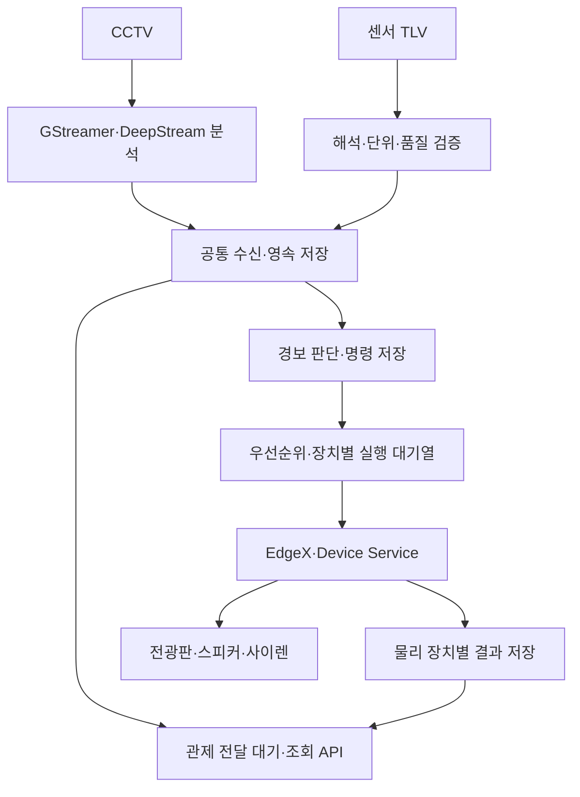

# CCTV·AIoT 모듈 안정화 개발 기준 및 SDLC

작성·갱신: 2026-10-02 KST · 계획 버전: 0.101

프로젝트 시작은 **2025년 11월 1주차**, 목표 종료는 **2026-12-31**이다.
영상·센서 입력부터 경보 출력과 관제 전달까지 모듈별로 정리하고, 현장팀과 POC 및
보완 검증을 마치는 것을 목표로 한다. 연말 완료는 목표이며 현재 성능 합격이나
확정 납기를 뜻하지 않는다. 사용자는 하루 순개발 **6시간 이상** 가능하다고 확인했다.
주당 일수·공휴일·현장팀 일정은 미확정이다. CCTV 1~2대, 온습도·기울기 센서,
전광판·스피커를 보유하며 사이렌은 없다. [현재 성과·이슈](STATUS.md)와
[실제 자원·POC 범위](POC_SCOPE.md)에 최신 확인을 기록한다.

v0.101: **실제 AI 후처리·버퍼 소유권5조건 확인, 종료 재진입 관측.** CPU 영상3565개 모두 독립 소유·인코더/디코더 중지20요청 반환, SIGTERM 이후2.18~14.65초 종료. flush 제외 대조에서 동일 스레드 stop() 중첩1건 확인·기존 native 멈춤과 인과 미확정. 제품206파일 불변·운영 정상, I40 OPEN·P5.1 IN_PROGRESS. [근거](evidence/buffer_ownership_20261002.json) · [분석](TRACKER_VALIDATION.md#buffer-ownership-v101).

v0.100: **실녹화·디코더·미리보기 종료6조건 확인.** 약89~90초씩 처리·인코딩15950개, 종료39~59ms·인코더/디코더 중지24요청 모두 반환. 미리보기 CPU 매핑5347개 확인. I40 원 실패는 미재현이며 해결 판정하지 않는다. 제품206파일 불변·운영 정상. [근거](evidence/encoder_decode_20261002.json) · [분석](TRACKER_VALIDATION.md#encoder-decode-v100).

v0.99: **Ponytail 검토·인코더 최소 재현6조건 확인.** 공통 생성/종료 함수와 기존 요청 계측을 재사용, 합성 입력·RTSP·단절·NVMM·mux6조건 종료21~35ms/중지 요청 모두 반환. 실제 AI 통합의90초 실패 조건과 달라 I40 해결 근거 아님. 진단 성공 판정에 실제 게시·단절 순서 확인 추가. 제품206파일 불변·운영 정상, I40 OPEN·P5.1 IN_PROGRESS. [근거](evidence/encoder_minimal_20261002.json) · [검토/시험](TRACKER_VALIDATION.md#encoder-minimal-v099).

v0.98: **종료 대기를 인코더 입력 STREAMOFF로 특정·flush 제외안 미채택.** 격리10회 중 정상 종료8회·30초 초과2회(서로 다른 조건, 실패율 아님). 실패 스택/동일 시점 주소와 SDK 바이너리 대조로 NvVideoEncAbortBuffer→NvOsSemaphoreWait 확인. 요청 계측에서도 인코더 입력 STREAMOFF만 반환되지 않음. 제품 소스·SDK·운영 변경 없음, I40 OPEN·P5.1 IN_PROGRESS. [실행 근거](evidence/native_shutdown_20261002.json) · [분석](TRACKER_VALIDATION.md#native-shutdown-v098).

v0.97: **첫 프레임 지연 구간 확인·새 후보 통합 검증, 종료 실패 잔여.** GPU OSD 첫 처리10.87초→CPU OSD17.64ms, 등록→CPU10.97→0.11초. 새 고정 후보 단절 복구8.16초·CPU1450개 정확 대응/누락0·TCN18회(유효17/Pose 부족1), 구성 회귀85 PASS. 추가 관찰 종료 실패2회(일반30초/진단60초 초과), 전체 NULL→NVIDIA 버퍼 풀/드라이버 대기 native 확보·I40 OPEN. 운영 미배포·P5.1 IN_PROGRESS. [실행 근거](evidence/startup_delay_20261002.json) · [분석](MODEL_INFERENCE_METRICS.md#startup-delay-v097).

v0.96: **매칭 누락 원인별 계측 구현·격리 검증.** 총계 유지·카메라별 최근256개 사유 기록, 실제 누락24건=무대상23+만료1로 프레임 기록/Prometheus 일치. 관련245 PASS/2 SKIP·전체2737 PASS/52 SKIP·Ruff PASS. 첫 프레임10.34초 중 메타 완료→미리보기 분기 전10.29초로 범위를 좁혔으며 원인은 미확정. 영상1333프레임/DB3개 검증·운영 미반영, I32/P5.1 진행 중. [실행 근거](evidence/match_metrics_20261002.json) · [분석](MODEL_INFERENCE_METRICS.md#match-reason-metrics-v096).

v0.95: **매칭 누락 사유 재현·배포 순서 조정.** 격리2회 정상 종료·영상3122프레임 디코드/DB3개ok. 두 번째 누락12건은 빈 사람 메타11·첫 프레임 만료1(도착7.95초)로 분류. 과거13건의 원인 확정은 아니며 I32/I38 OPEN. RF 재생성 설정2개를 현재 운영값에 맞춰 명시·서비스 재시작/제품 소스 변경 없음. 구성 회귀63 PASS·분류10조건 PASS, 기존 배포 구성 검사3실패/외형 모델 경로 불일치는 I46 OPEN. 별도 Jetson 시험은 기능 완성 후로 연기. [실행 근거](evidence/match_reason_20261002.json) · [분석](MODEL_INFERENCE_METRICS.md#match-reasons-v095).

v0.94: **운영 환경 복구·설치 검증 보완.** 호스트 누락2패키지 설치(I44 FIXED), 호스트/컨테이너 SDK·필수 플러그인 각6항목 PASS. X11 권한 복구와 동일 이미지 AI 재시작 후 프레임 진행 재개. 새 health는 첫 프레임 없음/30초 정지에503이며 운영 반영됨. X11 재시도·SDK 사전/사후 검사 서비스도 설치·reload 확인. 187초·7표본에서 처리 카운터6942→12535, 드롭/이벤트 실패0·video_ready=true. 재부팅·새 장비·장시간/다중 카메라 미검증, I43 VERIFY·P5.1 IN_PROGRESS 유지. [실행 근거](evidence/environment_20261002.json) · [설치·검증 절차](../guides/JETSON_EDGEX_FIELD_CHECKLIST.md#1-1-호스트와-컨테이너-의존성-준비). 최종 전체 회귀2717 PASS/52 SKIP/1 FAIL(DB 동시 쓰기 경합), 해당 단독 재시험1 PASS. 실패 경로4파일은 작업 전과 동일하나 원인 미확정으로 I45 OPEN을 등록했다.

v0.93: [복귀 매칭·TCN·CPU 대조](MODEL_INFERENCE_METRICS.md#rollback-match-timing-v093). 보존243표본 분석: 누락13건 중 TCN 시작/진행 구간5·반환 후8, CPU 제한 증가 없는 구간9. 후보/복귀 코드4파일 해시 일치. 개별 프레임 사유는 미확정·I32/I38 OPEN. 새 GPU 시험·제품 변경·운영 배포 없음.

v0.92: [I07 후보→이전 구성 전환](VIDEO_INFERENCE_CONTRACT.md#transition-rollback-v092). 동일 격리 DB에서 후보 실행·제거→이전 이미지 복귀. 후보 신규 이벤트31건/외형28건을 포함한705517행 보존·중복 재접수 시 행/내용 변경0. 복귀 후 이벤트32건/외형28건 추가·영상3009프레임 디코드. 후보/복귀 종료6.37/3.49초·복귀 매칭 누락13·TCN Pose 부족 잔여. 운영 미배포·I07 OPEN.

v0.91: [I07 복구본·이전 이미지 격리 기동](VIDEO_INFERENCE_CONTRACT.md#restore-bundle-v091). 49,917파일 해시 대조·설정12파일 암호화 복원·이전 이미지 내보내기/재적재. 기존705,398행 보존·대기32건/외형28건 추가·SIGTERM2.59초 종료. 첫 기동 timeout·TCN timeout1·매칭 누락17·최대 영상 간격1.936초는 잔여. 후보→이전 구성의 연속 전환은 후속·운영 미배포·I07 OPEN.

v0.90: [I07 후보 전체 기동·복구 의존성](VIDEO_INFERENCE_CONTRACT.md#profile-start-v090). 캐시 연결 디렉터리 누락 I42 수정·종료 유예60초 명시·46 PASS. 격리180초 입력/추론/송출·DB 저장, SIGINT25.12초/SIGTERM4.86초 정상 종료. 누적 이벤트82건 대기·외형73건/DB 무결성 정상. 외부 의존성 약7.69GB는 별도 복구본 준비 잔여·운영 미배포·I07 OPEN.

v0.89: [I07 후보 프로필·영속 저장 검사](VIDEO_INFERENCE_CONTRACT.md#candidate-profile-v089). 고정 이미지·읽기 전용 모델·영속 DB·필수 비밀값을 연결, 구성 회귀44 PASS. 격리 컨테이너 재생성 후 합성 대기2건 보존/중복 방지, 이미지359파일·모델8개 해시 일치. 전체 AI 통합 기동/이전 구성 복구는 후속이며 운영 미배포·I07 OPEN이다.

v0.88: [I07 구성 차이·DB 복구](VIDEO_INFERENCE_CONTRACT.md#rollback-preparation-v088). 재전송 DB 백업 누락 I41 보완·5 PASS, 실제 SQLite8개 복원·1717566행/스키마/상태 동일. 현재 디스크351파일·모델8개 보존, 비밀값/시작 당시 메모리·전체 구성 복구는 미검증. 다음은 운영용 후보의 영속 DB·비밀값·마운트 프로필 확인이며 AI 재배포 없음·I07 OPEN이다.

v0.87: [일반 실행 매칭·TCN 대조](MODEL_INFERENCE_METRICS.md#match-tcn-v087). 기준180초·단절/복구 시험 정상 종료, CPU 영상1497개 전부 등록 메타와 대응·후처리327/정상 제한1170. TCN18회 반환(유효17·Pose 부족1), timeout0·재연결8.23초. 과거 I32/I38 원인은 미확정·I34 OPEN·운영 미배포. 다음은 I07 고정 후보·이전 구성의 차이표와 격리 복구 준비다.

v0.86: [CUDA 할당 경계·수명 검사](TRACKER_VALIDATION.md#cuda-bounds-v086). padding32·비동기 할당 수명 검사를 추가해 원 보존본/고정 후보 각60프레임·정상 종료·메모리 오류0을 확인했다. 원 CUDA700은 미재현·I34 OPEN. 검사 중 TCN timeout과 매칭 누락은 별도 보존, 제품 코드·운영 배포 변경 없음. 다음은 일반 실행의 I32 매칭 사유·I38 상태 대조, 이후 I07 복구 준비다.

v0.85: [RTSP 종료 재활성화 수정·후보 이미지 검증](TRACKER_VALIDATION.md#rtsp-shutdown-fix-v085). 출력 bin이 종료 중 다시 열리는 결함 재현·상태 잠금 보완, 관련36 PASS. 공식 RTSP 보완을 포함한 조합5조건 종료1.62~5.27초·복구6.36초, 영상6파일 디코드/원본 DTS 정상. 후보 이미지 고정·I40 FIXED_LOCAL, I34 CUDA700/I32/I07 잔여·운영 미배포.

v0.84: [출력 장애 종료 대기 분리](TRACKER_VALIDATION.md#output-shutdown-v084). 진단 없는 정상 종료6.25초·출력 서버만 단절하면30초 초과 재현. RTSP caps 대기 native 스택 확보·공식1.20.2 패치 격리 빌드. 수정본 일반 실행의 전체 NULL 대기가 남아 I40 OPEN·배포 보류. CUDA700 해결 근거와 구분.

v0.83: [종료 시간 초과 재현·순서 보완](TRACKER_VALIDATION.md#shutdown-recovery-v083). 인코더 버퍼 풀 회수 대기 native 스택 확보·RTSP 출력 우선 종료로 최소 수정. 실제 후보 정상/입력 단절 종료7.23/2.49초·46 PASS. I40 추가 회귀·I34/I32/I07 잔여, 문제 해결·검증 전 배포 보류.

## 1. 매 작업을 시작할 때

1. 이 문서의 요구사항과 SDLC를 읽는다.
2. [진행 기록](PROGRESS.md)과 [기존 성과·이슈](STATUS.md)에서 현재 작업,
   결정 대기 사항, 완료 범위와 마지막 검증을 확인한다.
3. [WBS·일정](WBS.md)에서 선행 작업이 충족된 항목 **하나**를 선택한다.
4. 해당 모듈의 현재 코드·테스트·운영 반영 상태를 확인하고 작은 실행 범위를 정한다.
5. 완료·실패·차단·범위 변경이 생기면 같은 작업에서 WBS와 진행 기록을 갱신한다.
   새 이슈는 STATUS의 이슈 ID로 등록하고, 해결 시 검증 근거와 해결일을 남긴다.
   추가 문서화 요청을 기다리지 않는다. 새 대화에서도 같은 순서로 이어간다.

| 문서 | 한 곳에서 관리할 내용 |
|---|---|
| 이 문서 | 요구사항, 책임 경계, 완료 기준, 개발 절차 |
| [WBS.md](WBS.md) | 작업 ID·의존성·예상 공수·상태, 목표 일정 |
| [PROGRESS.md](PROGRESS.md) | 다음 행동, 실제 작업·검증 이력, 결정·위험·차단 사항 |
| [STATUS.md](STATUS.md) | 기존 성과·기준선·증거·미해결 이슈 대장 |
| [사내 진행판·갱신 방법](ONLINE_PROGRESS.md) | 브라우저 주소·전용 문서 서버·검증 범위·같은 주소로 갱신하는 절차 |
| [OBSERVATION_CONTRACT.md](OBSERVATION_CONTRACT.md) | 관측 ID·측정/수신 시각·단위·결측 규칙, 센서 구현과 영상 대응 범위 |
| [COMMON_DATA_CONTRACT.md](COMMON_DATA_CONTRACT.md) | 확정한 공통 필드·시간/ID·센서 단위 대응과 적용 범위 |
| [INGEST_FAILURE_CONTRACT.md](INGEST_FAILURE_CONTRACT.md) | 입력별 대응·접수/실패·재처리 계약, 결함 재현과 P1.1 완료 판정 |
| [ACTION_POLICY_CONTRACT.md](ACTION_POLICY_CONTRACT.md) | P1.3 DONE(계약): 위험 등급·장치별 경합·만료·중복·재실행·부분 결과. 현재 코드 차이 I23·후속 P3 인계 |
| [POSE_TRACK_ISOLATION.md](POSE_TRACK_ISOLATION.md) | I24 FIXED_LOCAL: 인물별 자세 입력·캐시·세대 분리, 신규 20개 포함 291 PASS/5 SKIP. 실영상 추적/운영 반영 잔여 |
| [MODEL_INFERENCE_METRICS.md](MODEL_INFERENCE_METRICS.md) | v0.73 동시 부하 근거 유지. 최신 v0.75 GPU/VIC 비교·종료 판정표는 VIDEO_INFERENCE_CONTRACT 참조 |
| [APPEARANCE_TRACK_ID.md](APPEARANCE_TRACK_ID.md) | v0.47: I31 FIXED_LOCAL, 67 PASS·실영상 기록/대형 ID 저장·조회 검증. 운영 미반영 |
| [TRACKER_VALIDATION.md](TRACKER_VALIDATION.md) | v0.66: GPU 버퍼/스트림 개선·인물별2Hz/미완료 중복 방지. I34 원인 미확정 |
| [VIDEO_INFERENCE_CONTRACT.md](VIDEO_INFERENCE_CONTRACT.md) | P5.1 진행: mux 좌표·ROI 경계 보정. 동일 토큰/크기와 실제 영상 내용 대응을 구분하며 I32 추가 확인·I07 OPEN |
| [STORAGE_DESIGN.md](STORAGE_DESIGN.md) | P1.2 DONE: 저장 책임·공통 조회·이행/복구 설계와 임시 DB 검증 |
| [SENSOR_RECOVERY.md](SENSOR_RECOVERY.md) | P2.1 DONE: 센서 영속 저장·중복 방지·재시작 복구 구현/시험, 운영 적용 준비 |
| [EVENT_PERSISTENCE.md](EVENT_PERSISTENCE.md) | P2.2 진행: 외부 MQTT 원본·이벤트·전달 대기 저장 1차 구현, 남은 영상/ACK/전달 복구 범위 |
| [MQTT_ACK_RECOVERY.md](MQTT_ACK_RECOVERY.md) | P2.2 외부 MQTT 수동 ACK·지속 세션·격리 브로커 재전송 검증, 직접 TLV의 별도 경계 |
| [TLV_MQTT_RECOVERY.md](TLV_MQTT_RECOVERY.md) | P2.2 직접 TLV 원본·수동 ACK·PG 복구 검증, 센서/영상/EdgeX 역할 구분 |
| [VIDEO_INGEST_RECOVERY.md](VIDEO_INGEST_RECOVERY.md) | P2.2 DeepStream/OpenCV 큐 전 원본 접수·오류 격리·실제 종료 후 저장 복구, 전달 worker 잔여 범위 |
| [RECORD_DELIVERY.md](RECORD_DELIVERY.md) | P2.2 기록 목적지별 worker·lease·PUBACK·재시도·실제 종료 복구, 관제/물리 출력과의 경계 |
| [TLV_RECORD_DELIVERY.md](TLV_RECORD_DELIVERY.md) | P2.2 DONE: 직접 TLV 공통 관측·기록 전달 연결, 490 PASS·종료 복구와 완료 판정/인계 |
| [MONITORING_DELIVERY_CONTRACT.md](MONITORING_DELIVERY_CONTRACT.md) | P1.4 DONE: 관제 저장 ACK·중복/충돌·고정 목록 대조·계측 내부 계약, 모형 55 PASS와 P2.3 인계 |
| [MONITORING_RECEIVER.md](MONITORING_RECEIVER.md) | P2.3 수신 실행 단위: 관제 DB·저장 ACK·재조회·종료 경계 검증 |
| [MONITORING_SENDER.md](MONITORING_SENDER.md) | P2.3 송신 실행 단위: v4 고정 bytes·ACK 영속화·조회/재전송·종료 복구 |
| [MONITORING_RECONCILIATION.md](MONITORING_RECONCILIATION.md) | P2.3 대조·계측 실행 단위: 고정 목록·ID/hash 대조·적체/구간 지연 |
| [MONITORING_SERVICE.md](MONITORING_SERVICE.md) | P2.3 DONE(내부 모형): 주기 실행·종료/재시작·실제 로컬 MQTT·commit/전체 지연, P2.4 인계 |
| [MONITORING_OUTAGE.md](MONITORING_OUTAGE.md) | P2.4 진행: DB 잠금 중 혼합 입력 누적·복구·ID/hash/ACK 대조, 송신 DB 경합과 용량 후속 검증 |
| [MONITORING_CONTENTION.md](MONITORING_CONTENTION.md) | P2.4 진행: 빈 관제 조회의 쓰기 잠금 제거, 입력별 실패 책임·197 PASS·I22 잔여 범위 |
| [MONITORING_REMOTE.md](MONITORING_REMOTE.md) | P2.4 진행: 실제 노트북 TLS 인증·수신기 중지/재기동 후 총 4건 저장 ACK 대조 완료, 용량·오래된 데이터 후속 |
| [MONITORING_CAPACITY.md](MONITORING_CAPACITY.md) | P2.4 용량 부족 실행 단위 완료: 격리 SQLite FULL·원본/대기 보존·ACK 복구, 신규 6개 포함 71 PASS |
| [MONITORING_FRESHNESS.md](MONITORING_FRESHNESS.md) | P2.4 내부 조회 단위 완료: 센서값 나이·지연 도착·판정 불가 표시, 신규 30개 포함 131 PASS |
| [VIDEO_INTAKE_CONTENTION.md](VIDEO_INTAKE_CONTENTION.md) | P2.4 영상 최초 저장 BUSY 1회 재시도·활성 혼합 쓰기 48건 대조, 신규 14개 포함 200 PASS·I22 운영 부하 잔여 |
| [MONITORING_BACKLOG_RESTART.md](MONITORING_BACKLOG_RESTART.md) | P2.4 혼합 300건 적체·두 차례 프로세스 종료 복구·DB 증가량, 신규 1개 포함 108 PASS·운영 검증 잔여 |
| [WINDOWS_MONITORING_POC.md](WINDOWS_MONITORING_POC.md) | Windows 11·32GB 노트북 임시 관제 서버: WSL2·네트워크 확인 이력·실행 패키지·잔여 시험 |
| [PERFORMANCE_DECISION.md](PERFORMANCE_DECISION.md) | 기존 Primary 성능 재계산·한계·전체 AI 검증 경로·장비 판단일 |
| [MULTICAMERA_ARCHITECTURE_REVIEW.md](MULTICAMERA_ARCHITECTURE_REVIEW.md) | 공유 GPT 답변 대조: 현재 pyds/SDK·입출력 격리·모델 성능 개선 후보와 채택 조건 |
| [POC_SCOPE.md](POC_SCOPE.md) | 확인된 장비·가용시간·단계별 시험·미확정 수치/협력 조건 |
| [Figma·시각화 보드](figma_exports/README.md) | 온라인 간트 차트, 로드맵·WBS·모듈 흐름/SDLC의 SVG·PNG 스냅샷 |
| [Archify 구조 보기](../architecture/archify/index.html) · [근거/사용법](../architecture/archify/README.md) | 09-22 기존 장치 제어·선택 공통 저장 데이터 흐름·관제 저장 ACK 시퀀스, 독립 HTML 3종 |

[사내 온라인 진행판](http://192.168.2.141:18081/)에서 현재 상태·전체 WBS·최근 검증·대기 이슈를 본다.
사용자는 09-22 같은 회사 네트워크에서 브라우저로 열람하는 방식을 선택했다.
세부 작업 상태는 WBS가 원본이다. 매 작업 종료 시 원본과 게시본을 함께 갱신하고
HTTP 재조회로 확인한다. 실시간 자동 동기화는 아니며 [갱신 절차](ONLINE_PROGRESS.md)를 따른다.
FigJam은 제목만 추가된 뒤 호출 한도에 막혀 최신 진행판으로 완성하지 못했고,
Google Drive PDF 업로드는 저장 공간 초과로 거부됐다. 이전 보드를 최신 완료 상태로 해석하지 않는다.

기존 [계획](../../tasks/plan.md), [작업 기록](../../tasks/todo.md), 모델·EdgeX 보고서는
과거 근거로 보존한다. 과거 체크박스를 새 WBS의 완료로 자동 이관하지 않는다.
상태 충돌은 관측 시각·실행 버전·검증 범위를 대조한 뒤 정리한다.

## 2. 요구사항 기준선

| ID | 요구사항 | 합격을 판단할 근거 |
|---|---|---|
| R01 | CCTV와 온습도·기울기 센서를 입력으로 받는다. 센서 개발은 타 부서 담당, TLV 수신·연동은 본 프로젝트 범위다. | 실제 패킷·녹화물·실장비 입력 대조, 단절·잘못된 입력 시험 |
| R02 | 전광판·스피커·사이렌은 EdgeX를 통해 제어하고 장치 상태와 명령 결과를 확인한다. | 물리 장치별 대상·요청·응답·실제 출력 증거 |
| R03 | 수신 데이터와 이벤트를 영속 저장하고 실패 후 복구한다. | 합의한 저장용량·장애시간 내 접수 ID 대조, 재시작·DB 실패 복구 |
| R04 | 중요도가 낮은 데이터도 관제에 전달하며, 장치 지연이 관제 전달을 막지 않는다. | 관제 수신·표시 시각, 누락·중복·재전송 및 장애 격리 결과 |
| R05 | 다중 경보는 장치·구역별 우선순위로 처리한다. | 동순위 순서, 선점 가능 여부, 대기·만료·중복·장기 대기 처리 |
| R06 | 장치가 달라도 ID·시각·관측값·이벤트·명령·결과의 공통 규칙을 사용한다. | 데이터 형식 버전, DB 소유권·관계, 기존 데이터 호환 검증 |
| R07 | GStreamer·DeepStream에서 낙상·헬멧·의상·색상 모델을 기능별로 검증한다. | 모델별 고정 평가셋, 정확도·추론 완료·지연·메모리 증거 |
| R08 | 향후 싸움·폭행 등 동작 분류를 추가할 수 있는 입력·출력 경계를 확보한다. | 카메라·인물·시각·영상 구간 계약과 모형 결과 연동 시험 |
| R09 | 기존 목표인 최대 4카메라, 카메라별 운영 AI 매 프레임 30FPS를 유지한다. | 전체 운영 모델·후처리를 포함한 카메라별 완료율과 지연, 실물 4대 검증 |
| R10 | 데이터 흐름의 지연·적체·누락·오류 및 장비 상태를 구분해 관측한다. | 단계별 지연 분포, 대기열 길이·최고 대기시간, 오래된 센서값·연결 끊김 표시 |
| R11 | 현장 POC에서 탐지·입출력·오작동·관제 전달을 검증하고 발견 결함을 보완한다. | 현장팀 확인이 있는 시험표·증거·결함 처리·재시험 |
| R12 | 한 번에 모듈 하나를 작은 변경으로 정리하고 추적 가능한 상태로 종료한다. | WBS와 요구사항·변경 파일·테스트·운영 반영·증거의 연결 |

R09의 근거는 [다중 카메라 인수 기준](../testing/MULTICAMERA_30FPS_ACCEPTANCE.md)이다.
1080p 우선, 필요 시 허용된 720p 조건을 비교한다. 추론 프레임 생략·Primary-only
결과·합산 FPS로 목표를 달성했다고 표시하지 않는다. 실물 1대, 독립 재생 2/4채널,
실물 4대는 별도 검증이며 모델 추가·해상도 변경 후 품질도 다시 확인한다.

싸움·폭행 모델의 데이터 수집·신규 학습·상용 검증은 이번 필수 범위에 포함하지
않는다. 확장 계약만 준비한다. 추가 학습이나 하드웨어·분산 구성 변경이 필요하면
근거와 공수·일정 영향을 기록한 뒤 별도 작업으로 편성한다.

## 3. 책임 경계와 데이터 흐름

| 경계 | 맡는 일 | 다음 모듈에 제공할 것 |
|---|---|---|
| 영상 입력·추론 | 영상 수신, 모델 전처리·추론·후처리 | 카메라·인물·실제 시각·모델 버전을 포함한 분석 결과 |
| TLV 입력 | 패킷 해석, 장치 식별, 단위·배율·품질 검증 | 측정값과 원본 참조, 해석 실패 사유 |
| 공통 저장 | 관측값·이벤트·전달 대기의 확정과 조회 | 영속 접수 결과, 재전송 가능한 기록 |
| 경보 정책 | 임계값, 사건 묶음, 우선순위, 대상 장치 결정 | 식별자가 있는 명령과 실행·보류·만료 이유 |
| 장치 실행 | 장치별 대기·시간 제한·재시도·EdgeX 전달 | 접수·실행·응답·실행 불명 등을 구분한 결과 |
| 관제 전달 | 전달 재시도, 이력·현재 상태 조회, 화면 반영 | 누락 대조가 가능한 수신 확인과 관제 표시 |

이 표는 코드 책임 경계다. 모듈마다 새 프로세스·컨테이너를 만드는 계획이 아니다.
기존 서비스와 파일 구조를 활용하며 각 기능은 작은 경로를 연결해 검증한다.
AI가 장치를 직접 호출하거나 모델별로 별도 관제 저장 규칙을 만들지 않는다.

## 4. 먼저 합의할 공통 규칙

- **관측과 경보:** 정상 온도나 의상 색상은 관측값이다. 임계값 초과·낙상 판정과
  같은 경보 이벤트와 구분하되 필요한 관측 기록도 관제에 전달한다.
- **식별자·시간:** 현장·구역·장치·관측·이벤트 ID, 발생·수신 시각, 형식 버전을
  공통화한다. [명령 ID 계약](../architecture/COMMAND_CORRELATION_CONTRACT.md)의
  `event_id → command_id → request_id` 관계를 재사용한다. 논리 명령과 물리
  장치 요청을 구분하고 재시도 ID·중복 판단 범위를 명시한다.
- **저장:** 장치, 관측값, 이벤트, 명령, 장치별 결과, 전달 대기는 논리적으로
  구분한다. 기존 DB와 테이블을 먼저 조사하고 공통 조회 모델·쓰기 주체를 정한다.
  EdgeX 내부 DB와 앱 DB를 바로 합치거나 기존 센서 테이블을 일괄 교체하지 않는다.
- **유실·복구:** 가능한 동일 저장소의 트랜잭션에서 데이터와 전달 대기를 함께
  확정한다. 수신 ACK·영속 접수 경계를 정하고, DB 실패를 성공으로 응답하지 않는다.
  저장용량·장애시간 범위, 디스크 부족 처리, 보관·삭제 정책을 함께 정한다.
- **우선순위:** 물리 장치·구역 단위로 경합을 조정한다. 동순위 FIFO, 반복 사건
  묶음, 최대 대기시간, 유효시간, 만료 기록을 정한다. 선점은 장치의 중단·교체
  기능을 확인한 뒤 적용한다. 후순위 기록 보존과 경보 재생 의무를 구분한다.
- **명령 결과:** 발행 성공·장치 응답·실제 출력 확인을 구분한다. 한 장치의 실패를
  다른 장치의 성공으로 덮지 않는다. 응답 유실은 실행 불명으로 남길 수 있어야 하며
  물리 장치의 기능 확인 없이 무조건 재전송하거나 정확히 1회 작동을 보장하지 않는다.
- **모델:** 전처리·입력 크기·시간창·인물/카메라 ID·품질 부족·출력·버전을 정한다.
  의상/색상과 사건 검출의 평가 기준을 구분한다. 영상은 파일 참조로 연결하고 DB에
  모든 프레임을 저장하지 않는다. 영상 보관량·개인정보 접근은 기존 운영 정책과 맞춘다.

미확정 수치와 담당자는 [결정 대기 목록](PROGRESS.md#결정-대기-목록)에서 관리한다.
기술 계약 변경은 기존 소비자·데이터 이행·복구 영향까지 검토한다.

## 5. 작업 하나에 적용하는 SDLC

| 단계 | 할 일 | 다음 단계로 넘어갈 조건 |
|---|---|---|
| 요구 확인 | WBS ID와 R-ID 연결, 정상·실패 사례와 완료 기준 최대 3개 작성 | 범위·의존성·측정 조건이 명확함 |
| 분석·설계 | 그래프로 현재 경로 확인, 입력·출력·상태·실패·복구와 변경 파일 정리 | 기존 계약과 영향 범위 확인; 미확정 사항은 해당 구현 전에 결정 |
| 구현 | 대체로 3~5개 파일 이내의 작은 변경, 기존 코드·증거 보존 | 정한 동작이 구현되고 관계없는 기능 변경이 섞이지 않음 |
| 검증 | 필요한 회귀 테스트, 실패·중복·복구 시험, 해당 모듈과 인접 모듈 연결 시험 | 명령·결과·환경·판정 근거가 기록됨 |
| 적용·POC | 배포·실장비 시험 범위와 복구 방법 확인, 승인 범위 내 실행 | 운영/실장비 적용이 필요한 항목은 그 범위의 증거 확보 |
| 종료·유지 | 상태·작업 이력·미해결 문제·다음 작업 갱신, 검토 가능한 변경 묶음 보존 | 완료 기준 충족, 증거 링크와 운영 반영 여부가 분명함 |

WBS는 작업 묶음이다. 하루를 넘는 항목은 진행 기록의 실행 카드에서 반나절 정도의
검증 가능한 단위로 나눈다. 분석→구현→연동을 프로젝트 끝까지 따로 미루지 않는다.
동시에 `IN_PROGRESS`인 작업은 기본 1개다. 외부 의존으로 막히면 `BLOCKED`와
해제 조건을 남기고, 선행 조건을 만족한 독립 작업 하나를 선택한다.

코드·DB·API·배포 설정의 변경 영향은 구현 전에 설명한다. 이미 허용된 범위의
읽기·검증·수정은 반복 승인 없이 진행한다. 이 개발 계획 자체는 운영 중지,
GPU 부하 시험, 물리 장치 작동, 모델 교체나 데이터 삭제에 대한 포괄 승인이 아니다.
WBS 상태와 Git 커밋 여부는 구분하며, 이미 쌓인 변경 전체를 함께 커밋하지 않는다.

## 6. 모듈 완료와 현장 POC 기준

**모듈 완료:** 정한 입력·출력, 정상·실패·중복·복구 중 해당 조건, 인접 모듈 연결을
검증하고 증거를 남긴다. 코드만 수정한 경우 운영 반영 완료로 표시하지 않는다.
단순 문서 변경은 링크·일정·ID·내용 일관성 검증으로 충분하며 장비 테스트를 요구하지 않는다.

**현장 POC 진입:** 사용할 입력·모델·출력 장비·부하와 수치 기준이 고정되고,
저장·관제 전달·우선순위·장치 격리의 사전 시험, 모델별 기본 평가, 복구 절차,
현장 장비 연결·시험 시나리오가 준비돼야 한다. 미검증 기능은 목록에 명시한다.

**POC 최종 완료:** 합의된 정상·동시 이벤트·장애·오작동 시험, 물리 출력과 관제 확인,
모델별 품질 및 성능 증거, 중요한 결함의 수정·재시험, 현장팀 확인까지 완료한다.
기록 유실, 의도하지 않은 장치 작동, 중복 출력, 잘못된 성공 표시는 완료 전에 해결한다.
관찰 목적으로 1카메라 POC를 먼저 할 수 있으나 R09의 4카메라 목표 완료와 구분한다.
범위 축소·목표 변경은 사용자가 명시적으로 결정하고 변경 이력에 남긴다.

| 측정 대상 | 기록할 기준 |
|---|---|
| 데이터 보존 | 정해진 장애·저장용량 조건에서 영속 접수 ID와 DB·관제 ID 대조, 누락 0건 |
| 명령 정확성 | 장치별 대상·내용·중복·시간 초과·실행 불명·실제 출력의 일치 |
| 지연 | 수신→저장, 판단→명령 응답, 수신→관제 표시의 p95·최대값과 합의 상한 |
| 모델 | 기능별 평가셋, precision/recall 또는 분류 지표, 오경보·탐지 지연·품질 부족률 |
| 처리량·안정성 | 카메라별 전체 AI 완료 FPS, 대기열 길이·최고 대기시간, 메모리·디스크 추이 |
| 복구 | 입력 단절, DB/관제 불통, 장치 장애, 프로세스 재시작 후 복구·잔여 데이터 대조 |

## 7. 근거와 현재 한계

- [2026-09-17 코드 감사](../reports/PROJECT_CODE_AUDIT_20260917.md): 저장·제어·상태 위험과 과거 검증 기록.
- [모델 감사](../reports/TRAINED_MODEL_AUDIT_20260917.md): 기존 평가의 범위와 모델별 한계.
- [전광판 UAT](../handover/EDGEX_SIGNBOARD_UAT_20260917.md): 로그·DB 기준 성공이며 현장 육안 증거는 별도.
- [최종 Pose 성능 진단](../testing/JETSON_POSE_DISPATCH_AND_COLOAD_20260917.md): 공유 부하 변동, 전체 4채널 30FPS 미검증.
- [센서 입력](../../parser-python/service/sensor_service.py), [센서 저장](../../parser-python/database/processor.py),
  [공통 이벤트](../../src/canonical_event.py), [장치 실행](../../src/services/_action_bridge_executor.py).

이 문서 작성 시 검토한 것은 기존 코드·기록이다. 과거 테스트 통과나 장치 health를
현재 전체 흐름 합격으로 사용하지 않는다. 초기 작업에서 실제 실행 버전과 증거를 갱신한다.
