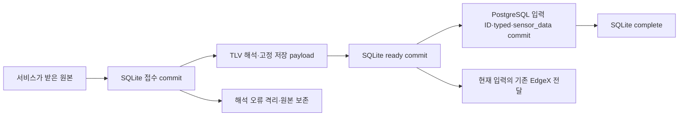

진# P2.1 — 센서 저장 실패·재시작 복구

2026-09-18 · **DONE: 로컬 구현·격리 PostgreSQL 시험 / 운영 미적용**

## 1. 구현 결과

센서 서비스가 받은 입력을 TLV 해석 전에 SQLite에 commit하고, 같은 입력의 센서 종류별
행과 `sensor_data` 행을 PostgreSQL의 처리 ID 장부와 한 번에 commit한다. SQLite 완료 표시
전에 종료되더라도 같은 ingest_id로 재시도해 PostgreSQL 행이 중복되지 않는다.

| 파일 | 책임 |
|---|---|
| [공통 접수 저장소](../../src/ingest_store.py) | 원본·ingest_id·수신 시각·hash·센서 처리 상태 보존. 잠금/저장 실패를 호출자에게 전달 |
| [PostgreSQL 저장기](../../parser-python/database/sensor_projection.py) | 입력별 typed 행+sensor_data+처리 ID를 한 transaction으로 저장. 같은 ID/다른 본문 충돌 차단 |
| [복구 worker](../../parser-python/database/sensor_projection_worker.py) | 미처리 입력 재개, DB 실패 재시도, 잘못된 행/ID 충돌 격리, 다른 입력 처리 계속 |
| [센서 서비스](../../parser-python/service/sensor_service.py) | 접수→해석→영속 저장 작업 준비→기존 실시간 전달. 복구에서는 외부 전달/알림 생략 |
| [실행 진입점](../../parser-python/main.py)·[Dockerfile](../../Dockerfile) | 설정 시 새 저장 경로 선택, PostgreSQL 장부 추가, parser 이미지에 공통 모듈 포함 |

`AIOT_INGEST_DB`를 지정하면 새 경로를 선택하고 기존 메모리 DataProcessor를 생성하지 않는다.
미설정이면 기존 경로다. 양쪽 writer를 동시에 쓰지 않는다. 기존 DB 컬럼·외부 payload·업무 ID를
재작성하지 않으며 새 라이브러리는 추가하지 않았다.

## 2. 저장·실패 경계



- **접수 경계는 SensorService 호출 시점**이다. 원본은 app_id/dev_eui/base64 payload/channel/
  frequency/게이트웨이 received_at/uplink_metadata를 포함한 envelope다. MQTT 외부 JSON 해석
  이전의 원본 bytes·브로커 ACK까지 이번에 연결한 것은 아니다. SQLite commit 실패는 서비스에서
  예외가 나지만 MQTT 상위 callback의 ACK/재전송 보장은 P2.2에서 별도 수정·검증한다.
- 접수 UUID는 수신마다 생성한다. 이미 저장된 입력을 복구할 때는 같은 ID를 유지한다.
  생산자 고유 ID가 확인되지 않은 동일 측정값 두 건을 자동 중복으로 삭제하지 않는다.
- SQLite schema version은 `PRAGMA user_version=1`이다. `ingest_receipts`와
  `sensor_ingest_state`를 추가하며 기존 비어 있지 않은 미버전 DB 또는 미지원 버전은 거부한다.
  DELETE/EXTRA·foreign_keys·0.25초 busy timeout을 사용하고 실패를 성공으로 바꾸지 않는다.
- 센서 상태는 pending→ready→complete 또는 quarantined다. ready의 저장 payload는 최초
  확정 이후 교체하지 않는다. base64/TLV 오류·비유한 수치·DB 데이터 제약 오류·ID 충돌은
  원본과 오류를 남긴다. 자동 삭제하지 않는다. worker는 `tlv_mqtt` 출처만 소비한다.
- PostgreSQL `sensor_projection_receipts`의 PK는 `(ingest_id, projection_version)`이며 현재
  버전은 `sensor-v1`이다. 같은 ID의 다른 payload hash는 충돌로 격리한다. 재시도는 같은
  payload를 사용한다. 저장 중간 오류는 관련 행과 장부 모두 rollback된다.
- DB 일시 장애는 SQLite에 실패 횟수를 기록하고 1~60초 간격으로 재시도한다. 한 회차 최대
  100건을 처리하며 한 오류가 뒤 입력을 막지 않는다. PostgreSQL 저장 transaction에 lock
  timeout 2초·statement timeout 5초를 둔다. 이 숫자는 내부 제한이며 현장 지연 합격 기준이 아니다.
- 복구 worker는 과거 EdgeX 발행·사용자 알림을 재실행하지 않는다. 실시간 전달 실패 후 재발행과
  관제 전달 대기의 원자성은 P2.2의 범위다. 이번 코드로 출력의 종단 무손실을 주장하지 않는다.

P1.2의 [전체 저장 설계](STORAGE_DESIGN.md)는 유지한다. 이번에는 센서 저장 복구에 필요한
원본과 작업 상태만 구현했다. 공통 canonical/revision/delivery_jobs는 P2.2에서 추가 이행한다.
설계 SQL 모형을 이 구현 DB에 그대로 실행하지 않는다.

## 3. 검증과 완료 판정

[시험 원자료](evidence/sensor_durable_recovery_20260918.xml): **57 PASS, 58.51초**.
시간은 이번 회귀 실행 시간이며 처리량/성능 측정값이 아니다.
[검증 요약·소스 해시](evidence/sensor_durable_validation_20260918.json)에 시험 환경·종료 경계·
문서/WBS 정합성·미검증 범위를 함께 기록했다.

| 완료 기준 | 검증한 내용 | 판정 |
|---|---|---|
| 저장 실패 시 배치 보존 | 원본/작업 재연결, 접수 transaction 실패 rollback, PostgreSQL 장애 후 재시도, 오류 행 보존·후속 입력 처리 | 충족 |
| 재시작·재시도 후 ID 대조 | 실제 자식 프로세스를 접수/작업 준비/PG commit 직전/직후 `os._exit(42)`로 종료 후 복구. 원래 ID와 각 테이블 1건 대조 | 충족 |
| 중복 저장 방지 | 동시 재시도, commit 성공 후 응답 유실, 같은 ID/다른 본문 충돌, 서로 다른 입력의 동일 측정값 보존 | 충족 |

환경: 호스트 가상환경 Python 3.10, 임시 SQLite, 로컬 `postgres:16-alpine` 컨테이너.
컨테이너는 network none·호스트 포트 없음·256MiB/1CPU 제한·일회용 DB이며 운영 DB와 분리했다.
시험마다 별도 PostgreSQL schema를 생성/제거했다. 테스트 자식 프로세스만 강제 종료했다.
실제 서버 전원 단절·운영 프로세스 재시작·장비 출력·관제·부하 시험은 수행하지 않았다.

시험 구성: 공통 접수 9개, 센서 저장/서비스/복구 19개, 기존 배치 6개, TLV 16개,
MQTT 2개, EdgeX 계약 2개, Dockerfile 소스 검사 3개. Ruff 7파일·새 Python 5파일 Black·
앱 5파일 py_compile PASS. 기존 대형 파일의 무관한 포맷 변경은 하지 않았다.
parser 이미지 전체 build/redeploy는 하지 않았고 Dockerfile 검사와 Python import/컴파일을 검증했다.

```bash
# CCTV_TEST_PG_DSN은 폐기 가능한 시험 전용 PostgreSQL로만 지정한다.
rtk proxy .venv/bin/python -m pytest tests/test_ingest_store.py parser-python/tests/test_sensor_projection.py parser-python/tests/test_data_processor.py parser-python/tests/test_tlv_parser.py parser-python/tests/test_mqtt_dcalpwan.py parser-python/tests/test_edgex_forwarder_contract.py tests/test_check_dockerfile_sources.py -q
```

`CCTV_TEST_PG_DSN`이 없으면 PostgreSQL 의존 시험은 SKIP된다. SKIP 실행을 위의 57 PASS
대신 사용하지 않는다. 시험 계정에 schema 생성/제거 권한이 필요하므로 운영 DSN을 넣지 않는다.

## 4. 적용 전 준비·복구

1. parser 이미지에 공통 모듈이 포함됐는지 build/import를 확인하고 실제 SQLite 버전을 기록한다.
   계획한 공유 파일의 mount·그룹 권한·디스크 여유·백업을 준비한다. 새 파일 경로를 사용한다.
2. 운영 적용 시 `AIOT_INGEST_DB`를 parser 컨테이너에 명시적으로 전달한다. 예를 들어 공통
   디렉터리를 `/app/data`에 mount했다면 `/app/data/runtime/common_events.db`를 지정한다.
   지금 Compose에는 이 설정/mount를 추가하지 않았다. `.env` 값만 적으면 전달된다고 가정하지 않는다.
3. 기존 입력 유입과 메모리 큐 배수 범위를 정한다. 기존 worker 종료는 큐 자동 영속화를 보장하지
   않으므로 배수 확인 없이 재시작하지 않는다. 새 기능 활성화 시 PostgreSQL 처리 장부는 추가
   생성되지만 기존 행을 이행/삭제하지 않는다. 과거 데이터 backfill은 이번 범위가 아니다.
4. 단일 서비스 적용 후 새 ingest_id와 PostgreSQL 장부/두 행을 대조한다. 초기 수신/재시작 시험은
   [실장비 적용 순서](POC_SCOPE.md#31-모듈별-실장비-적용-시점)를 따른다.
5. 되돌릴 때는 입력 유입을 제어하고 새 worker를 멈춘 뒤 SQLite 원본/미완료 상태와 PostgreSQL
   장부를 보존한다. 단순히 flag를 끄면 새 backlog를 기존 worker가 소비하지 못한다. 수정 버전으로
   같은 파일에서 재개하거나 별도 이행 절차를 수행한다. 테이블/file 삭제로 복구하지 않는다.

I01은 **새 경로의 로컬 구현 해결**이며 운영 반영은 남는다. I12는 직접 TLV 오류 보관 일부가
추가됐지만 영상·MQTT 외부 JSON/ACK 경계는 여전히 남는다. I14의 기존 숫자/결측 변환,
I15의 온습도 EdgeX 매핑, 장기 장애 용량/지연은 해당 후속 WBS에서 다룬다.

**다음 작업은 P2.2: 공통 이벤트·전달 대기 영속화다.** 새 접수 저장소를 영상/외부 MQTT에
연결하고 이벤트와 전달 작업을 같은 transaction으로 확정하며, 접수 실패 시 MQTT ACK 경계를 검증한다.
