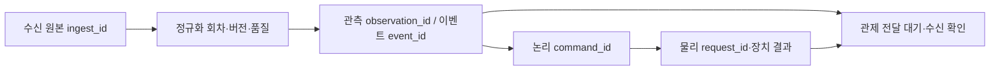

# P1.2 — 저장 책임·공통 조회·이행 설계

2026-09-18 · **DONE / 내부 저장 설계 1.0** · R03,R06

[확정된 입력/실패 계약](INGEST_FAILURE_CONTRACT.md)을 실제 저장 구조로 옮기는 작업이다.
쓰기 책임·접수 경계·중복/충돌·조회·이행/복구를 확정하고 임시 SQLite로 주요 관계를
검증했다. 설계 완료이며 운영 DB·테이블·API에 적용한 상태는 아니다. 구현은 P2에서 진행한다.

후속 구현: [P2.1 센서 복구](SENSOR_RECOVERY.md)는 로컬 DONE,
[P2.2 직접 TLV 연결·완료 판정](TLV_RECORD_DELIVERY.md)까지 09-21 로컬 검증을 마쳤다. 아래 표의 기존 writer
조사와 설계 목표를 현재 선택 경로의 구현/배포 완료로 혼동하지 않는다.

09-21 후속 [P1.4 관제 계약](MONITORING_DELIVERY_CONTRACT.md)에서 broker/관제 저장 ACK,
origin/consumer 범위, 고정 목록 기반 누락 대조를 구체화했다. 아래 수신 시각 cursor는
일반 이력 조회 기준이며 늦게 정규화된 과거 접수의 누락 검사는 별도 snapshot으로 수행한다.

## 1. 현재 저장소와 쓰기 주체

아래는 **코드의 책임**이다. Compose 파일에 선언된 경로도 대조했다. 실제 mount·권한·
컨테이너 내 라이브러리 버전은 적용 직전 확인하며, 선언을 현재 실행 상태로 단정하지 않는다.

| 데이터 | 쓰기 주체·확인 소스 | 저장/식별 방식 | 공통화 전에 해결할 점 |
|---|---|---|---|
| 센서 종류별 값·해석 원본 | [DataProcessor](../../parser-python/database/processor.py)→[bulk_insert](../../parser-python/database/connection.py) | PostgreSQL t34954/55/57 등 + sensor_data, 테이블별 commit | 하나의 입력에서 생긴 행 연결·부분 성공·재시작/중복. 큐 제거 후 DB 실패 I01 |
| 외부 수신 원본·정규화·격리 | [IngestEventRepository](../../src/services/external_ingest.py) | SQLite ingest_events, event_id unique, INSERT OR IGNORE | 업무 ID와 접수 ID 분리·충돌 원본 보존; 정상 발행→저장 순서 I13 |
| 경보 처리 이력·논리 명령 | [_EventRepo](../../src/services/_action_bridge_repo.py) | SQLite action_events(event_id unique), action_commands(command_id PK), 각각 commit | 입력 원본 저장소와 구분. save/record_command의 DB 오류가 로그로 끝남 I18 |
| HTTP 전달 대기 | [HttpEventOutbox](../../src/protocols/http_outbox.py) | SQLite http_event_outbox, unique(event_id,target_name,target_url) | 정상 이벤트 접수와 별도 commit. 재시도/중복·원본과 상태 연결 확인 |
| MQTT 전달 대기 | [MqttEventOutbox](../../src/protocols/mqtt_outbox.py) | SQLite mqtt_event_outbox, unique(event_id,destination_name) | 큐/정규화 이전 오류까지 보존하는 수신 저장소가 아님; 적용 호출 경로 조사 |
| 센서 EdgeX 전달 대기 | [EdgeXOutbox](../../parser-python/database/edgex_outbox.py) | SQLite event_outbox, unique(event_id,destination_name) | PostgreSQL 센서 commit과 별도. event_id 없는 이전 행·TTL/재시도 종료·재접수 이행 |
| 물리 장치 결과 | [CommandResultStore](../../src/edgex/command_result_collector.py) | SQLite command_results(request_id PK), UPSERT | event/command/request/device 관계 유지. 응답 이력과 현재 상태를 공통 조회에서 구분 |

센서 bulk_insert는 `ON CONFLICT DO NOTHING`을 쓰지만 그것만으로 재수신 중복 제거를
보장하지 않는다. 실제 고유 제약과 stable ID가 있어야 한다. SQLite outbox의 존재도
입력/정규화 전에 탈락한 원본 보존을 대신하지 않는다. 모듈 사이 별도 commit을
하나의 트랜잭션으로 취급하지 않는다.

## 2. 설계에서 유지할 논리 관계

이 그림은 목표 관계다. 입력의 정상/오류 원본과
관측값, 물리 경보 실행 이력을 분리한다. 같은 DB를 사용하더라도 쓰기 책임은 모듈별로
명확히 하며 EdgeX 내부 저장소를 앱의 접수 원본 저장소로 바꾸지 않는다.

공통 조회는 장치 종류에 따라 다른 열 이름을 사용자가 외우지 않도록 장치 ID,
관측/이벤트 ID, 측정·처리·수신 시각과 품질, 전달/출력 상태를 연결해야 한다.
모든 입력을 경보로 분류하거나 장치 성공 상태로 데이터 저장 성공을 대신하지 않는다.
관제 미선정 동안 내부 조회 계약을 준비하고 실제 제품의 ACK/표시는 P1.4/P2.3에서 검증한다.

## 3. 저장소와 쓰기 책임 결정

**같은 장비의 공통 SQLite 파일 하나를 접수 원본·정규화·전달 대기의 기준 저장소로 둔다.**
센서 PostgreSQL은 종류별 조회 데이터를 받는 후속 저장소로 유지한다. 영상 프레임/클립
전체를 이 DB에 넣지 않고 관측·이벤트와 필요한 원본 메시지만 기록한다.
신규 DB 제품·라이브러리·독립 서비스는 추가하지 않는다. Python 표준 `sqlite3`을 이용한
작은 공통 저장 모듈을 각 입력 서비스가 사용한다. 대형 서비스 클래스 간 직접 의존을 추가하지 않는다.

| 위치/소유자 | 책임과 적용 경계 |
|---|---|
| 계획 경로 `./data/runtime/common_events.db` | AI/외부 MQTT/파서가 같은 로컬 파일을 사용. 환경 설정으로 경로 주입; 다른 장비와 파일 공유하지 않음 |
| 입력 어댑터 | 원본을 파싱/휘발성 큐 투입 전에 접수. 자신의 namespace와 원본만 쓰며 다른 입력의 값을 보정하지 않음 |
| 공통 repository | ID·제약·짧은 트랜잭션·명시적 성공/예외·정규화/전달 작업의 원자성 담당. DB 실패를 로그만 남기고 성공 반환하지 않음 |
| 정규화 worker | 접수됐으나 처리 회차가 없는 입력 재개. 계약/변환기 버전과 오류 기록. 네트워크 호출은 트랜잭션 밖에서 수행 |
| 전달 worker | 목적지별 독립 상태·시도·lease 관리. 만료 lease 재취득, 같은 업무 ID로 재전송. 응답 유실은 결과 미확정으로 표시 |
| PostgreSQL projection worker | 영속 전달 작업을 읽고 기존 센서 테이블에 반영. 실패가 원본 제거/관제 중단으로 이어지지 않도록 분리 |
| Action / 장치 결과 저장소 | 기존 event_id→command_id→request_id 관계 유지. 물리 출력의 성공과 데이터 저장/전달 성공을 구분 |

Compose 선언상 AI/Action/API는 `./data:/app/data`, 파서는 `aiot-parser-data:/data`,
PostgreSQL은 `aiot-db-data:/var/lib/postgresql/data`를 사용한다. 파서의 기존 EdgeX outbox는
`/data/runtime/event_outbox.db`다. 따라서 새 공통 파일은 **파서에 별도 공유 디렉터리 mount와
그룹 쓰기 권한**이 필요하다. 기존 volume을 공통 경로로 바꿔 덮지 않는다.
루트 Dockerfile의 parser target은 `parser-python/`만 복사하므로 공통 모듈 COPY도 필요하다.
이들은 P2 구현 후 적용 준비 변경이며 이번에는 Compose/Dockerfile/실행 서비스를 수정하지 않았다.

### SQLite 접속·내구성 기준

- 현재 호스트 가상환경은 SQLite **3.37.2**다. 초기 구현 기준은 `journal_mode=DELETE`,
  `synchronous=EXTRA`, 연결마다 `foreign_keys=ON`, 제한된 busy timeout이다.
  DELETE 모드의 EXTRA는 commit 직후 전원 단절에 대비해 저널 디렉터리 동기화를 추가한다.
  실제 디스크/파일시스템의 동기화 동작은 별도 검증한다. [SQLite 공식 설명](https://www.sqlite.org/pragma.html#pragma_synchronous).
- WAL은 성능 시험 후 선택한다. 공식 문서의 WAL-reset 결함 수정 버전인 3.51.3 이상 또는
  수정이 포함된 3.44.6/3.50.7 계열·배포판 패치 증거를 **모든 writer에서** 확인해야 한다.
  현재 호스트 버전 문자열만으로 수정 여부를 확정할 수 없어 새 공유 저장소에 WAL을 전제하지 않는다.
  기존 DB의 모드를 일괄 변경하지 않는다. [SQLite WAL-reset 설명](https://www.sqlite.org/wal.html).
- 잠금 대기에도 상한을 두고 실패를 접수 성공으로 처리하지 않는다. 긴 조회·무제한 재시도·
  네트워크 대기를 쓰기 트랜잭션에 포함하지 않는다. 용량 부족 시 기존 미전달 원본을 삭제하지 않고
  입력 제어/장애 상태를 노출한다. 보관기간·경보/부하 수치는 D04/D06에서 확정한다.
- DB 공유로 병목이 사라졌다고 판단하지 않는다. P2.4/P6에서 여러 프로세스·잠금 경합·디스크 부족·
  실제 입력률로 시험한다. 4카메라 전체 AI 각 30FPS 요구는 유지하며 관측 발생률도 함께 계측한다.

## 4. 데이터 관계와 접수 트랜잭션

[SQL 모형](evidence/storage_design_schema.sql)은 설계 검증용이며 배포 migration이 아니다.

| 테이블 | 키 / 내용 | 변경 책임 |
|---|---|---|
| ingest_receipts | ingest_id PK; namespace·장치·수신 시각·원본 형식/본문/SHA256·live/replay/import | 접수 후 원본 불변. 오류 bytes도 base64로 보존; NaN 등은 실패 계약의 error_repr 사용 |
| ingest_revisions | (ingest_id, revision) PK; 계약/변환기 버전·정규화 결과·품질/오류·업무 레코드 참조 | 재처리마다 추가. 정상·invalid·unsupported·duplicate·conflict 구분 |
| canonical_records | (source_namespace, source_record_id) PK; 관측/이벤트 payload·시각·장치·최초 접수 참조 | 기존 업무 ID 유지. observation_id/event_id와 원본 필드는 payload에도 보존 |
| delivery_jobs | job_id PK; 업무 레코드 FK; unique(namespace, record_id, destination); 상태/시도/다음 시각/lease | 정규화와 같은 commit에서 생성. 재전송 payload 고정; 대상을 바꾸면 별도 destination 버전 |
| legacy_import_map | (원본 저장소, 테이블, 기존 PK) PK → ingest_id | 이행 중 재실행 중복 방지. 기존 행은 수정/삭제하지 않음 |

1. **T1 접수:** 새 ingest_id와 원본을 commit한 다음 접수 성공을 반환한다. 쓰기 실패 시
   성공 응답·MQTT 애플리케이션 ACK 금지. MQTT QoS/자동 ACK는 별도 구현·브로커 단절 시험이
   필요하며 예외 하나로 broker 재전송이 보장된다고 가정하지 않는다.
2. **T2 정규화:** `BEGIN IMMEDIATE`로 업무 키를 확인하고 revision·새 canonical record·
   전달 작업들을 같은 DB transaction에서 commit한다. 중간 실패면 전부 rollback;
   T1 원본은 남아 재처리된다. invalid/unsupported/conflict는 원본+오류 회차만 보존한다.
3. **T3 목적지 처리:** 짧은 transaction으로 작업을 점유한 뒤 DB 밖에서 전달한다.
   확인된 응답을 받아 별도 transaction으로 상태를 기록한다. 전송 후 상태 기록 전 종료되면
   같은 ID로 재시도되므로 수신측 멱등 처리 또는 결과 재조회가 필요하다.
4. **센서 PostgreSQL:** `projection_receipts` 같은 처리 ID 장부를 추가하고 해당 ID 등록과
   한 입력의 typed 행·sensor_data를 **하나의 PostgreSQL transaction**으로 저장한다.
   장부 키는 공통 업무 키+projection 버전으로 고정한다. commit 응답 유실 뒤 재시도는 장부를
   대조한다. SQLite 완료 표시와 PostgreSQL commit은 서로 원자적이지 않다.

앞선 배치 실패 시 메모리 보존 수정만으로는 T1/영속 복구가 완성되지 않았다. 장기 장애의 메모리 적체와
잘못된 행 하나가 배치를 계속 실패시키는 경우도 영속 격리/입력 제어로 보완해야 한다.
재시작 복구·센서 행 연결·PostgreSQL 처리 장부와 중복 방지는 후속 P2.1에서 로컬 구현/검증했다.
공통 영상/외부 MQTT 접수 연결은 P2.2, 장기 용량 시험은 P2.4로 인계한다.
우선순위/명령 스케줄은 P1.3/P3에서 구체화하며 낮은 순위도 T1/T2 저장 대상이다.

## 5. ID·중복·공통 조회

- `ingest_id`는 수신마다 새로 만든다. 저장된 원본의 재처리는 같은 ingest_id에 회차만 추가한다.
  기존 event_id·observation_id 산식은 바꾸지 않는다.
- 신뢰할 수 있는 같은 업무 ID+같은 원본 fingerprint는 **중복 접수 기록은 남기고** canonical/
  전달 작업은 추가하지 않는다. 같은 ID+다른 원본은 conflict로 보존하고 기존 내용을 덮지 않는다.
  bytes는 원본 그대로, JSON 생산자는 정해진 직렬화 규칙으로 hash한다. 앱이 추가한 수신 시각은
  source fingerprint에 포함하지 않는다. 전송 헤더 차이의 동등성은 근거 없이 추측하지 않는다.
- 직접 TLV에 믿을 수 있는 생산자 메시지 ID가 없으면 source_record_id는 ingest_id로 시작한다.
  같은 온도·시각·원본 hash만으로 서로 다른 측정을 삭제하지 않는다. 센서 재송신을 식별하는
  규격은 D02 확인 후 추가한다. 영속 저장된 동일 작업의 재시도 중복 방지는 이와 별개다.
- 공통 읽기 모델은 `device_id, namespace, ingest_id, source_record_id, observation_id/event_id,
  observed_at, processed_at, received_at, quality, validation_status, delivery_status`를 제공한다.
  측정 시각이 없으면 null을 유지한다. 출력은 event/command/request별 결과를 연결한다.
- 수신 시각+ingest_id로 안정적인 cursor 페이지 조회, 장치/업무 ID/기간 필터를 지원한다.
  빠진 측정 시각을 수신 시각으로 바꿔 정렬하지 않는다. 과거 DB 결과는 `legacy` 출처와
  품질을 표시하고 import_map으로 이중 노출을 방지한다. 실제 API·관제 ACK는 P1.4/P2.3에서 구현한다.
- 재처리 기본값은 기록/분석 전용이다. 과거 backfill·변환기 변경으로 새 물리 명령을 자동 생성하지
  않는다. 기존 레코드의 정정은 새 revision에 보존하고 이미 전달한 payload는 조용히 수정하지 않는다.

## 6. 기존 데이터 이행·복구 순서

1. 실제 경로·권한·남은 용량·각 SQLite 버전·서비스 버전을 기록하고 백업을 복원해 읽어 본다.
   SQLite는 backup API 또는 쓰기를 중지한 일관된 백업을 사용한다. 실행 중인 DB 본체만
   복사하거나 WAL 파일만 삭제하지 않는다. PostgreSQL backup/restore는 격리 환경에서 별도 시험한다.
2. 새 공통 파일/스키마와 센서 처리 ID 장부를 **추가**한다. 기존 테이블/PK/명시 ID는 유지한다.
   schema 버전을 기록하고 구버전/미지원 새버전은 쓰기를 거부한다. 생성은 배포 단계 하나가 담당한다.
3. 과거 행은 일정 PK 상한까지 작은 묶음으로 읽고 원본 저장소/테이블/PK를 매핑한다.
   mapping과 receipt는 같은 T1으로 넣고 T2는 record-only로 수행한다. 중단 시 매핑부터 재개한다.
   원본/시각이 과거에 사라졌으면 `legacy_missing` 품질을 남기고 복원했다고 표시하지 않는다.
4. 센서 경로 하나부터 새 영속 접수→PostgreSQL projection으로 전환한다. 같은 입력에 기존 direct
   writer와 새 projection을 동시에 켜지 않는다. 마지막 old 처리 위치와 첫 new ingest_id를 기록한다.
   외부 MQTT·영상은 후속 모듈별로 전환한다. 과거 outbox pending도 소유 worker 하나만 둔다.
5. 입력 ID·행 수·원본 hash·오류 수·대기/완료 상태를 대조하고 장애/재시작 시 누락 ID 0을 확인한다.
   실제 장치 출력은 [모듈별 적용 순서](POC_SCOPE.md#31-모듈별-실장비-적용-시점)를 따른다.
6. 복구 시 새 writer/전달 worker를 멈추고 마지막 처리 위치와 미전달 원본을 보존한다.
   구버전 서비스·기존 DB 읽기를 복구해도 새 DB를 삭제하지 않는다. 새 포맷은 exporter로 처리하거나
   수정 버전에서 재개한다. 구버전 입력 경로로 돌아가면 종전 유실 위험도 돌아오므로 무손실 보장을
   유지했다고 보고하지 않는다. 이행 중 발생한 물리 출력은 DB rollback으로 취소되지 않는다.

검토한 실패점: 이행 중 종료, 같은 PK 재이행, DB commit/전달 완료 표시 사이 종료, 한 테이블만
성공, old/new worker 중복, 원본이 없는 과거 행, backup 파일 불일치, 용량 부족, 라이브러리/권한 차이.
실제 PostgreSQL·여러 컨테이너 동시 접근·전원 단절 복구는 P2.1/P2.4의 시험 항목이다.

## 7. 완료 판정과 다음 작업

| P1.2 완료 기준 | 근거 | 판정 |
|---|---|---|
| DB/쓰기 주체 조사 | 7개 writer·키/commit 및 Compose/Dockerfile의 저장/패키징 경계 | 충족 |
| 논리 관계·접수 경계 확정 | 공통 SQLite, T1/T2/T3·PostgreSQL projection, ID·중복/충돌·조회 계약 | 충족 |
| 기존 데이터 이행·복구 검토 | 추가 이행·혼합 읽기·worker 소유권·되돌리기 절차, 임시 DB 관계/복구 시험 | 충족 |

[임시 DB 시험](evidence/test_storage_design.py), [최종 결과 XML](evidence/storage_sensor_green_20260918.xml):
원본 commit 뒤 정규화 rollback/재연결, 중복, 같은 ID/다른 본문 충돌, import/replay의 전달 금지,
고아 FK 차단, 과거 키 매핑/backup 읽기 **7개 PASS**. 함께 실행한 센서 배치 6개·TLV 16개까지
총 **29 PASS**다. 이는 **설계 모형/로컬 회귀 시험**이며 실제 MQTT ACK,
PostgreSQL 이행·프로세스 강제 종료·정전·성능 합격을 뜻하지 않는다.

**P1.2는 DONE이며 후속 P2.1도 로컬 구현·격리 DB 검증을 완료했다.**
P2.1은 ① 실패 배치 보존 → ② 영속 접수·PostgreSQL 중복 방지 → ③ 재시작 후 ID 대조 순서로
진행했다. [센서 복구 구현과 적용 준비](SENSOR_RECOVERY.md)에 최초 구현 스키마와 전체 설계의
차이를 명시했다. 다음 P2.2에서 canonical/revision/전달 대기를 추가한다.
외부 조건 D02/D04/D06은 명시적으로 남겨두며 내부 설계 완료를 계속 열어둘 사유로 사용하지 않는다.
