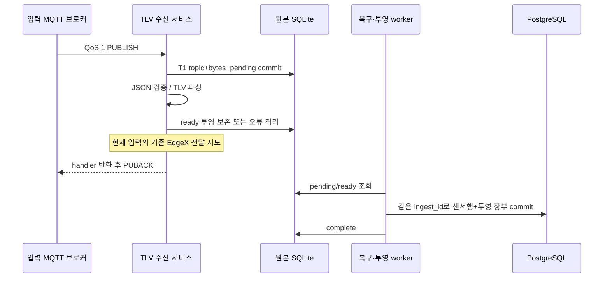
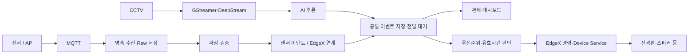

# P2.2 — 직접 TLV MQTT 원본 접수·ACK·복구

2026-09-18 · **선택 경로 로컬 구현·격리 통합 시험 완료 / P2.2 IN_PROGRESS / 운영 미적용**

> 2026-09-21 현재: [직접 TLV 공통 관측·기록 전달과 P2.2 DONE 판정](TLV_RECORD_DELIVERY.md). 아래는 당시 접수/ACK 시험 이력이며 생산자 ID 미확정 I19는 계속 열린 상태다.

> 후속 갱신: [영상 큐 전 원본 접수·저장 복구](VIDEO_INGEST_RECOVERY.md)를 로컬 검증했다. 다음 P2.2 작업은 목적지별 전달 worker다.

직접 TLV 수신도 JSON 해석 전에 MQTT 원본 바이트를 보존하도록 연결했다.
원본과 센서 처리 상태를 한 transaction으로 저장하고, 같은 `ingest_id`를 파싱·PostgreSQL
투영에 사용한다. 외부 MQTT에서 검증한 [수동 ACK 구독기](MQTT_ACK_RECOVERY.md)를 재사용한다.

## 1. 변경 파일·영향

| 파일 | 변경 이유·범위 |
|---|---|
| [ingest_store.py](../../src/ingest_store.py) | topic·원본 bytes를 base64로 보존하는 접수 추가. 기존 JSON 접수와 transaction 공유 |
| [uplink.py](../../parser-python/mqtt/uplink.py) | MQTT 외부 JSON 해석·검증을 독립 모듈로 분리. 실시간/복구에서 같은 해석 사용 |
| [manager.py](../../parser-python/mqtt/manager.py) | 선택 모드에 고정 ID·수동 ACK 구독기를 연결. 소유 반복문에서 재접속 |
| [sensor_service.py](../../parser-python/service/sensor_service.py) | T1 원본 접수 후 동일 ID로 처리. 후속 오류는 같은 접수로 재시도. 실시간/복구 준비 경쟁 방지 |
| [main.py](../../parser-python/main.py) | 공통 저장 선택 시 영속 MQTT 사용. 필수 설정 오류 전파·주기적 연결 복구 |
| [Dockerfile](../../Dockerfile) | parser 이미지에 공용 MQTT 경량 모듈 포함 |
| [단위·패키징 시험](../../parser-python/tests/test_tlv_mqtt_durable.py)·[통합 시험](../../parser-python/tests/test_tlv_mqtt_integration.py) | 원본/ACK/DB/재시작 경계 검증 |

DB 스키마 버전·기존 PG 테이블·외부 API는 변경하지 않았다. `raw_format=mqtt_bytes_base64`인
센서 접수가 추가되고, `device_id`는 원본 접수 시 미해석이므로 NULL이다. 원본 topic과 bytes는 남는다.
기존 JSON 형식의 pending 접수도 계속 복구한다. `AIOT_INGEST_DB` 미설정 경로는 기존 수신 방식이다.

## 2. 실제 처리 순서와 ACK 의미

- T1 실패는 호출자에게 전파한다. 구독기는 ACK 없이 연결을 끊고 같은 지속 세션으로 재접속한다.
- T1 성공 후 파싱 준비/저장 오류는 원본을 남긴 채 ACK할 수 있다. worker가 같은 접수 ID로 재시도한다.
  retry 상태 갱신마저 실패해도 이미 commit된 pending 원본은 남는다.
- 잘못된 UTF-8/JSON·필수 payload·중첩 구조·비유한 숫자는 원본 보존 후 격리한다.
- **현재 ACK는 handler 반환 뒤다. Raw commit 직후 ACK하고 파싱·모든 네트워크 출력을
  완전히 분리한 구조까지 구현한 것은 아니다.** 기존 실시간 EdgeX 전달 시도가 콜백에 남아 있다.
  DB 투영 worker는 별도지만 수신 콜백의 지연·장치 전달 분리는 후속 작업이다.
- ACK는 원본 확보 경계다. PostgreSQL 투영 완료, 관제 도착, 출력 장치 작동 성공을 뜻하지 않는다.
- 디스크 backlog 복구는 기록 전용이다. 복구 worker는 EdgeX/알림을 재발행하지 않는다.
  브로커가 다시 보낸 입력은 별도 실시간 접수이므로 오래된 경보 판정·재출력 방지는 P1.3/P3에서 연결한다.

## 3. 격리 검증

[통합 JUnit](evidence/tlv_mqtt_integration_20260918.xml): **9 PASS / 실패·오류·SKIP 0**.
[최종 회귀 JUnit](evidence/tlv_mqtt_final_20260918.xml): **298 PASS / 실패·오류·SKIP 0, 133.13초**.
신규 단위·패키징 17개와 통합 9개, 기존 센서 PG 복구 19개·외부 MQTT 및 공통 저장 회귀를 포함한다.
Ruff 7파일·Black 4파일·앱 py_compile 5파일·관련 diff 공백 검사 PASS다.
소스 해시와 범위는 [검증 기록](evidence/tlv_mqtt_validation_20260918.json)에 남겼다.

| 시험 | 확인한 결과 |
|---|---|
| 정상 입력·잘못된 UTF-8 | 원본 모두 보존·ACK, 정상 PG 투영 1건·오류 격리 1건. 동일 세션 재시작 후 재전송 없음 |
| T1 INSERT 실패 | ACK 0회·접수 0건. 제약 해제 후 Manager poll로 동일 mid/DUP=True 재전송·PG 저장 |
| T1 이후 prepare 실패 | ACK 후 pending 원본을 같은 ID로 복구, 원본·PG 투영 각각 1건, 복구 출력 없음 |
| PG commit 후 SQLite 완료 실패 | 새 Store/worker 재처리 후 각 PG 테이블 1행 유지, 접수 complete |
| 서비스 오프라인 | 지속 세션의 대기 입력을 재접속 후 저장 |
| T1 이전 자식 프로세스 종료 | 브로커 재전송 후 접수·PG 투영 각각 1건 |
| T1 직후 자식 프로세스 종료 | 기존 접수 복구+별도 재수신으로 접수·PG 투영 각각 2건 |
| ACK 직전 자식 프로세스 종료 | 기존 접수 복구+별도 재수신으로 접수·PG 투영 각각 2건 |
| 브로커 ACK 수신 후 자식 프로세스 종료 | 재전송 없음, 기존 접수 복구로 PG 투영 1건 |

마지막 4개는 실제 `os._exit(42)`다. ACK 전달은 동일 MQTT 연결의 후속 시험 PUBLISH 응답으로
확인했다. 원본 저장·투영의 동시 접근과 parser Docker COPY 파일만 배치한 격리 import도 검사한다.

**같은 접수 ID의 PG 재처리는 중복을 만들지 않는다. 별도 MQTT 재수신의 업무 중복 제거는 미완료다.**
센서 안정 메시지 ID·부팅/시퀀스 규격 D02가 미정이므로 값이 같다는 이유로 측정을 버리지 않는다.
T1/ACK 사이 종료에서 2건을 보존한 결과를 exactly-once로 표시하지 않는다. [I19](STATUS.md)로 추적한다.

시험 DB는 PostgreSQL 16.13, 브로커는 Mosquitto 2.0.22, Paho는 2.1.0이다.
둘 다 `--network none`, 공개 TCP 포트 없이 `/tmp/cctv-p22-*` Unix socket으로만 연결했다.
MQTT 64MiB/0.5CPU, PG 384MiB/1CPU·shared_buffers 16MB·임시 PG data 128MiB였다.
EdgeX 출력은 mock이며 실제 장비 명령·운영 DB·운영 브로커를 사용하지 않았다.
시험 컨테이너는 모두 종료·제거했고 해당 이름의 컨테이너가 남지 않았음을 확인했다.

초기 [시험 환경 실패](evidence/tlv_mqtt_environment_failure_20260918.xml)는 PostgreSQL 초기화가
기본 소켓을 찾는 문제였다. 컨테이너 내부 기본 소켓과 시험 소켓을 함께 설정해 해결했다.
그다음 [7 PASS / 2 시간 초과](evidence/tlv_mqtt_readiness_failure_20260918.xml)는 시험 준비 경계에서
발생했다. ACK 직전 시험의 원본은 0건, 다음 시험은 스키마 생성도 미완료였다. 시험 harness가
SUBACK 완료를 기다린 뒤 ready를 표시하도록 수정하고 자식 기동 대기 한도를 30초로 분리했다.
이 결과를 앱의 지연/처리량 합격 근거로 사용하지 않는다.

전체 회귀의 첫 실행은 [297 PASS / ACK 대기 1 FAIL](evidence/tlv_mqtt_ack_wait_failure_20260918.xml)이었다.
해당 자식 프로세스의 T1 원본은 pending으로 남았지만 시험의 ACK 대기 5초가 만료됐다.
종료 경계 관찰용 ACK 대기는 20초, 자식 종료 대기는 30초로 분리했다.
최종 PASS 판정은 ACK의 브로커 도착·원본/PG 행 수·복구 출력 부재를 모두 확인한 결과에만 적용한다.

## 4. 적용 조건·남은 범위

- 새 경로는 `AIOT_INGEST_DB`와 **`AIOT_MQTT_CLIENT_ID_PREFIX`**가 필요하다.
  실제 ID는 `<prefix>-ns_park`, `<prefix>-lab`이다. 프로세스 재시작 시 유지하고 동시 인스턴스 간
  겹치지 않게 배정한다. broker 이름/구독/ID 변경 시 이전 세션의 대기 데이터 이행을 별도 확인한다.
- Paho 2 수동 ACK가 필요하다. requirements는 아직 1.x도 허용하므로 적용 이미지의 버전 확인이
  필요하다. 미지원 환경은 자동 ACK로 폴백하지 않는다. Docker COPY import 시험은 이미지 build가 아니다.
- PG projection guard schema·기존 큐 배수·원본 DB volume/권한·복구 절차는
  [센서 적용 조건](SENSOR_RECOVERY.md)을 함께 따른다. 운영 설정은 이번에 변경하지 않았다.
- QoS 0, broker 자체 재시작/전원 단절, 장기 장애·디스크 포화·TCP/TLS/ACL·현장 센서/장비·부하 성능은 미검증이다.
- 영상 큐 전 접수, 목적지별 worker/lease·실제 ACK, 관제 연계가 남아 **P2.2는 IN_PROGRESS**다.
  다음 작업은 영상 큐 전 원본 접수다. 기존 I14 결측값 변환·I15 센서 EdgeX 매핑도 이번 범위에 포함하지 않았다.

## 5. 센서·영상·EdgeX 역할 구분

AP를 센서 수집 게이트웨이라는 의미로 보면, 사용자가 제시한 원본 보존→검증→업무 처리 방향과 같다.
다만 현재 직접 TLV 수신 어댑터는 `parser-python`이다. 이번에 이 기능을 EdgeX Device Service 내부로
이전하지 않았다. 기존 forwarder는 파싱 결과를 MQTT·Core Data HTTP·Alert API로 전달한다.

목표 역할 분리는 다음과 같다. 아래 그림 전체가 이번에 구현 완료됐다는 뜻은 아니다.

센서 임계치 판단과 영상 AI는 서로 다른 입력 처리 경로다. 필요한 경우 결합 분석을 추가한다.
Core Data와 App Service를 하나의 작업 큐나 동일 DB로 취급하지 않는다. 공통 원본/업무 저장과
관제 전달 책임은 별도 계약으로 유지한다. Device Service로 입력을 옮기더라도 원본 commit 이전
자동 ACK가 발생하지 않는지 수신 경계에서 다시 검증해야 한다.
