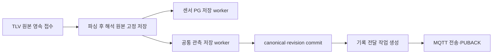

# P2.2 — 직접 TLV 공통 관측·기록 전달 연결과 완료 판정

2026-09-21 · 계획 v0.12 · **P2.2 DONE: 선택 경로 로컬 구현·격리 복구 검증 / 운영 미적용**

직접 TLV 센서의 해석 원본을 공통 관측으로 저장하고 기존 기록 전달 worker로 전송한다.
온습도·기울기를 경보 이벤트로 꾸미지 않고 `sensor_observation`으로 구분한다.
이번 연결로 P2.2의 입력별 영속 접수·공통 저장·기록 전달 복구 범위를 닫는다.
관제 DB 저장 ACK·화면·물리 출력·현장 부하 합격은 후속 WBS에서 검증한다.

## 1. 변경과 영향 범위

| 파일 | 변경과 이유 |
|---|---|
| [sensor_record.py](../../src/sensor_record.py) | 원본 해석값→공통 관측 저장과 독립 복구 worker. PG 저장 지연/거절이 공통 기록 생성을 막지 않음 |
| [event_ingest_store.py](../../src/event_ingest_store.py) | 관측 ID로도 기존 canonical/revision transaction을 재사용. 이벤트 ID 규칙 유지 |
| [record_delivery.py](../../src/record_delivery.py) | 센서 관측의 전달 식별자는 observation_id. 기존 이벤트 envelope의 event_id 유지 |
| [sensor_service.py](../../parser-python/service/sensor_service.py) | 기존 선택형 영속 모드에서 공통 관측 worker 시작·종료 연결 |
| [Dockerfile](../../Dockerfile) | parser 이미지에 관측 저장 모듈·기존 의존 파일을 포함하는 COPY 1줄 추가 |
| [단위/SQLite 시험](../../tests/test_sensor_record.py) | 11개: 품질/ID·동시 처리·rollback/재시도·미지원/손상 데이터 보존 |
| [파서/통합 시험](../../parser-python/tests/test_sensor_record_integration.py) | 7개: 서비스 생명주기, 실제 TLV, PG 거절, 실제 프로세스 종료 4지점 |
| [기존 파서 패키징 시험](../../parser-python/tests/test_tlv_mqtt_durable.py) | Docker COPY대로 분리한 디렉터리에서 신규 모듈 import·저장소 생성·worker 실행 |

새 라이브러리·환경변수·외부 API·PG 스키마를 추가하지 않았다. SQLite 새 테이블/버전도
추가하지 않는다. `SensorRecordStore`는 기존 v1→v2 추가 이행을 재사용하고 v3도 허용한다.
`RecordDeliveryStore`를 명시적으로 만들면 기존 v3 이행/테이블을 사용한다. 운영 DB는 열지 않았다.
센서 종류별 기존 PG 컬럼과 실시간 EdgeX/경보 경로는 유지한다.

`AIOT_INGEST_DB`를 사용하는 서비스에서는 새 공통 저장 worker가 시작된다. 1초마다 최대
100개 후보를 처리하며 네트워크 발행은 하지 않는다. **기록 전송 worker의 서비스 자동 실행은
이번에 연결하지 않았다.** 기존 `RecordDeliveryWorker`를 명시적으로 실행한 경로까지 검증했다.
실제 서비스 배포·전송 목적지 연결은 P2.3 적용 준비에 포함한다.

## 2. 데이터·ID·품질 계약



입력 ACK와 파싱 순서의 세부 경계는 [직접 TLV 접수 계약](TLV_MQTT_RECOVERY.md)을 따른다.
공통 변환은 `sensor_ingest_state.projection_json`에 고정한 `sensor_data.payload_tlv`를 읽는다.
이미 결측을 0으로 보정한 종류별 PG 컬럼에서 원래 품질을 추측하지 않는다.

| 식별/필드 | 직접 TLV 공통 관측의 의미 |
|---|---|
| source_namespace | `tlv_mqtt` |
| observation.source_record_id | 원본을 저장할 때 발급한 `ingest_id` |
| observation_id | 기존 산식의 namespace·device·profile·ingest_id 해시 |
| canonical_records.source_record_id | 공통 레코드 키인 observation_id. first_ingest_id로 원본 연결 |
| delivery_id | 목적지별 전달 작업 ID. 같은 작업 재시도에서 유지 |
| message_type | `sensor_observation` |
| received_at | 원본 영속 접수 시각. 재처리 시 새로 생성하지 않음 |
| observed_at | 해석 원본 created_at의 정수 epoch ms. 없거나 잘못되면 null·품질 기록 |

프로필은 `t34954` 온습도, `t34955` 기울기, `t34957` 온도·기울기다. 단위와
`value/unit/quality/source_field`는 [관측 계약](OBSERVATION_CONTRACT.md)을 재사용한다.
실제 0은 valid, 누락/null은 missing, 문자열/bool 등 잘못된 수치는 invalid다.
측정 품질과 PG 저장 결과는 별개다. PG 제약 거절로 quarantined가 되어도 고정된 해석
원본이 있으면 공통 관측 생성·기록 전송을 계속할 수 있다.

미지원 프로필은 공통 정규화 상태에 `invalid / profile:unsupported_profile`로 남긴다.
이는 공통 변환 미지원이라는 의미이며 TLV 원본이나 기존 PG 작업을 삭제/실패 처리하지 않는다.
손상된 projection은 `projection:invalid_projection`으로 별도 보관한다.

전달 envelope 예시의 핵심 필드만 보이면 아래와 같다. 실제 record에는 전체 관측 필드가 들어간다.

```json
{
  "schema_version": "1.0",
  "delivery_id": "job_...",
  "source_namespace": "tlv_mqtt",
  "observation_id": "obs_...",
  "record": {
    "message_type": "sensor_observation",
    "observation_id": "obs_...",
    "source_record_id": "ing_..."
  }
}
```

기존 영상/외부 이벤트 envelope에는 계속 event_id를 사용한다. 수신측은 `record.message_type`과
관측/이벤트 ID를 구분해야 한다. 센서 관측을 보내기 위해 가짜 event_id를 만들지 않는다.
외부 관제별 최종 payload·ACK 계약은 아직 미확정이다.

같은 접수 ID의 복구는 canonical/revision/job을 추가하지 않는다. 별도 MQTT 재수신은 새로운
접수 ID이므로 값이 같아도 보존한다. 이는 [기존 저장 설계](STORAGE_DESIGN.md#5-id중복공통-조회)의
정책이며 생산자 ID가 확인되기 전 임의 중복 제거를 하지 않는다(D02/I19).

## 3. 검증 결과

[최종 JUnit](evidence/sensor_record_final_20260921.xml): **490 PASS / 실패·오류 0 / SKIP 5, 123.47초**.
신규 18개와 센서 저장/수신, 기존 영상·외부 MQTT·기록 전달·공통 이벤트·processor 회귀를 포함했다.
5개 제외는 pyds 미설치로 실행하지 않은 기존 Jetson 전용 시험이다. GPU 성능 합격이 아니다.
Ruff 7파일·Black 6파일·앱 4파일 py_compile PASS.
[검증 요약·소스 해시](evidence/sensor_record_validation_20260921.json).

| 실제 자식 프로세스 종료 위치 | 재시작 후 확인 |
|---|---|
| 해석 원본 projection commit 직후 | 같은 원본에서 관측 생성·PG 저장·기록 전송 |
| canonical/revision commit 직후 | 전송 작업 생성 전 공백을 scan으로 복구 |
| 기록 전달 job commit 직후 | 기존 작업으로 전송 재개 |
| PUBACK 및 SQLite ACK commit 직후 | 확인된 작업 재전송 없음 |

네 시험은 실제 `os._exit(42)`로 종료했다. 각 원본/관측/revision/job 1건, PG 세 테이블
각 1행을 대조했다. EdgeX 모형 호출이 복구 중 추가되지 않는 것도 확인했다.
PG 제약 위반으로 기존 투영을 거절한 별도 시험에서도 실제 MQTT 구독 수신과 PUBACK를 확인했다.
관측 transaction 실패 rollback/재시도, 동시 처리의 한 번 저장도 검증했다.

임시 SQLite와 network none·호스트 포트 없는 전용 Unix socket 컨테이너를 사용했다.
MQTT는 eclipse-mosquitto:2.0(64MiB/0.5CPU), PG는 postgres:16-alpine 서버 16.13(384MiB/1CPU)이다.
브로커 persistence는 꺼져 있었다. 브로커 정전·관제 DB 저장·실물 출력 보장을 뜻하지 않는다.
시험용 컨테이너는 시험 후 제거했다. 운영 서비스·DB·브로커·GPU에는 연결하지 않았다.

실패 이력도 보존했다. [최초 DB 환경 오류](evidence/sensor_record_environment_failure_20260921.xml)는
이미지 초기화의 기본 소켓 누락이 원인이었다. PGHOST 지정만으로 해결되지 않아 기본 소켓과
시험 소켓을 함께 열어 수정했다. [조회 시험 잠금 오류](evidence/sensor_record_polling_failure_20260921.xml)는
결과 확인 중 저장소 초기화를 반복한 시험 코드를 단순 SELECT로 바꿔 해결했다.
[해당 회귀 13 PASS](evidence/sensor_record_polling_fix_20260921.xml)와 최종 전체 선별 결과를 구분한다.
그래프 분석은 변경 5파일에서 함수 0개를 반환해 실제 코드·transaction·회귀를 수동 대조했다.
Docker COPY 모형 import는 통과했지만 **이미지 빌드·배포 실행은 하지 않았다**.

## 4. P2.2 완료 판정과 인계

| 기존 WBS 완료 기준 | 확인 근거 | 판정 |
|---|---|---|
| 이벤트/전달 대기 일관성 | 외부/영상 canonical 저장, 목적지별 job 원자성 및 scan 복구, 직접 TLV 관측 연결 | 로컬 충족 |
| 영속 접수 전 실패 응답 | 외부/직접 TLV 수동 ACK·저장 실패 재전송, 영상 큐 전 접수/실패 전파 회귀 | 로컬 충족 |
| 중간 종료 후 복구 | 입력별 실제 프로세스 종료, 동일 접수/기록/작업 ID 및 PUBACK 상태 대조 | 격리 환경 충족 |

선행 근거는 [외부 저장](EVENT_PERSISTENCE.md), [외부 MQTT ACK](MQTT_ACK_RECOVERY.md),
[직접 TLV ACK/PG](TLV_MQTT_RECOVERY.md), [영상 저장](VIDEO_INGEST_RECOVERY.md),
[기록 전달](RECORD_DELIVERY.md)이다. 기존 선택 경로의 모듈 완료 기준으로 **P2.2 DONE**을 판정한다.

| 잔여 항목 | 다음 담당 범위 |
|---|---|
| 별도 센서 재수신의 업무 중복 식별 | D02/I19·P4.1 생산자 규격, P1.3 중복/경보 정책; 미해결 유지 |
| 관제 수신 ID·최종 저장 ACK·조회/누락 대조 | 다음 P1.4 내부 계약 → P2.3 최소 흐름. 제품별 연동은 D06 확정 후 |
| 기록 전송 서비스 자동 실행·목적지/ACL·배포/롤백 | P2.3 적용 준비. 기존 전송 worker는 호출자가 실행해야 함 |
| 용량·보관·scan 비용·SQLite 경합·장기 장애 | P2.4. 이번 기능 시험으로 병목 없음 판정하지 않음 |
| 경보 우선순위·만료·실행 불명·실물 출력 | P1.3/P3 |

다음 작업은 **P1.4 관제 전달·계측의 내부 계약**이다. 관제 제품이 미정이어도 저장 ACK의
의미·ID·재조회·누락 대조 규칙을 먼저 정할 수 있다. 지연 상한은 D04, 실제 수신처는 D06으로
남긴다. 전체 진척률이나 연말 일정은 이번 시험 수만으로 다시 계산하지 않는다.
