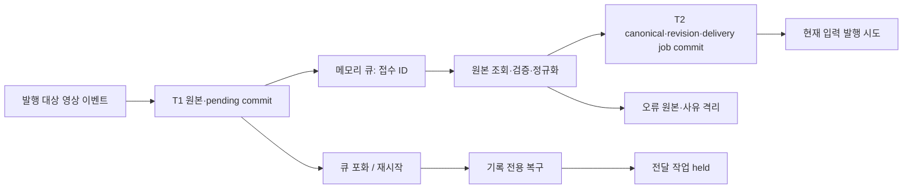

# P2.2 — 영상 큐 전 원본 접수·저장 복구

2026-09-18 · **DeepStream/OpenCV 선택 경로 로컬 검증 완료 / P2.2 IN_PROGRESS / 운영 미적용**

> 2026-09-21 현재: [P2.2 로컬 완료 판정·잔여 인계](TLV_RECORD_DELIVERY.md). 아래 판정/시험은 영상 접수 단계의 이력이다.

후속 작업: [기록 목적지별 worker·lease·PUBACK·재시도](RECORD_DELIVERY.md)를 격리 검증했다.
아래는 영상 접수 단계의 당시 결과이며 실제 관제/물리 출력 완료와 구분한다.

영상 발행 큐에 넣기 전에 이벤트 원본을 공통 SQLite에 저장한다. 큐에는 `ingest_id` 참조만 넣는다.
큐 포화·정규화 오류·발행 실패·프로세스 종료 후에도 접수된 원본을 조회하고 저장 처리를 재개한다.
실패한 전달의 자동 재전송·종단 ACK·실물 장비 작동·추론 성능까지 완료했다는 뜻은 아니다.

## 1. 변경 파일과 범위

| 파일 | 변경·목적 |
|---|---|
| [video_event_ingest.py](../../src/core/video_event_ingest.py) | 영상 접수·정규화·현재 입력 발행·기록 전용 복구를 담당하는 독립 모듈 |
| [event_ingest_store.py](../../src/event_ingest_store.py) | JSON 이벤트 원본 접수 추가. 외부 MQTT와 기존 T1 저장 transaction 공유 |
| [_deepstream_event_queue.py](../../src/core/_deepstream_event_queue.py) | 큐 이전 접수, 큐 포화 시 메모리 참조를 해제하고 원본 복구 대상으로 유지 |
| [_event_publish.py](../../src/core/_event_publish.py) | 선택 모드에서 접수 ID로 발행·주기적 기록 복구 실행 |
| [deepstream_processor.py](../../src/core/deepstream_processor.py) | DetectionEvent·dict/보조 분석 결과의 큐 진입점과 발행 반복문 연결 |
| [event_dispatcher.py](../../src/core/event_dispatcher.py) | OpenCV 입력 접수와 큐 포화 처리 연결. 기존 경로의 로컬 백업 유지 |
| [_inference_pipeline.py](../../src/core/_inference_pipeline.py) | DetectionEvent의 `to_dict()`를 접수 뒤로 이동해 변환 오류 이전 원본 확보 |
| [processor.py](../../src/core/processor.py) | OpenCV 초기화·발행 worker에 공통 영상 접수 연결 |
| [시험](../../tests/test_video_event_ingest.py) | 신규 26개. 두 입력 경로·오류·DB transaction·동시 접근·실제 자식 종료 검증 |

`AIOT_INGEST_DB`가 지정된 경우에만 새 영상 경로를 선택한다. 기존 센서/외부 MQTT와 같은 공통 DB를
사용할 수 있으며 namespace는 `video_detection`, 변환기는 `video-v1`이다. 새 테이블/스키마 버전은
추가하지 않았다. v1 DB에서 처음 켜면 기존 EventIngestStore의 v2 확장 절차가 적용된다.
운영 환경변수·서비스·모델·출력 장치·외부 API·Docker 이미지는 변경하지 않았다.

이번 경계는 **tracking/filter/debounce 등을 거쳐 발행 대상으로 선택된 이벤트의 큐 진입 직전**이다.
모든 영상 프레임이나 탈락한 모델 후보를 저장하는 작업이 아니다. 영상 파일·GPU tensor 저장을 추가하지
않고 이벤트 필드·키포인트·메타데이터·기존 미디어 참조를 보존한다. 구역 이벤트는 기존 생산자가 만든 dict를 받는다.

## 2. 처리 순서와 실패 상태

- **T1 실패:** 예외를 호출자에게 전달하고 `events_failed`를 증가시킨다. 큐에 넣거나 접수 성공으로 표시하지 않는다.
  CCTV는 이 경계에서 MQTT처럼 상위 재전송 ACK를 갖지 않는다. T1 이전 입력의 재취득·역압은 별도 과제다.
  09-22 후속으로 [BUSY에 한한 동일 접수 1회 재시도](VIDEO_INTAKE_CONTENTION.md)를 추가했다. 두 시도 소진·FULL 등의 최종 실패 경계는 그대로다.
- **T1 성공 후 큐 포화:** 큐 적재 결과는 False지만 원본은 pending으로 남는다. 복구가 정규화해 전달 작업을 held로 둔다.
- **입력 오류:** NaN/Infinity·잘못된 식별/시각·중첩 구조·변환 후 비표준 값은 원본·revision 오류 사유를 남기고 invalid 처리한다.
  Python 비표준 값은 `error_repr`로 구분한다. NaN 토큰은 보존하고 0/null로 바꾸지 않는다. 지원하지 않는 객체나 순환 참조의
  repr은 진단용 표현이므로 원래 객체 전체를 손실 없이 복원할 수 있다고 보장하지 않는다.
- **T2 저장 실패:** canonical/revision/job은 함께 rollback되고 T1은 남는다. 다음 시도 시각과 횟수를 기록해 재처리한다.
- **발행 예외/명시적 False:** 원본·canonical·job을 남기고 전달 상태를 uncertain으로 둔다.
- **발행 함수 정상 반환:** submitted다. 기존 void 콜백의 None도 정상 반환으로 취급한다. 이 상태는 MQTT broker ACK,
  관제 도착·저장 확인, EdgeX 장비 작동 성공을 뜻하지 않는다.
- **동일 event_id/동일 원본:** 접수 회차는 남기고 canonical/job은 추가하지 않는다. 다른 원본은 conflict로 남겨 기존 값을 보존한다.
  출력 목적지 변경은 원본 hash를 바꾸지 않는다. 기존 이벤트를 새 목적지에 다시 보내는 이행은 자동으로 수행하지 않는다.

timestamp 0은 현재 시각으로 대체하지 않고 epoch로 정규화한다. 접수 시각·backend·목적지는 접수 시 고정한다.
DetectionEvent의 관측에는 저장한 접수 시각을 사용한다. dict에는 출처별 계약 없이 관측 스키마를 추측해 추가하지 않는다.

## 3. 복구와 실시간 처리의 구분

발행 반복문은 대략 1초 간격으로 pending 원본을 최대 100개 확인한다. 같은 프로세스의 현재 큐/발행 중 접수는
복구 대상에서 제외한다. 큐 포화·후속 처리 실패 시 해당 보호를 해제한다. 프로세스 재시작 시 메모리 보호가 사라져
pending 원본을 같은 ID로 다시 정규화한다. **이 복구는 MQTT/장비 출력을 호출하지 않는다.**

T2 이후 종료한 작업은 이미 canonical과 job이 있다. 이 구현은 기존 pending/sending/submitted/uncertain job을
자동 실행·삭제·성공 처리하지 않는다. 특히 sending 상태에서 종료되면 실제 전달 여부가 불명일 수 있다.
이 상태의 lease 만료·재시도·물리 경보 유효시간은 다음 전달 worker 작업에서 처리한다.

입력/정규화의 짧은 구간만 같은 lock으로 보호하고 발행 콜백은 lock 밖에서 실행한다.
콜백을 의도적으로 대기시킨 상태에서도 다른 T1 접수를 완료하는 시험을 통과했다.
단, **T1의 직렬화·SQLite commit은 생산자 스레드에서 동기 실행**한다. 전체 처리량·p95 지연·
실제 4카메라/전체 AI 30FPS를 검증한 결과는 아니다.

현재 운영 전제는 **공통 DB당 활성 영상 수신 프로세스 하나**다. 그 안의 다중 카메라/worker를 지원하는 형태이며,
서로 다른 영상 프로세스가 같은 namespace를 동시에 복구하는 분산 소유권/lease는 이번에 구현하지 않았다.
동일 프로세스의 파이프라인 stop/start에 남아 있는 메모리 이벤트의 경보 만료 판단도 P1.3/P3 범위다.

## 4. 검증 근거

[최종 JUnit](evidence/video_ingest_final_20260918.xml): **403 PASS / 실패·오류 0 / SKIP 5, 25.66초**.
총 408개 중 5개는 pyds가 필요한 기존 Jetson 전용 시험이다. 이번에는 GPU 대신 Python 이벤트 진입점과 저장 경계를 검증했다.
신규 26개와 외부 MQTT 저장·기존 큐·관측·센서 저장소·발행·processor 회귀가 포함된다.
Ruff 9파일·Black 6파일·앱 8파일 py_compile과 관련 diff 공백 검사도 통과했다.
[검증 요약·소스 해시](evidence/video_ingest_validation_20260918.json),
[최초 10개 실패](evidence/video_ingest_red_20260918.xml),
[중간 22개 통과](evidence/video_ingest_slice_20260918.xml)를 보존한다.

| 실제 자식 프로세스 종료 위치 | 재시작 후 확인 |
|---|---|
| T1 commit 직후, 큐 이전 | 같은 접수 ID로 canonical 1개·revision 1개·held job 1개 복구 |
| 메모리 큐 적재 직후 | 메모리 큐가 사라져도 위와 동일한 기록 복구 |
| T2 commit 직후 | canonical/revision/job 각 1개 유지. pending job 재발행 없음 |
| 전달 claim 직후 | sending 상태 보존. 재시작으로 성공/실패를 임의 확정하거나 발행하지 않음 |
| 발행 콜백 실행 직후, 완료 기록 이전 | sending 상태 보존. 시험 콜백의 출력 기록 1개 유지, 복구 재호출 없음 |

5개 모두 실제 `os._exit(42)`를 실행했다. 발행 콜백은 시험 파일에 event_id를 남기는 대역이며
실제 MQTT broker ACK나 장비 작동 시험을 대신하지 않는다. 임시 SQLite만 사용했고 운영 DB/장비에 연결하지 않았다.

그 밖에 큐 포화, 잘못된 원본, T1/T2 transaction 실패, 원본 객체의 사후 변경, 정상 출력,
명시적 False, 동일 ID 충돌, epoch 0 중복 식별, OpenCV 변환 이전 오류 보관을 검증했다.
새 경로와 기존 MQTT outbox의 동시 재생은 시작 시 거부한다.

## 5. 적용·후속 작업

- `AIOT_INGEST_DB`를 공통 DB 경로로 지정하고 volume/권한·기존 큐 배수·복구 준비를 확인한 후 적용한다.
  `MQTT_EVENT_OUTBOX_DB`와 동시에 활성화하면 시작을 거부한다. 기존 outbox 이행은 별도 절차다.
- 새 원본 형식의 DB를 만든 뒤 구버전 코드로 돌아가면 그 코드가 새 접수를 해석하지 못할 수 있다.
  후보 고정과 DB 백업/복구·미처리 데이터 인계는 운영 적용 전에 확인한다.
- `events_detected`는 큐 적재, `events_dropped`는 메모리 큐 포화, `events_sent`는 발행 함수 반환 기준이다.
  접수 성공·원본 유실·종단 ACK와 동일한 지표로 사용하지 않는다. 새 경로에서 격리/중복/충돌로 발행하지 않은
  큐 항목도 현재의 `events_failed`에 포함되므로 원인은 DB stage로 구분한다. 관제 지표 개선은 후속 범위다.
- 실제 GPU 추론·RTSP 단절·장기 장애·전원 단절·용량/보관 정책·동시 다중 프로세스·현장 장비·성능 시험은 미검증이다.
- **다음 작업:** 목적지별 전달 worker의 lease·실제 ACK·재시도/미확정 상태 처리. 센서 메시지 식별 D02/I19와
  오래된 물리 경보 재출력 정책도 남는다. 따라서 영상 접수 항목은 로컬 완료, P2.2 전체는 IN_PROGRESS다.
