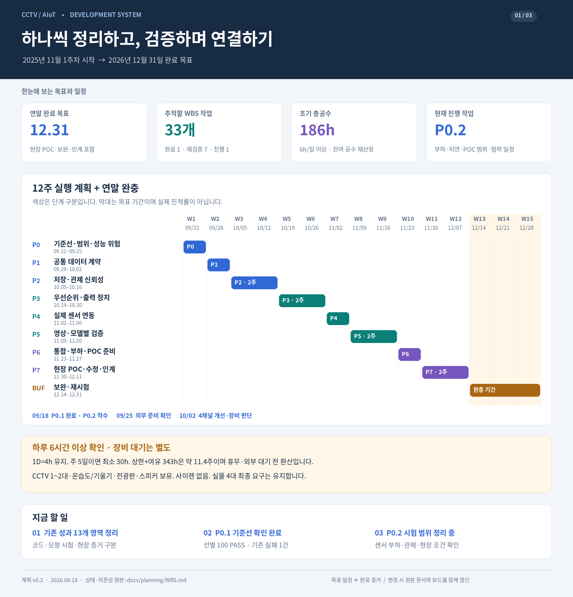

# 개발 계획 시각화 · Figma / FigJam

갱신: 2026-09-29 KST · **최신 진행판/문서 v0.66 · 기존 SVG/PNG v0.2 · FigJam 갱신 미완료**

최신 상태는 [사내 온라인 진행판](http://192.168.2.242:18081/)에서 본다.
전체 WBS 33개·검색/필터·최근 검증·주요 이슈·다음 작업을 제공한다.
[갱신/운영 절차](../ONLINE_PROGRESS.md), [로컬 HTML](../online/index.html),
[PDF](../online/CCTV_project_progress.pdf)를 함께 관리한다.

[Figma에서 연말 일정표 열기](https://www.figma.com/board/2GQKlBrmSVjZljX74IJLij)

온라인 FigJam에는 P0~P7·완충 기간·12월 31일 목표를 담은 간트 차트를 생성했다.
이후 Figma MCP가 현재 Starter 플랜의 호출 한도 초과를 반환해 WBS와 SDLC의
온라인 추가 편집은 진행하지 못했다. 아래 세 보드는 별도로 만든 SVG 원본과 PNG
미리보기다. 온라인 FigJam에 세 보드가 모두 추가된 상태는 아니다.

09-22에는 FigJam 영역 `9:53`에 제목과 갱신 중 안내까지 추가했다.
이후 호출 한도로 WBS 본문을 추가하지 못해 해당 영역은 미완성이다.
Google 문서 생성은 403, Drive PDF 업로드는 저장 공간 초과로 거부돼
사용자가 선택한 사내 브라우저 열람 방식으로 전환했다. FigJam 최신화 완료로 표시하지 않는다.

과거 v0.2는 기존 성과·기준선 완료와 사용자 자원 확인을 **로컬 SVG/PNG에 반영**했다.
아래 SVG/PNG는 이번에 다시 생성하지 않았다. 목표 기간은 그대로이며 최신
작업 상태는 [현재 WBS](../WBS.md)를 확인한다. P0.3/P1.1/P1.2/P1.4/P2.1/P2.2 완료·관제 미정은
아래 보드에 아직 반영되지 않았다. 도표를 현재 완료 상태로 해석하지 않는다.

## 보드 구성

| 보드 | 담은 내용 | SVG 원본 | PNG 미리보기 |
|---|---|---|---|
| 01 개발 로드맵 | 연말 목표, 15주 일정, 공수 가정, 조기 판단일, 다음 작업 | [SVG](01_roadmap_20260918.svg) | [PNG](01_roadmap_20260918.png) |
| 02 단계별 WBS | P0~P7의 33개 작업·예상 공수·착수 상태 | [SVG](02_wbs_20260918.svg) | [PNG](02_wbs_20260918.png) |
| 03 모듈 흐름·SDLC | 저장/관제/장치 실행 경계, 6단계 개발 절차, POC 완료 기준 | [SVG](03_modules_sdlc_20260918.svg) | [PNG](03_modules_sdlc_20260918.png) |

보드 폭은 1,920px이며 높이는 각각 2,000px / 3,212px / 2,740px다.
색상은 단계·책임 구분이다. 완료 상태나 합격을 뜻하지 않는다.

## Figma에서 활용하기

- Figma Design 캔버스에는 SVG 파일을 가져와 배치한다. 미리보기·공유에는 PNG를 쓴다.
- SVG의 한글은 글꼴 누락을 막기 위해 **벡터 윤곽선**으로 저장했다. 확대할 수 있지만
  문구를 일반 텍스트처럼 바로 고치는 형식은 아니다. PNG는 이미지다.
- 온라인 FigJam 간트 차트와 로컬 SVG/PNG는 서로 다른 결과물이며 자동 동기화되지 않는다.
- 실제 Figma 재가져오기와 전체 보드의 온라인 배치는 이번에 검증하지 못했다.

## 계속 갱신할 때

상태·의존성·공수의 원본은 [WBS](../WBS.md), 요구사항·개발 절차의 원본은
[개발 기준·SDLC](../README.md), 실제 작업 결과는 [진행 기록](../PROGRESS.md)이다.

원본 문서를 먼저 갱신하고 보드의 버전·기준일·상태도 맞춘다. **보드 v0.2 당시에는** `P0.1 DONE`,
`P0.2 IN_PROGRESS`, `P0.3 READY`, 재검증 7개, 사이렌 장비 대기 1개, 계획 22개다.
현재 v0.44은 P0.1/P0.3/P1.1~P1.4/P2.1/P2.2/P2.3 내부 범위 DONE 9개,
P5.1 IN_PROGRESS: 모델별 실제 출력 대조·SGIE ROI/탐지 완료 표시 보완. 동일 해상도에서 의상/헬멧 각 266프레임 출력, 201 PASS/2 SKIP. I29 FIXED_LOCAL·I30 좌표 오류 OPEN. I07 운영 미반영·I28 다중 preview 잔여.

09-22 사용자 요청으로 별도 [Archify 구조·데이터 흐름·시퀀스 HTML](../../architecture/archify/index.html)을 추가했다.
코드 흐름은 이 자료에서도 볼 수 있다. Figma/FigJam 보드를 갱신한 것은 아니다.
P2.4 DB 잠금·혼합 입력 누적, 빈 조회 쓰기 경합 개선(197 PASS)·I22 잔여·노트북 HTTP 연결 회복은 문서 원본에만 반영했다.
원격 수신/ACK 패키지 격리 검증에 이어 실제 노트북 TLS 인증·수신기 중지/재기동 후 총 4건 저장 ACK 대조 완료도 문서 원본에만 반영했다.
격리 SQLite 용량 부족 검증(71 PASS), 오래된 센서값 내부 조회(131 PASS), 영상 최초 잠금 재시도·활성 쓰기(200 PASS), [혼합 300건 적체·실제 재시작/저장량](../MONITORING_BACKLOG_RESTART.md)(108 PASS)은 기존 SVG/PNG에 미반영이다. 후속 P1.3 계약·현재 정책 87 PASS·I23 및 WBS 9/33(작업 수 기준 27.3%)는 새 사내 진행판에 반영했다. P2.4 실제 부하/보관 검증은 남긴다.
직접 TLV 연결과 P2.2 종료, 관제 전달·계측 내부 계약 P1.4 종료는 문서에 반영됐으며 보드에는 미반영이다.
P2.3의 수신/송신 ACK·대조·서비스/로컬 MQTT·전체 지연 검증과 내부 DONE 판정은 문서에만 반영했다.
실제 외부 관제·운영 배포·부하/용량은 후속 범위다. 온라인 보드가 최신 상태로 갱신됐다는 뜻은 아니다.
나머지는 [WBS](../WBS.md)를 따른다. 작업 수를 전체 프로젝트 진척률로 해석하지 않는다.
[기존 성과 13개 영역](../STATUS.md)도 함께 확인한다.

사용자는 하루 순개발 6시간 이상, CCTV 1~2대·온습도/기울기·전광판·스피커 보유,
사이렌 미보유를 확인했다. 주당 일수·외부 관제·현장 일정은 미확정이며 목표 기간은
확정 납기가 아니다. 초기 총공수와 현재 잔여 공수를 구분한다.

v0.2 생성 당시 세 SVG의 XML 형식과 33개 WBS ID·제목·공수·상태를 원본과 대조했고, PNG 세 장의
배치와 한글 표시를 육안 확인했다. 온라인 간트는 생성 후 노드 구조와 날짜를 확인했다.
이 확인은 개발 문서 검증이며 코드·모델·장치 시험이 아니다.

## 로드맵 미리보기

### v0.46 (2026-09-28)

[progress_v046.json](progress_v046.json): 추적·RTSP 대조, 172 PASS/2 SKIP. 사내 HTML/PDF 게시용이며 Figma 동기화는 수행하지 않았다.

### v0.47 (2026-09-28)

[progress_v047.json](progress_v047.json): I31 FIXED_LOCAL·67 PASS, 사내 HTML/PDF 게시용. Figma 동기화는 수행하지 않았다.

### v0.48 (2026-09-28)

[progress_v048.json](progress_v048.json): 격리 RTSP 6회·시험 큐 확대 2회 재현, I32/I20 OPEN. 사내 HTML/PDF 게시용. Figma 동기화는 수행하지 않았다.

### v0.49 (2026-09-28)

[progress_v049.json](progress_v049.json): 동일 후보 단절/복구 2회·371건 대조, I20/I32 OPEN. 사내 HTML/PDF 게시용, Figma 동기화 없음.

### v0.50 (2026-09-28)

[progress_v050.json](progress_v050.json): 실CCTV 수집 영상 대조·후보 보존·지연 잔여. 사내 HTML/PDF 게시용, Figma 동기화 없음.

### v0.51 (2026-09-28)

[progress_v051.json](progress_v051.json): 관측 부하/CPU 3조건 대조·후보 복원 실행. 사내 HTML/PDF 게시용, Figma 동기화 없음.

### v0.52 (2026-09-28)

[progress_v052.json](progress_v052.json): 운영 설정 대조·RC1 고정·통합 실행 잔여. 사내 HTML/PDF 게시용, Figma 동기화 없음.

### v0.53 (2026-09-28)

[progress_v053.json](progress_v053.json): RC1 기능 통합 실행·출력 시간 정보 I33·후속 검증 범위. 사내 HTML/PDF 게시용, Figma 동기화 없음.

### v0.54 (2026-09-29)

[progress_v054.json](progress_v054.json): I33 출력 시간 정보 로컬 수정·실제 수신 검증. 사내 HTML/PDF 게시용, Figma 동기화 없음.

### v0.55 (2026-09-29)

[progress_v055.json](progress_v055.json): RF·TCN 실제 호출 검증·I33 출력 회귀 재개. 사내 HTML/PDF 게시용, Figma 동기화 없음.

### v0.56 (2026-09-29)

[progress_v056.json](progress_v056.json): 초기 정지 원인 분리·출력 회귀 단정 정정·I20/I33 OPEN. Figma 동기화 없음.

### v0.57 — 2026-09-29

[스냅샷](progress_v057.json): OSD JIT 원인·CPU 그리기 우회 검증 반영. WBS33개 상태 유지, 사내 HTML/PDF 갱신. FigJam은 갱신하지 않았다.

### v0.58 — 2026-09-29

[스냅샷](progress_v058.json): CPU OSD 복구3회·I33 로컬 수정 완료 반영. WBS33개 상태 유지, 사내 HTML/PDF 갱신. FigJam은 갱신하지 않았다.

### v0.59 — 2026-09-29

[스냅샷](progress_v059.json): RC2 영상 대응·DB 복사본 검증 반영. WBS33개 상태 유지, 사내 HTML/PDF 갱신. FigJam은 갱신하지 않았다.

### v0.60 — 2026-09-29

[진행 데이터](progress_v060.json): 장구간 재실행330초·8194프레임 수신, 첫 시작 CUDA 오류 I34·후처리 큐 폐기22건 반영. WBS 상태 유지·운영 미변경.

### v0.61 — 2026-09-29

[진행 데이터](progress_v061.json): 반복4회·TCN 단독 원인 배제, 후처리 지표6개 추가·213 PASS/2 SKIP. 큐 포화/시작 오류는 OPEN, 운영 미반영.

### v0.62 — 2026-09-29

[진행 데이터](progress_v062.json): CUDA MMU fault 확인·VIC 복사 우회, 격리3회/단절 복구·248 PASS/2 SKIP. I34 OPEN·장시간/운영 검증 잔여.

### v0.63 — 2026-09-29

[진행 데이터](progress_v063.json): RC3 600초·RC4 GPU/VIC 대조·치명적 오류 종료 보완. 최초 CUDA 원인 미확정·I34 OPEN·운영 미반영.

### v0.64 — 2026-09-29

[진행 데이터](progress_v064.json): 실CCTV600/180초·최소 경로 메모리 검사. I34 원인 미확정·I32 큐 폐기·운영 미반영.

### v0.65 — 2026-09-29

[진행 데이터](progress_v065.json): I35 시작·종료 대기 수정·실제 앱 전체 CUDA 메모리 검사30프레임/오류0. I34 최초 원인 미확정·운영 미반영.
